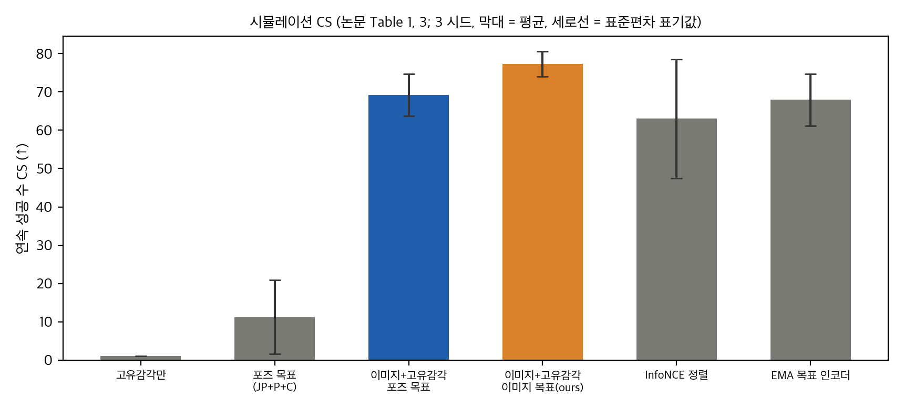
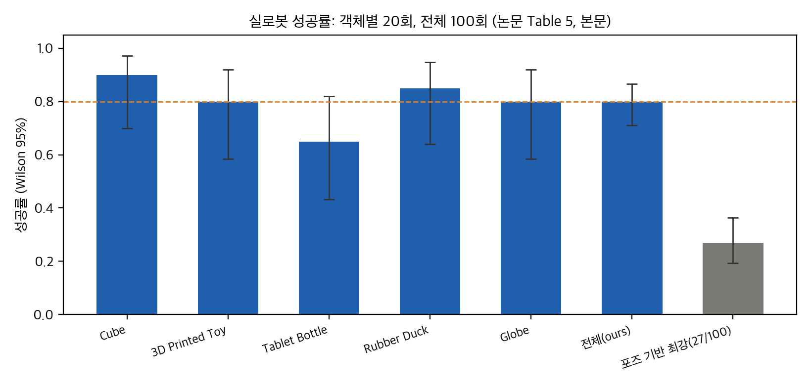
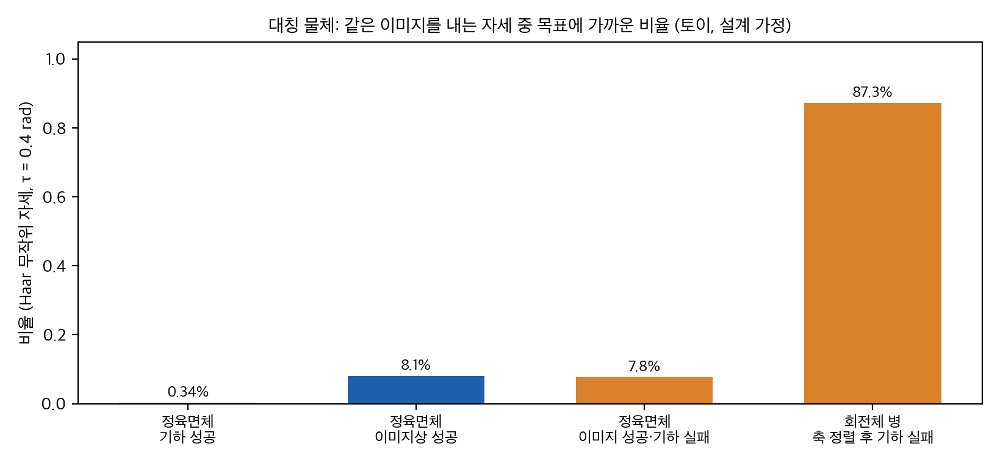
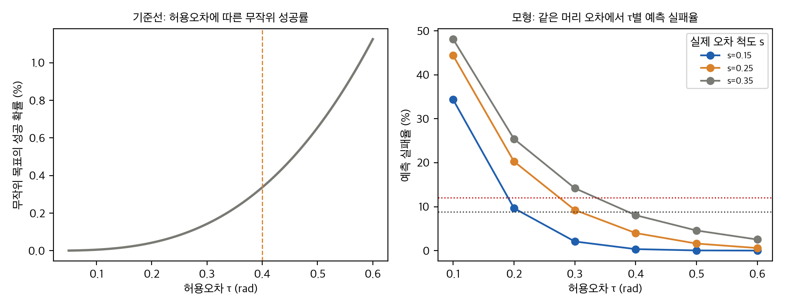

> **논문:** Bhardwaj 외 4인. *GoalDex: Learning Image-Goal-Conditioned Policies for Dexterous In-Hand Manipulation.* CoRL 2026, arXiv:2611.02171 (v1, 2026-11-01).
> 논문 라이선스는 CC BY-NC-ND 4.0입니다. 그래서 논문 그림은 싣지 않았고, 이 글의 그래프는 논문 표의 수치와 직접 만든 토이로 그렸습니다. 공식 코드는 2026-11-12 기준 "Code soon" 상태라 코드는 검토하지 않았습니다.

---

## 논문이 묻는 것

손 안에서 물체를 원하는 방향으로 돌리려면 보통 물체 자세를 먼저 추정하고, 그 자세를 목표 자세와 비교합니다. 자세 추정은 손에 가려지면 흔들리고, 물체마다 정준 좌표계를 정해야 합니다. GoalDex는 이 단계를 없앱니다. 정책은 RGB 관찰, 관절 상태, **목표 이미지**를 받아 관절 목표를 냅니다.

핵심 장치는 세 가지입니다. 교사(특권 상태)를 먼저 강화학습으로 학습하고, 학생은 영상과 관절만 보고 교사를 흉내 냅니다. 학생에게는 숨은 물체 상태를 맞히는 보조 손실을 주고, 목표 이미지와 현재 이미지의 임베딩 거리가 두 자세의 각도 차이에 비례하도록 연속 대조 손실을 줍니다.

## 결과를 다시 계산해 보기

**같은 입력에서 목표만 바꾼 비교가 핵심입니다.** 영상과 고유감각을 쓰는 정책에서 목표를 포즈로 주면 CS 69.20 ± 5.47, 이미지로 주면 77.30 ± 3.25입니다. 차이는 8.1이고, 3 시드에서 Welch 검정 p = 0.16입니다. 검정력은 약 0.23입니다. 방향은 맞지만 이 실험으로는 확인되지 않습니다.

더 흥미로운 것은 성공 판단입니다. 예측 실패율은 포즈 목표 8.33%, 이미지 목표 8.80%입니다. F1은 0.923 대 0.921입니다. 이미지 목표는 **연속 성공 수와 시간**을 개선하지만, 목표 도달을 판정하는 능력은 나아지지 않습니다.

*그래프: 논문 표 1과 표 3의 CS 평균과 표준편차 표기값. 3 시드. 우리가 그린 그래프이며, 논문 수치만 옮겼습니다.*

실로봇 결과는 강합니다. 다섯 물체에서 20회씩, 100회 중 80회 성공했습니다. Wilson 95% 구간은 [71.1, 86.7]%입니다. 논문은 같은 프로토콜의 포즈 기반 최강 기준선이 27회라고 씁니다. 이 차이는 이항 검정으로 확실하지만, 기준선의 시도 기록이 논문에 없어서 프로토콜이 같은지는 확인할 수 없습니다.

*그래프: 객체별 성공률(20회)과 전체 80%, 포즈 기준선 27/100(본문 값). Wilson 95% 구간. 객체 간 차이는 χ² p = 0.36으로 검출되지 않습니다.*

## 대칭 물체에서 목표가 모호해지는 이유

이미지 목표의 근본 문제는 **같은 이미지가 여러 자세에 대응할 수 있다**는 점입니다. 무늬가 없는 정육면체는 회전 대칭 24개가 모두 같은 모습입니다. 무작위 자세 가운데 목표에 0.4 rad 이내로 가까운 비율은 0.34%이지만, 이미지로는 같아 보이는 자세의 비율은 8.1%입니다. 약 23배 차이입니다.

연속 대조 손실은 기하 각도에 따라 목표 값을 정합니다. 같은 이미지에 대해 목표 값이 여러 개라면, 학습이 낼 수 있는 최선은 평균이고 나머지는 잡음입니다. 몸체가 회전체인 병은 더 심합니다. 축이 맞아도 스핀이 0.4 rad보다 크면 평가에서 실패하고, 이 비율은 87%입니다.

*그래프: 설계 가정 토이. 무작위 자세 40만 개. 정육면체 회전군 24개, 병은 z축 대칭. 무늬가 없는 물체의 상한이며, 논문 Cube에는 글자가 있습니다.*

논문은 Tablet Bottle이 가장 어려운 이유로 "대칭 기하"를 듭니다. 토이는 이 설명이 방향으로 맞는다는 것을 보여 줍니다. 다만 검증은 아닙니다. 실제 물체의 무늬와 대칭 분류가 있어야 확인할 수 있습니다.

## 허용오차 0.4 rad는 얼마나 여유 있는가

이 논문의 성공 기준은 0.4 rad, 약 23°입니다. 예측 실패율은 정책이 성공을 선언했는데 실제 오차가 기준보다 큰 경우입니다. 논문의 예측 실패율 8.8%와 실로봇 12%는, 최종 오차가 0.35 rad 근처로 퍼져 있다고 가정할 때 머리 잡음 0.19–0.30 rad로 설명됩니다. 최종 오차 퍼짐이 0.25 rad 이하이면 두 값 모두 재현되지 않습니다.

허용오차를 0.2로 줄이면 같은 조건에서 예측 실패율이 두 배 이상 뜹니다. 허용오차를 0.5로 늘리면 실패율은 줄지만 "성공"의 의미가 약해집니다. 따라서 허용오차가 다른 논문끼리 성공률을 직접 비교하면 안 됩니다.

*그래프: 왼쪽은 허용오차별 무작위 자세의 성공률. 오른쪽은 최종 오차 척도 0.15, 0.25, 0.35 rad 가정에서 허용오차별 예측 실패율. 설계 가정 토이입니다.*

## 구현할 수 있는가

- **이 맥(Apple M4 Pro, CUDA 없음)에서는 재현할 수 없습니다.** 학습은 Isaac Lab과 3D Gaussian Splatting 렌더링이 필요하고, NVIDIA GPU 리눅스 환경을 요구합니다.
- **공식 코드가 나와도** 3D 자산과 학습 인프라를 갖춰야 합니다. 학생 한 정책은 H100 두 장에서 약 30시간이라고 씁니다.
- **실로봇**은 Allegro 16-DOF 손과 손목 카메라, 30 Hz 정책, 300 Hz PD 제어가 필요합니다.
- 이 글에서 한 것은 CPU 토이까지입니다.

## 남는 질문

1. 시뮬레이션 CS의 정확한 정의(에피소드 안 연속 성공을 세는 방식과 시간 제한).
2. 표 4의 2x 학생 행이 표준편차 0.00인 이유. 3 시드 집계가 맞는지.
3. 포즈 기준선 27/100의 시도 기록과 목표 분포.
4. 대칭 물체의 무늬와 등가류를 학습에서 어떻게 처리했는지.
5. 실로봇 목표 이미지(메시 렌더링)와 학습 영상(3DGS)의 도메인 차이.

## 정리

GoalDex는 포즈를 버리고 목표를 이미지로 주는 방향이 실로봇에서도 작동한다는 것을 보여 줍니다. 다만 같은 입력에서 목표만 바꾼 이득은 연속 성공 수에서 좁고 통계적으로 약하며, 성공 판단은 좋아지지 않습니다. 실로봇 80%는 확실하지만, 기준선과 객체별 해석에는 검증할 수 없는 부분이 남아 있습니다. 공식 코드가 나오기 전까지는 토이와 재계산으로 읽는 것이 한계입니다.

## 자료

- [통합 리포트 PDF](report/report_public.pdf)
- [01. 논문 분석: GoalDex](analysis/01_paper_analysis.md)
- [02. 선행 연구와 관련 저장소](analysis/02_prior_work.md)
- [03. 수치 재계산, 통계 검정, 토이 검증](analysis/03_analysis.md)
- [04. 주장 검증과 구현 가능성 (공식 코드 없음)](analysis/04_claim_verification.md)
