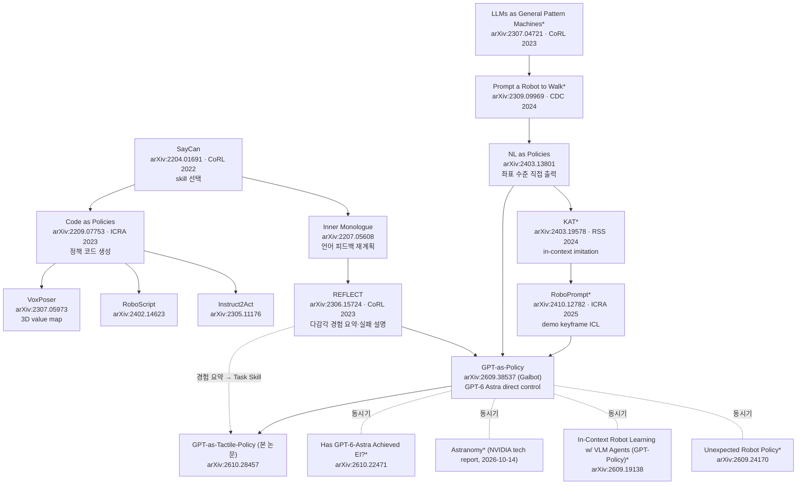
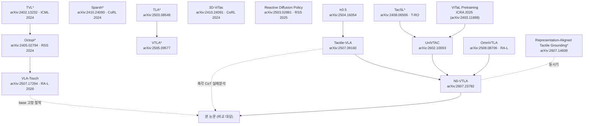
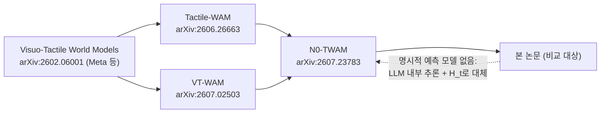

# 02. 선행연구 조사 및 인용 검증 — GPT-6-Astra Understands Touch (arXiv:2610.28457v1)

- 작성 역할: 선행연구 조사 에이전트
- 작성일: 2026-10-23
- 대상: Wang et al., "GPT-6-Astra Understands Touch and Outperform Vision–Tactile–Language–Action Models", arXiv:2610.28457v1 (2026-10-20), SYSU / X-Era AI Lab / PolyU. 프로젝트 페이지 https://gpt-as-tactile-policy.github.io/ ("Code Coming soon", 2026-10-23 기준 코드·프롬프트·Task Skill 원문 미공개)
- 검증 방법: arXiv abs/HTML 페이지, GitHub README/소스, 프로젝트 페이지를 WebFetch로 직접 열람. arXiv API는 HTTP 429로 막혀 abs 페이지를 하나씩 확인함. 아래 "확인됨"은 제목과 1저자(가능한 범위에서 저자 목록 전체)가 원 출처와 일치한다는 뜻임. "지식 기반"은 웹으로 다시 확인하지 않고 모델 지식으로만 확인한 항목.

---

## 0. 요약 (핵심 결론)

1. **References 22건 중 19건은 제목·저자·ID가 일치함.** 불일치는 3건: E0(제목이 다르고 NeurIPS 2026 채택을 확인하지 못함, 저자 표기 오류), VLA-Touch(저자 "M. S. Zheng"는 실제로 "Mike Zheng Shou"), VITaL Pretraining(arXiv 프리프린트 제목은 다르고 ICRA 2025 판 제목은 일치함, IEEE Xplore 원문은 직접 확인하지 못함). 존재하지 않는 인용은 없었음.
2. **Table 2의 baseline 수치는 모두 다른 논문에서 가져온 것이고, 저자들이 다시 돌린 결과가 아님.** ACT+UniVTAC는 UniVTAC 원 논문(arXiv:2602.10093) 표, π0.5와 N0-VTLA는 N0-VTLA 논문(arXiv:2607.23782) 표, N0-TWAM은 N0-TWAM 논문(arXiv:2607.23783) Table 2의 값과 숫자 단위로 같음. 본문에는 "previously evaluated on UniVTAC"라고만 적혀 있고 "가져왔다"는 명시가 없으며, seed와 episode가 같은지도 밝히지 않음.
3. **UniVTAC는 8개 task인데 논문은 5개만 보고함.** Insert HDMI, Insert Tube, Put Bottle in Shelf가 빠졌고 제외한 이유는 적혀 있지 않음. 다만 이 3개를 넣으면 N0-VTLA 평균이 96.2에서 83.1로 떨어지므로, 5-task 부분집합은 오히려 N0-VTLA에 유리함. 제외된 3개 task에서 본 방법이 얼마나 나오는지는 미확인임. 그래서 체리피킹 여부는 판정할 수 없지만 선정 기준이 공개되지 않은 것은 문제임.
4. **제목의 "Outperform"은 결과와 맞지 않음.** 5-task 평균 93.8은 N0-VTLA의 96.2보다 낮음(각 task 100 episode를 가정하면 차이 −2.4pp, SE 약 1.3pp). N0-TWAM의 84.6보다는 높음(+9.2pp, SE 약 1.8pp). 결국 "N0-TWAM과 일부 task에서 앞선다"가 정확한 표현임.
5. **E0는 Baselines 절에 이름이 나오지만 Table 2와 Fig. 1C에는 없음.** 본문은 "four methods"라고 쓰면서 다섯 개를 나열함. E0는 교신저자 Guangrun Wang과 Liang Lin이 공저자인 자기 인용이고, 우리가 확인한 UniVTAC·N0 계열 표에는 E0의 UniVTAC 결과가 없음.
6. **계보상 본 논문은 GPT-as-Policy(Galbot, arXiv:2609.38537)의 direct-control 정식화를 그대로 쓰고 tactile을 확장한 것임.** "IK 컨트롤러로 1–5 control step 실행", "xhigh reasoning"까지 같음. 2026년 9–10월에 GPT-6 Astra를 정책으로 평가한 논문이 최소 4편 더 확인됨(아래 4절). 그러나 촉각을 넣은 것은 본 논문이 처음으로 보이며, 이는 우리가 찾은 범위 안에서의 판단임.
7. **재구현에 중요한 발견.** UniVTAC 소스(`envs/insert_hole.py`)를 보면 Insert Hole 구멍의 기울기는 ±30°(π/6) 두 가지 중 하나로만 정해짐(`rotate ∈ {0, π}`). 그러니 "probing으로 방향을 찾는" 문제는 사실상 이진 선택에 가깝고, Fig. 2의 "~30° Success"도 여기서 나옴. episode 상한은 `step_lim = 300`으로, Fig. 2의 "step 300 Failed"와 맞음.

---

## 1. References 전수 검증표

| # | 논문 인용(약칭) | 인용상 ID/학회 | 실제 확인 결과 | 판정 | 비고 |
|---|---|---|---|---|---|
| 1 | Bi et al., VLA-Touch | IEEE RA-L 2026 | arXiv:2507.17294, "VLA-Touch: Enhancing Vision-Language-Action Models with Dual-Level Tactile Feedback", Jianxin Bi, Kevin Yuchen Ma, Ce Hao, **Mike Zheng Shou**, Harold Soh. GitHub README에 "RA-L 2026 accepted"(github.com/jxbi1010/VLA-Touch) | **부분 불일치** | 인용 저자 "M. S. Zheng"는 오기(실제 M. Z. Shou). base VLA는 RDT-1B, tactile-language 모듈은 Octopi. arXiv에는 journal-ref 없음 |
| 2 | Brohan et al., SayCan | CoRL, PMLR pp.287–318, 2023 | "Do As I Can, Not As I Say", CoRL 2022(PMLR v205 proceedings는 2023년 발행), pp.287–318. arXiv:2204.01691 | 확인됨 | 쪽수는 다른 논문의 인용 목록으로 교차 확인. arXiv ID는 지식 기반 |
| 3 | Chen et al., UniVTAC | arXiv:2602.10093 | 제목·저자(Baijun Chen, Weijie Wan, Tianxing Chen, Xianda Guo, Congsheng Xu, Yuanyang Qi, Haojie Zhang, Longyan Wu, Tianling Xu, Zixuan Li, …, Yao Mu) 일치. 2026-02-10 | 확인됨 | 상세 내용은 2절 |
| 4 | Chen et al., RoboScript | arXiv:2402.14623 | 제목·저자(Junting Chen, Yao Mu, Qiaojun Yu, …) 일치 | 확인됨 | |
| 5 | Cheng et al., OmniVTLA | IEEE RA-L 2026 | arXiv:2508.08706, 저자 8인이 인용 순서와 일치(v3). arXiv comments에 "Accepted by IEEE RA-L" | 확인됨 | journal-ref 필드는 없음 |
| 6 | George et al., VITaL Pretraining | ICRA 2025, pp.258–264 | 여러 논문의 인용 목록에서 같은 제목·학회·쪽수 확인. arXiv 프리프린트(2403.11898)는 "Visuo-tactile pretraining for cable plugging"으로 제목이 다름 | **부분 확인** | IEEE Xplore 원문은 직접 확인 못 함. 2506.13762(Zhao et al.의 ViTaL)와 이름만 같은 다른 연구이므로 혼동 주의 |
| 7 | Higuera et al., Visuo-Tactile World Models | arXiv:2602.06001 | 제목·저자 6인 일치, 2026-02-05 | 확인됨 | 학회 미기재 |
| 8 | Huang et al., 3D-ViTac | arXiv:2410.24091 | 일치. CoRL 2024 채택 | 확인됨 | |
| 9 | Huang et al., Tactile-VLA | arXiv:2507.09160 | 일치(Jialei Huang, Shuo Wang, Fanqi Lin, Yihang Hu, Chuan Wen, Yang Gao) | 확인됨 | |
| 10 | Huang et al., Instruct2Act | arXiv:2305.11176 | 일치 | 확인됨 | |
| 11 | Huang et al., Inner Monologue | arXiv:2207.05608 | 일치 | 확인됨 | 학회 표기 없음(CoRL 2022 게재는 지식 기반) |
| 12 | Huang et al., VoxPoser | arXiv:2307.05973 | 일치 | 확인됨 | (CoRL 2023, 지식 기반) |
| 13 | Intelligence et al., π0.5 | arXiv:2504.16054 | 일치 | 확인됨 | |
| 14 | Liang et al., Code as Policies | ICRA 2023, pp.9493–9500 | 일치(IEEE 레코드 미러, DOI 10.1109/ICRA48891.2023.10160591). arXiv:2209.07753 | 확인됨 | |
| 15 | Liu et al., REFLECT | arXiv:2306.15724 | 일치. CoRL 2023 | 확인됨 | |
| 16 | Mikami et al., NL as Policies | arXiv:2403.13801 | 일치 | 확인됨 | |
| 17 | Team et al., GPT-as-Policy | arXiv:2609.38537 | "Systematically Exploring the Capabilities of GPT-6 Astra as Embodied Policies", **Galbot Team**(Xuchuan Chen, Xiaoqian Cheng, Yu Deng, Lihe Ding, …, He Wang, Li Yi, …), 2026-09-29 | 확인됨 | 코드 링크 없음. 본 논문 저자들과 다른 그룹 |
| 18 | Team et al., N0-TWAM | arXiv:2607.23783 | 일치. NeoteAI Team & Fudan TEAI Team, 2026-07-26 | 확인됨 | 코드 github.com/neoteai/N0-TWAM(공개 예정) |
| 19 | Team et al., N0-VTLA | arXiv:2607.23782 | 일치. 같은 팀, 2026-07-26 | 확인됨 | 코드 github.com/neoteai/N0-VTLA |
| 20 | Tian et al., VT-WAM | arXiv:2607.02503 | 저자 10인 일치, 2026-07-02 | 확인됨 | 프로젝트 vt-wam.github.io |
| 21 | Wu et al., Tactile-WAM | arXiv:2606.26663 | 저자 일치(인용의 "H. Kaixiang, C. Yonghang"는 성·이름 순서가 뒤집힌 표기). RSS 2026 Workshop(Tactile for FM) 투고 | 확인됨 | 평가는 ManiFeel과 실로봇 5 task. UniVTAC 결과 없음 |
| 22 | Xue et al., Reactive Diffusion Policy | arXiv:2503.02881 | 일치. RSS 2025 | 확인됨 | |
| 23 | Zhan et al., E0 | NeurIPS 2026, 제목 "Expressive fine-grained discrete action prediction for VLA via tweedie discrete diffusion" | 실제는 arXiv:2511.21542, "**E0: Enhancing Generalization and Fine-Grained Control in VLA Models via Tweedie Discrete Diffusion**"(v2, 2026-03-25. v1 제목은 "Continuized Discrete Diffusion"). 저자 13인(… Liang Lin, Guangrun Wang) | **불일치** | ① 인용된 제목과 실제 제목이 다름 ② NeurIPS 2026 채택을 찾지 못함(arXiv comments에 학회 표기 없음, 검색 결과도 없음) ③ "Q. Lyu"는 실제 "Qinhan Lv", "W. Li, J. Zhang"은 실제 순서가 "Jusheng Zhang, Weizheng Li" ④ 자기 인용 |

> 정리하면 인용 23건(본문에 쓰인 서지 22개에 SayCan arXiv ID를 보충해 셈) 가운데 존재하지 않는 문헌은 0건임. 서지 정보가 틀린 것은 E0 1건(심각), VLA-Touch 1건(경미), VITaL 1건(제목 버전 차이).

---

## 2. 핵심 의존 연구 상세

### 2.1 GPT-as-Policy (Galbot Team, arXiv:2609.38537)
- **내용.** GPT-6 Astra를 6개 domain(gripper, dexterous in-hand, mobile manipulation, navigation, locomotion, humanoid WBC)에서 direct 정책과 hybrid 정책으로 평가함. 보고 수치는 RoboDojo gripper hybrid 약 48%, dexterous hybrid 50%, RoboCasa365 mobile 38.7%, RxR 92%, HM3D 82%임. locomotion은 5번 모두 실패했고 HumanoidBench에서는 30개 중 13개 task에서 baseline보다 나았음.
- **본 논문이 그대로 가져온 것.** Appendix H의 내용이 같음. `gpt-6-astra`를 **xhigh reasoning**으로 Responses API를 통해 호출하고, schema로 검증되는 tool call로 action vector와 **1–5 repeat count**를 받으며, episode마다 model thread 하나를 유지함. 본 논문 3.4절의 "IK controller executes the target for one to five control steps"와 4.1절의 "reasoning effort fixed to xhigh", "independent model session per episode"는 이 프로토콜을 그대로 옮긴 것임.
- **지연 시간.** locomotion 30초 롤아웃에 250번 호출, 호출당 평균 39.86초였고 그동안 physics를 멈춤. RoboDojo 50 instance에서 Direct 방식은 총 1,132.3M token을 썼음. **본 논문은 latency, token, 비용을 하나도 보고하지 않음.** 시뮬레이션을 멈추는 방식이라고 가정하면 "실시간 촉각 반응"이라는 주장은 RDP 같은 고주파 촉각 제어와 같은 선에서 비교할 수 없음.
- **촉각은 다루지 않음.** in-hand task 입력이 "images and state"뿐이었음. 그러므로 촉각 확장이 본 논문의 실질적인 새 기여임.
- GPT-6 Astra 자체: GPT-as-Policy의 ref [32]는 OpenAI, "GPT-6 Astra: A new generation of intelligence"(openai.com/index/gpt-6-astra/, 2026)임. 해당 페이지는 HTTP 403이라 원문 미확인.

### 2.2 UniVTAC (Chen et al., arXiv:2602.10093)
- **공개 여부.** 코드는 https://github.com/univtac/UniVTAC (README 본문은 MIT, 사이드바는 Apache-2.0으로 표기가 엇갈림), 데이터는 HuggingFace `byml/UniVTAC`와 ModelScope `byml2024/UniVTAC`(task마다 100 episode, isaac45/isaac51 두 판), 그리고 `checkpoints/`(ACT policy와 공유 tactile encoder, Isaac Sim 4.5 데이터로만 학습)가 공개됨.
- **스택.** Isaac Sim 4.5.0과 Isaac Lab 2.1.1(`main`) 또는 Isaac Sim 5.1(`isaac51` 브랜치), TacEx(libuipc IPC와 visuo-tactile renderer), cuRobo, Python 3.10. 논문은 GelSight Mini, ViTai GF225, Xense WS 세 센서를 시뮬레이션하지만 README 기준 데이터 수집은 현재 **GelSight Mini만 지원**함.
- **관측.** 카메라 `head`와 `wrist`(rgb, depth), 촉각 `left_tactile`과 `right_tactile`(`rgb_marker`, `depth`, `marker_motion`). 논문 기준 출력은 I_marked, I_pure, dense depth D, marker 2D 투영 M, gelpad 기준 object pose임. 본 논문 식 (3)의 I(tactile image), D(indentation depth 통계), M(marker displacement)은 이 출력과 정확히 대응함.
- **Action.** `take_action(action_type=qpos|ee|delta_ee)`. `ee`는 7-D pose에 gripper를 더한 형태임. 본 논문의 "target EEF pose + gripper + short horizon"은 `ee` 모드로 보임(추정).
- **Episode 상한.** `_base_task.py`의 `step_lim = 300`.
- **5개 task의 정의와 성공 조건.** 논문 Appendix Table V와 소스의 `check_success`를 함께 정리함. 소스는 WebFetch 요약을 거친 인용이므로 재구현 에이전트가 원문을 다시 확인하기를 권함.

| Task | 정의(논문) | 무작위화(소스) | `check_success`(소스) | early stop(소스) |
|---|---|---|---|---|
| Insert Hole | 기울어진 구멍이 있는 cube(60° 또는 120°)에 test tube를 넣음 | `rotate ∈ {0, π}`에 따라 target 기울기 −π/6 또는 +π/6(**이진**). slot base 위치 noise는 [0.02, 0.03, 0] | target 기준 \|x\|,\|y\| < 0.01, z < −0.04, z축 정렬 dot > 0.99, 손 안에서 높이 변화 < 0.04 | 손 안 높이 bias > 0.04 |
| Lift Can | 지름 4, 5, 6 cm 중 하나인 캔이 누워 있음. 미끄러지지 않게 세워 올림 | 크기 균등 선택, 위치 noise [0.02, 0.05, 0], grasp pitch noise | can z < 0.01, can x축과 수직축의 dot > 0.99 | 촉각 min depth < 20, 또는 손 안 높이 변화 > 0.05 |
| Grasp Classify | 외형은 비슷하고 texture만 다른 두 물체를 분류해 해당 영역에 놓음 | Rough/Plain prism **이진** 선택, 목표 pad 2개 | target 기준 \|p\| < [0.02, 0.02, 0.01], 기울기 15° 이내 | (없음) |
| Lift Bottle | 벽을 향해 누운 병을 잡아 세움. 최종 base가 벽에서 5 cm 이내 | 위치 noise [0.01, 0.05, 0], yaw noise ≤ 10°, grasp pitch −15°~0° | 상대 x > −0.02, \|y\| < 0.1, \|z\| < 0.001, 수직 정렬 > 0.99 | 300 step 초과 이후 자세 조건 |
| Pull-out Key | slot에 꽂힌 key를 저항이 느껴질 때까지 돌린 뒤 뽑음 | key yaw를 slot 기준 U(−90°, −45°)에서 뽑고, 공통 yaw ±45°, base noise ±5 mm | key z > 0.09, 기울기 15° 이내, slot 정렬 유지, gripper와 key 거리 < 0.14 | gripper–key 거리 ≥ 0.14, 또는 slot이 기울어짐 |

- 논문에 공통으로 적힌 무효 조건: 최대 penetration이 안전 임계치를 넘거나 gelpad와 물체 사이에 큰 상대 slip이 생기면 무효. 소스에서는 명시적인 임계치를 찾지 못했음(미확인).
- **UniVTAC 원 논문의 baseline 프로토콜.** task마다 자동 수집 trajectory 50개, 4,000 step, batch 64, lr 1e-5, rollout 100회. seed 수는 보고하지 않음. π0과 π0.5는 원 논문에 **없음**.

| UniVTAC 원표(%) | Lift Bottle | Pull-out Key | Lift Can | Put Bottle | Insert Hole | Insert HDMI | Insert Tube | Grasp Classify | Avg(8) |
|---|---|---|---|---|---|---|---|---|---|
| ACT | 42 | 28 | 20 | 28 | 19 | 15 | 45 | 50 | 30.9 |
| VITaL | 72 | 47 | 8 | 32 | 25 | 6 | 34 | 100 | 40.5 |
| ACT+UniVTAC | 71 | 46 | 29 | 31 | 24 | 28 | 56 | 99 | 48.0 |

### 2.3 N0-VTLA (arXiv:2607.23782)과 N0-TWAM (arXiv:2607.23783), NeoteAI와 Fudan TEAI
- **N0-VTLA.** 학습은 세 단계임. NeoData로 visuo-tactile pretraining을 하고, latent tactile pathway를 붙이고, ALTER라는 advantage-conditioned offline improvement를 함. 하드웨어는 Appendix B에 "multi-node distributed training at cluster scale"라고만 적혀 있어 본 논문 Table 1의 "Multi-node cluster"와 맞음. task별 적응은 "few hundred demonstrations"로 SFT하며 task마다 정책을 하나씩 둠. UniVTAC에서 몇 개 demo를 썼는지는 적혀 있지 않음.
- **N0-TWAM.** 6개 embodiment, 450개 task의 visuo-tactile 데이터로 pretraining함. NeoForce force representation, contact-event staging, 비대칭 MoT 구조. pretraining은 128×H800(FSDP2), NeoForce pretraining은 8×A100, post-training은 기본 1,000 step이라 Table 1과 맞음. UniVTAC는 task마다 100 trial로 평가함. **촉각 입력은 기본이 "simulator의 clean tactile output"이고**, gel-rendered 입력이면 82.4, gel-rendered에 NeoForce를 쓰면 88.1임.
- **두 논문의 UniVTAC 8-task 표.** π0.5 행은 두 논문에서 같음.

| 출처 | Method | IH | LC | GC | LB | PK | (Put Bottle) | (HDMI) | (Tube) | 5-task 평균 | 8-task 평균 |
|---|---|---|---|---|---|---|---|---|---|---|---|
| N0-VTLA·N0-TWAM 표 | π0.5 | 25 | 6 | 49 | 100 | 35 | 34 | 8 | 74 | 43.0 | 41.4 |
| N0-VTLA 표 | N0-VTLA | 95 | 88 | 100 | 99 | 99 | 60 | 25 | 99 | 96.2 | 83.1 |
| N0-TWAM 표 | N0-TWAM | 99 | 93 | 94 | 58 | 79 | 87 | 68 | 98 | 84.6 | 84.5 |

→ 본 논문 Table 2와 Fig. 1C의 baseline 25개 셀은 위 표들과 **모두 일치**함. 5-task 평균도 다시 계산하면 같음.

### 2.4 E0 (arXiv:2511.21542)
- SYSU 그룹(Liang Lin, Guangrun Wang)의 discrete-diffusion VLA임. LIBERO, VLABench, ManiSkill, 실제 Franka에서 평가했음. **UniVTAC 결과는 우리가 확인한 어떤 표에도 없음.** 본 논문은 E0를 "vision-only baseline"으로 Baselines 절에 넣었지만 Table 2에는 수치가 없음. 실험 설정 초안에 남은 흔적이거나 편집 누락으로 보이며, 이는 추정임.

### 2.5 π0.5 (arXiv:2504.16054)
- 본 논문의 π0.5 수치는 π0.5 원 논문이 아니라 N0 계열 논문에서 가져온 것임. 그 논문들도 baseline을 다시 돌렸는지 가져왔는지 밝히지 않음. N0-VTLA는 NeoReal 실험에 대해서만 "reproduced internally"라고 적음.

### 2.6 나머지 직접 인용 연구 요약
| 연구 | 핵심 메커니즘 | 학습 필요 | 촉각 사용 방식 | 본 논문과의 관계 |
|---|---|---|---|---|
| Tactile-VLA (arXiv:2507.09160) | VLA에 hybrid position-force control, CoT 변형으로 촉각 기반 실패 분석 | few-shot fine-tune | 촉각 토큰과 힘 목표 | "촉각 CoT로 실패 분석"을 학습된 VLA 안에서 수행. 본 논문은 이를 frozen LLM과 in-context로 대체함 |
| VLA-Touch (arXiv:2507.17294, RA-L 2026) | base VLA(RDT-1B)는 고정, Octopi로 촉각을 언어화해 planner 갱신, diffusion refiner | refiner 학습 | semantic feedback과 저수준 refinement | "base 모델 고정"이라는 철학이 가장 가까움. 다만 저수준 촉각 보정을 학습된 refiner가 맡는다는 점이 결정적으로 다름 |
| OmniVTLA (arXiv:2508.08706, RA-L) | π0 기반, dual-path tactile encoder(SA-ViT), ObjTac 데이터셋 | 학습 | encoder 정렬 | 학습형 VTLA 계열의 대표. 직접 비교는 없음 |
| 3D-ViTac (arXiv:2410.24091, CoRL 2024) | 시각과 촉각을 3D point로 통합한 뒤 diffusion policy | 학습 | 공간 표현 | 표현 학습 계열 |
| RDP (arXiv:2503.02881, RSS 2025) | slow latent chunk와 fast tactile feedback으로 나눈 계층 | 학습 | 고주파 반응 제어 | 본 논문의 "short horizon(1–5 step)과 재질의"는 RDP의 fast loop를 LLM 호출 주기로 근사한 것이지만 주파수 차이가 매우 큼(latency 미보고) |
| VITaL Pretraining (ICRA 2025) | visuo-tactile pretraining이 촉각 없이 배포하는 정책에도 도움 | 학습 | pretraining | UniVTAC 표에서 VITaL 행의 출처 |
| Visuo-Tactile World Models (arXiv:2602.06001) | 촉각을 넣은 action-conditioned world model로 planning | 학습 | 미래 예측 | WAM 계열의 기점 |
| Tactile-WAM (arXiv:2606.26663) | tactile 비대칭 attention | 학습 | 행동 경로에만 촉각 주입 | UniVTAC 결과 없음 |
| VT-WAM (arXiv:2607.02503) | flow matching으로 vision, tactile deformation, action을 함께 예측. contact-gated attention guidance | 학습 | 미래 촉각 예측 | 실로봇 6 task 평균 71.67%. UniVTAC 결과 없음 |

---

## 3. 계보도

### 3.1 LLM-as-policy 계열

`*` 표시는 본 논문이 인용하지 않은 연구(4절). 화살표는 개념상의 영향 관계를 정리한 것으로, 저자들이 직접 밝힌 영향 관계는 아님.

### 3.2 Visuo-tactile 학습 정책 및 tactile-language 계열

### 3.3 Tactile world-action model 계열

---

## 4. 논문이 인용하지 않은 관련 연구 (웹 검색으로 존재 확인)

| 연구 | 출처 | 관련성 | 본 논문이 빠뜨린 의미 |
|---|---|---|---|
| In-Context Learning Enables Robot Action Prediction in LLMs (RoboPrompt) | Yin et al., arXiv:2410.12782, ICRA 2025 | demo keyframe을 텍스트 ICL 예시로 써서 학습 없이 action을 예측 | 본 논문의 "expert demo → 고정 context"를 가장 직접적으로 앞선 연구. 다만 RoboPrompt는 원시 demo를 그대로 넣고, 본 논문은 LLM이 요약한 Task Skill을 넣는다는 점이 다름. 원시 demo ICL과 요약 ICL을 비교하는 ablation이 없음 |
| Keypoint Action Tokens (KAT) | Di Palo & Johns, arXiv:2403.19578, RSS 2024 | demo 10개 이하로 GPT-4 Turbo가 in-context imitation | 같은 "학습 없는 demo 활용" 주장. 본 논문은 demo를 40개 씀 |
| LLMs as General Pattern Machines | Mirchandani et al., arXiv:2307.04721, CoRL 2023 | LLM을 in-context sequence model로 써서 closed-loop 제어 | 수치 제어 계열의 기원. latency 한계도 이미 지적했음 |
| Prompt a Robot to Walk with LLMs | Wang et al., arXiv:2309.09969, IEEE CDC 2024 | LLM이 저수준 관절 목표를 직접 출력 | GPT-as-Policy는 인용했지만 본 논문은 빠뜨림 |
| In-Context Robot Learning with VLM Agents ("GPT-Policy") | Cheng et al., arXiv:2609.19138 (2026-09-16). 코드 github.com/cheng-haha/GPT-Policy | context compiler, VLM, constrained controller. contact-sensitive task에서 aligned action reference가 효과를 보임 | 거의 같은 시기의 경쟁 연구로 이름도 혼동될 수 있음("GPT-Policy"와 "GPT-as-Policy"). 촉각은 없음 |
| An Unexpected Robot Policy: Early Evaluations of GPT-6 Astra on RoboDojo | Zhang et al., arXiv:2609.24170 (2026-09-21) | RoboDojo 42 task에서 평균 22.48%. one-shot demo가 집계상 이득이 없었음 | **"demo를 context에 넣어도 이득 없음"이라는 반대 증거.** 본 논문의 demo 요약이 효과가 있다는 주장과 맞부딪히므로 논의가 필요함 |
| Astranomy: GPT-6 Astra as a native robot policy | Yang, Khetan, Zhang, NVIDIA tech report, 2026-10-14 (arXiv 아님) | Direct, Agentic, Orchestrated 비교. Direct는 호출당 18.56초, episode당 약 $1.96. 프롬프트에 기하 정보를 넣자 19.3%에서 72.7%로 상승 | **프롬프트 설계에 대한 민감도가 매우 큼.** 본 논문이 Task Skill 원문을 공개하지 않아 재현성이 크게 떨어진다는 근거 |
| Has GPT-6-Astra Achieved Embodied Intelligence? | SenseNova et al., arXiv:2610.22471 (2026-10-15) | 12개 벤치, ICL 허용 프로토콜, 시계를 계속 돌리는 평가를 제안 | latency를 포함한 평가를 주장함. 본 논문은 시계를 멈춘 평가로 추정됨 |
| Octopi | Yu et al., arXiv:2405.02794, RSS 2024 | tactile-language model(GelSight, PhysiCLeAR) | VLA-Touch의 구성 요소. 촉각 이미지를 LLM이 해석한 선례 |
| TVL | Fu et al., arXiv:2402.13232, ICML 2024 | 촉각·시각·언어 정렬. GPT-4V보다 12% 높다고 보고 | **범용 VLM의 촉각 이미지 이해가 약하다는 증거**(GPT-4V 기준). 본 논문이 이미지 대신 구조화된 descriptor(D, M)를 함께 넣은 이유를 뒷받침함 |
| Sparsh | Higuera et al., arXiv:2410.24090, CoRL 2024 | vision-based tactile SSL 표현 | 학습형 tactile encoder의 기준선 |
| TLA / VTLA | Hao et al., arXiv:2503.08548 / arXiv:2505.09577 | tactile-language-action 모델, peg-in-hole 삽입 | insertion을 다루는 VTLA 선행 연구 |
| TacSL | Akinola et al., arXiv:2408.06506, IEEE T-RO | GPU visuo-tactile 시뮬레이션 | UniVTAC/TacEx 계열 시뮬레이터의 선행 연구 |
| ManiSkill-ViTac 2025 / ManiFeel | arXiv:2411.12503 / arXiv:2505.18472 | 촉각 manipulation 벤치마크 | UniVTAC 말고도 평가 가능한 대안 벤치(Tactile-WAM이 ManiFeel 사용) |
| Representation-Aligned Tactile Grounding | Chen et al., arXiv:2607.14609 | VLA의 중간 action-expert feature에서 미래 촉각 예측 | N0-VTLA latent tactile 예측과 같은 계열 |

찾으려 했지만 확인하지 못한 것: "범용 VLM이 촉각 이미지를 입력받아 zero-shot으로 삽입 정책을 수행"하는 선행 연구는 검색 범위 안에서 발견하지 못함. 따라서 "frozen 범용 VLM을 촉각 직접 정책으로 쓴 첫 사례"라는 판단은 **검색 범위 안에서만 유효함**.

---

## 5. 차별점 및 공정 비교 평가

### 5.1 연구별 차별점
| 비교 대상 | 본 논문의 차별점 | 그 차별점의 실제 무게 |
|---|---|---|
| GPT-as-Policy | 촉각 관측(이미지, indentation 통계, marker 변위)과 expert demo를 요약한 Task Skill을 추가 | 정식화는 동일하고 입력만 확장함. 방법론의 새로움은 "LLM이 demo를 요약해 context를 만드는 단계"와 "촉각 descriptor 설계" 두 가지 |
| RoboPrompt, KAT | 원시 demo 대신 LLM이 요약한 원칙과 대표 촉각 reference를 사용 | 비교하는 ablation이 없어 요약의 효과가 검증되지 않음 |
| REFLECT | 실패 설명을 사후 재계획이 아니라 사전 Task Skill로 만들어 두고, 온라인 단계마다 반영 | 개념상 REFLECT의 경험 요약을 offline으로 옮긴 것에 가까움 |
| Tactile-VLA, VLA-Touch, OmniVTLA, N0-VTLA | 파라미터 갱신이 전혀 없음 | 대신 추론 비용과 latency가 매우 큼(미보고). 실로봇 실험 없음 |
| RDP | 반응 제어를 LLM 재질의로 대체 | 실시간성 비교는 불가능함 |
| 촉각 WAM 계열 | 명시적인 미래 촉각 예측 모델 없이 H_t와 LLM 추론으로 결과를 비교 | 예측 모델이 없으므로 "anticipating contact"는 주장하지 않음(정확한 위치 설정) |

### 5.2 공정 비교 체크리스트
| 항목 | 상태 | 근거 |
|---|---|---|
| baseline 수치의 출처 | **모두 가져온 값이며 출처 표기가 불명확함** | 2.2와 2.3의 표와 셀 단위로 일치함. 본문은 "previously evaluated on UniVTAC"라고만 씀 |
| 평가 seed와 episode가 같은지 | 미확인 | 본 논문은 "100 fixed test episodes"라고만 쓰고, UniVTAC 원 논문은 seed를 보고하지 않음. 소스에서는 `reset(seed)`로 seed별 재현이 가능함 |
| task 선정 | **8개 중 5개, 기준 미기재** | 제외된 3개 task에서 N0-VTLA는 평균 61.3, N0-TWAM은 84.3. 이 부분집합은 N0-VTLA에 유리하고 N0-TWAM에는 영향이 거의 없음. 본 방법이 제외 task에서 어떤지는 미확인 |
| 촉각 입력 조건 | 비대칭 | 본 방법은 시뮬레이터의 dense depth D와 marker를 바로 사용함(실센서에서는 depth를 재구성해야 함). N0-TWAM 기본값은 "clean simulator tactile"임. ACT+UniVTAC의 입력 형식은 원 논문에서 세부 확인 못 함 |
| demo 수 | 대체로 비슷함 | 본 방법은 50개(지식 구성 40, offline validation 10), ACT+UniVTAC도 50개. N0 계열은 대규모 pretraining 위에 "few hundred demos"(UniVTAC에서의 수는 미확인) |
| "per-task training 없음" 주장 | 부분적으로 성립 | 파라미터 갱신은 없음. 하지만 task별 Task Skill 생성과 10개 demo로 하는 "offline validation"은 사실상 task별 프롬프트 튜닝 단계일 수 있음. 반복 횟수와 사람의 개입 여부는 미기재 |
| 통계적 유의성 | 보고 없음 | n=100 Wilson 95% CI: Pull-out Key 84%는 [75.6, 89.9], Lift Bottle 93%는 [86.3, 96.6]. N0-VTLA 대비 평균 차이 −2.4pp(SE 약 1.3pp, n=100 가정) |
| ablation 범위 | 좁음 | 촉각 ablation은 Insert Hole 한 task만 했고, w/o tactile 쪽 Task Skill을 따로 다시 만들었음. 요약 대 원시 demo, reasoning effort, 모델 교체 ablation은 없음 |
| E0 | 내부 모순 | Baselines 절에는 있고 Table 2에는 없음. "four methods" 문구와 실제 나열 수(5)가 다름. 자기 인용 |
| 제목 주장 | 과장 | 평균 기준으로 N0-VTLA를 넘지 못함 |
| 비용과 latency | 미보고 | 비교 근거: GPT-as-Policy 호출당 39.86초(locomotion), Astranomy Direct 호출당 18.56초 |

### 5.3 Insert Hole 결과 해석에 대한 주의
- 소스상 hole 기울기는 ±30° 두 가지로만 정해짐. 따라서 "probing 방향 탐색"은 사실상 좌우 이진 탐색에 가깝고, Fig. 4의 near-vertical, leftward, rightward 3방향 탐색과 rightward 성공은 이 구조와 잘 맞음.
- w/o tactile의 31%는 무작위로 한 방향을 고를 때 기대되는 약 50%보다 낮음. 시각만으로는 방향을 고른 뒤에도 정렬과 삽입을 완료하기 어렵다는 해석이 가능하지만 이것은 추정임.
- Task Skill이 "구멍은 ±30° 중 하나"라는 사실을 demo에서 뽑아 담았을 가능성이 높음. 그렇다면 99%는 일반적인 촉각 추론이라기보다 task 구조를 사전 지식으로 쓴 결과일 수 있음. Task Skill 원문이 공개되지 않아 확인할 수 없음.

---

## 6. 재구현 및 검증 에이전트에 넘길 사항
1. UniVTAC repo의 `envs/{insert_hole,lift_can,grasp_classify,lift_bottle,pull_out_key}.py`에 있는 `check_success`, `check_early_stop`와 `_base_task.py`의 `step_lim=300`, `take_action(action_type='ee')`를 그대로 따를 것. Isaac Sim 4.5와 RTX급 GPU가 필요하므로 현재 환경(torch 없음, 설치 금지)에서는 실제 실행이 불가능함. mock env로 프로토콜만 재현하는 것을 권장함.
2. 촉각 descriptor D와 M은 `left_tactile/right_tactile`의 `depth`와 `marker_motion`에서 mean, peak, contact area, centroid, 변위장 통계로 계산할 것. 정확한 pooling 크기와 임계치는 논문에 없으므로 미확인.
3. LLM 호출 프로토콜은 GPT-as-Policy Appendix H를 기준으로 할 것: Responses API, xhigh, schema tool call(action, repeat 1–5, rationale), episode마다 thread 하나.
4. 검증 에이전트는 Table 2의 baseline 셀을 2.2와 2.3의 출처 표와 대조하고, n=100 binomial CI와 8-task로 외삽한 시나리오를 다시 계산할 것.

---

## 7. 출처 목록 (이번 조사에서 직접 열람)
- arXiv abs/HTML: 2610.28457, 2609.38537(HTML, Appendix H 포함), 2602.10093(HTML), 2607.23782(HTML), 2607.23783(HTML), 2602.06001, 2607.02503, 2606.26663, 2507.09160, 2410.24091, 2503.02881, 2305.11176, 2207.05608, 2307.05973, 2504.16054, 2306.15724, 2403.13801, 2402.14623, 2511.21542, 2508.08706, 2507.17294, 2609.19138, 2607.14609, 2609.24170, 2610.22471, 2408.06506
- GitHub: https://github.com/univtac/UniVTAC (README, `envs/` 소스), https://github.com/jxbi1010/VLA-Touch
- 프로젝트 페이지: https://univtac.github.io/, https://gpt-as-tactile-policy.github.io/, https://research.nvidia.com/labs/srl/projects/astranomy/
- 웹 검색으로만 확인(abs 페이지 미열람): 2410.12782(RoboPrompt), 2403.19578(KAT), 2307.04721, 2405.02794, 2402.13232, 2410.24090, 2503.08548, 2505.09577, 2411.12503, 2505.18472, VITaL ICRA 2025 서지(인용 목록 교차 확인), SayCan과 CaP 쪽수
- 열람 실패: openai.com/index/gpt-6-astra/ (HTTP 403), export.arxiv.org API (HTTP 429)
