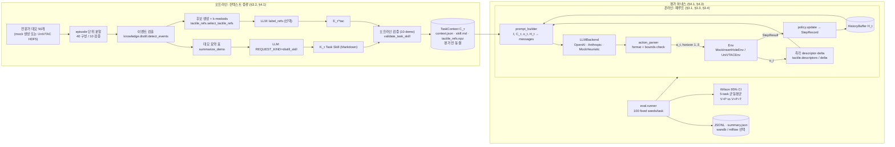
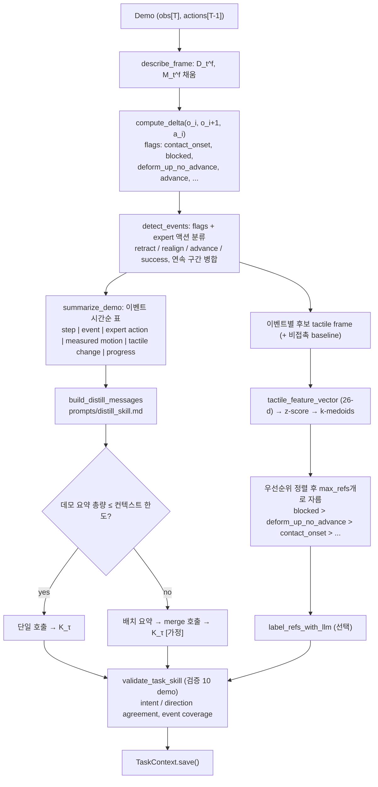
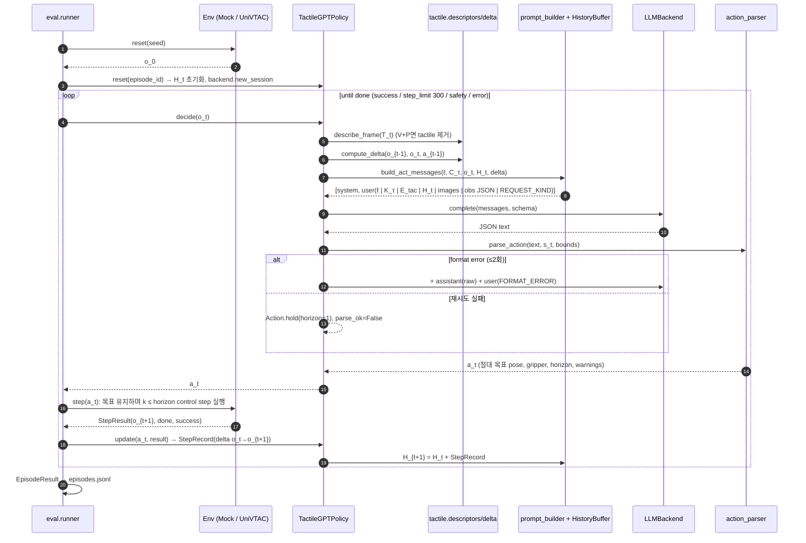
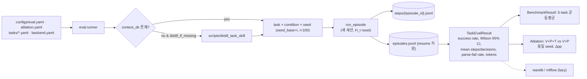
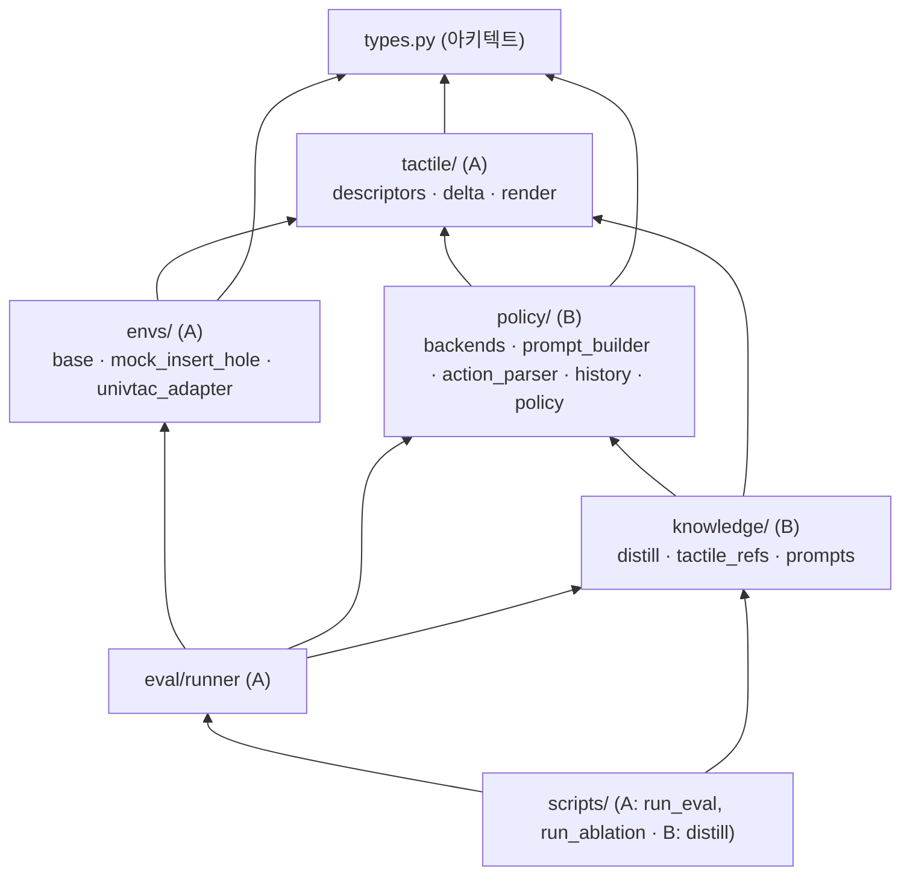

# 04. 시스템 아키텍처: GPT-as-Tactile-Policy 재구현

- 대상: *GPT-6-Astra Understands Touch and Outperform Vision–Tactile–Language–Action Models*, Wang et al., arXiv:2610.28457v1 (2026-10-20). 이하 "논문".
- 벤치마크: *UniVTAC*, Chen et al., arXiv:2602.10093, https://github.com/univtac/UniVTAC
- 인터페이스 원본: `code/SPEC.md`(진실의 원천), `code/tactile_gpt_policy/types.py`
- 표기: **[논문 §x]** 원문 근거 / **[UniVTAC 확인]** 공개 repo 문서·코드로 확인(2026-10-23) / **[가정]** 재구현 결정 / **[미확인]** 확인하지 못함

---

## 1. 한 줄 요약

논문의 정책은 **파라미터를 고정한 범용 멀티모달 LLM** 하나다. 이 LLM이 (1) 오프라인에서 전문가 데모 40개를 분석해 텍스트 Task Skill `K_τ`와 촉각 레퍼런스 `E_τ^tac`를 만들고 [논문 §3.2, §4.1], (2) 온라인에서는 `ℓ, C_τ, o_t, H_t`를 받아 EEF 목표 pose, 그리퍼, 1–5 step horizon을 직접 출력하는 폐루프 정책 역할을 한다 [논문 식(1), §3.4]. 학습되는 파라미터가 없으므로, 재구현의 핵심은 모델이 아니라 **관측 표현(식 3), 컨텍스트 증류, 프롬프트와 액션 계약, 평가 하네스**다. 아래 구조는 이 네 가지를 모듈로 나누고, 실제 LLM이나 시뮬레이터 없이도 끝까지 검증할 수 있도록 mock 경로를 함께 둔다.

---

## 2. 전체 구성도

---

## 3. 오프라인 증류 파이프라인

설계 포인트
- **이벤트 요약 기반 입력** [가정]. 논문은 GPT-6-Astra가 데모를 "jointly analyzes … relating contact changes and object motion before and after actions"라고만 쓴다 [논문 §3.2]. 40개 데모의 원시 프레임을 모두 넣으면 토큰 비용이 감당되지 않는다. 그래서 REFLECT(*Summarizing robot experiences for failure explanation and correction*, arXiv:2306.15724)의 계층적 경험 요약처럼, 촉각과 운동 변화를 이벤트로 압축한 표를 LLM 입력으로 쓴다. 원시 이미지를 포함한 변형은 비교 실험 대상으로 남긴다.
- **K_τ 섹션 고정**. 논문이 열거한 구성 요소 "task objectives, manipulation principles, evidence for stage transitions, corrective strategies for obstructions"[§3.2]를 Markdown 헤더로 강제한다. 여기에 촉각 해석과 액션 크기 섹션을 더했다.
- **E_tac 선택**. 논문은 "bilateral contact distributions and local deformation patterns를 보존하는 대표 촉각"이라고만 쓴다 [§3.2]. 재구현은 좌우 finger를 분리한 26차원 descriptor 공간에서 이벤트별 k-medoids로 고른다. medoid는 실제 관측 프레임이므로 이미지 레퍼런스로 그대로 쓸 수 있다.
- **ablation용 별도 컨텍스트**. "Each configuration uses a fixed Task Skill matched to its available observations"[§4.3]에 따라, V+P 조건은 촉각 플래그 없이 이벤트를 검출하고 K_τ를 따로 증류하며 E_tac은 비운다.

---

## 4. 온라인 폐루프

설계 포인트
- **상대 명령 JSON을 절대 목표로 변환** [가정]. 논문은 "a_t specifies the target end-effector pose, gripper position, and a short execution horizon"[§3.1]과 "constructs action a_t from the latest measured robot state"[§3.4]를 모두 쓴다. 모델은 base frame의 `dpos_mm`와 `drot_deg`(rotation vector)를 내고, parser가 최신 측정 상태를 기준으로 절대 목표(m, quat wxyz)로 바꾼다. LLM이 쿼터니언을 직접 다루지 않게 하려는 선택이다. 대가로 "상대 vs 절대" 자체가 재현 오차의 원인이 될 수 있다(미확인 항목 3).
- **Bounds와 format 체크** [논문 §3.4]. format 위반은 재질의(최대 2회) 후 hold로 처리하고, bounds 위반은 clip한 뒤 warning을 다음 prompt에 피드백한다. 논문은 위반 시 처리를 밝히지 않았다.
- **stateless 재직렬화** [가정]. "independent model session per episode, H_t updated within the episode"[§4.1]를 만족하면서 비용을 통제하기 위해, H_t는 텍스트(최근 20개는 상세, 이전은 압축, 막힘과 접촉 이벤트는 보존)로 넣고 이미지는 현재 시점과 직전 결정 시점의 촉각 패널만 넣는다. part 순서를 고정해 앞쪽(ℓ, K_τ, E_tac)이 에피소드 내내 바이트 동일하게 유지되므로 prompt caching이 가능하다.
- **delta 플래그는 Task Skill의 어휘다**. `deform_up_no_advance`는 논문 §3.2의 예시("increasing deformation without object advancement during insertion prompts retraction")를 그대로 관측 플래그로 만든 것이다. 같은 flag 어휘가 오프라인 이벤트 검출, K_τ 텍스트, 온라인 관측 JSON에 공통으로 쓰여서 증류된 지식과 현재 관측이 같은 언어로 연결된다.
- **privileged 차단**. 시뮬레이터 정답 상태는 `Observation.privileged`에만 두고, prompt와 mock 정책에 들어가지 않음을 테스트로 강제한다. mock 결과가 정답 누출로 부풀려지는 것을 막기 위해서다.

---

## 5. 평가 하네스

- 프로토콜 [논문 §4.1]: 태스크당 고정 100 에피소드, 환경 고유 성공 기준, 종료됐지만 성공하지 못한 에피소드는 실패, 5-task 균등 평균. ablation은 같은 100개 설정, 같은 초기화, 같은 저수준 제어와 예산을 쓴다 [§4.3].
- 통계: n=100이면 Wilson 95% CI 폭이 크다. 99/100은 [0.946, 0.998], 95/100은 [0.888, 0.979]다. Table 2의 Insert Hole 99(Ours) vs 95(N0-VTLA), Lift Can 95 vs 93(N0-TWAM)은 통계적으로 구분되지 않는다. 반면 ablation 99 vs 31(31/100 → [0.228, 0.406])은 CI가 겹치지 않는다. 하네스는 CI를 항상 함께 출력한다.
- 비용 통제: `resume`(완료된 episode_id는 건너뜀), `--n-episodes` 파일럿, 토큰 사용량 집계.

---

## 6. 모듈 의존 그래프와 소유자

A(관측, 환경, 평가)와 B(지식, 정책, LLM)의 접점은 `types.py`와 SPEC §3(tactile 함수 시그니처), §4.1(Env), §7.3(policy·run_episode) 세 곳뿐이다. B는 A의 `describe_frame`, `compute_delta`, `render_tactile_panel`, `image_part`를 시그니처만 보고 호출한다. A의 runner는 B의 `TactileGPTPolicy`, `run_episode`, `make_backend`, `distill_task_skill`를 시그니처만 보고 호출한다.

---

## 7. 컴포넌트 설명

| 컴포넌트 | 책임 | 핵심 결정 |
|---|---|---|
| `types.py` | o_t, a_t, H_t, C_τ 데이터 계약, 기하 헬퍼, 직렬화 | EEF는 xyz(m)+quat wxyz(UniVTAC `Pose`와 동일), RPY는 표시용 extrinsic XYZ, 그리퍼는 [0,1](1=open), depth는 mm(≥0) |
| `tactile/descriptors.py` | 식(3)의 D_t^f(mean·peak·contact area·centroid·bbox·pooled grid), M_t^f(mean vector·magnitude·주방향·coherence·divergence·curl·pooled field) | divergence와 curl을 넣어 "누름 / 전단 / 비틀림"을 숫자로 구분한다 [가정] |
| `tactile/delta.py` | o_t→o_{t+1} 변화 + 측정·명령 EEF 이동, flag 어휘 | `blocked`(추종 오차), `deform_up_no_advance`(§3.2 예시) 등 결정적 규칙 |
| `tactile/render.py` | marker field(Fig.4 스타일)와 indentation 렌더, PNG 인코딩(순수 zlib) | matplotlib 의존 없음 |
| `envs/mock_insert_hole.py` | numpy toy 삽입 시뮬레이터, 스크립트 전문가 | 촉각이 숨은 오차의 **부호**를 담고 시각과 proprio는 담지 않도록 설계(P1–P4). 논문 수치 재현 목적이 아님 |
| `envs/univtac_adapter.py` | UniVTAC 관측·액션 변환, task 구동, HDF5 데모 로딩 | 확인된 키·shape만 고정하고 단위·의미가 미확인인 항목은 config와 TODO로 둠 |
| `knowledge/distill.py` | 40/10 분할, 이벤트 검출, 요약, K_τ 생성, 검증 | 이벤트 요약 입력, K_τ 섹션 강제 |
| `knowledge/tactile_refs.py` | E_tac 후보, k-medoids, LLM 라벨링 | 이벤트별 medoid, 우선순위 컷 |
| `policy/backends.py` | OpenAI(Responses, reasoning effort) / Anthropic(Messages, adaptive thinking, `output_config.effort`) / Mock | SDK lazy import, payload 변환을 순수 함수로 분리해 테스트 |
| `policy/prompt_builder.py` | 식(1)의 입력을 메시지로 직렬화 | 고정 순서와 캐시 친화 구조, `REQUEST_KIND` 마커 |
| `policy/action_parser.py` | JSON 추출, 스키마·bounds 검사, 상대→절대 변환 | format은 재질의, bounds는 clip+피드백 |
| `policy/history.py` | H_t 관리, 길이 정책 | 최근 상세 + 과거 압축 + 이벤트 보존 |
| `policy/policy.py` | decide / update / run_episode | 직전 결정 시점 대비 delta, backend 오류 3연속이면 실패 |
| `eval/runner.py` | seed, 집계, CI, ablation, 로깅 | 조건 간 동일 seed, resume, wandb/mlflow 선택 |

---

## 8. 논문 대비 매핑표

| 논문 | 내용 | 모듈 / 심볼 | 근거 수준 |
|---|---|---|---|
| 식(1) `a_t ~ π_θ(·|ℓ, C_τ, o_t, H_t)` | 조건부 액션 생성 | `TactileGPTPolicy.decide`, `build_act_messages`, `LLMBackend.complete` | 논문 |
| §3.1 "numerical EEF and gripper targets → generic IK" | 액션 의미 | `Action`, `Env.step`, `action_to_univtac`(`take_action(..., 'ee')`) | 논문 + UniVTAC 확인(`'ee'` 8-d). IK 구현 동일성은 미확인 |
| §3.1 θ 고정 | 학습 없음 | 전 모듈(학습 코드 없음) | 논문 |
| 식(2) `C_τ = (K_τ, E_τ^tac)` | 고정 태스크 컨텍스트 | `TaskContext`(save/load, 평가 중 읽기 전용) | 논문 |
| §3.2 K_τ 구성(objectives, principles, transition evidence, corrective strategies) | Task Skill 형식 | `prompts/distill_skill.md`, SPEC §6.2 헤더 | 논문 + 형식은 가정 |
| §3.2 "deformation ↑ without advancement → retract, then adjust" | 대표 교정 규칙 | flag `deform_up_no_advance`, Mock 정책 규칙 | 논문 예시를 규칙화 |
| §3.2 E_τ^tac(bilateral distribution, local deformation 보존) | 촉각 레퍼런스 | `select_tactile_refs`, `kmedoids`, `label_refs_with_llm` | 논문 + 선택 절차는 가정 |
| §4.1 50 demo = 40 구성 + 10 검증(episode 단위) | 데이터 분할 | `split_demos`, `DistillConfig(n_construct=40, n_val=10)` | 논문 |
| §4.1 10 demo offline validation | 검증 절차 | `validate_task_skill` | 절차는 가정(논문 미기재) |
| 식(3) `T_t = {I, D, M}_{L,R}` | 촉각 관측 | `TactileFrame(L, R)`, `FingerTactile(image, depth_mm, marker_*, D, M)` | 논문 |
| §3.3 D: pooling, mean, peak, contact region, centroid | 압입 descriptor | `compute_indentation_descriptor` | 논문 + 세부(threshold, grid)는 가정 |
| §3.3 M: 2D marker displacement vs reference | marker descriptor | `compute_marker_descriptor`(+ divergence/curl은 가정) | 논문 |
| §3.3 L/R 분리 유지 | 양측 비교 | JSON `{"L":…, "R":…}`, flag `bilateral_asymmetry` | 논문 |
| §3.3 연속 관측 + 같은 구간 EEF·그리퍼 이동 | 변화 결합 | `compute_delta`, `ObservationDelta` | 논문 |
| §3.3 tactile images + structured descriptions | 이미지와 텍스트 병행 | `render_tactile_panel` + `frame_to_prompt_dict` | 논문 + 렌더 형식은 가정(Fig.4 참고) |
| §3.4 bounds·format 체크 후 1–5 step 실행 | 실행 계약 | `parse_action`, `ActionBounds`, `Action.horizon ∈ [1,5]`, `Env.step` | 논문 + 위반 처리는 가정 |
| §3.4 o_t vs o_{t+1} 비교로 효과 평가 | 피드백 | `StepRecord.delta`, H_t 렌더 | 논문 |
| §3.4 불확실할 때 능동 탐색(작은 병진·회전·그리퍼 변화) | 탐색 액션 | `intent ∈ {probe, adjust, retract}`, 소형 bounds | 논문 + 어휘는 가정 |
| §4.1 GPT-6-Astra, reasoning effort xhigh, 전 태스크 동일 | 모델 설정 | `OpenAIBackend(effort="xhigh")`, `backend.yaml` | 논문. model id는 미확인 |
| §4.1 에피소드마다 독립 세션, H_t reset | 세션 | `policy.reset(episode_id)`, `backend.new_session` | 논문 |
| §4.1 100 fixed episodes/task, native success, 균등 평균 | 프로토콜 | `fixed_seeds`, `evaluate_task`, `BenchmarkResult.mean_success` | 논문. seed 목록은 미확인 |
| §4.3 V+P vs V+P+T, 촉각과 레퍼런스 제거, 관측에 맞춘 Task Skill | ablation | `run_ablation`, `separate_context: true`, `use_tactile` 주입 | 논문 |
| Fig.2 step 300에서 실패 | step 한도 | `max_steps=300` | UniVTAC 확인(`step_lim=300`) |
| Fig.4 marker-displacement field | 촉각 시각화 | `render_marker_field`, 63 markers(7×9) | UniVTAC 확인(63), 7×9 배치는 가정 |

---

## 9. UniVTAC 연동 사실관계 (2026-10-23 조회)

| 항목 | 내용 | 상태 |
|---|---|---|
| 시뮬레이터 | Isaac Sim 4.5 + Isaac Lab 2.1.1 + TacEx(libuipc) + cuRobo, conda env Python 3.10. `isaac51` 브랜치는 Isaac Sim 5.1 | 확인(README, arXiv:2602.10093) |
| 로봇 | Franka Panda, finger qpos 0..0.039 m | 확인(`envs/robot/robot.py`) |
| 촉각 센서 | GelSight Mini / ViTai GF225 / Xense WS. 수집·평가는 현재 gsmini만 | 확인(README) |
| 관측 키·shape | head/wrist rgb 270×480×3. tactile `depth 240×320`, `marker 2×63×2`, `rgb`/`rgb_marker 240×320×3`, `pose 7`. embodiment `ee 7`, `joint 9` | 확인(`docs/Collection.md`, `_base_task.py`) |
| 액션 API | `take_action(action, action_type ∈ {'qpos','ee','delta_ee'})`. `'ee'`는 `[p(3), q(4), gripper]` | 확인(`_base_task.py`). docstring과 코드의 길이가 불일치 |
| 쿼터니언 순서 | wxyz(`Pose` 기본 q=(1,0,0,0), transforms3d) | 확인(간접 근거) |
| step 한도 / dt | `step_lim=300`, dt=1/120 | 확인 |
| Insert Hole 성공 조건 | xy < 1 cm, z < −0.04, 축 정렬 dot > 0.99, 손 안 높이 변화 < 0.04. 구멍은 y축 기준 ±30° 기울어짐, 위치 노이즈 | 확인(`envs/insert_hole.py`) |
| 정책 플러그인 | `policy/<Name>/deploy_policy.py`: `Policy(BasePolicy)`의 `encode_obs`, `eval(task, observation)`, `reset`. 실행은 `eval_policy.sh` | 확인(`docs/Deploy.md`) |
| depth 단위·부호, marker 첫 축 의미, gripper open 방향, 평가 seed, instruction 문구, `'ee'`의 IK 방식 | — | **미확인**. 어댑터 config와 `TODO(unverified)`로 둠 |

---

## 10. 검증 전략 (검증 에이전트용 체크포인트)

1. **계약 테스트**: `pytest`로 SPEC §11의 전 항목을 확인한다. 네트워크, API 키, GPU는 쓰지 않는다.
2. **누출 테스트**: privileged sentinel이 어떤 prompt part에도 나타나지 않아야 한다.
3. **인과 sanity**: mock env에서 V+P+T가 V+P보다 성공률이 높아야 한다. mock env는 촉각만 오차 부호를 담도록 만들었으므로, 이 차이가 없다면 descriptor, prompt, 정책 중 하나에서 촉각 경로가 끊긴 것이다. 이 결과는 논문의 31%→99%를 **재현하는 것이 아니다**. 논문 주장이 성립하려면 필요한 정보 흐름이 구현에 존재하는지를 보는 것이다.
4. **실제 재현(선택)**: UniVTAC + 실제 LLM backend로 Insert Hole 파일럿 20 에피소드를 돌린 뒤 100 에피소드로 확장한다. 논문 Table 2·3과 비교할 때는 Wilson CI를 함께 보고한다.

---

## 11. 미해결 이슈

1. GPT-6-Astra API model id와 `xhigh` 파라미터명 미확인. 기본값은 placeholder.
2. 논문의 실제 프롬프트, K_τ 원문, E_tac 크기와 선택 절차, 오프라인 검증 절차가 비공개다. 모두 가정으로 역설계했다.
3. 액션 절대·상대 표현, H_t 유지 방식(서버 대화 vs 재직렬화), 이미지 히스토리 길이 미확인.
4. UniVTAC 세부(§9의 미확인 행). 특히 depth 단위와 marker 배열 의미는 descriptor 수치 스케일에 직접 영향을 준다. 실제 HDF5 한 개로 확인해야 한다.
5. Grasp Classify처럼 분류 결과를 행동(place 위치)으로 표현하는 태스크에서 액션 스키마로 충분한지 미검증.
6. 평가 비용: 최대 약 5만 결정(5 task × 100 ep × 300 step / horizon 약 3). 실제 API 평가 전 예산 승인 필요.
7. 논문 Fig.1/Table 2의 baseline 수치는 UniVTAC 및 각 원 논문(N0-VTLA arXiv:2607.23782, N0-TWAM arXiv:2607.23783, π0.5 arXiv:2504.16054)에서 가져온 것으로 보인다. 같은 seed와 설정인지는 미확인이므로 직접 비교의 공정성은 별도 검증 대상이다.
