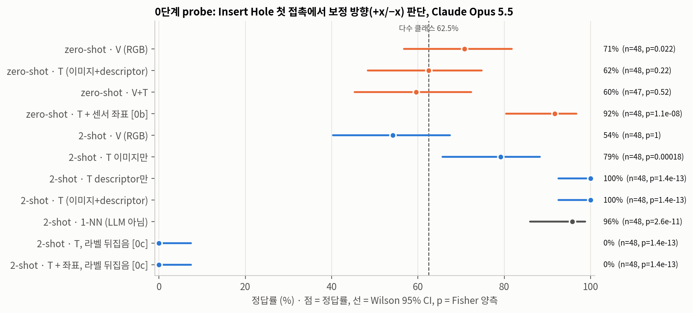
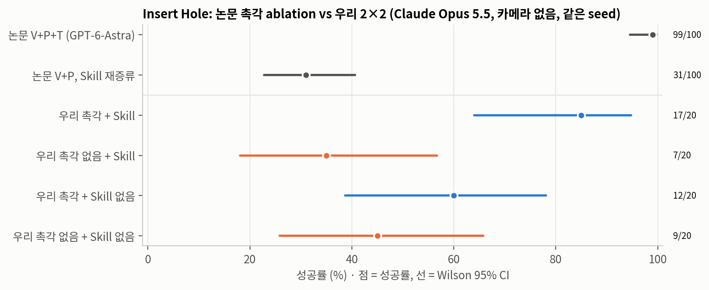
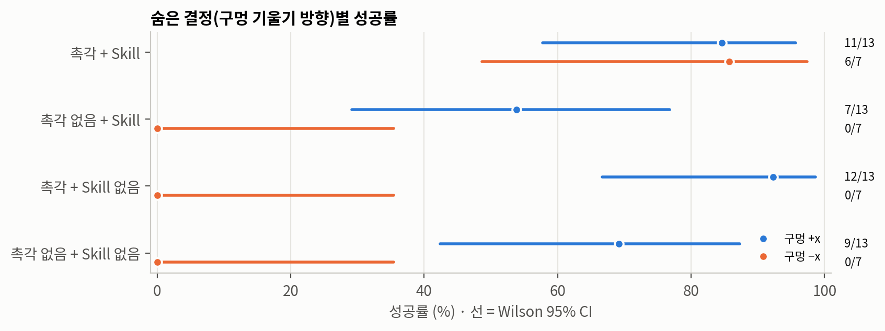
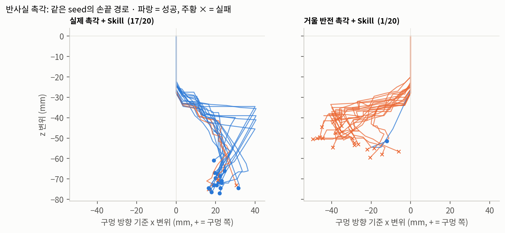

# 07. 추가 실험: 실제 LLM 촉각 probe와 UniVTAC 폐루프 2×2

이 문서는 통합 리포트 `report/report.html`의 §9(0단계 probe)와 §10(폐루프 2×2, 반사실 촉각)을 따로 정리한 것입니다. 원문 결과 파일은 `code/results/stage0/`, `code/results/univtac51_2x2/`, `code/results/univtac51_cf/`에 있습니다.

**이 실험이 원문 재현은 아닙니다.** GPT-6-Astra를 쓸 수 없어서 Claude Opus 5.5(effort xhigh)를 같은 자리에 넣었습니다. 목표는 원문 수치를 다시 내는 것이 아니라, 원문 주장 "Understands touch"의 메커니즘을 떼어 보는 것입니다. 원문 Tab.3의 촉각 ablation은 촉각 관측, 촉각 reference, Task Skill(재증류)이 한꺼번에 바뀐 비교라서(`05_claim_verification.md` §3.4), 세 요인을 분리하도록 실험을 설계했습니다. §2와 §3의 2×2와 거울 반전은 원문에 없는 실험입니다.

---

## 1. 0단계: 단일 판단 probe (시뮬레이터 없음)

### 1.1 설정
- **데이터:** UniVTAC 공개 데모(HF `byml/UniVTAC`, isaac45/insert_hole, 에피소드 0–49).
- **과제:** Insert Hole expert는 (1) 약 30 mm 내려가 구멍 입구에 막히고, (2) x로 ±40 mm 이동하며 peg를 약 26° 기울인 뒤, (3) 기울어진 축으로 넣습니다. 숨은 결정은 (2)의 부호 하나입니다(slot yaw 0°/180°가 정함).
- **질의:** 각 데모를 (1)의 마지막 프레임(첫 막힘 접촉)에서 멈추고 +x/−x를 묻습니다. 에피소드 2–49의 48개이고, +x 30개, −x 18개라 다수 클래스가 62.5%입니다. reference를 쓰는 조건은 에피소드 0(+x)과 1(−x)을 라벨과 함께 보여 줍니다. 원문 E_τ^tac에 해당합니다.
- **조건:** V = head·wrist RGB, T = 양손가락 marker overlay 이미지 + descriptor(압입 D, marker 변위 M), Ti = 이미지만, Td = descriptor만, VT = V+T. 모든 조건에 EEF pose를 넣습니다.
- **추가 조건:** 0b는 reference 없이 센서 장착 정보(이미지 u/v ↔ 로봇 축)를 시스템 프롬프트에 넣습니다. 0c는 reference 두 개의 라벨을 뒤집어 보여 줍니다.
- **센서 좌표 보정:** 정답 라벨을 쓰지 않았습니다. peg가 손 안에서 미끄러지기 전(정지 마찰) 구간에서 peg–센서 실제 상대 이동과 marker 평균 이동의 부호를 대조했습니다. u = +local X가 50/50, v = +local Y가 47/50(왼쪽)·44/50(오른쪽)이었습니다. 결과는 왼쪽 +u = −z, 오른쪽 +u = +z, 양쪽 +v = −x입니다. zero-shot에서 모델이 흔히 가정한 "v = 위쪽"은 틀린 가정이었습니다.
- **기준선과 통계:** 비LLM 기준선은 같은 reference 두 개에 대한 1-NN(marker 평균 변위 + 접촉 중심)입니다. 통계는 Wilson 95% CI, 예측 × 정답 Fisher 양측 검정, balanced accuracy입니다.

### 1.2 결과

| reference | 조건 | n | 정답률 [95% CI] | bal. acc | +x 예측 비율 | Fisher p | 평균 지연 s | 출력 토큰 |
|---|---|---|---|---|---|---|---|---|
| 0 | V | 48 | 0.71 [0.57, 0.82] | 0.62 | 0.88 | 0.022 | 44.3 | 3,754 |
| 0 | T | 48 | 0.62 [0.48, 0.75] | 0.60 | 0.62 | 0.22 | 70.4 | 6,422 |
| 0 | VT | 47 | 0.60 [0.45, 0.72] | 0.56 | 0.68 | 0.52 | 93.8 | 8,400 |
| 0 | T + 센서 좌표 (0b) | 48 | **0.92** [0.80, 0.97] | 0.90 | 0.67 | 1.1×10⁻⁸ | 37.4 | 2,781 |
| 2 | V | 48 | 0.54 [0.40, 0.67] | 0.49 | 0.71 | 1 | 19.2 | 1,618 |
| 2 | Ti | 48 | 0.79 [0.66, 0.88] | 0.79 | 0.58 | 1.8×10⁻⁴ | 16.2 | 1,379 |
| 2 | Td | 48 | 1.00 [0.93, 1.00] | 1.00 | 0.62 | 1.4×10⁻¹³ | 6.6 | 366 |
| 2 | T | 48 | 1.00 [0.93, 1.00] | 1.00 | 0.62 | 1.4×10⁻¹³ | 6.5 | 412 |
| 2 | 1-NN (비LLM) | 48 | 0.96 [0.86, 0.99] | 0.97 | 0.58 | 2.6×10⁻¹¹ | – | – |
| 2 | T, 라벨 뒤집음 (0c) | 48 | **0.00** [0.00, 0.07] | 0.00 | 0.38 | 1.4×10⁻¹³ | 6.8 | 406 |
| 2 | T + 좌표, 라벨 뒤집음 (0c) | 48 | **0.00** [0.00, 0.07] | 0.00 | 0.38 | 1.4×10⁻¹³ | 8.7 | 555 |

LLM 호출은 479회였고, 집계 대상 중 실패는 없습니다. zero-shot VT의 1건은 600 s 타임아웃이라 뺐습니다(n = 47). API 가격으로 환산한 비용은 합계 $35.41입니다. 0c의 Fisher p가 작은 것은 예측이 정답과 정반대로 완벽하게 연관되었기 때문입니다.

### 1.3 해석
1. **reference가 있으면 완벽히 맞히지만, 대조만으로도 되는 수준입니다.** descriptor 수치만 준 Td가 100%이고, 같은 특징으로 만든 1-NN도 96%입니다. 출력 토큰은 zero-shot의 약 1/15입니다(412 vs 6,422).
2. **reference가 없을 때의 병목은 물리 추론이 아니라 좌표계 정보였습니다.** zero-shot T는 62%(p = 0.22)이고, 근거 문장 48개 중 38개가 센서 장착 방향을 "가정"했습니다. 데이터로 보정한 장착 정보 다섯 줄을 넣자 92%(p = 1.1×10⁻⁸)로 올랐습니다. 다만 장착 정보에 "marker 이동 = 접촉면이 끌려간 방향"이라는 센서 원리 설명이 들어 있어서, 남은 추론은 한 단계입니다.
3. **reference가 있으면 모델은 자기 해석보다 reference를 따릅니다.** 라벨을 뒤집은 0c에서 48/48이 뒤집힌 라벨을 따랐고, 좌표 정보를 함께 줘도 0%였습니다. 근거 문장에서 "+x 방향 전단"이라고 맞게 읽고도 "reference 1(−x)과 일치"를 이유로 −x를 답했습니다.
4. **원문에 주는 함의:** 원문 Tab.3의 99 vs 31은 (i) 텍스트로 촉각을 물리적으로 해석하는 경로와 (ii) reference를 대조하는 경로 가운데 어느 쪽에서 나왔는지 원문 실험만으로는 구분할 수 없습니다. 두 경로가 충돌하면 (ii)가 이깁니다.

**한계:** 태스크 1개, 이진 판단 1회, 프레임 1개, 질의 48개입니다. reference는 에피소드 0·1로 고정했고, 조건당 1회만 호출했습니다. 압입 descriptor는 사후에 오류를 발견했습니다. depth는 젤까지의 거리라 정적 형상이 섞여 있습니다. 판단 근거가 된 marker 전단과 좌표 보정에는 영향이 없습니다.

---

## 2. 본실험: UniVTAC 폐루프 2×2 (Task Skill × 촉각)

### 2.1 설정
- **시뮬레이터:** UniVTAC Insert Hole, Isaac Sim 5.1(물리 120 Hz, 평가 60 Hz), GelSight Mini 양손가락. 시뮬레이터는 NVIDIA GPU 서버에서 env server로 띄우고, 정책 프로세스와 네트워크로 연결했습니다.
- **모델과 행동:** Claude Opus 5.5, effort xhigh, JSON schema로 행동 형식을 강제했습니다. 행동은 EEF 목표 변위(축당 최대 20 mm, 회전 10°), gripper, horizon입니다.
- **관측:** 카메라는 쓰지 않았습니다. 0단계에서 RGB가 판단에 기여한 근거가 없었고, 촉각 효과를 분리하기 위해서입니다. 자세(P)는 모든 조건에 줍니다. 촉각 조건(T)에는 marker overlay 이미지, 압입·전단 descriptor, 이전 결정 대비 변화, 데이터로 보정한 센서 장착 정보를 줍니다.
- **Task Skill:** 조건마다 같은 모델이 데모 40개로 증류하고 10개로 검증했습니다. 촉각 Skill은 촉각 reference 7개를 함께 만듭니다. "noskill" 조건은 지시문과 공통 규약만 받습니다.
- **평가:** 조건당 20 episode, 네 조건 모두 같은 seed 1000000–1000019입니다. 성공 기준은 구멍 축 기준 xy 1 cm 이내, 4 cm 이상 삽입, 축 정렬 cos > 0.99입니다. 실패는 전부 early_stop(시험관이 손 안에서 4 cm 넘게 밀림)이었습니다.
- **통계:** 같은 seed끼리 짝지은 McNemar 정확검정을 썼습니다. 상호작용은 seed별 diff-in-diff에 seed bootstrap 10,000회로 계산했습니다.

### 2.2 결과

| 조건 | 성공 | 95% CI | 결정 수 | API 시간(분) | 출력 토큰 | API 환산 $ |
|---|---|---|---|---|---|---|
| P+T skill (원문 V+P+T에 해당, 카메라 제외) | **17/20** | 0.64–0.95 | 16.6 | 8.2 | 46,215 | 2.80 |
| P skill (원문 V+P에 해당) | 7/20 | 0.18–0.57 | 8.8 | 1.0 | 5,270 | 0.45 |
| P+T noskill | 12/20 | 0.39–0.78 | 5.2 | 1.1 | 5,837 | 0.26 |
| P noskill | 9/20 | 0.26–0.66 | 4.5 | 0.4 | 1,881 | 0.09 |

결정 수 이하 열은 episode 평균입니다. LLM 호출은 701회였고, parse 실패는 없습니다.

| 효과 (같은 seed 짝) | 전체 20 seed | McNemar p | −x seed 7개 | McNemar p |
|---|---|---|---|---|
| 촉각 효과, Skill 있음 | **+50%p** (11 / 1) | 0.0063 | +86%p (6/7 vs 0/7) | 0.031 |
| 촉각 효과, Skill 없음 | +15%p (3 / 0) | 0.25 | 0 | 1 |
| Skill 효과, 촉각 있음 | +25%p (7 / 2) | 0.18 | +86%p | 0.031 |
| Skill 효과, 촉각 없음 | −10%p (3 / 5) | 0.73 | 0 | 1 |
| 상호작용 (diff-in-diff) | +35%p, bootstrap 95% CI [0, 65] | – | – | – |

단순효과 4개를 Holm 보정해도 "촉각 효과, Skill 있음"은 유의합니다(0.025). 상호작용은 CI 하한이 0이라 경계 수준입니다.

### 2.3 숨은 결정(구멍 기울기 방향)별 분석

UniVTAC는 reset에서 seed의 첫 난수로 구멍 방향을 정합니다. 이를 이용해 seed별 정답 방향을 복원했습니다(+x 13개, −x 7개). P+T skill 성공 17건의 최종 x 부호와 모두 일치합니다.

| 조건 | +x seed 성공 | −x seed 성공 | 선택한 방향 |
|---|---|---|---|
| P+T skill | 11/13 | **6/7** | 20개 모두 정답 방향 |
| P skill | 7/13 | 0/7 | 20개 모두 +x (데모 다수 방향) |
| P+T noskill | 12/13 | 0/7 | 측방 이동 없음 |
| P noskill | 9/13 | 0/7 | 측방 이동 없음 |

### 2.4 해석
1. **촉각 효과는 Skill이 있을 때만 나타납니다.** 촉각만 있고 Skill이 없으면 모델은 측방 이동을 한 번도 시도하지 않았습니다. 촉각 신호는 받았지만, "구멍이 기울어 있고 전단 방향이 기울기를 알려 준다"는 지식이 없었습니다.
2. **방향 결정은 증류된 규칙을 촉각에 적용한 결과입니다.**
   - 근거 문장이 Skill 규칙을 그대로 인용합니다. 예: "Shear y is positive on both pads …, which per the skill means the hole inclines toward −x."
   - 규칙은 증류 단계에서 같은 모델이 데모 촉각 데이터로 찾아냈습니다(Skill 원문: "Both y negative → move +x. This held in 26/26").
3. **촉각 없는 Skill은 다수 방향으로 찍고 사후에 합리화했습니다.** 막힘이 없자 "방향이 맞았다"고 결론 내렸지만, 시뮬레이터에서는 반대로 가도 자세에 막힘 신호가 나타나지 않습니다. CoT 근거가 실제 결정 요인과 다른 unfaithful explanation의 사례입니다(Turpin et al., arXiv:2305.04388).
4. **전체 성공률에는 과제 수준의 지름길이 섞여 있습니다.** 수직으로 밀기만 해도 +x seed는 9/13, 12/13이 성공했지만, −x seed는 0/7입니다. 촉각 효과는 숨은 변수별로 층화해야 보입니다.
5. **비용:** P+T skill은 결정당 약 30초(약 0.03 Hz), episode당 출력 토큰 약 46k입니다. 실시간 제어와는 거리가 멉니다. 원문은 비용과 지연을 보고하지 않았습니다.

원문 형태의 비교(P+T skill vs P skill)는 85% 대 35%로, 원문 99% 대 31%와 방향과 크기가 비슷합니다. 그러나 2×2로 나눠 보면 이 차이는 "촉각 관측" 하나의 효과가 아닙니다. 촉각과 증류된 Skill의 상호작용(+35%p)에, Skill 없이도 되는 수직 삽입 지름길이 더해진 것입니다.

---

## 3. 반사실 촉각: 정말 규칙대로 움직이는가

§2.4의 해석은 "근거 문장이 규칙을 인용하고 행동이 규칙과 맞았다"는 상관에 기대고 있습니다. 원인인지 확인하려면 입력에 개입해야 합니다. 같은 Task Skill과 seed로 **촉각 프레임만 v축으로 거울 반전**했습니다. 그러면 전단 y와 curl의 부호, 접촉 중심 v, 이미지 상하가 바뀌고, 나머지 물리와 자세는 그대로입니다. 전단 y 숫자만 뒤집으면 다른 촉각 특징과 모순되지만, 거울 반전은 "구멍이 반대쪽으로 기운 세계"에서 나올 법한 일관된 관측을 만듭니다. 예측은 실행 전에 등록했습니다.

| | 실제 촉각 + Skill | 거울 반전 촉각 + Skill |
|---|---|---|
| 성공 (Wilson 95% CI) | 17/20 (0.64–0.95) | **1/20** (0.01–0.24) |
| 첫 측방 이동이 구멍 쪽 | 20/20 | **0/20** |
| 첫 측방 이동이 제시된 전단 단서(규칙)와 같은 방향 | 20/20 | 20/20 |
| 결정 수 / 출력 토큰 / API 환산 (episode 평균) | 16.6 / 46k / $2.80 | 14.7 / 66k / $2.97 |

같은 seed 짝 McNemar 결과는 첫 이동 방향 p = 1.9×10⁻⁶, 성공 p = 3.1×10⁻⁵입니다.

- **방향 결정의 원인은 전단 y 부호입니다.** +x seed와 −x seed에서 똑같이 뒤집혔으므로, 데모 다수 방향으로 치우친 결과가 아닙니다.
- **틀린 방향을 알려 주는 신호도 규칙의 틀 안에서 읽었습니다.** 옆으로 움직이면 방향과 관계없이 축 방향 하중이 풀리는데, 모델은 이를 반대 방향에서도 "구멍 축 위에 있다"는 진행 증거로 읽었습니다. 방향 자체를 의심한 근거 문장은 없었습니다(키워드 검색 + 일부 직접 판독).
- **유일한 성공은 우연입니다.** 시험관을 놓친 뒤 빈 손으로 탐색하던 중 성공 판정이 났습니다.
- **뜻하는 바:** 데모에서 규칙을 스스로 찾아낸 것은 모델의 능력입니다. 그러나 폐루프에서 그 규칙이 틀렸을 때 물리 피드백으로 가설을 고치지는 못했습니다. 0단계 0c("reference를 뒤집으면 따른다", 48/48)가 폐루프에서도 재현된 것입니다. 다만 거울 반전 관측은 물리적으로 일관되므로, 물리를 이해하는 정책이라도 첫 이동은 틀릴 수 있습니다. 둘을 가르는 것은 그 뒤에 고치는지이고, 이번 결과는 "고치지 못했다"입니다.

---

## 4. 이 실험들의 한계

- 모델이 원문과 다릅니다(Opus 5.5 vs GPT-6-Astra). 카메라를 뺐으므로 원문 V+P+T 조건 자체의 재현이 아니고, 나머지 4개 태스크는 돌리지 않았습니다.
- 과제 1개, 조건당 20 episode, seed당 1회 실행입니다. 파일럿에서 같은 seed의 결과가 바뀐 사례가 있습니다.
- 센서 장착 정보는 촉각 조건에만 들어가므로, 여기서 "촉각" 요인은 촉각 관측과 그 해석 정보를 함께 뜻합니다.
- P skill의 Skill 텍스트가 실행 조건에 없는 카메라 단서를 참조했습니다. 증류 프롬프트의 결함일 수 있습니다.
- 구멍 방향 복원은 UniVTAC의 난수 소비 순서에 의존하며, P+T skill 성공 17건과의 일치로만 검증했습니다.
- 같은 seed라도 reset 직후의 파지 상태가 실행마다 조금 다를 수 있습니다. 성공률 비교에는 이 변동이 섞이지만, 반사실 실험의 주 지표(첫 이동 방향)에는 영향이 없습니다.

## 추가 검증 (2026-11-12)

### 목적
§1.3은 reference가 없을 때 병목이 센서 좌표계였다고 봤습니다. 이 검증은 같은 방향 판단을 **물리 descriptor**만으로 풀 수 있는지 묻습니다. 센서 자세로 전단 벡터를 로봇 축에 올리면 LLM 없이 진행 방향이 나오는지, 그리고 그 방향이 막힘 직후 실제 움직임과 맞는지 확인합니다.

### 데이터와 받은 양
- 대상: Hugging Face 공개 데이터셋 `byml/UniVTAC`, `isaac45/insert_hole/hdf5/N.hdf5`, 에피소드 0–29(30개). 게이트 없음, 라이선스는 MIT(작업 지시 기준)입니다.
- 받은 양: **4.00 GB**(30개 파일의 합, 파일당 121–163 MB). 파일마다 서버가 준 sha256으로 대조했고, 값은 `analysis/extra_physics_descriptors_results.json`의 `episodes[].sha256`에 있습니다.
- 디스크 사용: 한 번에 파일 하나만 받았고, 처리 후 바로 지웠습니다. 최대 추가 사용량은 한 파일 크기(약 163 MB)입니다. 남긴 파생 특징값은 `data/derived/`에 240 KB이며 git에서 제외했습니다.
- 사용한 것: 촉각 깊이 맵, 마커 위치(기준·현재), 센서 자세(`tactile/*/pose`, wxyz), end-effector 위치입니다. RGB 이미지는 읽지 않았습니다.

### 설정
- **막힘 프레임(t_q):** end-effector z가 처음 10 mm 이상 내려간 뒤, 5프레임 동안 0.5 mm 미만으로 내려가는 첫 프레임입니다. 30개 모두 67–85번째 프레임에서 잡혔습니다.
- **정답 방향:** t_q 이후 end-effector x 변위의 절댓값이 가장 큰 방향입니다(+1 또는 −1). 크기는 38–42 mm로 모두 1 cm 기준을 넘었습니다. 30개 중 +x 20개, −x 10개입니다.
- **전단 descriptor:** 두 손가락 각각에서, t_q−4부터 t_q까지 5프레임의 마커 평균 변위를 구합니다. 첫 프레임의 정적 오프셋(약 2 px)을 뺍니다. 변위 (du, dv)를 센서 쿼터니언으로 얻은 local X, local Y 축(로봇 기준)에 올려 **로봇 x 성분**을 씁니다. 자세 쿼터니언은 wxyz로 해석했습니다. 그렇게 하면 왼쪽 손가락의 local X가 −z, 두 손가락의 local Y가 −x가 되는데, §1.1의 자세 대조 결과와 같습니다.
- **대조 descriptor:** 좌표 변환 없이 image v, u를 그대로 쓴 값, 로봇 z 성분, 압입 깊이(첫 프레임 기준 p99), 접촉 면적 비율, 전단 크기, Hertz 근사 δ^{3/2}, 전단/δ^{3/2} 비율입니다. 힘과 slip margin의 절댓값은 계산하지 않았습니다. E*, R, μ와 픽셀-힘 비례상수가 없기 때문입니다.
- **통계:** AUC(Mann–Whitney)와 부트스트랩 95% CI(2000회), 부호 정확도와 Wilson CI, 이항 양측 검정입니다.

### 결과

| descriptor | 방향 판별 | 해석 |
|---|---|---|
| 로봇 x 전단(두 손가락 평균, 부호 사용) | AUC **1.00** [1.00, 1.00], 부호 정확도 **30/30** [89–100%], p = 1.9×10⁻⁹ | 주 descriptor |
| 왼쪽만 / 오른쪽만 로봇 x 전단 | 각각 30/30 | 두 손가락이 같은 결론 |
| image v를 좌표 변환 없이 사용 | AUC 0.00 | 같은 정보이고 부호만 반대입니다. 장착 방향으로 부호가 정해집니다 |
| 로봇 z 전단 | AUC 0.21 [0.06, 0.39], 부호 20/30 | 두 손가락의 z 부호가 반대라 평균에서 약해집니다 |
| 압입 깊이 p99 / Hertz 근사 δ^{3/2} | AUC 0.88 [0.73, 0.99] | **방향 대조군이 비어 있지 않습니다** (아래 해석) |
| 접촉 면적 비율 | AUC 0.99 [0.94, 1.00] | 같은 문제 |
| 전단 크기 | AUC 0.21 [0.06, 0.39] | −x 에피소드에서 전단이 더 큽니다 |
| 전단 / δ^{3/2} (slip 비율의 비례 근사) | AUC 0.13 [0.02, 0.28] | 크기 계열이므로 방향 정보가 있어야 한다고 보지 않았지만 있었습니다 |

- 좌표 변환이 없는 image v도 같은 순서로 방향을 맞히므로, 이 데이터에서 "좌표 문제"는 **부호 하나**입니다. 장착 방향을 알면 풀립니다. 자세 쿼터니언은 그 부호를 주는 근거입니다.
- 진행 방향은 막힘 직후 움직임이고, descriptor는 그 이전 프레임(t_q−4–t_q)에서 계산했습니다. 따라서 예측입니다. 정답 라벨을 descriptor 계산에 쓰지 않았습니다.

### 결론
- 좌표 문제는 descriptor로 풀립니다. 센서 자세로 로봇 축에 올린 전단의 x 성분 부호가 30개 에피소드에서 방향을 모두 맞혔습니다. LLM이나 학습 없이 한 줄 변환으로 됩니다.
- §1.3의 해석("reference가 없을 때 병목은 좌표계")과 맞습니다. 다만 이 결과는 descriptor가 방향을 알 수 있다는 뜻이고, 폐루프에서 정책이 이를 쓰는지는 §2–§3이 다룹니다.
- §1.3과 §2–§3의 결론은 바뀌지 않았습니다. 같은 방향에 대한 물리 근거가 하나 더 생겼을 뿐입니다.

### 해석 주의
- **압입과 접촉 면적도 방향과 관련됩니다.** 크기 계열을 방향 대조군으로 쓰려던 계획은 실패했습니다. 구멍 기울기에 따라 접촉 위치와 면적이 달라지는 것으로 보이지만, 이 데이터로는 원인을 나누지 못했습니다. 그래서 법선 쪽 특징만으로는 방향을 모른다고 말하기 어렵습니다.
- Hertz 근사와 slip 비율은 절대값이 아니라 순위만 봤습니다. 힘 척도가 없으므로 slip margin은 계산하지 않았습니다.

### 한계
- 과제 1개, 시뮬레이터 데모 30개, 판정 프레임 1개입니다. 0–49 가운데 30개만 썼습니다.
- 이미지 축 → 센서 local 축(u = X, v = Y)은 §1.1에서 같은 데모로 확인한 가정입니다. 이 검증에서 다시 맞추지는 않았습니다. 쿼터니언 규약(wxyz)도 같은 근거입니다.
- 막힘 프레임을 찾는 규칙은 z가 멈춘 뒤 5프레임을 봅니다. 정답 라벨은 쓰지 않았지만, 실시간 정책이라면 5프레임 늦게 판정하는 셈입니다.
- 접근 중 end-effector의 x 드리프트는 측정하지 않았습니다. 에피소드 0에서는 막힘 전까지 x가 약 0.592 m로 거의 고정되어 있었습니다. 다른 에피소드에서는 확인하지 않았습니다.
- 픽셀 단위 변위이고 부호와 순위만 씁니다. 절대 힘, slip margin, Hertz 역산 값은 주장하지 않습니다.
- 재현 명령은 `analysis/extra_physics_descriptors.py`입니다. 이미 있는 파생 파일은 건너뛰므로, 처음부터 다시 하려면 `data/derived/`를 비우고 실행합니다.

## 추가 검증 (2026-11-14): 힘 척도 필드 확인

### 목적
2026-11-12 검증은 slip margin과 Hertz 역산의 **절댓값**을 빼고 순위 근사만 했습니다. 이유는 E*, R, μ와 힘 척도가 없다는 것이었습니다. 이번 검증은 공개 HDF5에 힘이나 재질 필드가 있는지 확인해, 절댓값을 이 데이터로 얻을 수 있는지 판단합니다.

### 데이터와 받은 양
- 대상: `byml/UniVTAC`, `isaac45/insert_hole/hdf5/0.hdf5`(에피소드 0 한 개). 서버 sha256은 `e164ae67…f1eed`로 받은 파일과 일치했습니다. 크기는 121,234,636 bytes, 커밋은 `e1aee7b0`입니다.
- 받은 양: **121 MB**(이번 회차). 처음 25 MB는 HDF5 헤더만으로 열리지 않아 이어 받았고, 전체를 받은 뒤 바로 지웠습니다. 2026-11-12 회차의 4.0 GB는 이미 지운 상태입니다.
- 결과 파일: `analysis/extra_physics_fields_check_results.json`(파일 크기, sha256, 데이터셋 목록, 힘 관련 이름 검색, 파생 특징값 개수). 원자료는 저장하지 않았습니다.

### 결과
- 데이터셋은 20개입니다. 로봇·물체 자세(`actor/prism`, `prism_base`, `slot`, 각 (156, 7)), 관절과 end-effector(`embodiment/joint`, `ee`), 촉각(`tactile/{left,right}_gsmini/` 아래 `depth` (156, 240, 320), `marker` (156, 2, 1200, 2), `pose`, `rgb`, `rgb_marker`), 카메라 RGB 두 개(`observation/head/rgb`, `observation/wrist/rgb`), `atom/id`, `atom/tag`, `step`이 있습니다.
- 힘, 토크, wrench, 마찰, 탄성계수, 포아송비, 강성, 법선 관련 이름을 검색한 결과 **0개**입니다.
- 파생 특징값은 30개 에피소드 모두 있습니다(`data/derived/`, 240 KB).

### 해석
- Hertz 힘 F = (4/3)E*·√R·δ^{3/2}의 절댓값은 E*를 알아야 합니다. 이 데이터에는 E*가 없습니다. R은 깊이 맵에서 접촉 반경 a를 재고 δ = a²/R로 추정할 수 있지만, 그래도 E*가 없어 힘이 나오지 않습니다.
- slip margin은 μF_n − F_t입니다. μ와 F_n이 모두 없으므로 절댓값을 계산할 수 없습니다. 2026-11-12의 "전단 / δ^{3/2}" 비율은 순위 정보만 줍니다.
- 따라서 R7의 방향 판별 결과(30/30)는 그대로 유효하지만, slip margin과 Hertz 절댓값은 이 데이터셋으로는 **계산 불가**입니다.

### 남은 것
- 힘 척도를 주는 다른 자료가 필요합니다. 예를 들어 시뮬레이터의 접촉력 로그, 센서 교정 데이터(힘-변위 곡선), 또는 E*·μ를 바꿔 보는 민감도 분석입니다. 민감도 분석은 가정에 따라 결과가 달라지므로, 결론이 아니라 범위를 보여 주는 용도로만 씁니다.

### 한계
- 에피소드 1개만 열어 필드를 확인했습니다. 나머지 29개는 같은 스크립트가 같은 키로 읽었으므로 같은 구조라고 보지만, 개별 확인은 하지 않았습니다.
- 데이터셋 이름 검색은 "force", "torque", "friction" 같은 단어에 의존합니다. 이름이 다른 힘 필드가 있을 가능성은 배제하지 못합니다. 전체 목록(20개)에서 직접 보면 이름에 힘을 뜻하는 항목은 없습니다.
- 재현 명령: `python3 -I analysis/extra_physics_fields_check.py <에피소드 HDF5 경로>`
