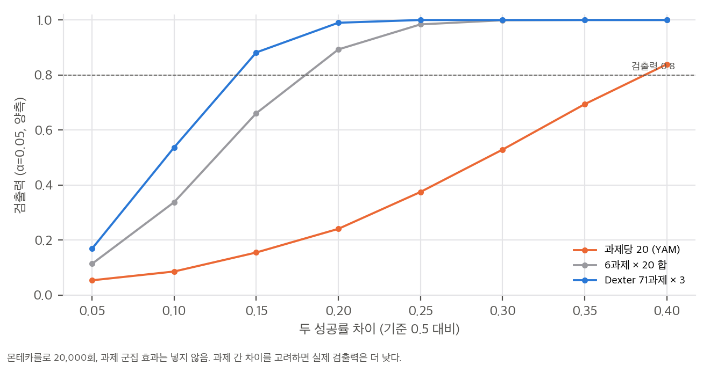
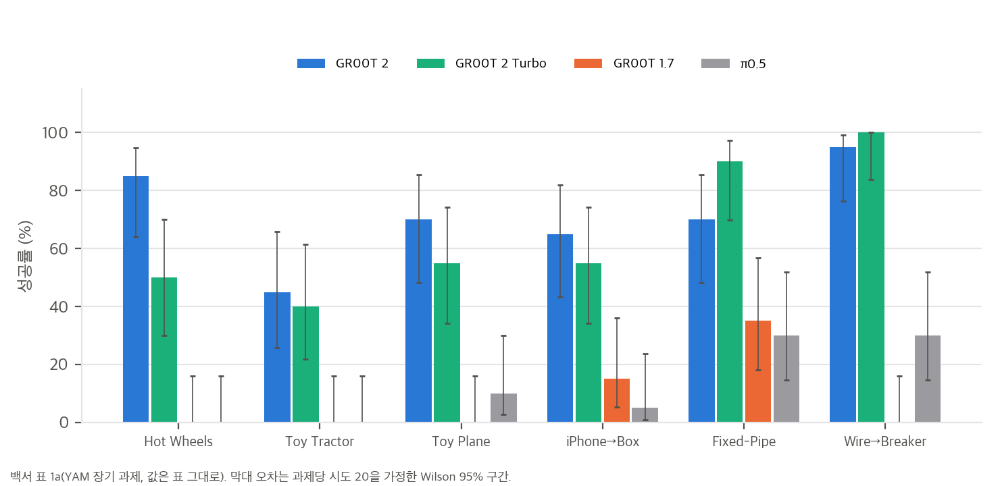
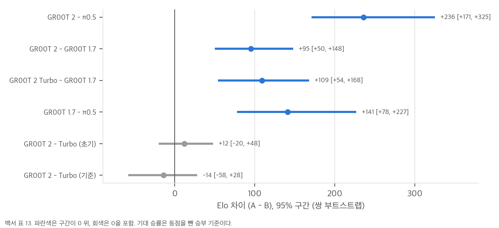
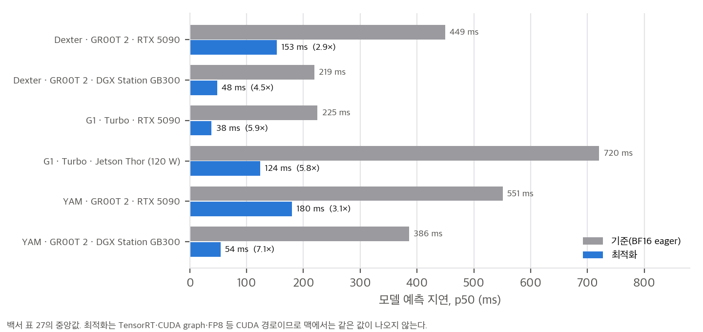

NVIDIA가 2026년 11월에 낸 GR00T 2 백서를 읽고 정리했습니다. 백서는 동료 심사를 거치지 않았고, 원문의 저작권 표기는 "© 2026 NVIDIA. All rights reserved."라서 백서의 그림은 싣지 않고 직접 그린 그래프만 씁니다. 원문 확인일은 2026-11-12입니다.

## 무엇이 바뀌었나

GR00T 2는 이전 세대(GR00T N1.7, VLM과 확산 행동 헤드를 쓰는 VLA)와 달리 **세계-행동 모델(WAM)**입니다. Cosmos-Predict2.5-2B 비디오 확산 트랜스포머 하나가 카메라 영상, 로봇 상태, 행동 토큰을 한 시퀀스에서 처리하고, 미래 영상과 행동을 flow matching으로 함께 예측합니다. 영상 인코더(Wan 2.1 VAE)와 언어 모델(Cosmos-Reason1)은 동결합니다.

이 구조 덕분에 **행동이 없는 사람 영상**도 미래 영상을 맞히는 손실로 학습에 들어갑니다. 행동 감독은 손 자세 궤적으로 따로 줍니다. 사전학습 데이터는 사람 영상 402,730시간, UMI 손그립 시연 10,184시간, 원격조작 23.5k시간이고, 1,024장의 GB300 GPU로 학습했습니다. 총 스텝 수와 GPU 시간은 백서에 없습니다.

## 숫자 검산

백서 표의 평균과 합계를 모두 다시 계산했습니다.

- YAM 장기 과제 6개 평균: GR00T 2 71.7%, Turbo 65.0%, π0.5 12.5% (보고값과 일치)
- Dexter 장기 과제 7개 평균: GR00T 2 68.6%, Turbo 34.3% (일치)
- 아레나 집계(195 캠페인, 16,044 롤아웃, 11,767 쌍 비교)와 지연 배율(2.9–7.2배)도 맞습니다.

다만 Dexter 트럭 조립의 GR00T 2 65%는 **쉬운 새 시작 장면**의 값입니다. 원래 장면은 20회 중 7회(35%)였고, 그 값을 넣으면 Dexter 평균이 68.6%에서 64.3%로 내려갑니다.

## 통계는 어디까지 믿을 수 있나

| 주장 | 검산 결과 |
|---|---|
| Turbo가 YAM에서 6.7점 떨어진다 | 과제당 20회로 표준오차 약 5.5점. 구분되지 않음 |
| Dexter에서 Turbo가 절반으로 떨어진다 (68.6 → 34.3) | 차이 34점, 뚜렷함 |
| 아레나에서 π0.5 대비 "80% 승률" | Elo식 기대값이며 동점(35%)을 뺀 승부 기준. 엄격한 승률은 약 52% |
| WAM이 시뮬레이션 데이터를 더 잘 쓴다 (19/30 대 12/30) | Fisher p = 0.12. 백서도 "suggestive"라고 씀 |

과제당 20회 평가는 20%p 차이를 4번 중 3번 놓칩니다. 큰 차이만 말하는 표라면 괜찮지만, 작은 차이를 "우세"로 읽으면 안 됩니다.

그림 1. 시도 수별 두 비율 검정의 검출력(몬테카를로 20,000회, 과제 군집 효과 미포함). 과제당 20회(주황)는 차이 20%p에서 검출력이 0.25에 그친다.

그림 2. 백서 표 1a의 과제별 성공률. 구간은 과제당 시도 20회를 가정한 Wilson 95%.

그림 3. 백서 표 13의 쌍별 Elo 차이. 회색 구간은 0을 포함해 구분되지 않는 비교다.

## 공개 상태: 아직 없다

2026-11-12 기준으로 GR00T 2의 가중치와 코드는 공개되지 않았습니다. Hugging Face에 GR00T 2 저장소가 없고, 프로젝트 페이지 버튼은 "Code Available in December"입니다. 백서 Tab. 13 주석의 "released checkpoint"는 이 상태와 맞지 않습니다.

공개된 것은 GR00T N1.7-3B(가중치, nvidia-open-model-license), Isaac-GR00T 코드(Apache-2.0), Human-1M 공개 부분집합 100k 시간(CC-BY-4.0)입니다.

그림 4. 백서 표 27의 지연 중앙값과 배율. 기준은 BF16 eager PyTorch, 최적화는 TensorRT·CUDA graph·FP8이라 CUDA 경로의 값이다.

## 이 맥(M4 Pro 24 GiB)에서 구현할 수 있나

- **지금: 불가.** 가중치가 없습니다.
- **공개 후 추론: 조건부.** 2B 트랜스포머 가중치는 BF16으로 약 3.7 GiB라 메모리는 충분합니다. 다만 백서의 빠른 경로는 CUDA 전용이고, RTX 5090에서 153 ms인 행동 청크가 맥에서는 수 초로 추정됩니다(측정 전 가정). 실시간 제어보다는 오프라인 평가에 맞습니다.
- **미세조정: 비추천.** 백서의 LoRA 적응은 RTX 5090에서 약 30분이고, 맥에서는 같은 비율로 5–12시간으로 추정됩니다(거친 추정).
- **사전학습과 아레나 재현: 불가.** GB300 1,024장과 원자료가 필요합니다.

## 읽을 때 주의할 점

1. 원자료, 평가 시도 로그, 학습 스텝 수, 총 GPU 시간이 없어 백서 수치를 독립적으로 재현할 수 없습니다.
2. 과제 수가 본문 안에서 71개와 72개로 엇갈립니다.
3. RoboCasa365 평균은 세 열의 단순 평균(66.4)과 보고값(67.2)이 다르고, 가중치가 공개되지 않았습니다.
4. 시뮬레이션의 GR00T 1.7은 저자들이 다시 학습한 값입니다.

원문: https://research.nvidia.com/labs/gear/gr00t-2/ (백서 PDF 링크 포함). 이 글의 분석 문서, 계산 스크립트, 게시용 리포트는 같은 폴더의 `git/`에 있습니다.

## 자료

- [통합 리포트 PDF](report/report_public.pdf)
- [01. GR00T 2 백서 분석: 초록에서 실험까지](analysis/01_paper_analysis.md)
- [02. 선행연구, 구성 요소의 출처, 공개 자료](analysis/02_prior_work.md)
- [03. 수치 재계산, 통계 검정, 산술 점검](analysis/03_analysis.md)
- [04. 주장 검증과 구현 가능성](analysis/04_claim_verification.md)
