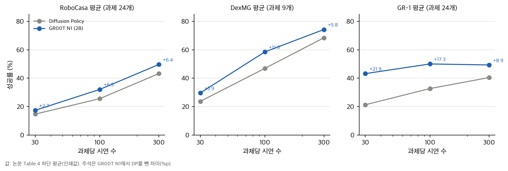
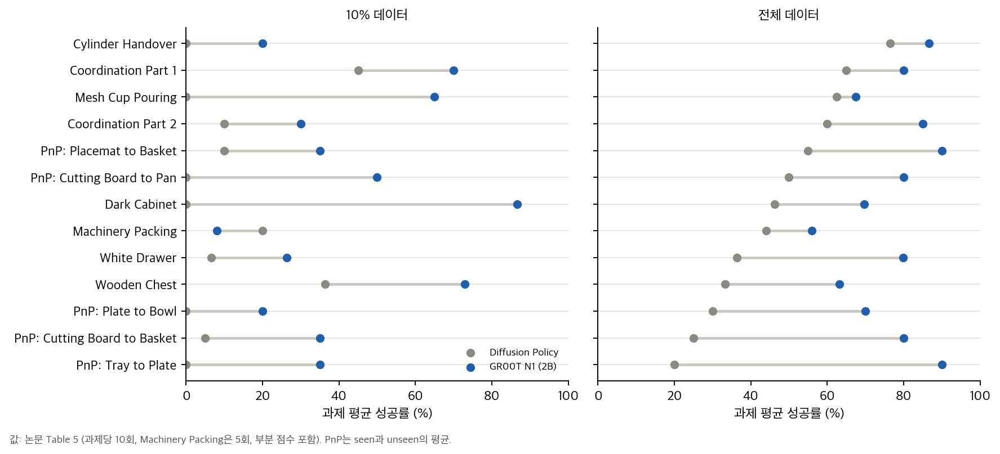
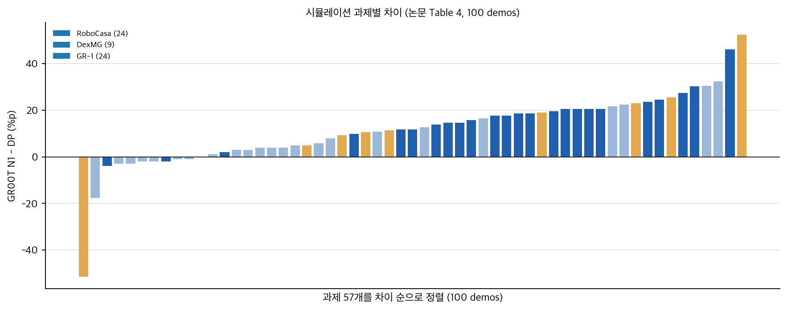

> **논문:** NVIDIA (Johan Bjorck 외, 프로젝트 리드 Linxi "Jim" Fan, Yuke Zhu). *GR00T N1: An Open Foundation Model for Generalist Humanoid Robots.* arXiv:2503.14734 (v2, 2025-03-27). 학회 표기 없는 기술 보고서입니다.
> 공식 코드(Apache-2.0)는 `n1-release` 태그를 정적으로만 읽었습니다. 실행하거나 설치하지 않았고, 가중치와 데이터도 받지 않았습니다. 논문 그림은 싣지 않고, 논문 표 숫자로 우리가 그린 그래프만 씁니다.

## 논문이 묻는 것

휴머노이드 로봇은 같은 형태의 데이터가 부족합니다. 로봇마다 센서와 행동 공간이 달라서 인터넷처럼 한곳에 쌓이지 않고, 여러 "데이터 섬"으로 흩어집니다. GR00T N1은 이 문제를 모델 구조와 데이터 구성 두 방향에서 풉니다. 하나의 VLA가 실로봇 텔레오퍼레이션, 사람 영상, 시뮬레이션, 영상 생성 데이터를 함께 학습하도록 하는 것입니다.

핵심 구조는 두 시스템입니다. 비전-언어 모델(System 2)이 지시와 장면을 읽고, 흐름 매칭으로 학습된 확산 트랜스포머(System 1)가 행동 청크를 만듭니다. 전체 2.2B 파라미터이며, 행동은 16스텝 청크로 예측하고 추론에는 4단계 오일러 적분을 씁니다.

## 데이터 피라미드

논문은 학습 데이터를 피라미드로 쌓습니다. 맨 위는 실제 로봇 데이터(GR-1 텔레오퍼레이션 88.4시간)이고, 가운데는 시뮬레이션(1,742.6시간)과 영상 생성 신경 궤적(827.3시간)입니다. 바닥은 사람 영상 2,517시간입니다. 아래 층일수록 양이 많고 로봇 특이성이 낮습니다.

행동 라벨이 없는 영상은 두 방법으로 행동을 붙입니다. 하나는 연속 프레임 쌍으로 학습한 잠재 행동 VQ-VAE이고, 다른 하나는 역동역학 모델(IDM)입니다. 신경 궤적은 Wan2.1 영상 모델을 GR-1 영상으로 미세조정해 만들었습니다. 생성 비용은 L40 기준 약 105,000 GPU 시간입니다.

## 이 글에서 확인한 것

**1. 평균 향상은 재계산에서 대체로 맞습니다.** 시뮬 평균은 표 2에서 BC 26.4, Diffusion Policy 33.4, GR00T N1 45.0입니다. 벤치마크별 과제 수로 가중하면 이 값이 재현됩니다. 실로봇 평균 (10%: 42.6 대 DP 10.2, 전체: 76.8 대 DP 46.4)도 과제 13개 기준으로 맞습니다.

**2. 표 한 열이 다른 표와 맞지 않습니다.** 표 2의 DexMG 열(DP 56.1, GR00T 66.5)은 같은 100 시연 조건의 표 4 값(46.9, 58.5)과 다릅니다. RoboCasa와 GR-1 열은 맞습니다. 표 4 값으로 다시 평균하면 차이는 거의 같지만 열 값은 다릅니다. 저자에게 확인할 일입니다.

**3. 실로봇 향상은 방향이 일관됩니다.** 과제당 10회라서 한 과제의 차이는 통계적으로 약합니다. 그래도 13개 과제 모두에서 GR00T가 높았고(전체 데이터), 평균 차이의 95% 구간은 +21에서 +40 %p입니다.

**4. 본문 표현이 표보다 강합니다.** 10% 데이터의 기계 포장 과제에서 GR00T는 8%, DP는 20%로 졌습니다. 그런데 본문은 "모든 과제에서 유의하게 높다"고 적었고, 유의성 검정은 보고하지 않았습니다. GR-1 평균은 100→300 시연에서 50.0→49.3으로 떨어지는데, 부록은 "꾸준히 오른다"고 씁니다.

**5. 식의 부호는 표기 오류로 보입니다.** 식 (1)의 목표 ε−A를 "+V" 오일러 갱신과 함께 읽으면 맞지 않습니다. 공식 코드는 A−ε를 쓰고 일관됩니다. 1차원 토이에서 식을 문자 그대로 따르면 평균이 −3.7, 목표 1.0으로 어긋납니다.

**6. 평가 방식에 선택 편향이 있습니다.** 시뮬 결과는 과제마다 마지막 5개 체크포인트 중 최댓값입니다. 학습 시드 분산은 보고되지 않았습니다. 그래서 작은 차이는 결론 근거로 약합니다.

## 공식 코드와 논문의 차이

공식 저장소 `n1-release`(2025-06-11)는 모델, 학습 스크립트, 데이터 로더를 담고 있습니다. 확인된 것은 행동 청크 16, 흐름 매칭 손실, 4단계 추론, 임베디먼트별 인코더, 12번째 층 VLM 표현, 224×224 입력, 미세조정 옵티마이저 설정입니다.

차이는 다음과 같습니다. 부록의 보조 검출 손실(OWL-v2 상자 좌표)은 공개 코드에 없습니다. 잠재 행동, IDM, 신경 궤적 생성 파이프라인은 공개되지 않았고, 학습 코드는 미리 만든 라벨 키만 읽습니다. 미세조정 스크립트의 기본 배치와 스텝 수는 논문 설정과 다릅니다(16 대 128–1024, 10,000 대 20,000–60,000). 평가 프로토콜(체크포인트 최댓값)도 이 저장소에는 없습니다.

## 이 맥에서 구현할 수 있을까

요약하면 **논문 주장은 재현할 수 없습니다.** 이 맥(M4 Pro, 24 GiB, CUDA 없음)에서 사전학습(약 50,000 H100 시간)과 신경 궤적 생성은 자원상 불가능합니다. 전체 미세조정은 파라미터, 그래디언트, 옵티마이저 상태를 합하면 fp32 기준 약 35 GB가 필요해 메모리에 들어가지 않습니다.

추론은 가능성이 있습니다. 2.2B 모델의 bf16 가중치는 약 4.4 GB라 메모리에 들어갑니다. 다만 공식 코드가 CUDA 12.4와 flash-attn을 전제하므로 MPS 포팅이 먼저 필요합니다. 포팅 노력은 추정 1–2주입니다. 속도는 아직 측정하지 않았습니다.

## 라이선스와 그림

arXiv 페이지의 라이선스는 CC BY 4.0입니다. 그런데 PDF에 "© 2025 NVIDIA. All rights reserved." 표기가 있어서 두 표기가 충돌합니다. 그래서 이 글에는 논문 그림을 싣지 않았습니다. 가중치 `nvidia/GR00T-N1-2B`는 NVIDIA One-Way Noncommercial 라이선스이고, 코드(Apache-2.0)와 달리 상업 사용이 제한된다고 읽힙니다.

## 그래프

위 그래프는 시뮬레이션 세 벤치마크의 평균을 30, 100, 300 시연에서 보여 줍니다. 주석은 GR00T N1에서 DP를 뺀 차이입니다. GR-1에서는 300 시연에서 GR00T가 정체합니다.

실로봇 그래프는 과제마다 DP와 GR00T를 선으로 잇습니다. 10% 데이터(왼쪽)와 전체 데이터(오른쪽) 모두에서 과제 대부분의 선이 오른쪽으로 향합니다. 기계 포장 과제는 10% 데이터에서 예외입니다.

과제별 차이는 57개 중 46개에서 양수입니다. 음수인 과제 대부분은 두 방법 모두 성공률이 낮아서 차이가 작습니다. 예외는 DexMG Box Cleanup(DP 80.8, GR00T 29.4)입니다.

## 마무리

GR00T N1은 데이터 피라미드라는 틀과 흐름 매칭 VLA 구조를 공개했다는 점에서 중요합니다. 공개 코드와 체크포인트가 있어서 CUDA 환경이라면 추론 수준의 검증은 가능합니다. 반면 논문 수치를 그대로 믿기 전에는 DexMG 열의 불일치와 평가 선택 편향을 확인해야 합니다. 재현은 GPU 환경이 필요하므로 이 글은 읽기와 계산까지만 다룹니다.

## 자료

- [통합 리포트 PDF](report/report_public.pdf)
- [GR00T N1 논문 분석 (arXiv:2503.14734)](analysis/01_paper_analysis.md)
- [GR00T N1 선행연구와 자료 (02)](analysis/02_prior_work.md)
- [GR00T N1 수치 재계산과 일관성 점검 (03)](analysis/03_analysis.md)
- [GR00T N1 논문과 공식 코드의 대조 (04)](analysis/04_code_verification.md)
