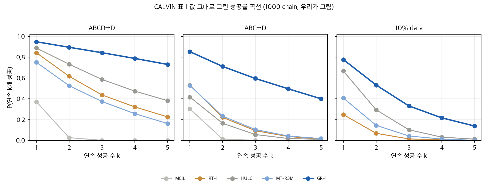
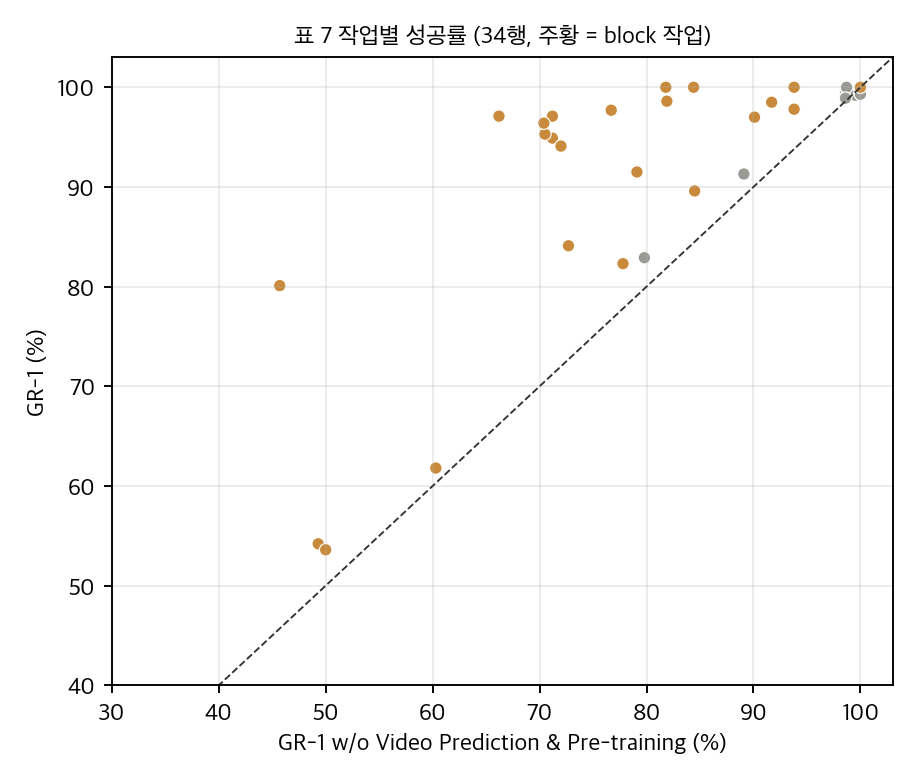
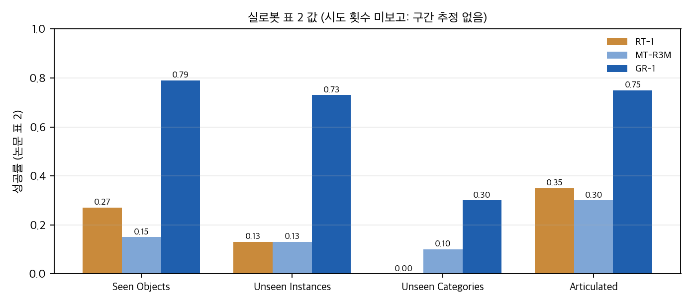

> **논문:** Hongtao Wu, Ya Jing, Chilam Cheang, Guangzeng Chen, Jiafeng Xu, Xinghang Li, Minghuan Liu, Hang Li, Tao Kong. *Unleashing Large-Scale Video Generative Pre-training for Visual Robot Manipulation.* ICLR 2024, arXiv:2312.13139 (v2, 2023-12-21).
> 공식 코드(Apache-2.0, bytedance/GR-1)는 정적으로만 읽었고 실행하지 않았습니다. 논문 그림은 싣지 않고, 논문 표 값으로 우리가 그린 그래프만 씁니다.

## 논문이 묻는 것

로봇 조작 정책은 언어 지시, 여러 과제, 여러 장면을 함께 다뤄야 해서 데이터가 많이 필요합니다. 이 논문은 **대규모 영상 생성 사전학습**이 그 부족을 메울 수 있는지 묻습니다. 로봇 궤적이 곧 영상이므로, 미래 프레임을 예측하는 능력이 행동을 고르는 데 도움이 될 것이라는 가정입니다.

방법은 **GR-1**입니다. 언어, 관측 영상 여러 장, 로봇 상태를 받아 행동과 미래 프레임을 함께 냅니다. 인과 Transformer 하나가 두 일을 모두 합니다. 먼저 Ego4D 사람 영상 80만 클립으로 다음 프레임 예측을 사전학습하고, 로봇 데이터로 행동과 영상 손실을 함께 파인튜닝합니다.

## 표 값을 다시 계산하면

**평균 길이는 맞습니다.** 평균 길이는 연속 k개 성공률의 합입니다. 표 1, 표 4, 표 5의 값을 이 합으로 다시 계산하면 대부분 반올림 범위 안에서 맞습니다. 기준선 두 행만 0.007–0.009 어긋났습니다.

**CALVIN 차이는 유의합니다.** 1000개 사슬로 평가한 연속 1개 성공률에서 ABC→D(장면 밖)의 0.854 대 0.533은 z = 15.6입니다. 같은 사슬을 쓰므로 독립 가정 검정은 보수적입니다.

그림 1. 표 1의 연속 k개 성공률을 옮긴 곡선 (1000 chain). 우리가 그린 그래프입니다.

**작업별 결과는 블록 작업에 집중됩니다.** 표 7에서 블록 작업 23개의 향상은 평균 +14.2%p이고, 나머지 11개는 +0.6%p입니다. 차이가 큰 상위 10개가 모두 블록 작업입니다. 다만 작업별 평균 92.1%와 헤드라인 94.9%는 차이가 납니다. 논문에 두 값의 가중치 정의가 없어서, 어느 쪽이 맞는지 판단할 수 없습니다.

그림 2. 표 7의 34개 작업별 성공률, GR-1 대 사전학습 없음 변형. 우리가 그린 그래프입니다.

## 실로봇은 방향만 확인됩니다

실로봇 결과에서 GR-1은 훈련 물체, 새 개체, 새 범주, 관절 조작 모두에서 기준선보다 높습니다. 그러나 **시도 횟수가 없습니다.** 가정한 시도 수 10에서는 0.79 대 0.27도 p = 0.07이고, 20이면 p = 0.001입니다. 시도 수를 밝히지 않으면 어느 쪽이라도 말할 수 없습니다.

그림 3. 표 2의 실로봇 성공률. 시도 횟수가 논문에 없어서 구간은 그리지 않았습니다. 우리가 그린 그래프입니다.

## 공식 코드로 확인되는 것과 안 되는 것

공식 저장소(bytedance/GR-1)에는 **평가 코드와 모델 구조만** 있습니다.

- **확인되는 것:** 모델 크기(12층, 12헤드, 은닉 384), 동결한 CLIP 텍스트 인코더와 MAE 영상 인코더, 패치 단위 정규화 타깃, 두 카메라 입력, CALVIN 평가 프로토콜(1000 chain, 360스텝).
- **확인되지 않는 것:** 사전학습 코드와 설정(Ego4D 800k 클립), 파인튜닝 손실, 학습 하이퍼파라미터, 실로봇 코드.
- **논문에 없는 것:** 추론 때 행동을 고르는 규칙입니다. 코드는 마지막 시점의 행동을 쓰고, 그리퍼는 임계값 0.5로 자릅니다.

평가 코드는 CUDA를 가정하고, 2022년 무렵 라이브러리에 묶여 있습니다.

## 이 맥에서 구현할 수 있을까

- **재현 (학습과 CALVIN 평가): 이 맥에서는 어렵습니다.** 학습 코드가 없고, 평가는 CUDA와 Linux 렌더링이 필요합니다. CUDA 기기가 있으면 평가는 조건부로 가능합니다.
- **모델 구조 옮기기: 가능합니다.** 최신 PyTorch로 구조를 다시 짜고, 체크포인트 출력과 맞추는 작업입니다. 노력은 2–4일 정도로 추정합니다.
- **작은 CPU 실험: 가능합니다.** 영상 예측 보조 손실의 메커니즘을 작은 과제에서 보여 줄 수 있습니다. 논문 주장을 검증하는 것은 아닙니다.

## 주의할 점

- 같은 이름의 데이터가 여럿 있습니다. NVIDIA의 GR1 휴머노이드 데이터셋은 이 논문의 GR-1과 다릅니다.
- 기준선의 학습 데이터가 설정마다 다릅니다. 예를 들어 MCIL과 HULC는 언어 없는 데이터까지 씁니다.
- 영상 예측은 추론에 쓰이지 않습니다. 정책 성능이 영상 예측 품질에서 온다는 주장은 간접 근거에 기댑니다.

## 참고

- arXiv: https://arxiv.org/abs/2312.13139 (라이선스 링크: CC BY 4.0)
- ICLR 2024 발표: https://iclr.cc/virtual/2024/poster/18762
- 프로젝트 페이지: https://GR1-Manipulation.github.io
- 공식 코드: https://github.com/bytedance/GR-1

## 자료

- [통합 리포트 PDF](report/report_public.pdf)
- [01. 논문 분석: Unleashing Large-Scale Video Generative Pre-training for Visual Robot Manipulation (GR-1)](analysis/01_paper_analysis.md)
- [02. 선행연구, 구성 요소의 출처, 공식 코드와 자료](analysis/02_prior_work.md)
- [03. 보고 수치 재계산과 일관성 검사](analysis/03_analysis.md)
- [04. 논문과 공식 코드의 대조 (정적 읽기)](analysis/04_code_verification.md)
