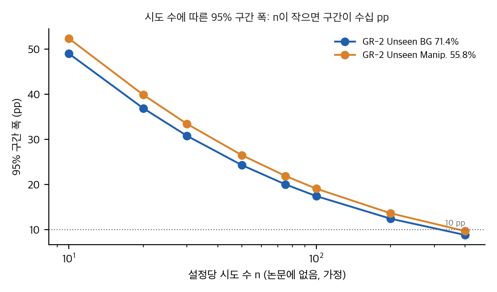
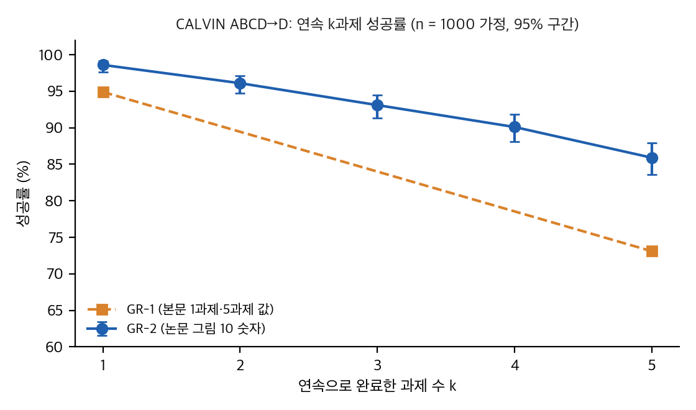
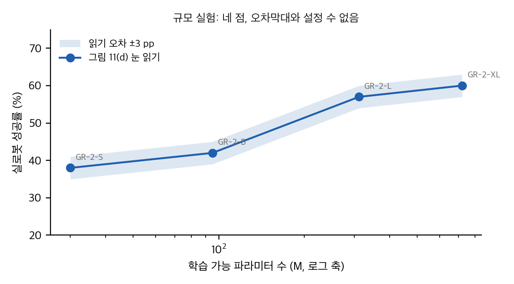

# 03. 수치 재계산과 일관성 검사

GR-2 논문에는 **표가 없습니다.** 다중 과제, 빈 피킹, 규모 실험의 성공률은 그림 막대에만 있고, 숫자는 본문에 몇 개만 적혀 있습니다. 시도 수, 오차, 검정은 한 군데도 없습니다. 그래서 이 분석의 재계산은 세 종류입니다.

1. **본문 값끼리 맞는지** (평균, 합, 산술). §1.
2. **시도 수를 모를 때 얼마나 확실한지.** 시도 수 n을 20, 50, 100으로 가정하고 구간과 검정을 계산합니다. §2–3.
3. **그림 막대를 눈으로 읽은 값의 정확도.** 본문과 같은 값(73.9, 97.7, 71.7, 87.0, 74.7)으로 보정 편향을 쟀습니다. 평균 편향은 −0.8 pp이고 읽기 오차는 약 ±1.5 pp입니다. 규모 그림(11d)은 ±3 pp입니다.

재계산 코드는 `analysis/recompute.py`, 결과는 `analysis/recompute_results.json`입니다(numpy, scipy, 1초 미만).

## 1. 본문 값끼리의 일관성

| 검사 | 계산 | 결과 | 판정 |
|---|---|---|---|
| V1. CALVIN 평균 길이 = 연속 1–5과제 성공률의 합 | 98.6 + 96.1 + 93.1 + 90.1 + 85.9 = 463.8 → 4.638 | 본문 4.64 | **일치** (반올림 범위) |
| V2. CALVIN 성공률이 정수 k/1000인지 (n = 1000 가정) | 986, 961, 931, 901, 859 | 모두 정수, 단조 감소 | **일치** (n = 1000을 확인한 것은 아님) |
| V3. 미본 과제 평균 (3.1절) | (71.4 + 71.7 + 55.8) / 3 = 66.3 | 그림 6 읽기 65.6 (GR-2 400) | **일치** (읽기 오차 안) |
| V4. DA 평균 74.7 에서 BG + Manip 합 | 3 × 74.7 − 87.0 = 137.1 | 그림 6 읽기 83.2 + 52.8 = 136.0 | **일치** (읽기 오차 안) |
| V5. 빈 피킹 평균 79.0 | 그림 9 읽기 네 막대 평균 77.4 | 차이 −1.6 pp | 읽기 편향 범위. **판정 보류** |
| V6. 빈 피킹 GR-1 평균 33.3 | 그림 9 읽기 평균 32.8 | 차이 −0.5 pp | **일치** |
| V7. CALVIN GR-1 평균 4.21이 가져야 할 2–4과제 평균 | (4.21 − 0.949 − 0.731) / 3 = 84.3% | 그림 10 GR-1 2–4과제 막대에 숫자 없음 | **검증 불가** (숫자 없음) |
| V8. 데이터 산술 | 40,000 / 105 = 381회. 본문은 "평균 400" | 반올림 범위 (약 5%) | **사소한 불일치** |
| V9. 1/8 부분집합 | 40,000 / 8 / 105 = 47.6회 | 본문 "약 50" | **일치** |
| V10. 빈 피킹 1물체당 시연 | 94,000 / 55 = 1,709회 | 본문에 없음 | 정보 |
| V11. 사전학습 토큰 | 50B / 38M = 1,316 토큰/클립 | 본문에 없음 | 정보 |
| V12. 사전학습 규모 | 38M / 0.8M = 47.5배 | 본문 1절 "47배 이상" 취지 | **일치** |
| V13. 모델 크기 표기 | 기본 230M 중 95M 학습 가능 (3절). 3.5절 GR-2-B = 95M 학습 가능 | 두 값이 같지만 3.5절은 사전학습 단계의 값으로 씀 | **모호** (파인튜닝 학습 파라미터 미기재) |

**해석.** 본문 숫자끼리는 대체로 맞습니다. CALVIN 평균 길이는 정의대로 계산한 값과 맞고(V1), 미본 과제 평균과 DA 평균도 그림과 맞습니다(V3, V4). 따라서 **숫자를 잘못 옮긴 흔적은 없습니다.** 문제는 숫자가 어떻게 얻어졌는지(시도 수, 오차, 검정)가 없다는 것입니다.

## 2. 시도 수를 모를 때의 검정 (설정당 n = 20, 50, 100 가정)

그림 막대 값으로 GR-2와 GR-1의 차이를 두 비율 차이로 보았습니다. Newcombe 구간과 두 비율 z 검정입니다.

| 비교 | n | GR-2 | 기준 | 차이 (pp) | 95% 구간 (pp) | p |
|---|---|---|---|---|---|---|
| 미본 배경: GR-2(400) 대 GR-1 (읽기 33) | 20 | 71.4 | 32.8 | 35.0 | 4.2 – 57.9 | 0.027 |
| | 50 | 71.4 | 32.8 | 40.0 | 20.6 – 55.4 | < 0.001 |
| | 100 | 71.4 | 32.8 | 38.0 | 24.4 – 49.6 | < 0.001 |
| 미본 환경: GR-2(400) 대 GR-1 (읽기 34) | 20 | 71.7 | 33.6 | 35.0 | 4.2 – 57.9 | 0.027 |
| | 50 | 71.7 | 33.6 | 38.0 | 18.5 – 53.6 | < 0.001 |
| | 100 | 71.7 | 33.6 | 38.0 | 24.4 – 49.6 | < 0.001 |
| 미본 과제: GR-2(400) 대 GR-1 (읽기 48) | 20 | 55.8 | 48.0 | 5.0 | −23.9 – 32.8 | 0.75 |
| | 50 | 55.8 | 48.0 | 8.0 | −11.2 – 26.4 | 0.42 |
| | 100 | 55.8 | 48.0 | 8.0 | −5.8 – 21.3 | 0.26 |
| 미본 과제: GR-2(50) 대 GR-2(400) (읽기 55.2 대 55.8) | 50 | 55.2 | 55.8 | 0.0 (반올림 같은 28/50) | −18.8 – 18.8 | 1.0 |
| Simple: GR-2(400) 본문 97.7 대 DA 읽기 90.4 | 100 | 97.7 | 90.4 | 8.0 (반올림 98 대 90) | 1.3 – 15.6 | 0.017 |
| 빈 피킹 Seen: GR-2 대 GR-1 (읽기 80 대 48) | 50 | 80.4 | 48.4 | 32.0 | 13.2 – 47.8 | < 0.001 |
| 빈 피킹: Seen 대 Unseen (읽기 80 대 76) | 50 | 80.4 | 76.3 | 4.0 | −12.3 – 20.0 | 0.63 |

**결과.**
- **미본 배경과 환경에서 GR-1 대비 개선은 유의합니다.** n = 20에서도 p < 0.05이고, 차이는 35 pp 이상입니다. 본문의 "두 배"와 맞습니다(읽기 약 2.1–2.2배).
- **미본 과제(Unseen Manipulation)에서 GR-1 대비 개선은 n = 100에서도 p ≈ 0.26입니다.** 본문은 "모든 설정에서 개선"이라고 쓰지만, 이 설정의 차이는 읽기 오차 안입니다.
- **GR-2(50)와 GR-2(400)의 미본 과제 차이는 읽기 오차 안에서 0입니다.** 데이터 양이 이 설정에서 효과가 없다는 뜻입니다. 확정하려면 시도 수가 필요합니다.
- **빈 피킹의 "Seen과 Unseen이 비슷하다"는 주장은 검정할 수 없습니다.** n = 50에서 차이 구간이 −12 ~ +20 pp입니다. 비슷하다고도, 다르다고도 말할 수 없습니다.


<p class="cap">그림 1. 설정당 시도 수 n에 따른 95% 구간 폭. 논문에 n이 없어서 n을 가정했습니다. 우리가 그린 그래프입니다.</p>

## 3. CALVIN (그림 10, 1000 사슬 가정)

| 연속 k과제 | GR-2 (%) | 95% Wilson 구간 | GR-1 (%) | 차이 (pp, 구간) | z, p |
|---|---|---|---|---|---|
| 1 | 98.6 | 97.7 – 99.2 | 94.9 | 3.7 (2.2 – 5.3) | 4.67, p ≈ 3e-6 |
| 2 | 96.1 | 94.7 – 97.1 | – | – | – |
| 3 | 93.1 | 91.4 – 94.5 | – | – | – |
| 4 | 90.1 | 88.1 – 91.8 | – | – | – |
| 5 | 85.9 | 83.6 – 87.9 | 73.1 | 12.8 (9.3 – 16.3) | 7.09, p ≈ 1e-12 |

**해석.** CALVIN의 GR-2 우위는 **1000 사슬을 독립 표본으로 볼 때** 명백합니다. 두 방법이 같은 1000 사슬로 평가했다면 쌍체 검정이 더 정확하지만, 개별 사슬 결과가 본문에 없어 할 수 없습니다. GR-1의 1000 사슬 평가도 GR-1 논문 기준의 가정입니다. 평균 길이 차이(4.64 대 4.21)의 구간은 계산하지 않았습니다. 본문에 k별 분산 정보가 없기 때문입니다.


<p class="cap">그림 2. 그림 10의 GR-2 숫자와 GR-1의 본문 값(1과제, 5과제). 1000 사슬 가정의 Wilson 구간을 붙였습니다. 우리가 그린 그래프입니다.</p>

## 4. 빈 피킹 (그림 9, 읽기)

| 설정 | GR-1 (읽기) | GR-2 (읽기) |
|---|---|---|
| Seen | 48.4 | 80.4 |
| Unseen | 36.2 | 76.3 |
| Cluttered Seen | 22.4 | 74.8 |
| Cluttered Unseen | 24.0 | 77.9 |
| 평균 (읽기) | 32.8 | 77.4 |
| 평균 (본문) | 33.3 | 79.0 |

읽기 평균과 본문 평균의 차이는 GR-1 −0.5 pp, GR-2 −1.6 pp입니다. 막대 읽기의 편향 범위 안입니다. GR-2의 네 설정 값이 비슷하다는 것은 확인되었습니다. 그러나 **시도 수가 없어서** 설정 간 차이의 해석은 §2처럼 가정에 의존합니다.

## 5. 규모 실험 (그림 11d, 읽기)

| 모델 | 학습 가능 파라미터 (M) | 성공률 (읽기, %) |
|---|---|---|
| GR-2-S | 30 | 38 |
| GR-2-B | 95 | 42 |
| GR-2-L | 312 | 57 |
| GR-2-XL | 719 | 60 |

log₂(파라미터)에 대한 최소제곱 기울기는 약 5.3 pp/배입니다(네 점). 읽기 오차 ±3 pp에서 기울기의 불확실성은 상당합니다. 점 네 개와 오차막대 없음, 설정 수 미기재 때문에 "잘 확장한다"는 주장은 방향만 말할 수 있습니다.


<p class="cap">그림 3. 논문 그림 11(d)를 눈으로 읽은 값입니다(±3 pp). 우리가 그린 그래프입니다.</p>

## 6. 영상 지표

본문에 FVD, PSNR, FID 등 정량 영상 지표가 없습니다. 검증 수단이 없으므로 재계산 항목이 아닙니다. 검정 기준으로는 "영상 정렬이 행동 성공률과 상관이 있다"는 주장을 확인할 수 없습니다.

## 7. 재계산으로 확정된 것과 확정되지 않은 것

**확정된 것.**
- CALVIN 평균 길이 4.64는 그림 10의 연속 성공률과 맞습니다(V1).
- CALVIN 1000 사슬 가정에서 GR-2의 5과제 85.9%는 GR-1의 73.1%보다 유의하게 높습니다(z ≈ 7.1).
- 미본 배경과 환경에서 GR-2의 GR-1 대비 개선은 시도 수 20 이상에서 유의할 가능성이 큽니다.

**확정되지 않은 것.**
- 시도 수가 없으므로 실로봇 모든 비율의 구간은 확인할 수 없습니다.
- 미본 과제(55.8%)의 GR-1 대비 개선, 데이터 양의 효과, 빈 피킹의 Seen–Unseen 차이는 n에 따라 달라집니다.
- 규모 실험의 기울기, 영상 지표의 주장은 본문으로 검증할 수 없습니다.

## 8. 재실행

```bash
cd gr2
python3 analysis/recompute.py
python3 analysis/plot_figures.py
```
