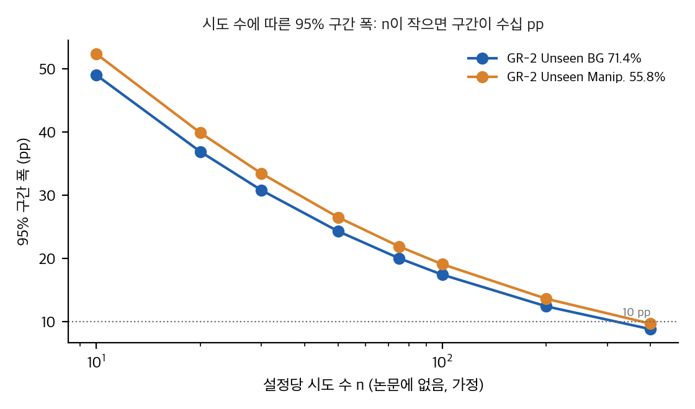
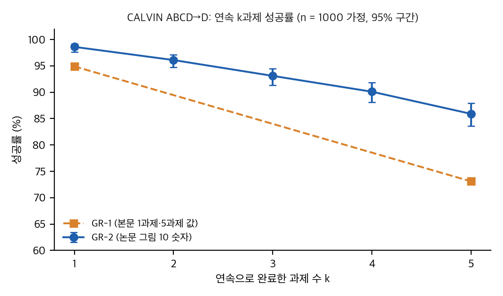
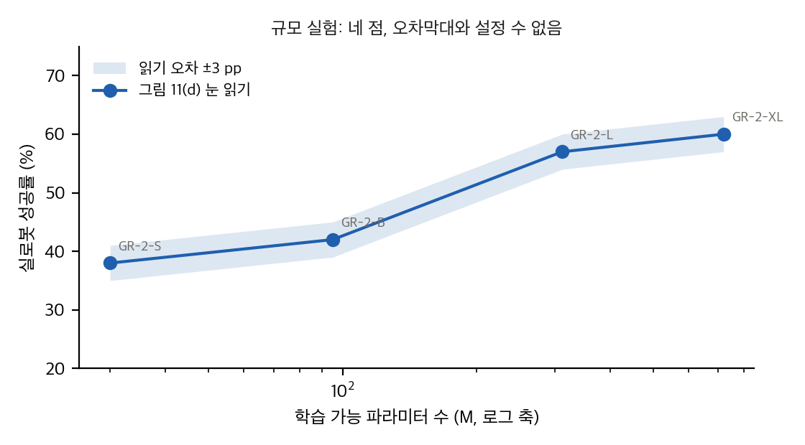

> **논문:** Chi-Lam Cheang 외 11인. *GR-2: A Generative Video-Language-Action Model with Web-Scale Knowledge for Robot Manipulation.* arXiv:2410.06158 (v1, 2024-10-08). 기술 보고서이며 학회 표기는 없습니다. 공식 코드와 가중치는 공개되지 않았습니다. 프로젝트 페이지에는 코드 링크가 없습니다.
> 이 글의 그래프는 논문의 본문 값과 그림 막대를 옮겨 우리가 그린 것입니다. 논문 그림은 싣지 않았습니다.

## 무엇을 주장하나

GR-2는 인터넷 영상 3,800만 클립으로 미래 프레임을 예측하도록 먼저 사전학습하고, 로봇 시연으로 행동과 영상을 함께 파인튜닝하는 정책입니다. 105개 과제에서 단순 설정 성공률 97.7%, 새 배경과 환경에서 71–72%, 빈 피킹에서 평균 79.0%를 보고합니다. CALVIN ABCD→D에서는 평균 길이 4.64로 GR-1(4.21)을 넘습니다.

물음은 두 가지입니다. 보고된 숫자는 서로 맞는가. 그리고 숫자가 주장하는 것(영상 사전학습의 효과)을 뒷받침하는가.

## 숫자끼리는 맞습니다

CALVIN에서 평균 길이는 연속 1–5과제 성공률의 합입니다. 그림 10의 값을 더하면 4.638이고, 본문의 4.64와 맞습니다. 미본 과제 세 설정의 평균은 66.3%이고, 그림의 평균 막대와 맞습니다. DA 평균 74.7%에서 역산한 두 설정의 합도 그림 읽기와 맞습니다.

숫자를 잘못 옮긴 흔적은 찾지 못했습니다. 빈 피킹 평균은 그림 막대를 읽으면 77.4%로, 본문 79.0%와 약 1.6 pp 차이입니다. 그림 읽기의 오차 범위 안입니다.

## 시도 수가 없으면 차이를 말할 수 없습니다

실로봇 결과는 그림 막대에만 있습니다. 시도 수, 오차, 검정이 없습니다. 논문에 없는 시도 수를 설정당 20, 50, 100으로 가정해 보면, 같은 차이도 결론이 달라집니다.

그래프: 설정당 시도 수 n에 따른 95% 구간 폭. 논문에 n이 없어서 가정했습니다. 우리가 그린 그래프입니다.

미본 배경과 환경에서 GR-1 대비 개선은 n = 20에서도 p < 0.05입니다. 그러나 미본 과제(Unseen Manipulation)에서 GR-2는 55.8%이고 GR-1은 그림 읽기로 약 48%입니다. 이 차이는 n = 100에서도 p ≈ 0.26입니다. 논문은 "모든 설정에서 개선"이라고 쓰지만, 이 설정에서는 확인되지 않습니다.

## CALVIN에서는 차이가 분명합니다

CALVIN 1000 사슬을 가정하면 결과는 분명합니다. 5과제 연속 성공률 85.9%와 GR-1의 73.1%는 차이 12.8 pp이고, 두 비율의 z는 약 7.1입니다. 다만 개별 사슬 결과가 없어서 쌍체 검정은 할 수 없습니다. 기준선 값은 GR-1 논문의 표와 같습니다.

그래프: 논문 그림 10의 GR-2 숫자와 GR-1의 본문 값입니다. 1000 사슬 가정의 Wilson 구간을 붙였습니다. 우리가 그린 그래프입니다.

## 빠진 증거: 영상 사전학습의 효과

이 논문의 중심 주장은 영상 사전학습이 행동 예측을 돕는다는 것입니다. 그 증거는 GR-1과의 비교입니다. 그런데 GR-2와 GR-1은 사전학습 데이터(0.8M에서 38M 클립), 구조, 크기, 증강이 모두 다릅니다. 어떤 변화가 이득을 만들었는지 나눌 수 없습니다.

GR-1 논문에는 "사전학습 없음" 변형이 있었습니다. GR-2 논문에는 이런 대조가 없습니다. 영상이 미래를 "재생"한다는 주장(3.4절)도 그림으로만 보입니다. FVD나 PSNR 같은 정량 지표가 없습니다.

## 데이터 증강의 대가

증강은 미본 환경의 성공률을 71.7%에서 87.0%로 올립니다. 그런데 그림 막대를 읽으면 단순 설정은 약 97%에서 약 90%로 내려갑니다. 본문은 이 대가를 쓰지 않습니다.

## 규모 실험은 네 점입니다

30M, 95M, 312M, 719M 파라미터 모델의 실로봇 성공률은 그림 11(d)에서 약 38%, 42%, 57%, 60%로 읽힙니다. 기울기는 log₂ 파라미터당 약 5 pp입니다. 방향은 일관되지만, 네 점과 오차막대 없이 "잘 확장한다"고 말하기는 어렵습니다.

그래프: 논문 그림 11(d)를 눈으로 읽은 값입니다(±3 pp). 우리가 그린 그래프입니다.

## 재현 가능성

논문 수치의 재현은 이 맥(Apple M4 Pro, 24 GiB, CUDA 없음)에서는 불가능합니다. 38M 클립 사전학습, 실로봇 시연 40,000회 이상, 빈 피킹 94,000회, CALVIN 학습은 GPU와 실로봇이 필요합니다. 공식 코드와 체크포인트가 없어서, 구조 세부(학습률, 배치, 토큰 수 등)를 추정해야 합니다.

맥에서 할 수 있는 것은 두 가지입니다. 하나는 본문 숫자의 재계산과 검정입니다. 다른 하나는 MuJoCo 도달 과제에서 "영상 사전학습 있음과 없음"을 비교하는 작은 대조 실험입니다. 후자는 원본 결과를 재현하지 못하지만, 빠진 대조를 작게 채울 수 있습니다.

## 저자에게 물을 것

1. 실로봇 각 성공률의 시도 수(설정별, 과제별)
2. 영상 사전학습의 대조 실험(없음, 사람 영상만, 로봇 영상만)의 존재 여부
3. 기준선(RT-1, MT-ACT, HULC, RoboFlamingo)의 CALVIN 값 출처
4. 규모 실험의 설정과 오차
5. 코드와 체크포인트의 공개 계획

## 정리

GR-2의 숫자는 서로 맞고, CALVIN 우위는 분명합니다. 그러나 실로봇 결과는 시도 수가 없어서 검정할 수 없고, "영상 사전학습이 도움이 된다"는 주장은 대조 실험 없이는 확인되지 않습니다. 이 논문은 방향을 보여 주지만, 인과를 증명하는 단계는 아닙니다.

## 자료

- [통합 리포트 PDF](report/report_public.pdf)
- [01. 논문 분석: GR-2](analysis/01_paper_analysis.md)
- [02. 선행연구, 구성 요소의 출처, 공식 코드와 자료](analysis/02_prior_work.md)
- [03. 수치 재계산과 일관성 검사](analysis/03_analysis.md)
- [04. 주장 검증 (공식 코드 없음)](analysis/04_claim_verification.md)
