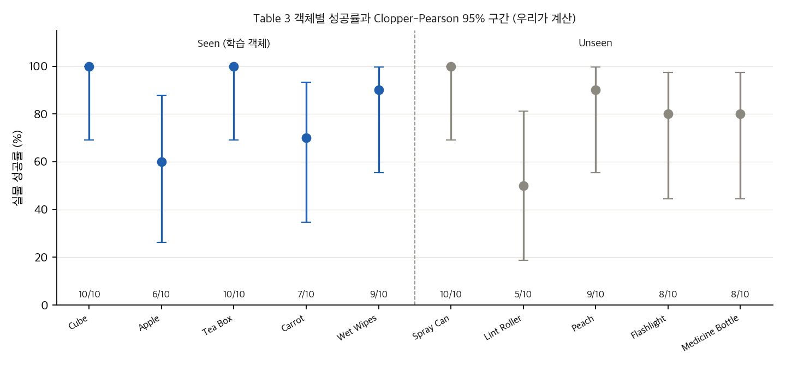
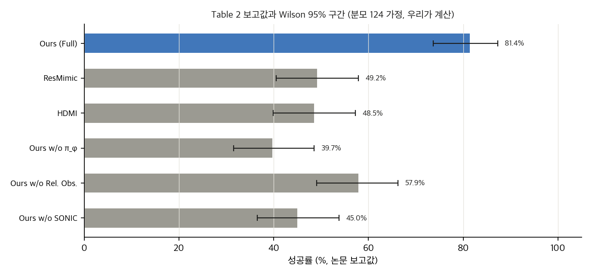

> **논문:** Tianyi Xie, Haotian Zhang, Jinhyung Park 외. *GRAIL: Generating Humanoid Loco-Manipulation from World Models.* CoRL 2026 구두 발표, arXiv:2606.05160 (v2, 2026-10-19).
> 공식 코드는 `NVlabs/GRAIL`(NVIDIA License, 연구·평가 목적 비상업)입니다. 이 글은 코드를 정적으로만 읽었고 실행하지 않았습니다. 논문 PDF에는 "© 2026 NVIDIA. All rights reserved." 표기가 있어 논문 그림은 싣지 않고, 우리가 만든 그래프만 씁니다.

---

## 논문이 묻는 것

휴머노이드 loco-manipulation 학습에는 다양한 물체, 전신 동작, 장면 기하가 담긴 로봇용 시연 데이터가 필요합니다. 원격조작과 모션캡처는 물리 세팅과 로봇 운용에 묶여서 확장하기 어렵습니다. 인터넷 영상에서 4D 사람-물체 상호작용(HOI)을 복원하는 방법은 카메라, 스케일, 물체 형상, 몸 모양이 모두 모호합니다.

GRAIL의 질문은 이렇습니다. 장면을 먼저 완전히 정하면 어떨까요? 카메라, 메트릭 스케일, 깊이, 로봇 비율의 캐릭터를 생성 전에 고정하고, 영상 세계 모델이 그 안에서 상호작용을 만들게 하면 복원이 훨씬 쉬워지지 않을까요?

## 방법 한눈에

1. **3D 구성.** 물체 자산을 시뮬레이터용 장면에 놓고, G1 몸 비율의 사람 캐릭터를 배치합니다. 고정 카메라로 첫 프레임을 렌더링합니다.
2. **영상 생성.** Kling(논문 기준 2.5 Turbo Pro)이 정적 카메라에서 상호작용 영상을 만듭니다.
3. **4D 복원.** 사람 포즈와 물체 추적으로 초기 궤적을 얻고, 키포인트, 물체 투영, 깊이 점군, 접촉, 발 미끄럼, 시간 평활을 묶은 공동 최적화로 다듬습니다.
4. **추적기.** 궤적을 G1에 리타게팅하고, 사전학습 전신 제어기 SONIC 위에 두 종류를 학습합니다. 하나는 물체를 다루는 잔차 어댑터(64차원 잔차와 2차원 손 동작)이고, 하나는 지형과 의자를 다루는 높이맵 추적기입니다.
5. **실물 배포.** 합성 데이터만으로 머리 카메라 RGB 정책을 학습해 G1에 올립니다.

논문이 말하는 데이터 규모는 20,000개 이상 시퀀스입니다. 물리 추적 성공률은 생성 데이터에서 88.9%로, 비교한 기준선(최대 24.0%)보다 높습니다(Table 1).

## 결과 읽기

그림 두 장은 우리가 원자료 표의 숫자로 다시 그린 것입니다.

**실물 pick-up.** 객체당 10회씩, 학습 객체 5개와 미학습 객체 5개에서 시험했습니다. 합계는 학습 객체 42/50(84%), 미학습 객체 40/50(80%)입니다.

*객체별 실물 성공률과 95% 구간. 한 객체당 10회라서 구간이 넓습니다. 학습 객체와 미학습 객체의 차이는 Fisher 정확 검정에서 p = 0.80으로 유의하지 않습니다. "미학습 객체에도 전이된다"는 결론은 지지되지만, 같은 수준이라고 말하기에는 시험 수가 부족합니다.*

**과제 일반 추적.** 논문은 HDMI(48.5%)와 ResMimic(49.2%)보다 높은 81.4%를 보고합니다. 본문은 이 벤치마크를 124 모션이라고 적었습니다. 그런데 여섯 행의 성공률을 124의 정수 비율로 설명하면 ResMimic 한 행만 맞습니다. 시드 평균이나 행마다 다른 분모로 보입니다.

*논문 보고값과 분모 124 가정에서의 Wilson 95% 구간. 분모가 실제로 124인지는 본문만으로 확인할 수 없습니다. 분모가 확인되기 전까지 기준선과의 차이는 방향만 읽는 것이 안전합니다.*

## 숫자를 다시 세 보니

- **Table 3 평균**(84%, 80%)은 객체별 값과 맞습니다.
- **계단 90%**는 시도 수가 없습니다. 10회라면 95% 구간은 56–100%입니다. 프로젝트 페이지 영상은 계단 9회, pick-up 12회를 보여 주는데, 이는 표와 맞지 않습니다. 영상은 골라 낸 것일 수 있어 단정하지 않겠습니다.
- **학습 비용**은 "모션당 0.5–0.9분"으로 적혀 있습니다. 이는 벽시계 시간을 모션 수로 나눈 값입니다. 64장의 GPU를 곱하면 모션당 29–58 GPU분입니다. 방법 사이를 비교할 때는 단위를 맞춰야 합니다.
- **데이터 규모**는 논문 20,000 이상, 프로젝트 페이지 35,000 이상, 공개 데이터 카드 36,097 모션으로 시점마다 다릅니다.

## 공식 코드는 논문과 같은가

공식 저장소는 논문의 전체 흐름과 PPO 설정(학습률 2×10⁻⁵와 10⁻³, 미니배치 4)을 따릅니다. 하지만 세부는 다릅니다.

- 사람 포즈 추정기가 GENMO(SMPL-X)에서 GEM-X(SOMA)로 바뀌었습니다.
- 리타게팅 주 경로가 GMR에서 NVIDIA SOMA Retargeter로 바뀌었습니다. GMR은 G1 자산 경로로만 쓰입니다.
- 논문 식 1의 λ 값은 본문과 부록에 없습니다. 공식 설정에는 가중치가 있지만 논문과 대응하지 않는 항목도 있습니다. 논문의 투영 정합 손실 L_proj에 해당하는 독립 항목은 찾지 못했습니다.
- 추적기는 논문의 "동결 디코더와 잔차 어댑터"뿐 아니라 디코더 LoRA 변형도 포함합니다. 높이맵 인코더는 논문의 CNN과 달리 공식 코드에서 MLP입니다.
- 공식 미세조정 기본값은 5,000 iteration, 2,048 env, 단일 GPU입니다. 논문의 30,000 iteration과 GPU 64장과는 다른 설정입니다.

즉 공식 코드는 논문의 "최초 제출 시점 코드"라기보다, 이후 확장된 파이프라인으로 보는 편이 맞습니다.

## 이 맥에서 할 수 있는 것

- **재현은 불가합니다.** 복원 단계는 CUDA GPU를 쓰고, 학습은 GPU 64장과 약 30시간이 필요하며, 실물 검증에는 G1과 RTX 데스크톱이 필요합니다.
- **구조 검사는 가능합니다.** 잔차 어댑터의 입출력 차원과 기울기 흐름은 PyTorch로 확인할 수 있습니다. 성능 주장은 검증하지 못합니다.

## 남은 질문

1. Table 2의 성공률 분모와 시드 수, 분산은 얼마인가?
2. 식 1의 λ 값과 튜닝 방법은 무엇인가?
3. 생성 영상의 카메라가 정말 정적인지 어떻게 확인했고, 실패 필터(τ = 0.2)가 버린 비율은 얼마인가?
4. 실물 계단과 pick-up의 전체 시도 기록을 공개할 수 있는가?
5. HDMI와 ResMimic을 같은 손가락 자유도와 같은 학습 예산으로 맞춘 비교가 있는가?

데이터 생성 파이프라인이 데이터 부족을 실제로 메우는지는, 위 질문에 답이 나온 뒤에 따져 볼 문제라고 생각합니다.

## 자료

- [통합 리포트 PDF](report/report_public.pdf)
- [01. 논문 분석: GRAIL (arXiv:2606.05160 v2)](analysis/01_paper_analysis.md)
- [02. 선행연구, 구성 요소 출처, 관련 분석 연결: GRAIL (arXiv:2606.05160)](analysis/02_prior_work.md)
- [03. 수치 재계산과 일관성 검사: GRAIL (arXiv:2606.05160 v2)](analysis/03_analysis.md)
- [04. 논문 ↔ 공식 코드 대조와 구현 가능성: GRAIL (arXiv:2606.05160 v2)](analysis/04_code_verification.md)
