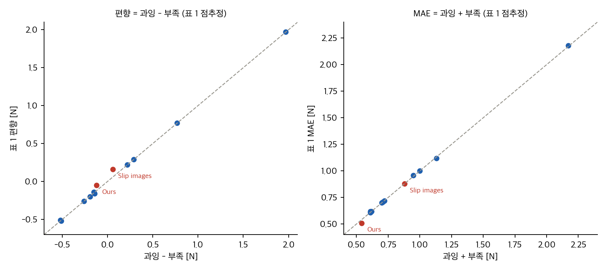
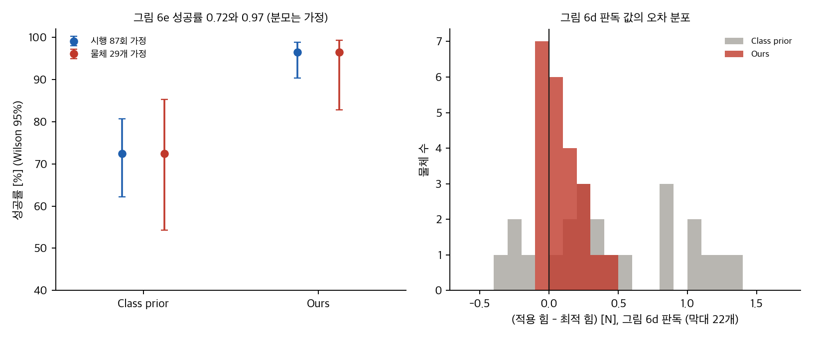
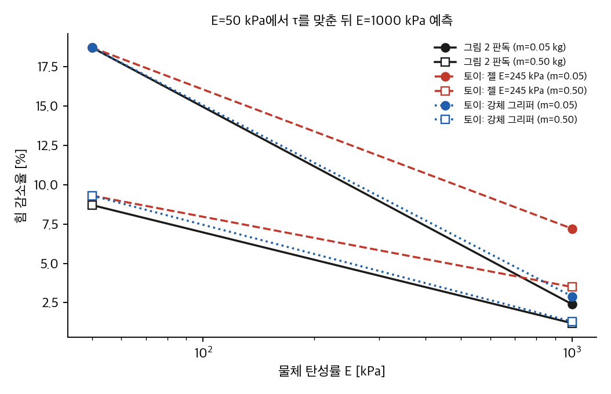

# 03. 수치 재계산과 일관성 검사

재계산 스크립트는 `analysis/recompute.py`(수 초), 그림 판독 보조는 `analysis/fig6d_readings_raw.json`, 토이는 `analysis/toy_hertz_reduction.py`입니다. 결과는 `analysis/recompute_results.json`, `analysis/toy_hertz_reduction_results.json`에 있습니다. 논문에 시행 수가 없는 곳은 문장 안에 가정을 적었습니다. 재현은 하지 않았고 논문에 적힌 값만 다시 계산했습니다. 판정 라벨은 V(재계산), K(일관성), T(토이)입니다.

## 1. 표 1 재계산

### 1.1 V1. 편향 = 과잉 − 부족, MAE = 과잉 + 부족 (표 1 점추정)

과잉(Excess)은 목표보다 큰 힘의 평균, 부족(Deficit)은 작은 힘의 평균이라면 두 항등식이 성립합니다. 12행 중 10행이 반올림(±0.02) 안에서 맞습니다. 다음 두 행은 다릅니다.

| 행 | 표의 편향 | 과잉 − 부족 | 표의 MAE | 과잉 + 부족 | 비고 |
|---|---|---|---|---|---|
| Slip-reactive (learned, images) | 0.16 | 0.47 − 0.41 = 0.06 | 0.88 | 0.88 | 편향만 0.10 차이 |
| Ours | −0.05 | 0.21 − 0.33 = −0.12 | 0.51 | 0.54 | 편향 0.07, MAE 0.03 차이 |

- Ours의 MAE와 WAPE: Naive의 편향에서 평균 최적 힘은 3 − 1.97 = 1.03 N이고 다른 행의 MAE/WAPE는 1.02–1.05입니다(`recompute_results.json`). Ours는 0.51/0.52 = 0.98입니다. MAE가 0.54이면 0.54/0.52 = 1.04로 맞습니다. 점추정 하나(0.51)가 같은 행의 과잉 + 부족(0.54), WAPE와 다릅니다.
- 이 값들은 표 1의 인쇄된 반올림 값에서 읽은 관계입니다. 어느 칸이 다른 정의를 쓰는지 논문만으로는 알 수 없고 저자 확인이 필요합니다. 결론의 방향(Ours가 MAE 최저)은 0.54로 바꿔도 바뀌지 않습니다(두 번째 낮은 값 0.61).
- 편향 −0.05가 "가장 0에 가깝다"는 서술(§6)은 표의 값 기준으로는 맞습니다. 과잉 − 부족인 −0.12로 보면 no prior(−0.15)·Coulomb-only(−0.14)와 비슷한 크기입니다.

### 1.2 V2. 신뢰 구간 폭의 단위

- 성공률 구간을 Wilson 구간으로 보고 그 폭에서 유효 독립 단위 수를 거꾸로 구하면 Ours 약 90, Class prior 약 28, Direct 약 59입니다. 5,000개가 독립이라면 Ours 0.95의 Wilson 구간은 [0.944, 0.956]이므로 표의 [0.90, 0.99]는 더 거친 단위(물체 또는 class)로 묶은 구간으로 보입니다. 논문에 구간 계산법(부트스트랩 단위, 횟수)이 없습니다(시행 수 가정 없이 구간 폭만으로 낸 근사).
- 같은 행의 MAE 구간 폭과 WAPE 구간 폭의 비는 0.22–3.8로 흩어집니다. WAPE = MAE/평균 최적 힘이므로 같은 재표집이면 폭이 비슷해야 하는데, Ours는 MAE [0.19, 0.84](폭 0.65)에 WAPE [0.43, 0.60](폭 0.17)입니다. 두 지표를 서로 다른 단위로 재표집했을 가능성이 있습니다.
- 결과적으로 표 1만으로는 Ours 대 Class prior MAE 차이(0.51 대 0.70)의 유의성을 판정할 수 없습니다. 구간이 겹치고 짝지은 검정에 필요한 물체별 값이 없습니다.

### 1.3 V3. 표 S1 과잉(Overload) 대 표 1 과잉(Excess)

Naive는 힘이 3 N로 고정이라 물체마다 (3 − 최적)을 쓰면 과잉과 최대 초과가 같은 양입니다. 표 1 과잉 2.07 N, 표 S1 과잉(Overload) 2.01 ± 0.41 N으로 0.06 N 다릅니다. 두 표가 다른 시각(전체 시퀀스 대 들어 올린 뒤)이나 다른 물체 부분집합을 썼을 가능성이 있고, 정의가 본문에 없습니다.

### 1.4 V4. 표 S1: 재료 추정

Class prior 대비 Ours의 MAPE는 E 1.91배, m 3.06배, µ 2.16배, τ 1.75배 낮습니다. 반면 Pearson r은 E 0.65, m 0.88, µ 0.28, τ 0.57(§6)입니다. µ는 상관이 가장 낮은데 MAPE가 절반 이하로 줄었습니다. 상관은 사전 평균보다 개체별 변화를 얼마나 따라가는지, MAPE는 평균 수준 오차를 재므로 두 값은 서로 다른 것을 보며, µ의 사전 대비 개선은 상당 부분 평균 수준 보정일 수 있습니다(가능성). 표 S1 작업량(work)은 Class prior 3.63 mJ이 Naive 3.32 mJ보다 큽니다(SD 5.76).

### 1.5 V5. 부록 S4 비율

83.0 + 15.4 + 1.6 = 100.0으로 맞습니다.

## 2. 실물 파지 (그림 6e)

### 2.1 V6. 성공률의 정수 가능성과 구간 (시행 수 가정)

시행 수가 본문에 "물체당 3회, 29개"로만 있어 두 분모를 가정했습니다.

| 분모 가정 | Ours 0.97 | Class prior 0.72 | Wilson 95% (Ours / Class prior) | Fisher p |
|---|---|---|---|---|
| 87회(29 × 3) | 84/87 = 0.9655만 가능 | 63/87 = 0.724만 가능 | [0.904, 0.988] / [0.622, 0.807] | 1.2e-5 |
| 29개 물체 | 28/29 = 0.9655만 가능 | 21/29 = 0.724만 가능 | [0.828, 0.994] / [0.543, 0.853] | 0.025 |

두 가정 모두 정수로 가능하고, 어느 쪽이든 Ours > Class prior 방향은 유지됩니다. 87회 가정이면 확실하고, 물체 단위(29)로 묶으면 유의 수준이 한 단계 낮아집니다. Naive 1.00은 모든 시행 성공으로 읽히며 힘 오차가 가장 큽니다(1.99 N).

### 2.2 V7. MAE 차이(요약 통계만 사용한 Welch 검정)

| 비교 | n = 29 | n = 87 |
|---|---|---|
| Ours 0.21 ± 0.14 대 Class prior 0.46 ± 0.40 | t = −3.18, p = 0.003 | t = −5.5, p = 2.6e-7 |
| Ours 대 Naive 1.99 ± 0.33 | p ≈ 4e-26 | p ≈ 1e-76 |

짝지은 검정이 아니고 SD의 단위(물체 또는 시행)도 본문에 없어 보수적인 근사입니다. 비 0.46/0.21 = 2.19배는 서론의 "2배 이상"과 맞습니다(`01` §5).

Naive의 MAE 1.99 N에서 실물 평균 최적 힘은 3 − 1.99 ≈ 1.01 N입니다(시뮬 1.03 N과 비슷). Naive MAPE 2.44에서 조화 평균 최적 힘은 0.87 N이며 평균 1.01 N 이하라서 서로 모순되지 않습니다.

### 2.3 V8. Hertz 압축 시험 식

Hertz에서 접촉 반경 a² = R*L(L은 압입), A = πa². F = (4/3)E*√R* L^{3/2}에 R* = A/(πL)을 넣으면 E* = 3F/(4L)·√(π/A)가 되어 본문 식(§4)과 같습니다. 식 2의 A(F)도 같은 식에서 나옵니다. 단 이 L이 물체 쪽 압입인지 젤+물체 전체 압입인지는 본문에 없습니다.

### 2.4 V9. 서론의 "2배 이상 감소"

| 지표 | Naive 대비 | Class prior 대비 |
|---|---|---|
| 시뮬 Excess (표 1) | 2.07 → 0.21, 9.9배 | 0.22 → 0.21, 1.05배 |
| 시뮬 MAE (표 1) | 2.18 → 0.51, 4.3배 | 0.70 → 0.51, 1.37배(0.54이면 1.30배) |
| 실물 MAE (그림 6e) | 1.99 → 0.21, 9.5배 | 0.46 → 0.21, 2.19배 |

"2배 이상(non-adaptive baselines 대비)"은 실물 MAE와 Naive 대비 수치에서 성립하고, 시뮬에서 Class prior 대비로는 성립하지 않습니다.

### 2.5 K6. 그림 6d 막대 수

그림 6d의 막대는 픽셀 검출로 25개입니다(분석 스크립트는 막대를 색 마스크로 세었습니다). 본문과 캡션은 "29개 실물 과일·채소"입니다. 라벨 25개에는 그림 6b–c의 네크타린이 없습니다. 29개 중 4개 이상이 그림 6d에 없는 이유는 본문에 없고 저자 확인이 필요합니다(그림 판독 값, 막대 수 ±0).

### 2.6 V10. 그림 6d 판독 오차

25개 막대 중 색이 겹쳐 읽기 어려운 3개(17, 18, 24번째)를 빼고 22개에서 "Ours 막대 높이 − 최적 선 높이"를 읽었습니다(해상도상 ±0.02 N). Ours 평균 절대 오차 0.12 N, 평균 편향 +0.10 N, 최대 초과 +0.42 N(그림 판독 값), 최적보다 0.02 N 이상 낮은 막대 7개(최대 −0.06 N)입니다. Class prior는 평균 절대 오차 0.55 N(표 0.46)입니다. 막대는 물체별 평균이라 시행 단위 MAE 0.21보다 작게 나오는 것이 자연스럽고, "최적 이상 또는 약간 위에서 적용한다"는 캡션 서술과 일치합니다.

### 2.7 V11. 그림 6b–c 판독 (네크타린 1개)

| 양 | 참값(판독) | 파지 끝 추정(판독) | 오차 | 사전(t = 0, 판독) |
|---|---|---|---|---|
| E | 42 kPa | 37 kPa | −12% | 83 kPa |
| m | 192 g | 181 g | −6% | 142 g |
| µ | 0.59 | 0.62 | +5% | 0.23 |

질량과 마찰의 추정은 들어 올리기 시작(0.32 s 전후) 전에는 사전에 머물다가 이후 수렴합니다. 한 개 물체의 한 번 시행이므로 §6 표의 일반 성능과 별개입니다.

## 3. 일관성 검사

### 3.1 K5. 턱당 하중 해석

네크타린(판독 m = 192 g, µ = 0.59, 최적 힘 1.12 N)에서 식 1이 총 하중 mg = 1.88 N을 한 턱이 지는 해석(µF + τA = mg)이면 Coulomb만으로 3.2 N이 필요해 최적 1.12 N을 설명하지 못합니다. 턱당 mg/2 = 0.94 N로 보면 Coulomb만으로 1.60 N, 그리고 τA 항이 0.28 N(하중의 30%)을 담당해야 1.12 N이 됩니다. 표 1이 "per jaw" 힘을 쓰고 Naive 3 N이 "per jaw"이므로 두 턱 분담 해석이 맞는 것으로 보입니다. 식 1에 이 분담이 적혀 있지 않습니다(그림 판독 값, 접촉 형상 가정 없음).

### 3.2 K1–K4

- K1. Naive의 3 N: 질량 0.5 kg, µ = 0.5의 Coulomb만 있으면 턱당 mg/(2µ) = 4.9 N이 필요합니다. Naive 3 N이 "Squash에서 가장 큰 물체를 들기에 충분"(§6)한 것은 τA 항이 일부를 담당하는 경우입니다. 가장 무거운 Squash 물체의 질량·µ는 본문에 없습니다.
- K2. 시뮬의 닫는 속도 4 mm/s, 접촉 검출 0.25 N, 서보 최대 100스텝 × 4 ms = 0.4 s, 대기 0.1 s, 들어 올리기 2 mm / 10 mm/s = 0.2 s. 그림 S3의 "들어 올린 지 2 mm, 즉 0.2 s 뒤"와 맞습니다. 그림 6c의 파지 단계 약 0.32 s도 서보 상한 0.4 s 안입니다.
- K3. 제어 250 Hz = 4 ms는 시뮬 Δt와 맞습니다. 촉각은 25 Hz이므로 한 이미지당 10스텝은 보간 값입니다(S5). 1 s 파지에서 실제 새 이미지는 약 25장입니다.
- K4. 학습량: 200k / 배치 8 × 500 에폭 = 12.5 M 스텝, 48 h = 172,800 s면 초당 72 스텝(전체 200k가 학습에 쓰였다고 가정, 85% 분할이면 10.6 M). 배치 8이 GPU당인지 전체인지 본문에 없습니다.

## 4. T1 토이: 그림 2의 E 의존성이 어떤 접촉 모델과 맞는가

`analysis/toy_hertz_reduction.py`. 식 1(턱당 mg/2), 식 2(ν = 0.48)를 풀어 Coulomb만 쓸 때 대비 힘 감소율을 계산했습니다. R* = 40 mm, 턱당 분담 1/2은 가정입니다.

1. **τ = 17 kPa(그림 S1b 복숭아)를 그대로 넣으면** 감소율이 E = 50 kPa에서 질량 0.05 kg 96.6%, 0.5 kg 90.2%로 나옵니다. 그림 2의 18.7%, 8.7%와 한 자릿수 이상 다릅니다. 다른 물체·접촉 면적 가정이므로 모순으로 단정하지는 않고, 그림 2가 쓴 τ와 R*가 본문에 없다는 점을 기록합니다.
2. **E = 50 kPa(가벼운 쪽 18.7%)에 τ를 맞추면**(τ ≈ 0.4–0.8 kPa, R* 20–40 mm), 젤 패드(E_grip = 245 kPa, S2.2)를 포함한 식 2는 E = 1000 kPa에서 가벼운 쪽 7.2%, 무거운 쪽 3.5%를 예측합니다. 그림 판독은 2.4%, 1.2%입니다.
3. **그리퍼를 강체(E_grip → ∞)로 두고 같은 맞춤을 하면** 예측이 9.3%(무거운 쪽, E = 50), 2.9%와 1.3%(E = 1000)로 판독 값(8.7%, 2.4%, 1.2%)에 가깝습니다. 그림 2의 곡선이 젤 컴플라이언스를 뺀 식 2(E* ∝ E_obj)와 맞는 것으로 보이는 이유는 E* 포화입니다. 젤 포함 시 1/E*의 젤 항이 E가 클 때 지배합니다.
4. 읽는 법: 그림 2는 개념도로서의 곡선이고 시뮬(젤 포함)·실물의 정량 근거는 아닌 것으로 보입니다. 두 조건 사이에서 어느 쪽이 쓰였는지는 저자 확인이 필요합니다(그림 판독 값, ±0.3%).

## 5. 요약 판정

| 항목 | 결과 |
|---|---|
| 표 1 항등식 | 10/12행 맞음, Ours·Slip(이미지) 행은 인쇄 값 사이에 관계가 안 맞음 (V1) |
| 표 1 구간 | 계산 단위 불명, Ours 대 Class prior MAE는 구간이 겹침 (V2) |
| 실물 성공률 | 정수 가능, 분모 87이면 p = 1e-5, 29이면 0.025 (V6) |
| 실물 MAE | Ours 대 Class prior 2.19배, p 0.003–3e-7 (V7) |
| 서론 "2배 이상" | 실물 MAE·Naive 대비는 성립, 시뮬 Excess Class prior 대비는 1.05배 (V9) |
| 그림 6d | 막대 25개, 본문 29개 (K6) |
| 그림 2 | 젤 포함 식 2보다 강체 그리퍼 식과 맞음 (T1) |
