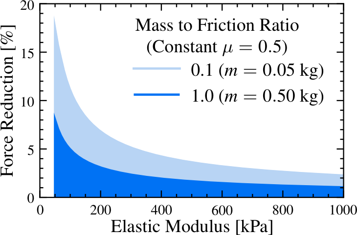
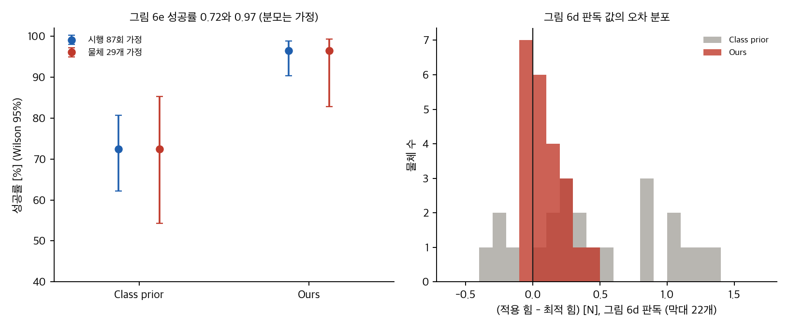
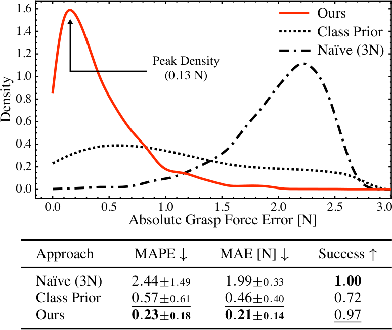
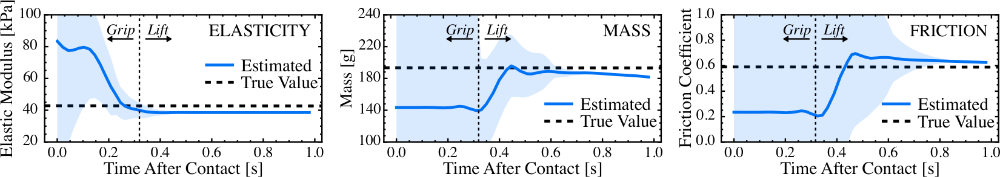
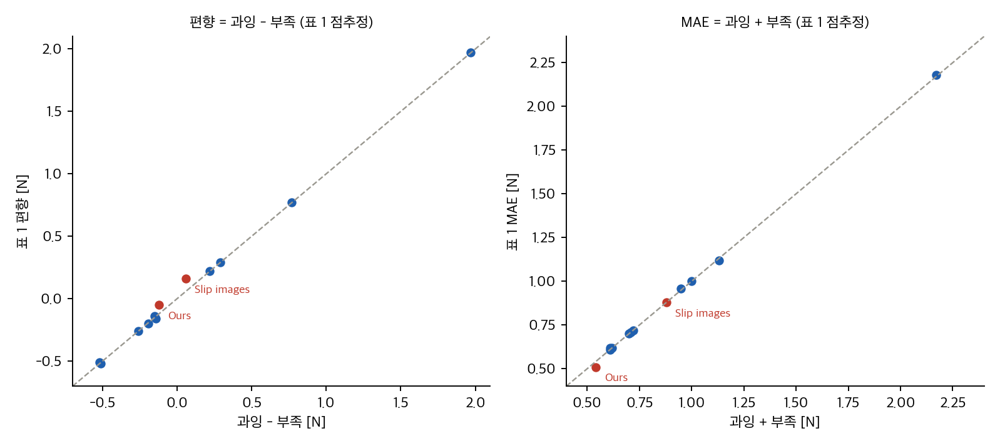
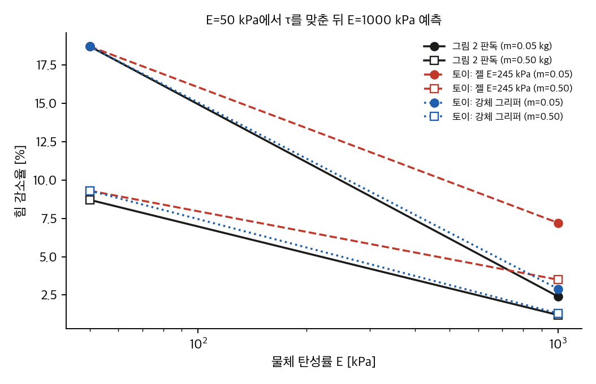

> **논문:** Matthew Beveridge, Shree K. Nayar (Columbia University). *How Firm Should a Grasp Be?* CoRL 2026 포스터, arXiv:2610.11221 (v1, 2026-10-08, 한 판만 있음).
> 공식 코드는 찾지 못했습니다. 이 글의 그림은 논문 그림 세 장(출처 표기)과 우리가 그린 그래프 세 장입니다. 시행 수를 가정했거나 그림에서 읽은 값은 문장 안에 그렇게 적었습니다.

## 논문이 묻는 것

물체를 떨어뜨리지 않는 가장 작은 힘으로 쥐면 과일이 멍들지 않습니다. 문제는 그 힘이 질량, 마찰, 탄성에 달려 있고 처음 보는 물체에서는 정확히 모른다는 점입니다. 이 논문은 비전으로 물체 종류를 알아 재료 사전분포를 얻고, 쥐는 동안 GelSight 촉각 이미지와 로드셀 힘의 시계열로 탄성률 E, 질량 m, 마찰 µ, 계면 전단 강도 τ의 사후분포를 갱신합니다. 그리고 사후에서 계산한 최소 힘을 그리퍼의 목표 힘으로 줍니다.

물리 모델은 Coulomb 마찰에 접촉 면적 비례 항을 더한 µF + τA = mg입니다. 부드러운 물체는 힘을 줄수록 접촉 면적이 빨리 늘어 τA가 하중 일부를 맡기 때문에 더 약하게 쥐어도 됩니다. 면적은 Hertz 접촉식으로 닫힌 형태로 구합니다.

*그림 2 (논문 원문). © 저자, CC BY 4.0, 출처 arXiv:2610.11221.*

학습에는 두 가지가 쓰였습니다. 과일·채소 52종 270개의 3D 스캔과 실측 물성을 모은 데이터셋 Squash, 그리고 Squash에서 뽑은 재료로 변형체 접촉 시뮬레이터(IPC 계열)를 돌려 만든 200k 파지 시퀀스입니다. 모델은 합성곱 인코더, 연속시간 순환망(CfC), 후보 재료의 점수를 매기는 가능도 헤드로 구성되고, 사전에서 한 번 뽑은 512개 후보의 가중치만 매 시각 갱신합니다.

## 이 글에서 확인한 것

**1. 실물 파지의 힘 오차 개선은 분모를 어떻게 두어도 방향이 같습니다.** 29개 실물 과일·채소에서 평균 절대 힘 오차는 0.21 N, 성공률 0.97입니다(그림 6e). Class prior는 0.46 N과 0.72, 3 N 고정은 1.99 N과 1.00입니다. 시행 수가 본문에 "물체당 3회"로만 있어 두 가지로 가정했습니다. 87회(시행 수 87 가정)이면 Fisher p = 1e-5, 물체 29개 단위(n = 29 가정)이면 p = 0.025입니다. 0.97과 0.72는 두 분모 모두에서 정수 성공 수(84/87, 28/29, 63/87, 21/29)로 만들어집니다.

*그래프 (우리가 그림). 왼쪽은 분모 두 가정에서의 Wilson 95% 구간, 오른쪽은 그림 6d 막대에서 읽은 (적용 힘 − 최적 힘)의 분포(막대 22개, 그림 판독 값)입니다.*

*그림 6e (논문 원문). © 저자, CC BY 4.0, 출처 arXiv:2610.11221.*

**2. 한 번의 파지 안에서 추정이 수렴하는 모습이 그림 6c에 있습니다.** 네크타린 한 개에서 탄성률은 파지 단계에서, 질량과 마찰은 들어 올릴 때 갱신됩니다. 그림에서 읽은 값으로 탄성률 추정은 42 kPa 참값에 대해 37 kPa(−12%), 질량은 192 g에 대해 181 g(−6%), 마찰은 0.59에 대해 0.62(+5%)입니다(그림 판독 값). 질량과 마찰은 들어 올리기 시작(약 0.32 s) 전까지 사전 값 근처에 머뭅니다.

*그림 6c (논문 원문). © 저자, CC BY 4.0, 출처 arXiv:2610.11221.*

**3. 표 1의 두 행에서 인쇄된 값 사이의 관계가 맞지 않습니다.** 편향은 과잉(Excess)에서 부족(Deficit)을 뺀 값, MAE는 둘의 합이라면 열두 행 중 열 행은 반올림 안에서 맞습니다. Slip-reactive(이미지) 행은 편향 0.16 대 과잉 − 부족 0.06이고, Ours 행은 편향 −0.05 대 −0.12, MAE 0.51 대 과잉 + 부족 0.54입니다. Ours의 WAPE 0.52에서 환산한 MAE도 0.54에 가깝습니다. 어느 칸이 다른 정의를 쓰는지 논문만으로는 알 수 없습니다. 저자 확인이 필요합니다. Ours가 MAE 최저라는 방향은 0.54로 바꿔도 같습니다.

*그래프 (우리가 그림). 표 1의 점추정(반올림 값)만 사용했습니다.*

**4. 서론의 "2배 이상 감소"는 지표에 따라 다르게 읽힙니다.** 실물 MAE는 Class prior 대비 2.19배(0.46 → 0.21)이고 3 N 고정 대비 시뮬 Excess는 9.9배입니다. 시뮬 Excess의 Class prior 대비는 1.05배(0.22 → 0.21)입니다. 표 1에서 Ours는 MAE가 가장 낮지만 구간이 Class prior와 겹치고([0.19, 0.84] 대 [0.50, 0.95]), Excess는 두 Slip-reactive 방식이 더 낮고(0.10), 성공률은 Slip-reactive(이미지) 0.97과 Direct 0.96이 더 높습니다. 구간의 계산 단위(재표집 대상)는 본문에 없습니다. 성공률 구간 폭으로 거꾸로 구한 유효 독립 단위는 약 90개(근사)여서 시뮬 5,000개가 독립이 아닌 단위로 묶였다고 읽힙니다.

**5. 그림 6d의 막대는 25개이고 본문은 29개 물체라고 씁니다.** 막대 수는 픽셀 검출로 셌습니다(그림 판독 값). 라벨에 그림 6c의 네크타린이 없는 점을 포함해, 나머지 물체가 어디에 있는지는 논문에서 알 수 없습니다. 저자 확인이 필요합니다.

**6. 그림 2의 E 의존성은 젤 패드를 뺀 접촉식과 가깝습니다.** 식 1–2를 풀어 힘 감소율을 계산하는 토이를 만들었습니다(턱당 하중 mg/2, 곡률 반경 40 mm는 가정). E = 50 kPa에서 가벼운 쪽 18.7%에 τ를 맞추고 E = 1000 kPa를 예측하면, 젤 탄성 245 kPa(부록 S2.2)를 식 2에 넣은 경우 7.2%, 무거운 쪽 3.5%이고 강체 그리퍼로 두면 2.9%, 1.3%입니다. 그림에서 읽은 값은 2.4%, 1.2%입니다(그림 판독 값). 그림 2가 개념도로서 쓰였을 가능성이 있고, 어느 조건의 곡선인지는 저자 확인이 필요합니다. 또 그림 S1b의 τ = 17 kPa를 그대로 넣으면 감소율이 90% 이상이 되어 그림 2의 18.7%와 크기가 다릅니다. 다른 물체와 접촉 가정이므로 불일치로 단정하지 않고, 그림 2에 쓴 τ와 곡률 반경이 본문에 없다는 점을 기록합니다.

*그래프 (우리가 그림). 검은 선은 그림 2에서 읽은 값, 빨간 점선은 젤 패드 포함, 파란 점선은 강체 그리퍼입니다.*

## 이 글에서 하지 않은 것

공식 코드가 없어 코드 대조는 하지 않았고, Squash 데이터와 모델도 받지 않았습니다. 시뮬레이터(접착 항을 넣은 UIPC)와 UR5 실험은 이 글의 범위 밖입니다. 합성 접촉 데이터로 작은 순환망을 학습해 사후 추정의 이득을 따로 재는 일은 가능해 보이지만 하지 않았습니다.

## 정리

- 재료를 추정해 최소 힘을 직접 계산한다는 설계와, 실물 29개에서의 힘 오차 개선(분모 두 가정 모두 같은 방향)은 일관됩니다.
- 표 1의 두 행과 그림 6d의 막대 수, 구간의 계산 단위는 논문만으로는 확인되지 않아 저자 확인이 필요합니다.
- "2배 이상"과 "과일·채소 밖 일반화"는 서술이 가리키는 지표와 실험 범위를 함께 읽어야 합니다. 후자는 같은 produce 분포 안의 절제 실험에 기댄 서술이고 다른 재료 도메인 실험은 없습니다.
- 공식 코드는 찾지 못했고, 재현하려면 변형체 시뮬(GPU)과 촉각 그리퍼 장비가 필요합니다.

논문의 모든 수치와 결론은 저자의 원문을 기준으로 하며, 이 글의 계산은 논문에 적힌 값(또는 위에 적은 가정)에서 낸 것입니다.

## 자료

- [통합 리포트 PDF](report/report_public.pdf)
- [01. 논문 분석: How Firm Should a Grasp Be? (arXiv:2610.11221)](analysis/01_paper_analysis.md)
- [02. 선행연구, 구성 요소 출처, GitHub](analysis/02_prior_work.md)
- [03. 수치 재계산과 일관성 검사](analysis/03_analysis.md)
- [04. 주장 검증과 구현 가능성 (공식 코드 없음)](analysis/04_claim_verification.md)
