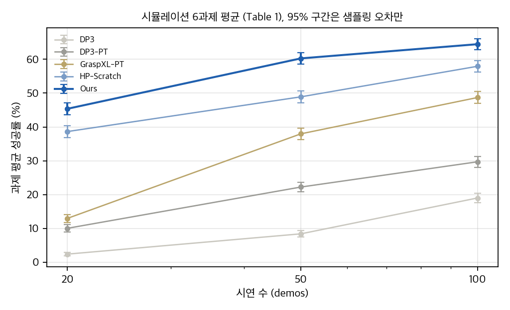
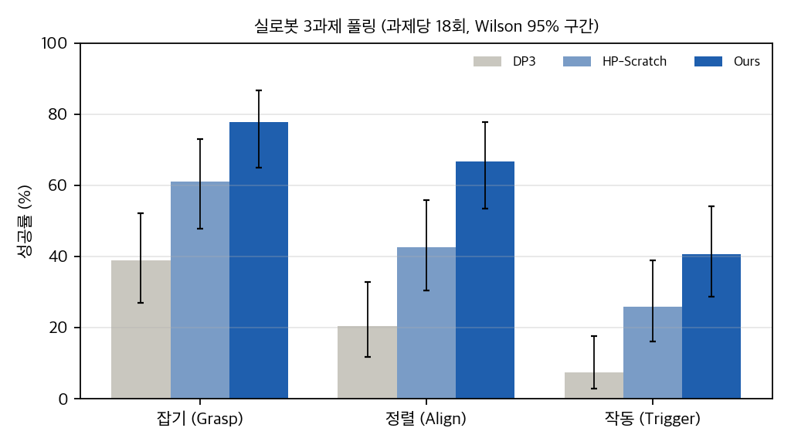
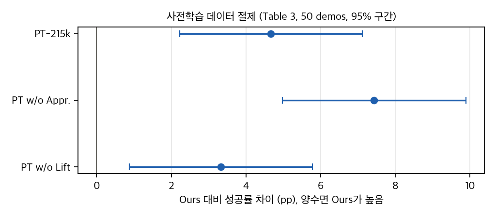

> **논문:** Ying Yuan, Xinyu Liu, Sriram Krishna, David Held. *From Grasps to Dexterity: Large-Scale Grasp Pretraining for Dexterous Manipulation.* CoRL 2026 포스터, arXiv:2606.30749 (v2, 2026-10-26).
> 공식 코드는 두 저장소입니다. 정책은 `xinyu1Liu/G2D-Policy`, 시뮬레이션과 데이터 생성은 `YingYuan0414/DexCraft`입니다. 두 저장소 모두 라이선스 파일이 없어 이 글은 코드를 옮기지 않고 링크만 적습니다. 논문은 arXiv 비독점 배포 라이선스라서 논문 그림을 싣지 않았습니다. 이 글의 그래프는 표 값을 다시 계산해 우리가 그렸습니다.

## 논문이 묻는 것

대규모 파지 데이터셋은 파지 합성과 집어 옮기기에 주로 쓰였습니다. 저자들은 이 데이터가 **관절이 있는 도구를 쓰는 긴 과제**에도 쓰일 수 있는지 묻습니다. 도구를 잡고, 접촉을 유지하고, 가동부를 움직이는 일입니다. 그래서 파지 데이터를 사전학습에 쓰고, 과제 시연으로 미세 조정하는 방법을 제안합니다.

## 방법을 한눈에

- **고수준:** 현재 점군에서 손 키포인트 16개를 예측합니다. 평행 집게용 부목표 4점이 손에는 부족하다는 것이 이유입니다.
- **저수준:** 확산 정책 DP3를 고쳐, 현재 손과 목표 손 키포인트를 조건으로 씁니다.
- **사전학습:** Dexonomy 파지 주석 9.5M개에서 3단계 궤적 355,677개를 만들어 저수준 정책을 먼저 학습합니다. 손 관절은 고정 매핑 어댑터로 옮깁니다.
- **평가:** 시뮬레이션 6과제(DexCraft)와 실로봇 3과제입니다.

## 결과를 다시 계산하니

논문 표의 값을 옮겨 평균과 검정을 다시 계산했습니다. 시뮬레이션 셀은 500 에피소드, 실로봇 셀은 과제당 18회입니다. 시드 분산은 논문이 보고하지 않아 아래 구간은 샘플링 오차만 반영합니다.

그래프: 논문 표 1의 과제 평균 (20, 50, 100 시연). 우리가 그린 그래프이며 구간은 샘플링 오차만입니다.

- **DP3 대비:** 시뮬레이션 평균이 43–52pp 높습니다. 샘플링 구간은 ±2pp 정도입니다.
- **계층 정책 대비(사전학습 없음):** 6.5–11.4pp 높습니다. 시드 분산이 빠져 있어 "유의하다"는 샘플링 기준에서만 말할 수 있습니다.
- **셀 단위:** 18개 중 17개에서 우리 방법이 계층 정책보다 높습니다. 예외는 펜 과제 20 시연입니다.

그래프: 논문 표 4의 단계별 풀링 성공률(과제 3개, 과제당 18회, 54회). 우리가 그린 그래프입니다.

실로봇에서는 작동 단계(=전체 과제 성공)가 40.7%(우리 방법), 25.9%(계층 정책, 사전학습 없음), 7.4%(DP3)입니다.

- **DP3 대비 33.3pp:** Fisher 정확 검정 p < 0.001입니다. 이 차이는 샘플이 적어도 확실해 보입니다.
- **계층 정책 대비 14.8pp:** p = 0.15이고 95% 구간이 0을 포함합니다. 논문 본문이 두 비교를 같은 강도로 쓴 것은 과장입니다.

그래프: 논문 표 3의 절제 결과(50 시연). 우리 방법 대비 성공률 차이와 샘플링 95% 구간입니다. 우리가 그린 그래프입니다.

사전학습 데이터를 줄이거나 접근 단계를 빼면 평균이 3–7pp 떨어집니다. 방향은 일관되지만, 시드 한 개로 보면 크기는 확정하기 어렵습니다.

## 확인된 것과 아닌 것

- **확인됨:** 궤적 수 355,677(표 7 합계)과 31개 파지 유형, 표 1 평균 재계산(최대 차이 0.17pp), 실로봇 DP3 대비 우위.
- **문제가 있음:** 표 2의 캡션은 100 시연이라고 쓰지만 우리 방법의 수치는 50 시연 열과 같습니다. 표 1의 GraspXL 비교는 전이 방식이 적혀 있지 않습니다.
- **코드와 논문 설정이 다른 곳:** 인코더 출력 차원(60 대 64), 고수준 옵티마이저(Adam 대 AdamW), 사전학습 epoch(5 대 500), 분무기 목표 회전 기준입니다. 어댑터 매핑(표 8)은 코드와 일치합니다.

## 재현할 수 있을까

이 맥(Apple M4 Pro, CUDA 없음)에서는 공식 수치를 재현할 수 없습니다.

- 학습 설정이 CUDA(`cuda:0`)로 고정되어 있고, README는 4 GPU를 전제합니다.
- G2D-Pretrain 355k 궤적은 공개 자료에서 확인되지 않아 Dexonomy 자산으로 다시 만들어야 합니다.
- 실로봇은 Franka, LEAP 손, Azure Kinect 두 대, GELLO가 필요합니다.

대신 표 재계산, 두 저장소의 정적 대조, 어댑터 매핑의 단위 검사는 가능합니다. DexCraft 환경을 CPU에서 한 번 여는 것은 새 설치가 필요해서 그 뒤에 하기로 했습니다.

## 정리

파지 데이터를 손 전체 과제의 사전학습에 쓰는 아이디어는 설득력이 있습니다. 다만 실로봇 근거는 DP3와의 비교에 한정되어 있고, 계층 정책 대비 우위는 표본이 작아 확정하기 어렵습니다. 시드 분산과 비교 프로토콜이 보고되면 판단이 더 쉬워질 것입니다.

## 자료

- [통합 리포트 PDF](report/report_public.pdf)
- [01. 논문 분석: From Grasps to Dexterity (arXiv:2606.30749)](analysis/01_paper_analysis.md)
- [02. 선행연구, 공식 저장소, 학회, 이 저장소의 관련 분석](analysis/02_prior_work.md)
- [03. 수치 재계산과 주장 검사](analysis/03_analysis.md)
- [04. 코드 대조 (논문 ↔ 공식 코드, 차이 D1–Dn)](analysis/04_code_verification.md)
