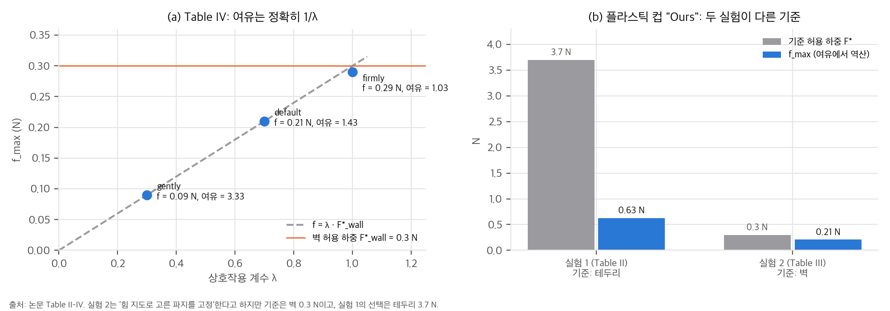
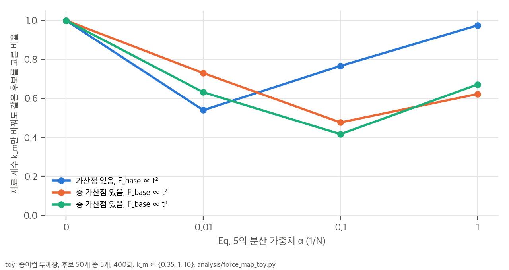
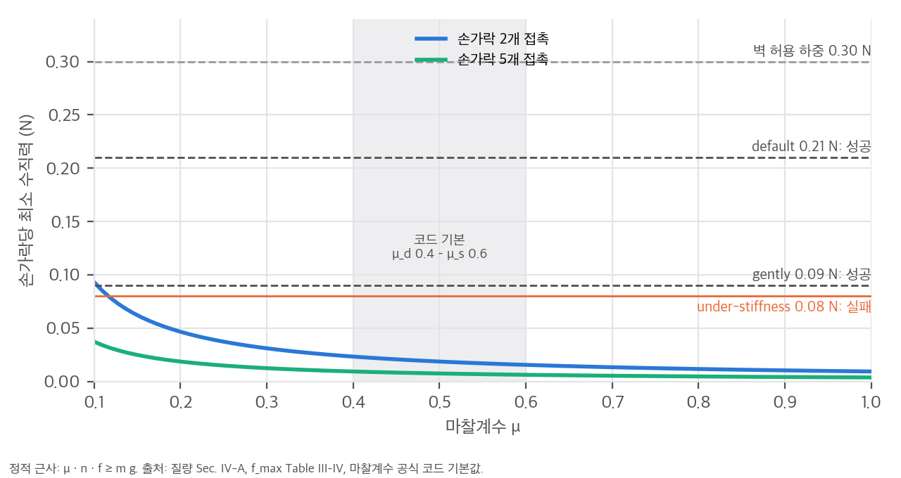

# 03. 핵심 식 해석과 toy 검증

재계산 스크립트는 `analysis/table_check.py`(표 정합성, 결과 `table_check_results.json`)와 `analysis/force_map_toy.py`(재순위화와 조회 방식, 결과 `force_map_toy_results.json`)입니다. 공식 코드에 힘 지도와 재순위화가 없어서, toy는 논문 Sec. III-C·D의 설명대로 직접 만들었습니다. 논문에 없는 값(F_base의 꼴, 가산점 폭, α)은 가정했습니다. 모두 CPU에서 2초 안에 끝납니다.

## 1. 표가 말해 주는 것 (Table II–IV)

### 1.1 여유 > 1이면 위반은 생길 수 없다
Table II의 여유는 F*_min / f_max이고, 위반은 f_k > F*_k인 손가락 수입니다. F*_min = min_k F*_k이므로 다음이 성립합니다.

```
여유 > 1  ⇔  f_max < F*_min  ⇒  모든 k에서 f_k ≤ f_max < F*_min ≤ F*_k  ⇒  위반 0
```

기준선 세 행은 여유가 1.4, 1.2, 2.1인데 위반이 1/5, 2/5, 1/5입니다. 정의대로라면 불가능한 조합입니다. 가능한 설명은 실행 중 접촉점이 계획한 손끝 위치와 달라서 F*_k가 계획 단계의 F*_min보다 작았던 경우입니다. 실행 단계는 최근접 꼭짓점으로 조회하므로, 이런 차이가 생길 수 있습니다(§4). 논문에는 설명이 없습니다.

### 1.2 Table IV의 여유 = 1/λ는 제어 법칙에서 나온다
실험 2의 강성은 K_k = K_base · F*_k / F_max · λ입니다. 정상 상태 오프셋을 Δx라 하면 f_k ≈ K_k Δx = λ · F*_k · (K_base Δx / F_max)입니다. 괄호 항이 1이면 f_k = λ F*_k이고, 여유는 F*/f = 1/λ가 됩니다. 보고된 값이 정확히 그렇습니다.

| 모드 | λ | f_max / (λ · 0.3 N) | 여유 × λ |
|---|---|---|---|
| gently | 0.3 | 1.000 | 0.999 |
| default | 0.7 | 1.000 | 1.001 |
| firmly | 1.0 | 0.967 | 1.03 |



**해석:** Table IV는 "언어 명령이 끝까지 전달되었다"는 증거로 제시되었지만, 실제로는 제어기가 f = λ F*를 따라갔다는 확인입니다. 안전 여유를 따로 두지 않았으므로 λ = 1("firmly")은 허용 한계의 97%까지 갑니다. 센서 잡음이나 지도 오차가 3%만 있어도 위반입니다.

### 1.3 두 실험의 기준이 다르다
그림 (b)처럼 실험 1의 플라스틱 컵 제안 방법은 테두리 기준(3.7 N)에 f_max 0.63 N이고, 실험 2는 벽 기준(0.3 N)에 f_max 0.21 N입니다. 실험 2가 "힘 지도로 고른 파지를 고정했다"면 기준은 테두리여야 하는데, Fig. 4의 손끝은 벽에 있습니다. 실험 2의 결론(under/over-stiffness 대비 우위)은 벽 파지라는 가장 불리한 설정에서 나온 것으로, 실험 1이 고른 파지에 대한 검증이 아닙니다.

## 2. 재순위화는 재료와 무관한 기하 규칙이다 (T1)

### 2.1 유도
상한에 걸리지 않는다고 하면(F < F_clamp) F_{i,k} = k_m · (F_base(t_{i,k}) + b(l_{i,k}))입니다. b(l)은 층 가산점이고, F_base는 두께에 대해 단조 증가합니다.

- **α = 0:** S_F(g_i) = k_m · min_k (F_base(t_{i,k}) + b(l_{i,k}))입니다. k_m > 0은 모든 후보에 같은 배율이라 argmax에 영향이 없습니다. 따라서 **선택은 재료 계수와 무관합니다.**
- **α = 0, 가산점 없음:** min_k F_base(t_{i,k}) = F_base(min_k t_{i,k})이므로(단조성), 선택은 **"접촉점 최소 두께가 가장 큰 후보"**와 같습니다. F_base가 t인지 t²인지 t³인지도 상관없습니다.
- **α > 0:** S_F = k_m · [min(·) − α k_m · Var(·)]입니다. 분산 항이 k_m²로 커지므로, 선택이 α·k_m에 따라 달라집니다. min은 N, Var는 N² 단위라서, 같은 α라도 재료와 단위계를 바꾸면 순위가 바뀝니다.

### 2.2 toy 확인
종이컵 같은 두께장(벽 0.35 mm, 테두리 1.0 mm, 바닥 1.5 mm, 잡음 4%)을 만들었습니다. 그 위에 후보 50개(손가락 5개)를 뽑고, 무작위 5개 중 하나를 고르는 일을 400번 반복했습니다. k_m ∈ {0.35, 1, 10}입니다.

| 설정 | k_m만 바꿨을 때 선택이 같은 비율: α = 0 / 0.01 / 0.1 / 1 | 최소 두께 규칙과 일치 (α = 0) |
|---|---|---|
| 가산점 없음, F_base ∝ t² | **1.00** / 0.54 / 0.77 / 0.98 | **1.00** |
| 가산점 있음, F_base ∝ t² | **1.00** / 0.73 / 0.48 / 0.62 | 0.48 |
| 가산점 있음, F_base ∝ t³ | **1.00** / 0.63 / 0.42 / 0.67 | 0.46 |



**해석:**
- 논문이 "physics-informed"라고 부르는 재료 모델(k_m)은 **어떤 후보를 고를지에 영향을 주지 않습니다**(α = 0일 때). 재료가 쓰이는 곳은 λ 필터의 문턱과 임피던스 강성뿐입니다.
- 선택을 실제로 바꾸는 것은 두 가지입니다. 하나는 층 가산점의 설계이고(toy에서 선택의 절반이 두께 규칙과 달라짐), 다른 하나는 α입니다. 둘 다 논문에 값이 없습니다.
- α > 0이면 재료 계수만 바꿔도 선택이 2–58%의 시행에서 바뀝니다. 손가락 간 균일성을 벌하려면 변동계수(표준편차/평균)처럼 단위가 없는 양을 써야 단위계와 재료에 무관해집니다.

## 3. 마찰로 들기 위한 힘 (C6, C7)

정적 근사로, 손가락 n개가 같은 수직력 f로 누를 때 μ · n · f ≥ m g이면 물체를 들 수 있습니다.

| 물체 | 무게 | 손가락당 최소 f (μ = 0.3, 2개) | (μ = 0.6, 5개) | 보고된 f_max (실험 1, 제안) | f_max / 무게 |
|---|---|---|---|---|---|
| 플라스틱 컵 1.9 g | 0.019 N | 0.031 N | 0.006 N | 0.63 N | 34 |
| 종이컵 7.6 g | 0.075 N | 0.124 N | 0.025 N | 5.28 N | 71 |
| 고블릿 155 g | 1.52 N | 2.53 N | 0.51 N | 45.6 N | 30 |



**해석:**
- 실험 1의 제안 방법은 들기에 필요한 힘의 수십 배로 잡습니다. "안전한 파지"는 힘을 아껴서가 아니라 강한 영역에 접촉해서 얻은 것입니다(01 §3.3).
- 실험 2에서 under-stiffness(0.08 N)는 미끄러졌습니다. 그런데 정역학으로는 μ = 0.3, 손가락 둘이어도 필요량의 2.6배입니다(공식 코드의 기본 마찰계수는 0.4–0.6). 미끄러짐의 원인은 힘의 크기가 아니라 접촉 손가락 수, 힘의 방향, 시뮬레이터의 접촉 해상도 같은 다른 요인일 가능성이 큽니다. 성공한 gently(0.09 N)와의 차이도 12.5%뿐입니다. 시행이 한 번씩이라 이 경계는 우연일 수 있습니다.

## 4. 계획과 실행의 조회 방식 차이 (T2)

계획(Eq. 4)은 삼각형 꼭짓점 값을 무게중심 좌표로 보간하고, 실행(Sec. III-E)은 최근접 꼭짓점 값을 씁니다. 종이컵의 벽(4.8 N) → 테두리(41.2 N) 전이가 3 mm 안에서 일어난다고 하고, 전이 구간 ±5 mm의 접촉점에서 두 값을 비교했습니다(1D, 꼭짓점 간격 h).

| 꼭짓점 간격 | 상대 차이 중앙값 | 상대 차이 95% 분위 | 실행값 > 1.5 × 계획값인 비율 |
|---|---|---|---|
| 0.5 mm | 0.00 | 0.15 | 0.0% |
| 1 mm | 0.00 | 0.33 | 0.0% |
| 2 mm | 0.00 | 0.68 | 0.7% |
| 5 mm | 0.09 | 2.43 | 5.6% |
| 10 mm | 0.35 | 3.39 | 12.1% |

**해석:** 꼭짓점 간격이 전이 폭보다 크면, 같은 접촉점을 계획과 실행이 몇 배 다른 허용 하중으로 봅니다. SAM 3D 메쉬의 해상도는 보고되지 않았습니다. 이 차이가 1.1절 모순(여유 > 1인데 위반)의 원인일 수 있습니다(가설). 두 단계에 같은 조회 방식을 써야 합니다.

## 5. Table I 값의 크기 (T3)

얇은 판에 점하중이 걸릴 때 최대 굽힘 응력은 대략 F / t²에 비례합니다. 그래서 항복(파손) 직전 허용 하중은 F ≈ C · σ · t²(C ~ 1) 꼴입니다. 재료 강도 σ를 사전 지식의 대략값으로 두고 Table I이 어떤 두께에 해당하는지 역산했습니다. σ는 종이·판지 30–50 MPa, 얇은 플라스틱 25–35 MPa, 유리(설계 인장) 30–50 MPa로 두었고, 확인이 필요한 값입니다.

| 물체 | 영역 | 허용 하중 | 함의하는 두께 (C = 1) |
|---|---|---|---|
| 종이컵 | 벽 / 테두리 / 바닥 | 4.8 / 41.2 / 88.8 N | 0.31–0.40 / 0.91–1.17 / 1.33–1.72 mm |
| 플라스틱 컵 | 벽 / 테두리 / 바닥 | 0.3 / 3.7 / 8.0 N | 0.09–0.11 / 0.33–0.38 / 0.48–0.57 mm |
| 고블릿 | 볼 / 줄기 / 바닥 | 69 / 565 / 989 N | 1.17–1.52 / 3.4–4.3 / 4.5–5.7 mm |

**해석:**
- 함의하는 벽 두께(종이 0.3–0.4 mm, 얇은 플라스틱 약 0.1 mm, 유리 볼 1–1.5 mm)는 실제 컵과 같은 자릿수입니다. Table I 값은 σ t² 꼴로 해석하면 그럴듯한 두께에 해당합니다. 다만 F_base의 실제 꼴은 논문에 없으므로, 이것은 자릿수 확인일 뿐 실측 검증이 아닙니다.
- 영역 간 비율(8.6, 12.3, 8.2배)은 F ∝ t²이면 두께비 2.9–3.5배, F ∝ t³이면 2.0–2.3배에 해당합니다. 논문의 향상 배수는 결국 이 두께비가 결정합니다.
- 고블릿 줄기는 속이 찬 막대라 "벽 두께"가 지름이 됩니다. 얇은 벽의 굽힘과 막대의 접촉·굽힘은 다른 파손 모드인데, 같은 식으로 묶었습니다. 바닥 989 N은 F_clamp보다 작아야 하므로, 상한은 1,000 N 가까이로 설정되었다는 뜻입니다. 공식 코드의 placeholder 상한은 10 N입니다.
