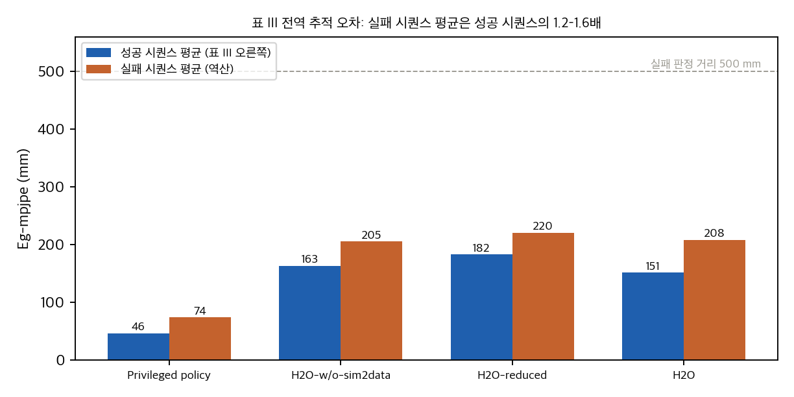
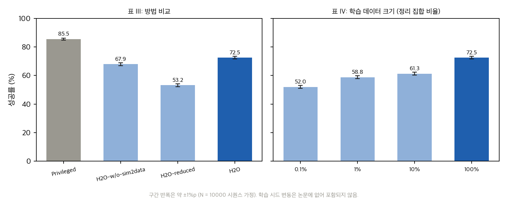
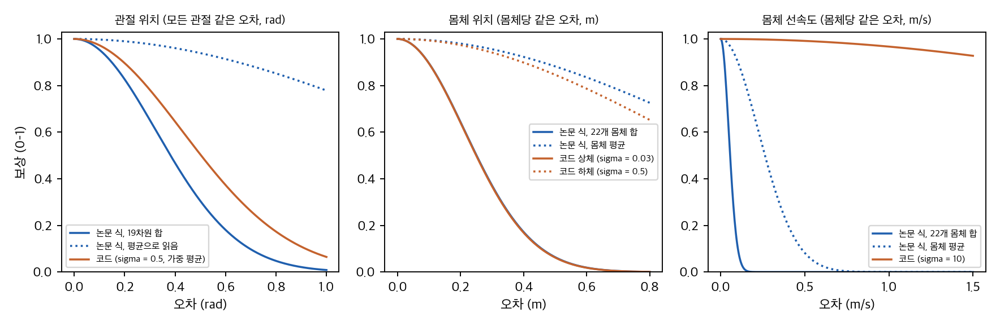

# 03. 수치 재계산, 일관성 검사, 주장 판정 (V1–V10, K1–K12, C1–C9)

재현 실험은 하지 않았습니다. 논문 표의 값을 `analysis/recompute.py`로 다시 계산했습니다(numpy, scipy, 수 초). 결과는 `analysis/recompute_results.json`에 있습니다. 그래프는 `analysis/plot_figures.py`가 `report/figures/own_*.png`로 그립니다. V는 재계산, K는 일관성 검사, C는 주장 판정입니다.

## 0. 방법과 가정

- **평가 시퀀스 수 N = 10000.** 표 III, IV의 평가 집합은 "uncleaned retargeted AMASS (10k sequences)"입니다. 정확한 N은 논문에 없어 10,000으로 둡니다. 구간은 Wilson 95%, 두 비율의 차이는 Newcombe 구간과 독립 z 검정입니다. 같은 시퀀스 집합을 모든 방법이 푸므로 쌍체(McNemar) 검정이 맞지만 시퀀스별 결과가 없어 쓰지 못합니다. 그래서 아래 구간은 "시퀀스 표본 변동만 본 근사"이고 쌍체 상관을 빼서 보수적입니다.
- **시드.** 논문 어디에도 학습 시드 수와 시드 간 변동이 없습니다. 표 III, IV는 단일 학습으로 읽어야 하고, 아래의 "유의"는 시드 변동을 뺀 값입니다. V10이 시드 변동에 대한 민감도를 보입니다.
- **표 III의 평균은 시퀀스 평균으로 읽습니다.** 전체 값 = 성공률 × 성공 평균 + (1 − 성공률) × 실패 평균 이라는 항등식을 씁니다(V1). 시간 가중 평균이면 이 항등식이 근사입니다.
- **보상 식의 노름(V9).** 논문 표 I의 ‖·‖²를 "몸체 전체 합"과 "몸체 평균" 두 가지로 읽어 비교합니다. 몸체 수는 H1 22점(관절 몸체 20 + 확장 손 2)을 가정합니다.

## 1. 재계산 (V)

### 1.1 V1. 표 III 성공/전체 평균에서 실패 시퀀스 평균 역산

| 방법 | Eg-mpjpe: 성공 → 실패(역산) | Empjpe: 성공 → 실패 | Eacc: 성공 → 실패 | Evel: 성공 → 실패 |
|---|---|---|---|---|
| Privileged policy | 46.0 → 73.6 (×1.60) | 40.9 → 59.5 (×1.46) | 5.2 → 16.9 (×3.3) | 6.2 → 17.2 (×2.8) |
| H2O-reduced | 182.5 → 220.3 (×1.21) | 111.0 → 121.3 (×1.09) | 3.0 → 20.5 (×6.8) | 8.1 → 20.3 (×2.5) |
| H2O-w/o-sim2data | 163.1 → 205.2 (×1.26) | 93.8 → 97.5 (×1.04) | 3.0 → 25.4 (×8.5) | 7.5 → 22.1 (×2.9) |
| H2O | 151.0 → 208.1 (×1.38) | 88.8 → 99.3 (×1.12) | 2.9 → 24.7 (×8.5) | 7.0 → 21.5 (×3.1) |

- 16개 셀 모두 실패 평균이 성공 평균보다 크고, 표 값의 반올림(±0.05)을 모두 고려해도 뒤집히지 않습니다. 표 내부는 일관됩니다.
- sim-to-real 정책의 실패 시퀀스 Eg-mpjpe는 205–220 mm로 서로 비슷하고, 성공 시퀀스 평균 차이(151–183)가 방법 간 차이를 더 만듭니다.
- **Eacc와 Evel은 성공 시퀀스에서는 sim-to-real 정책이 더 매끄럽습니다**(Eacc 2.9–3.0 대 특권 5.2, Evel 7.0–8.1 대 6.2는 반대로 조금 큼). 전체 평균에서 sim-to-real이 나빠 보이는 것은 실패 시퀀스(가속도 오차 20–25)의 비중 때문입니다. 본문의 "물리 현실성" 해석(§VI-A Metrics)에는 이 구분이 없습니다.

*그래프: 표 III의 성공 시퀀스 평균과 항등식으로 역산한 실패 시퀀스 평균(Eg-mpjpe). 우리가 그린 그래프입니다.*

### 1.2 V2. 상태 차원의 재구성 (138, 90, 778)

- 고유감각 66 = 관절각 19 + 관절속도 19 + 루트 선속도 3 + 루트 각속도 3 + 투영 중력 3 + 이전 행동 19.
- 목표 72 = 8 키포인트 × 3좌표 × 3항목(위치, 위치 차이, 기준 속도). 합 138이 표 III과 같습니다. reduced는 24 + 66 = 90으로 표 III의 R^90과 같습니다.
- 특권 정책 778: 공식 코드(`phc/phc/env/tasks/humanoid.py`)의 자기 관측 1 + 20 몸체 × 15 − 3 = 298, 과제 관측(`humanoid_im.py`, obs_v 6) 20 몸체 × 표본 1 × 24 = 480, 합 778. **표본 수 1을 가정할 때만** 778이 됩니다. 저장소의 H1 설정 네 개는 모두 `numTrajSamples: 3`이라 1,738차원이 됩니다(`04` D12).

### 1.3 V3. 시퀀스 수 흐름

N = 10,000에서 특권 정책 성공 85.5%는 8,550개이고 본문의 "∼8.5k out of 10k"와 맞습니다. 지워진 것은 1,450개(14.5%)입니다. 본문의 "AMASS 약 13k 시퀀스 → 10k 리타게팅"의 3k 손실은 단계 설명이 부족합니다(휴리스틱 필터의 효과로 보임). 공식 README의 리타게팅 로그는 15,886개 모션을 처리합니다(`04` D11). 13k, 15,886, 필터 파일의 수는 같은 집합이 아니거나 버전이 다릅니다.

### 1.4 V4. 성공률의 구간과 차이 검정 (N = 10000, 시드 제외)

| 비교 | 차이 (%p) | 95% 구간 | z | p (독립 근사) |
|---|---|---|---|---|
| H2O − H2O-w/o-sim2data | +4.6 | [3.33, 5.87] | 7.1 | 1e-12 |
| H2O − H2O-reduced | +19.3 | [17.98, 20.61] | 28.2 | < 1e-100 |
| H2O − Privileged | −13.0 | [−14.11, −11.88] | −22.6 | 1e-112 |
| 표 IV: 100% − 10% | +11.2 | [9.90, 12.49] | 16.8 | 1e-63 |
| 10% − 1% | +2.5 | [1.14, 3.86] | 3.6 | 3e-4 |
| 1% − 0.1% | +6.8 | [5.42, 8.17] | 9.7 | 4e-22 |
| H2O-reduced − 0.1% 데이터 H2O | +1.2 | [−0.18, 2.58] | 1.7 | 0.09 |
| H2O-w/o-sim2data − 10% | +6.6 | [5.28, 7.92] | 9.8 | 2e-22 |

- 각 성공률의 Wilson 구간 반폭은 0.9–1.0%p입니다.
- 시퀀스 표본 변동만으로는 모든 방법 간 차이가 확실합니다. 가장 작은 +4.6%p(sim-to-data의 효과)도 구간이 [3.3, 5.9]입니다. 평가 시퀀스가 1,000개뿐이었다면 [0.6, 8.6], 500개면 [−1.1, 10.2]입니다(N 민감도).
- **다만 이는 같은 학습 한 번을 다른 시퀀스로 평가했을 때의 변동입니다.** RL 학습의 시드 간 변동은 이보다 클 수 있고 논문에 없습니다(V10).
- 흥미로운 비교: **학습 데이터 약 9개 시퀀스(0.1%)의 H2O가 전체 데이터의 H2O-reduced(53.2%)와 차이가 없습니다**(+1.2%p, p = 0.09). 목표 상태의 설계(위치 차이와 속도)가 데이터를 1000배 늘리는 것과 같은 크기입니다.

*그래프: 표 III와 표 IV의 성공률과 Wilson 95% 구간(N = 10,000 가정, 시드 변동 미포함). 우리가 그린 그래프입니다.*

### 1.5 V5. 표 IV 데이터 크기 곡선

- 로그10 데이터 비율에 대한 선형 적합 기울기는 +6.4%p/decade(R² = 0.94)입니다. 그러나 구간별 증가는 +6.8(0.1→1%), +2.5(1→10%), +11.2(10→100%)로 **마지막 한 decade에서 가장 크게 가속**합니다. 로그 선형 곡선이 아닙니다.
- Empjpe(루트 상대 오차)는 10%(92.3)와 100%(91.7)가 사실상 같은데 성공률은 61.3에서 72.5로 오릅니다. 데이터가 늘어 평균 추적이 좋아진다기보다 **꼬리 시퀀스(실패하던 것)를 더 맞히게 된다**는 해석과 맞습니다. 이는 평가 집합이 학습 집합을 포함하기 때문일 수도 있습니다(C4).
- Eacc와 Evel은 비단조입니다(1%→10%에서 10.7→10.8, 12.0→12.1). 같은 선상에서 성공률은 단조 증가이고 이 비단조는 수치 크기가 0.1 수준이라 반올림 범위입니다.

### 1.6 V6. 지운 시퀀스와 정리 집합의 성공률 분해

표 III의 전체 성공률 = 0.855 × (정리 집합 성공률) + 0.145 × (지운 집합 성공률)입니다. 지운 집합이 정확히 "특권 정책이 실패한 시퀀스"라는 가정(§IV-B의 정의)에서:

| 지운 집합 성공률 | 0 | 0.1 | 0.25 | 0.5 |
|---|---|---|---|---|
| H2O의 정리 집합 성공률 | 84.8% | 83.1% | 80.6% | 76.3% |
| H2O-reduced의 정리 집합 성공률 | 62.2% | 60.5% | 58.0% | 53.7% |

- 특권 정책은 정의상 정리 집합에서 100%입니다. H2O는 지운 집합을 하나도 못 맞춰도 정리 집합에서 84.8%입니다. 즉 **H2O의 72.5% 중 어떤 경우에도 정리 집합에서 최소 15%는 실패**합니다.
- **13.0%p 격차는 전부 정리 집합에서 생깁니다.** 지운 집합은 특권 정책도 정의상 0이므로 그 격차에 기여하지 않습니다(H2O가 지운 집합에서 일부 맞히면 정리 집합 격차는 더 커집니다). 정리 집합 안의 실제 격차는 15.2%p 이상이고, 논문이 이를 "관측과 DR" 두 요인으로 돌리는 것은 이 크기로 읽어야 합니다(C6).
- H2O-w/o-sim2data는 이 집합들로 나눌 수 없습니다(학습 집합이 달라 정리 집합이 "본 데이터"가 아님).

### 1.7 V7. 표 I 보상 가중치의 규모

과제 보상 가중치 합은 24 + 24 + 40 + 16 + 60 + 60 = 224입니다. 종료 벌점(−200)은 한 스텝 최대 과제 보상(224)보다 작고 γ = 0.99에서 남은 보상의 흐름이 더 큽니다. 공식 코드는 모든 보상 척도에 정책 주기(0.02 s)를 곱하므로(`legged_robot.py` `_prepare_reward_function`) 표의 가중치가 dt를 곱하기 전 값인지 논문은 말하지 않습니다.

### 1.8 V8. 표 II와 코드 설정 값의 수치 대조 (`04`에서 자세히)

| 항목 | 논문 표 II | 공식 설정 (`cfg/domain_rand/domain_rand_teleop.yaml`) |
|---|---|---|
| 마찰 | U(0.2, 1.1) | U(−0.6, 1.2), 음수 구간이 33% |
| 밀기 속도 | 0.5 m/s, 5 s | 1.0 m/s (xy 각 성분 ±), 5 s |
| 제어 지연 | U(20, 60) ms | 정수 스텝 0–3 (0, 20, 40, 60 ms) |
| 토크 RFI | 0.1 × 한계 | 0.1 × 한계 × 관절별 U(0.5, 1.5) |
| 조기 종료 거리 | 평균 0.5 m (§V-D) | README 명령 1.5 m (기본 5.0 m), 몸체별 최댓값 |

### 1.9 V9. 보상 커널 토이: 같은 오차에서 논문 식과 코드 식의 값

모든 관절 또는 몸체에 같은 오차를 넣고 보상 값을 비교합니다(`recompute.py` V9). 보상 0.5가 되는 오차("반감 오차"):

| 항목 | 논문 식 (몸체 합으로 읽음) | 논문 식 (몸체 평균으로 읽음) | 코드 |
|---|---|---|---|
| 관절 위치 (rad, 관절당) | 0.38 | 1.67 | 0.50 (가중 평균, σ = 0.5) |
| 몸체 위치 (m, 몸체당) | 0.25 | 1.18 | 상체 0.25 (σ = 0.03), 하체 1.02 (σ = 0.5) |
| 몸체 선속도 (m/s, 몸체당) | 0.056 | 0.26 | **4.56** (σ = 10) |

- **위치 항은 "몸체 합으로 읽으면" 코드와 크기가 같습니다**(관절 0.38 대 0.50, 상체 0.25 대 0.25). 합 읽기가 저자의 의도라면 위치 커널은 논문과 코드가 일치합니다.
- **속도 항은 어느 읽기로도 코드가 17–81배 완만합니다.** 코드의 속도 보상은 몸체당 1 m/s 오차에서도 0.967로 거의 1에 붙어 있어 속도 추적 신호가 거의 없습니다. 가중치도 코드 8 대 논문 60입니다(`04` D2).
- 이 토이는 식의 모양만 비교한 것이고 어느 쪽으로 학습했는지는 말해주지 못합니다. 학습 로그가 필요합니다.

*그래프: 같은 오차에서 논문 식(몸체 합과 평균 두 해석)과 공식 코드 식의 보상 값. 우리가 그린 그래프입니다.*

### 1.10 V10. 시드 변동 민감도

학습 시드 SD(%p)를 가정하고 +4.6%p(H2O 대 w/o-sim2data)를 Welch 검정하면:

| 시드 SD | 3시드 | 5시드 |
|---|---|---|
| 1%p | p = 0.005 | p = 0.0001 |
| 2%p | p = 0.048 | p = 0.007 |
| 3%p | p = 0.13 | p = 0.04 |

시드 SD가 2%p를 넘으면 3시드로는 이 효과를 가르기 어렵습니다. 논문에 시드 정보가 없으므로 sim-to-data의 효과 +4.6%p는 "시퀀스 표본 변동으로는 확실, 학습 변동으로는 미확인"입니다.

## 2. 일관성 검사 (K)

| 번호 | 검사 | 결과 |
|---|---|---|
| K1 | 상태 차원 138, 90, 778 | 138과 90은 식으로 재구성됨. 778은 20 몸체 × 표본 1에서만 맞음 (V2) |
| K2 | 85.5% 대 "약 8.5k / 10k" | 일치 (V3) |
| K3 | 표 III의 H2O 행 대 표 IV 100% 행 | 다섯 값(72.5, 166.7, 91.7, 8.9, 11.0)이 모두 같음 |
| K4 | 표 III 내부 평균의 항등식 | 16개 셀 모두 일관 (V1). 다만 "성능 저하" 해석은 실패 시퀀스 비중 때문이며 성공 시퀀스의 Eacc는 sim-to-real이 더 낮음 |
| K5 | 초록 "only an RGB camera" 대 §VI-B | **불일치(서술).** 루트 선속도를 MoCap(50 Hz)으로 얻음. 본문이 "온보드 오도메트리로 대체 가능"이라 인정하나 이 논문의 시스템은 RGB 단독이 아님. 감사의 글은 같은 방에서 CMU MoCap 데이터를 썼다고 적음 |
| K6 | 정책 주기와 목표 입력 주기 | 정책 50 Hz와 PD 200 Hz는 그림 4에만 있고 본문에 없음. 포즈 추정은 30 Hz라 목표가 정책 주기보다 느림. 기준 속도 ṗ̂의 계산 방법(유한 차분, 필터)이 없음 |
| K7 | H2O 수치의 다른 논문 값 | 후속 논문(OmniH2O)은 H2O를 87.52%로 보고, 이 논문의 표 III은 72.5%. 평가 시퀀스 집합이 달랐을 가능성이 큼(이 논문은 지운 집합 포함 10k, 후속은 14k 규모로 읽힘). 후속의 H2O 재평가 절차는 확인하지 못해 설명할 수 없음 |
| K8 | 성공 판정 정의 | 본문 "평균 몸체 거리가 평균 0.5 m 이상" 정의가 §V-D 조기 종료 기준과 같음(학습 종료 기준 = 평가 성공 기준). 공식 코드는 학습 종료를 몸체별 최댓값(README에서 1.5 m)으로 둠 (`04` D6) |
| K9 | 본문의 "0.1% 데이터" | 학습 시퀀스 약 8–9개. 어느 시퀀스를 뽑았는지에 성공률이 크게 좌우됨. 한 번 뽑은 값 |
| K10 | 데이터 수 | 논문 13k → 10k → 8.5k, README 리타게팅 로그 15,886, 후속 논문이 쓴 필터본은 14k 규모. 같은 파일이 아님 (V3) |
| K11 | 원고 표기 | "teleportation"(§I), "proximal policy gradient", "imfeasible", 표 III 캡션 "imtiation" 같은 오타. 내용에는 영향 없음 |
| K12 | 표 I 가중치 대 코드 | 표 I의 값과 코드 값이 전체적으로 다름 (`04` D3) |

## 3. 주장 판정 (C)

| 번호 | 주장 (위치) | 판정 | 근거 |
|---|---|---|---|
| C1 | 처음으로 학습 기반 실시간 전신 휴머노이드 원격조작을 시연 (초록) | 검정 불가 | 우선권 주장. 같은 시기 ExBody(상체 + 속도)와 구분함(§I). 이 분석은 선행을 조사하지 않음 |
| C2 | sim-to-data가 성공률을 올림 (§VI-A, 표 III) | 부분적으로 지지 | +4.6%p는 시퀀스 변동으로 확실(V4)하나 시드 변동 미확인(V10). H2O는 정리 집합을, w/o-sim2data는 전체를 학습해 평가 집합(전체 10k)과의 겹침이 다름. "정리하면 학습 효율이 오른다"와 "평가 집합이 정리 집합에 가깝다"가 섞여 있음. 정리 집합만 따로 평가한 값 없음 |
| C3 | 목표 상태에 위치 차이와 속도를 넣으면 대규모 일반화가 좋아짐 (표 III) | 방향은 확실, 원인 분리 불가 | +19.3%p [18.0, 20.6]. reduced와 full의 차이는 위치 차이 24차원 + 속도 24차원 두 가지를 동시에 추가한 것. 어느 쪽이 기여하는지 알 수 없음 |
| C4 | 데이터가 늘수록 계속 좋아짐 (표 IV) | 방향만 지지 | 성공률은 단조 증가하나 증가폭이 마지막 decade에서 가속(V5). 평가가 학습 시퀀스를 포함해 일반화와 암기를 분리하지 못함. 0.1% 한 번 추출 |
| C5 | 실물에서 동적 동작과 외란에 강건 (§VI-B, 그림 1, 5–7) | 검정 불가 | 정성적 그림만. 시도 수, 성공률, 오차, 지연 없음. 실패 사례 없음 |
| C6 | 특권 정책 대비 저하는 관측 정보와 sim-to-real 정규화 때문 (§VI-A) | 검정되지 않음 | 두 요인을 분리하는 실험이 없음. V6: 격차는 정리 집합에서 15.2%p 이상(H2O는 정리 집합에서 최대 84.8%) |
| C7 | 특권 정책의 실패가 "H1에게 불가능한 동작"을 뜻함 (§IV-B) | 정의에 가까움 | 필터가 한 정책(한 번의 학습)의 능력에 종속. 더 강한 정책은 더 적게 지움. §VII가 "체계적 알고리즘이 없음"을 인정 |
| C8 | 학습 데이터가 적어도 필터링으로 성능이 오름 (§VI-A) | 부분적으로 지지 | 72.5(약 8.5k 학습) 대 67.9(10k 학습)는 사실. 다만 표 IV가 보이듯 데이터 양 자체가 성공률에 크게 작용(10% → 100%에서 +11.2%p)해서, 학습 시퀀스 수가 다른 두 행을 정리의 효과로만 읽기는 어려움(같은 8.5k를 무작위로 뽑은 대조군이 없음) |
| C9 | 초록 "RGB 카메라만으로" | 부분적으로 거짓 | K5. 선속도는 MoCap |

## 4. 이 문서의 한계

- N = 10,000과 "시퀀스 평균" 가정에 기대는 계산입니다(§0).
- 표 III, IV의 모든 값은 단일 학습으로 읽었습니다. 시퀀스별 결과가 없어 쌍체 검정을 못 했습니다.
- V9는 식의 모양 비교이고 학습 결과가 아닙니다. 몸체 22점 가정(합 읽기)에 의존합니다.
- 실물 결과는 지표가 없어 재계산할 것이 없습니다.
