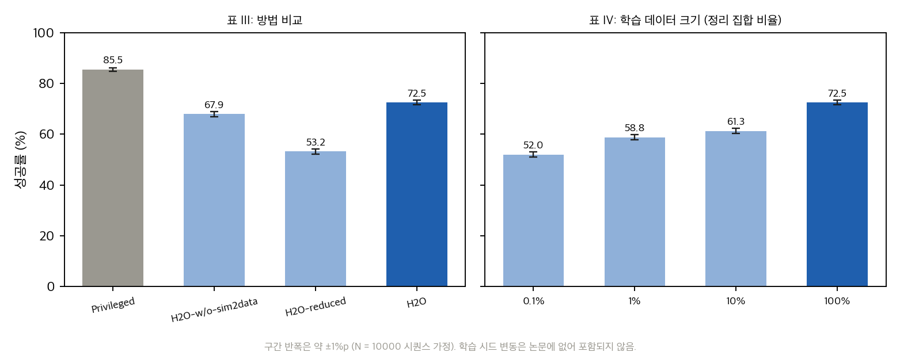
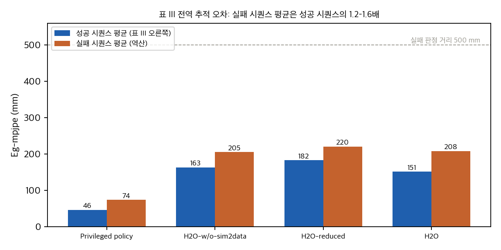
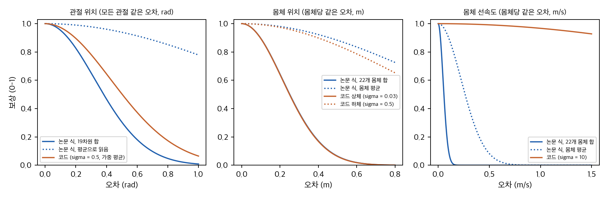

> **논문:** Tairan He, Zhengyi Luo, Wenli Xiao, Chong Zhang, Kris Kitani, Changliu Liu, Guanya Shi. *Learning Human-to-Humanoid Real-Time Whole-Body Teleoperation.* IROS 2024, arXiv:2403.04436 (v1, 2024-03-07).
> 공식 코드(CC BY-NC 4.0, LeCAR-Lab/human2humanoid)는 정적으로만 읽었고 실행하지 않았습니다. 논문 라이선스가 CC BY가 아니라서 논문 그림은 싣지 않고, 우리가 그린 그래프만 씁니다.

## 논문이 묻는 것

사람이 웹캠 앞에서 움직이면 실물 휴머노이드(Unitree H1)가 같은 동작을 실시간으로 따라 하게 할 수 있을까요? 기존 전신 원격조작은 모델 기반 제어기에 외골격이나 힘 센서가 필요했습니다. H2O는 RL로 이를 풉니다.

세 부분으로 이뤄집니다. 첫째, AMASS 모션 약 13k를 H1에 맞춰 10k를 얻고, **모든 몸체의 상태를 아는 특권 정책이 따라 하지 못하는 시퀀스를 지워** 약 8.5k를 남깁니다(sim-to-data). 둘째, 이 데이터로 138차원 입력(고유감각 66 + 8개 키포인트의 위치, 위치 차이, 기준 속도 72)의 추적 정책을 DR과 함께 학습합니다. 셋째, 웹캠과 HybrIK(30 Hz) 포즈로 실물 H1을 움직입니다.

## 이 글에서 확인한 것

**1. 필터링의 효과(+4.6%p)는 시퀀스 변동으로는 확실하지만 시드 정보가 없습니다.** 표 III에서 H2O 72.5%, 필터를 쓰지 않은 H2O 67.9%입니다. 평가 시퀀스를 10,000개로 두면 차이의 95% 구간은 [3.3, 5.9]입니다. 그러나 논문에는 학습 시드 수와 시드 간 변동이 없습니다. 시드 SD가 2%p라면 3시드의 Welch 검정은 p = 0.048이고, 3%p라면 p = 0.13입니다.

*그래프 (우리가 그림). 표 III(방법 비교)와 표 IV(학습 데이터 크기)의 성공률과 Wilson 95% 구간입니다. 시드 변동은 들어 있지 않습니다.*

**2. 특권 정책과의 격차 13%p는 정리 집합에서 생깁니다.** 지운 시퀀스는 특권 정책도 정의상 하나도 못 맞춘 집합입니다. 그래서 전체 72.5%는 0.855 × (정리 집합 성공률) + 0.145 × (지운 집합 성공률)이고, 지운 집합에서 하나도 맞히지 못해도 H2O는 정리 집합에서 최대 84.8%입니다. 정리 집합에서도 최소 15%는 실패한다는 뜻입니다. 논문은 이 격차를 "정보가 적은 관측"과 "sim-to-real 정규화" 두 요인으로 돌리지만 둘을 분리한 실험은 없습니다.

**3. 데이터 9개짜리 정책이 전체 데이터의 축소판 정책과 같습니다.** 표 IV의 0.1% 데이터(약 9개 시퀀스)는 성공률 52.0%이고, 전체 데이터로 학습하되 목표 상태를 위치만으로 줄인 H2O-reduced는 53.2%입니다(차이 +1.2%p, p = 0.09). 목표 상태의 설계가 데이터를 1000배 늘리는 것과 비슷한 크기라는 뜻입니다. 표 IV는 마지막 한 decade(10% → 100%)에서 +11.2%p로 가장 크게 오르고, 평가 집합이 학습 시퀀스를 포함합니다. 데이터 크기 곡선은 일반화 곡선이 아닙니다.

**4. 표 III의 평균은 서로 맞습니다.** 성공 시퀀스 평균과 전체 평균에서 실패 시퀀스 평균을 역산하면 16개 셀 모두 실패 평균이 더 큽니다. 한 가지 흥미로운 점은, 성공 시퀀스만 보면 sim-to-real 정책의 가속도 오차(2.9–3.0)가 특권 정책(5.2)보다 낮다는 것입니다. 전체 평균에서 나빠 보이는 것은 실패 시퀀스의 비중 때문입니다.

*그래프 (우리가 그림). 표 III의 전역 추적 오차(Eg-mpjpe)입니다. 실패 시퀀스 평균은 전체 = 성공률 × 성공 평균 + (1 − 성공률) × 실패 평균 항등식으로 역산했습니다.*

**5. 실물 결과는 정성적입니다.** 그림 1, 5–7이 전부이고 시도 수, 성공률, 오차, 지연이 없습니다. 초록의 "RGB 카메라만"과 달리 루트 선속도는 MoCap(50 Hz)으로 얻습니다. 본문이 온보드 오도메트리로 대체할 수 있다고 적기는 합니다.

## 공식 코드와 논문의 차이

공식 저장소는 논문보다 6.5개월 뒤에 공개된, **OmniH2O와 공용인 코드베이스**입니다. H2O 학습은 README의 명령 한 줄이고, 그 명령이 `omnih2o_teacher` 보상 파일을 씁니다. 관측 138차원, 제어 주파수(정책 50 Hz, PD 200 Hz), 8개 키포인트는 논문과 맞습니다. 다음은 다릅니다.

- **보상.** 과제 보상의 선속도와 각속도 가중치가 8 대 60입니다. 속도 커널은 몸체 합으로 읽어도 논문 식보다 17–81배 완만해서 몸체당 1 m/s 오차에서도 보상이 0.967입니다. 논문 표 I에 없는 항이 있습니다(착지 시 최대 발 높이가 0.25 m보다 낮으면 −2500, 양발 공중 −200 등).
- **종료 조건.** 논문은 평균 링크 거리 0.5 m, 기저 높이 0.3 m인데, 코드 설정은 몸체별 최댓값 1.5 m(README 명령)이고 높이 종료가 꺼져 있습니다. 접촉 종료가 추가됩니다.
- **무작위화.** 마찰 범위가 [−0.6, 1.2](음수 구간 33%), 밀기 1.0 m/s(논문 0.5), 지연 0–60 ms(논문 20–60 ms)입니다. 논문에 없는 관측 잡음과 기준 키포인트 오프셋이 있습니다.
- **빠진 것.** 평가 스크립트(공저자도 이슈에서 제공하지 않았다고 답함), 필터링 스크립트, 가중치, 실로봇 배포 코드가 없습니다. 필터를 통과한 모션 파일은 외부 링크로만 있습니다.

*그래프 (우리가 그림). 모든 관절 또는 몸체에 같은 오차를 넣었을 때의 보상입니다. 논문 식의 노름을 몸체 합으로 읽으면 위치 항은 코드와 크기가 같고, 속도 항만 코드가 훨씬 완만합니다.*

위의 토이는 식의 모양만 비교한 것입니다. 어느 쪽으로 학습했는지는 학습 로그가 있어야 알 수 있습니다.

## 이 맥에서 구현할 수 있는가

**논문 수치와 실물 시연의 재현은 불가능합니다.** 공식 코드는 Isaac Gym Preview 4(Linux, NVIDIA GPU)를 전제하고, 평가와 필터 스크립트가 없어 표 III, IV를 다시 만들 수 없으며, 실물에는 H1과 MoCap이 필요합니다. 리타게팅 스크립트는 AMASS와 SMPL 다운로드, 새 설치, 실행 승인이 있으면 조건부로 돌릴 수 있습니다. 표 재계산과 보상 커널 비교는 끝냈습니다. 소형 MuJoCo 축소판(보상 σ, 필터 효과, 시드 변동)은 새 설치 없이 시작할 수 있고 노력은 3–5주(추정, 측정 전)입니다.

## 남은 질문

- 논문 실험의 보상과 종료 설정은 표 I, §V-D의 값입니까, README 명령의 값입니까?
- 표 III, IV의 시드 수와 변동은?
- 정리 집합의 크기(8.5k)와 공개 필터 파일의 시퀀스 수의 관계는?
- 실로봇 평가의 시도 수와 실패 사례는?

분석 문서 01–04, 재계산 스크립트와 결과, 통합 리포트는 같은 폴더의 git 패키지에 있습니다.

## 자료

- [통합 리포트 PDF](report/report_public.pdf)
- [01. 논문 분석: Learning Human-to-Humanoid Real-Time Whole-Body Teleoperation (H2O)](analysis/01_paper_analysis.md)
- [02. 선행연구, 구성 요소의 출처, GitHub와 자료](analysis/02_prior_work.md)
- [03. 수치 재계산, 일관성 검사, 주장 판정 (V1–V10, K1–K12, C1–C9)](analysis/03_analysis.md)
- [04. 공식 코드 대조 (정적 읽기): D1–D17, 구현 가능성 판정](analysis/04_code_verification.md)
