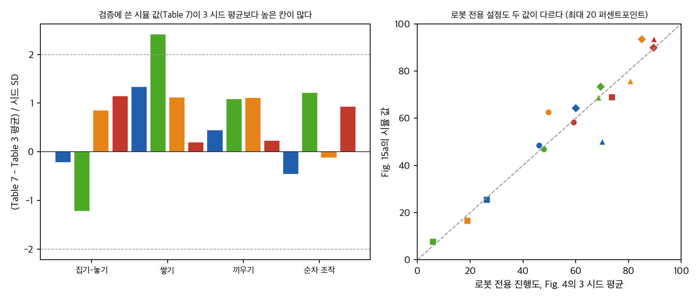
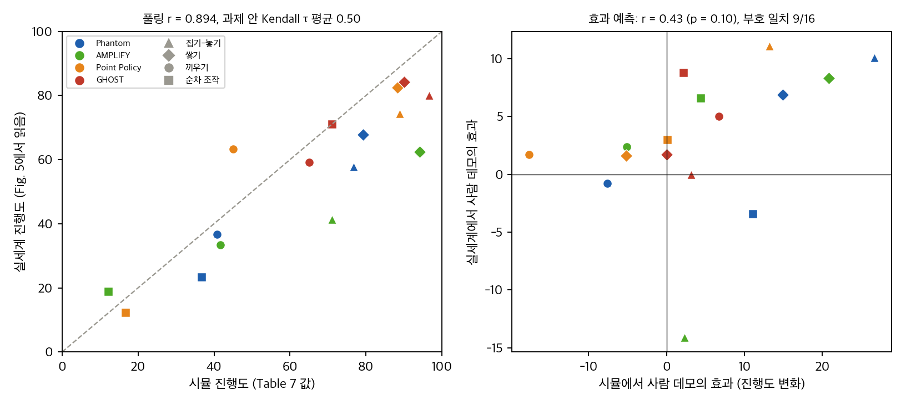
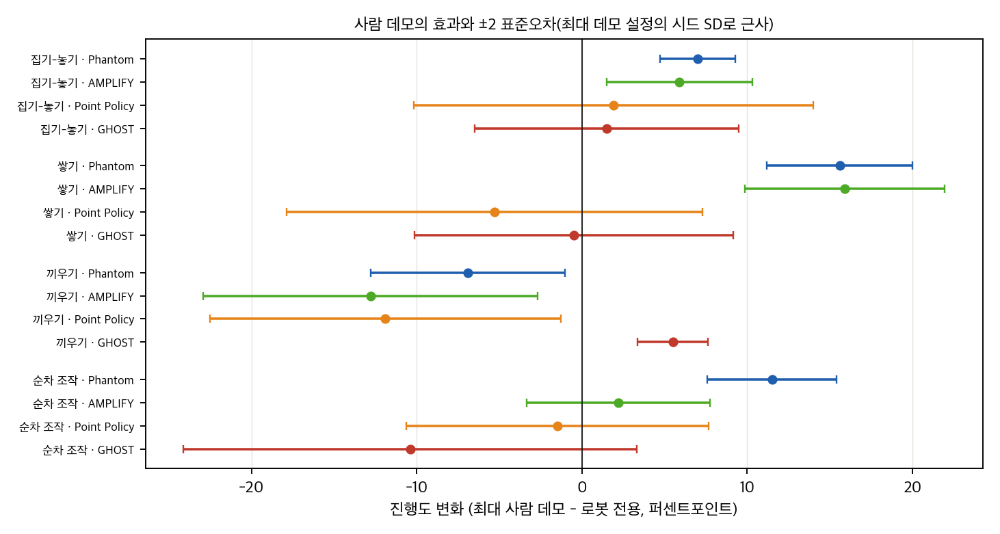

> **논문:** Chuyang Xiao, Haotian Zhan, Sriram Krishna, Peilin Meng, Muhammad Zubair Irshad, Sergey Zakharov, David Held. *H2RBench: A Real-to-Sim Benchmark for Evaluating Human-to-Robot Transfer.* CoRL 2026 포스터, arXiv:2609.24778 (v3, 2026-10-25).
> 공식 코드는 GitHub xiaochy/H2RBench(MIT)에 있습니다. 논문은 arXiv 비독점 배포 라이선스(CC 아님)라서 이 글에는 논문 그림을 싣지 않고, 우리가 다시 그린 그래프만 넣었습니다.

## 논문이 묻는 것

사람 영상으로 로봇 정책을 배우는 H2R 방법은 늘어났지만, 방법마다 과제, 장면, 로봇 데이터 양이 달라서 서로 비교하기 어렵습니다. H2RBench는 실제 작업대를 PolaRiS로 재구성한 시뮬 과제 네 개(집기-놓기, 쌓기, 끼우기, 순차 조작)에서 **로봇 데모 수는 고정하고 사람 데모 수만 바꿔** Phantom, Point Policy, AMPLIFY, GHOST를 비교합니다. 사람 쪽은 시뮬 손이 아니라 실제 영상을 씁니다. 마지막으로 같은 방법을 실로봇에서도 학습해 시뮬 순위가 실세계 순위를 예측하는지(Pearson r 0.89, Spearman ρ 0.85, MMRV 0.06) 확인합니다.

## 이 글에서 확인한 것

**1. 보고된 Sim-vs-Real 지표는 정확히 재현됩니다.** 실세계 수치는 어떤 표에도 없고 산점도에만 있습니다. 벡터 그림의 점 좌표를 읽어 16개 방법–과제 쌍을 되살리면 r 0.894, ρ 0.851, MMRV 0.060이 소수 셋째 자리까지 맞고(과제별 MMRV는 ±0.001 이내), 로봇 전용 조건과 부록의 부분 집합 표(AMPLIFY 제외, 쌓기 제외)도 모두 맞습니다. 점은 신뢰할 수 있습니다. 다만 실세계 시도 수는 논문에 없습니다.

**2. 검증에 쓴 시뮬 값은 Table 3의 평균이 아닙니다.** 산점도의 "Success Rate" 축은 진행도이고, 시뮬 x값 16개는 3 시드 평균(Table 3)이 아니라 부록 Table 7의 값과 같습니다. Table 7이 평균보다 평균 3.5 퍼센트포인트 높습니다. 로봇 전용 설정에서도 산점도의 시뮬 값과 확장 곡선의 3 시드 평균이 최대 20 퍼센트포인트 다릅니다(Phantom 집기-놓기 50.0 대 70.0). 로그 오즈 이득(Fig. 3B)도 본문 정의의 "성공률"이 아니라 진행도로 계산되어 있습니다.

*그래프: 우리가 그린 그래프. 왼쪽은 (Table 7 − Table 3 평균) / 시드 SD, 오른쪽은 Fig. 15a의 시뮬 값 대 Fig. 4의 3 시드 평균. 점 좌표는 논문 그림에서 읽었습니다.*

**3. 절대 수준은 맞지만 사람 데모의 효과는 거의 예측하지 못합니다.** 이 벤치마크의 목적은 "사람 데모가 도움이 되는가"의 비교입니다. 그런데 사람 데모의 효과(최대 사람 − 로봇 전용)를 시뮬과 실세계에서 비교하면 상관이 r = 0.43(p = 0.096), 부호 일치가 9/16입니다. 3 시드 평균으로 시뮬 효과를 정의하면 r = 0.06입니다. 과제 안에서 네 방법의 순위를 보면 Kendall τ가 집기-놓기 1.00, 끼우기 0.33, 순차 0.67, 쌓기 0.00(평균 0.50)입니다. 읽기 오차와 시뮬 값 불일치 때문에 불확실하지만, 논문이 검증한 것은 절대 수준의 순위이고 효과 예측은 아닙니다. 실세계 시도를 30회로 가정한 잡음 시뮬레이션에서 MMRV의 95% 구간은 0.025–0.136입니다.

*그래프: 우리가 그린 그래프. 왼쪽은 시뮬 대 실세계 진행도(16점), 오른쪽은 사람 데모의 효과를 시뮬과 실세계에서 비교한 것. 모양은 과제, 색은 방법.*

**4. 사람 데모의 효과는 방법과 과제에 따라 갈리고, 상당수는 시드 잡음 범위 안입니다.** 쌓기에서 Phantom과 AMPLIFY는 +16 포인트 가까이 오르지만 Point Policy(−5.3)와 GHOST(−0.5)는 오르지 않습니다. 로봇 전용 성능이 이미 높은 방법에는 이득이 없습니다. 끼우기는 4개 중 3개가 −7에서 −13 포인트 떨어집니다. 16칸 중 7칸은 시드 SD로 근사한 ±2 표준오차 안입니다. 사람 데모 수 4개 수준의 확장 곡선 16개 중 단조는 2개뿐입니다.

*그래프: 우리가 그린 그래프. 진행도 변화(최대 사람 데모 − 로봇 전용)와 ±2 표준오차. 표준오차는 최대 데모 설정의 시드 SD로 근사했습니다.*

**5. 쌓기와 순차 조작에서는 로봇 전용 Diffusion Policy가 모든 H2R 방법보다 높습니다.** 부록 Table 10에서 로봇 100회로만 학습한 Diffusion Policy는 쌓기 진행도 95.0 / 성공 80.0, 순차 82.2 / 63.3입니다. 사람 데모를 쓴 H2R 최고(GHOST)는 88.9 / 76.7과 63.3 / 38.9입니다. 끼우기만 GHOST가 크게 앞섭니다(64.7 대 41.7, 성공 34.5 대 0.0). 본문 Q1은 이 기준선을 언급하지 않습니다.

**6. GHOST의 우위는 과제마다 다릅니다.** Table 3의 8개 지표에서 GHOST가 모두 최고지만, 시드 3개 Welch 검정 p는 끼우기 0.003(진행도)과 0.008(성공), 순차 진행도 0.027이고 집기-놓기와 쌓기는 0.08–0.43입니다.

**7. 평가 규칙은 코드에만 있고 느슨합니다.** 공식 코드를 정적으로 읽었습니다(실행하지 않음). 진행도는 "한 번이라도 도달한 기준의 비율"이고 성공은 모든 기준을 한 번씩 거친 것입니다. 성공해도 에피소드는 끝나지 않고 길이는 300 스텝(15 Hz, 20 s)입니다. 닿기 판정은 20 cm이고 놓기와 끼우기는 XY 상자 겹침과 원점 거리로 판정합니다. 쌓기의 3단계와 장난감 세 개는 의존성이 없어 순서가 강제되지 않습니다. 또 방법마다 IK 실패 처리와 그리퍼 이진화가 달라 같은 인터페이스라고 보기 어렵습니다. 부록 B.3의 분포 밖 배치 실험은 쌓기라고 쓰였지만 저장소의 배치 변형 설정은 머그 환경에만 있습니다.

## 공식 코드와 재현 가능성

공식 저장소는 평가 하네스(환경 등록, 진행도 규칙, 서버–클라이언트, 데이터 생성)입니다. 네 방법의 학습 코드, 체크포인트, 평가 결과, 쌓기와 끼우기와 장난감 장면의 자산은 저장소에 없고, 사람 데이터는 약 63 GB입니다. 환경은 Isaac Sim과 Isaac Lab 2.3(NVIDIA RTX, CUDA 13)을 전제하므로 GPU 없는 기기에서는 벤치마크를 돌릴 수 없습니다. 이 글의 모든 수치는 논문 표와 그림에서 재계산한 것입니다. 노력 추정(측정 전): 리눅스 + RTX에서 환경과 한 방법 평가 2–5일, 네 방법 전부 2–4주입니다.

## 한계

그림 읽기 오차는 벡터 그림 약 0.1, 래스터 그림 약 0.5 퍼센트포인트입니다. 가려진 점 세 개는 눈으로 추정했습니다. 실세계 시도 수가 없어 30회라는 가정으로 잡음을 시뮬레이션했습니다. 공식 코드는 정적으로 읽었고 임계값이 실제 시뮬에서 어떻게 작동하는지는 확인하지 않았습니다.

## 자료

- [통합 리포트 PDF](report/report_public.pdf)
- [01. 논문 분석: H2RBench](analysis/01_paper_analysis.md)
- [02. 선행연구, 가까운 대안, 코드 저장소](analysis/02_prior_work.md)
- [03. 수치 재계산, 일관성 검사, 주장 판정](analysis/03_analysis.md)
- [04. 공식 코드 대조와 구현 가능성](analysis/04_code_verification.md)
