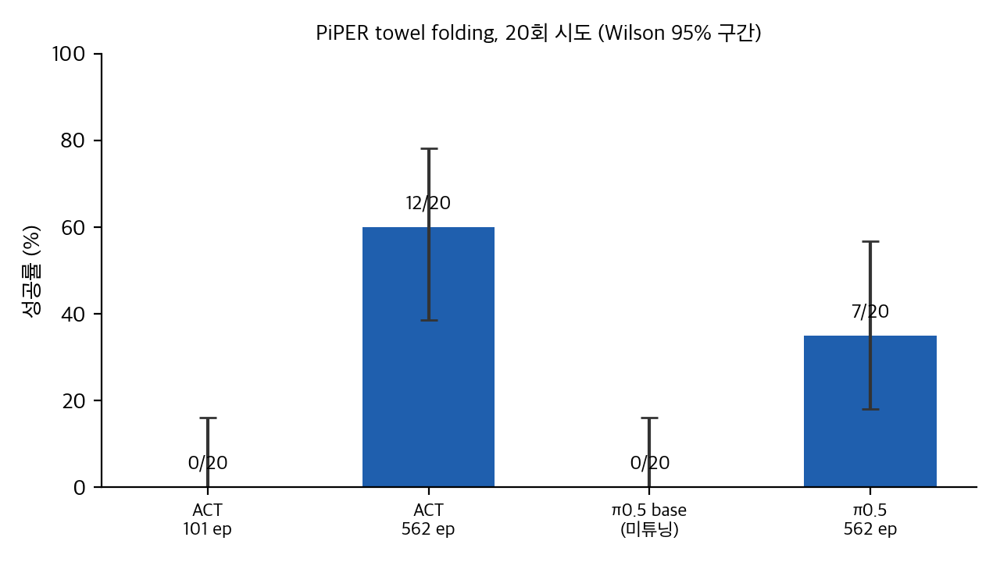
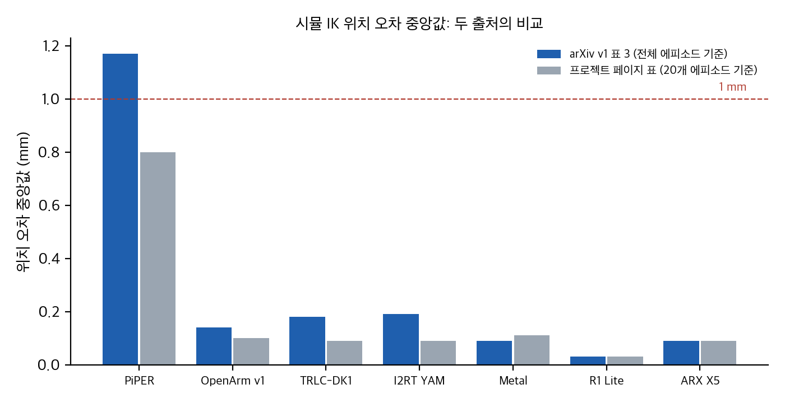

# HandUMI: 손에 끼는 로봇 없는 기록 장치, 숫자로 다시 보기

HandUMI는 로봇 없이 사람 손에 끼고 양손 시연을 모으는 장치입니다. 손가락 턱은 로봇 그리퍼에 맞는 교체형 팁을 쓰고, 기록은 로봇과 무관한 형식으로 저장한 뒤 여러 양팔 로봇에 역기구학(IK)으로 재생합니다. 논문은 562개 로봇 없는 시연으로 PiPER 두 대가 수건을 반으로 접는 정책을 학습했다고 보고합니다.

이 글은 논문 본문, 프로젝트 페이지, 공식 저장소(Apache-2.0)를 대조해 숫자를 다시 계산한 결과입니다. 재현은 하지 않았습니다. 학습은 GPU가 필요하고 실로봇 평가에는 로봇이 필요하기 때문입니다.

## 실로봇 성공률은 차이를 말하지 못합니다

| 모델 | 학습 데이터 | 성공 | Wilson 95% |
|---|---|---|---|
| ACT | 101개 | 0/20 | 0.0–16.1% |
| ACT | 562개 | 12/20 | 38.7–78.1% |
| π0.5 기본 (미튜닝) | 없음 | 0/20 | 0.0–16.1% |
| π0.5 | 562개 | 7/20 | 18.1–56.7% |

ACT 562와 π0.5 562의 정확 Fisher 검정 p는 0.205입니다. 논문의 0.20과 맞습니다. 그러나 시도가 20회뿐이라 검출력은 약 0.23입니다. 60%와 35%의 차이를 80% 확률로 잡으려면 모델당 약 70회가 필요합니다. "차이가 없다"가 아니라 "이 실험으로는 판정할 수 없다"가 맞습니다.

그래프: 우리가 그린 그림. 논문 그림 2의 성공 횟수(20회)에서 계산한 성공률과 Wilson 95% 구간.

## 두 출처의 IK 수치가 다릅니다

논문 본문과 저장소 README는 IK 위치 오차를 "sub-millimeter"라고 씁니다. arXiv 표 3에서 PiPER의 위치 중앙값은 1.17 mm입니다. 프로젝트 페이지는 PiPER 0.80 mm를 보고하는데, 이것은 첫 101개 에피소드 중 20개로 계산한 값입니다. 표본과 지표가 다르므로 인용할 때 어느 판인지 밝혀야 합니다.

그래프: 우리가 그린 그림. 논문 표 3(arXiv v1, 전체 에피소드)과 프로젝트 페이지 표(20개 에피소드)의 IK 위치 오차 중앙값 비교.

## 저장소와 맞지 않는 곳

- **Metal 배치.** 공식 저장소의 Metal 시뮬 배치는 0.45 m에서 0.35 m로 바뀌었고, 옛 지표가 새 배치를 검증하지 않는다고 설정 파일 주석과 커밋 메시지에 적혀 있습니다. 표 3의 Metal 행이 옛 배치 값일 가능성이 큽니다.
- **60° 규칙.** 논문은 PiPER 기저 관절이 60°를 넘는 79개 에피소드를 뺐다고 씁니다. 저장소의 이 규칙은 기본값이 꺼져 있어, 논문 설정은 따로 켜야 했을 것입니다. 설정은 공개되지 않았습니다.
- **가격.** 한 쌍 557 USD는 Quest 3S 기준입니다. 실험은 PICO 4 Ultra로만 했고, Quest 앱은 APK 역공학 재구성이며 하드웨어 검증 전입니다.

## 정리

- 데이터 산술(641 − 79 = 562, 111.9분, 30 fps)과 가격 산술(207.11 + 349.99 = 557.10)은 맞습니다.
- 기록 검사 상수 세 개(시간차 60 ms, 불량 1%, 워밍업 0.2 s)는 저장소 코드와 일치합니다.
- 성공률 실험은 방향을 보여 주지만 모델 간 차이는 판정하지 못합니다.

*재현 여부는 이 글에서 다루지 않습니다. 설치와 데이터 다운로드가 필요한 재현은 별도로 정리합니다.*

## 자료

- [통합 리포트 PDF](report/report_public.pdf)
- [01. 논문 분석: HandUMI (arXiv:2611.22146)](analysis/01_paper_analysis.md)
- [02. 선행연구와 관련 저장소](analysis/02_prior_work.md)
- [03. 재계산과 일관성 검사](analysis/03_analysis.md)
- [04. 공식 코드 대조 (논문 ↔ 저장소)](analysis/04_code_verification.md)
