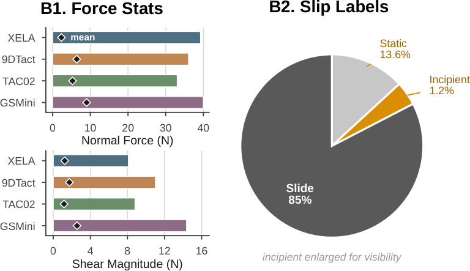
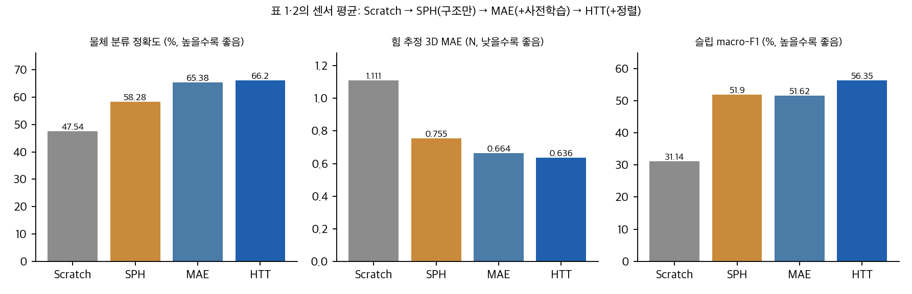
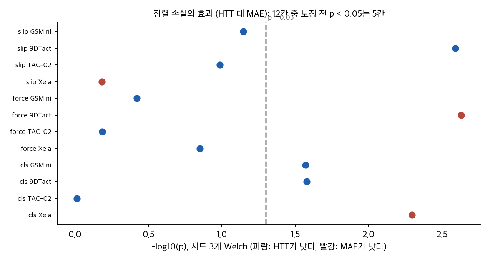
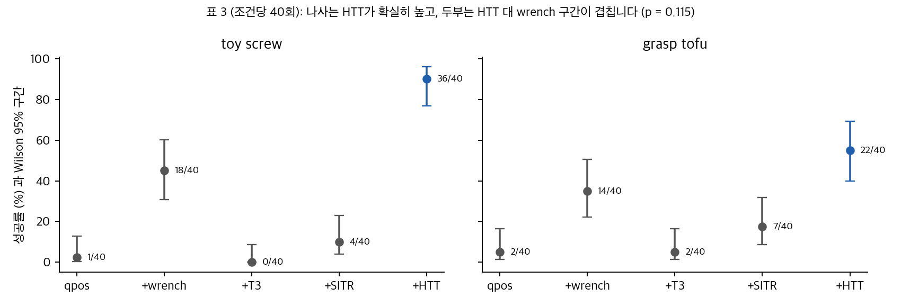
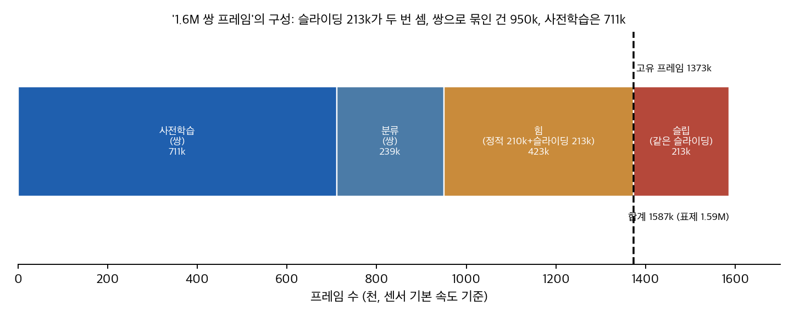
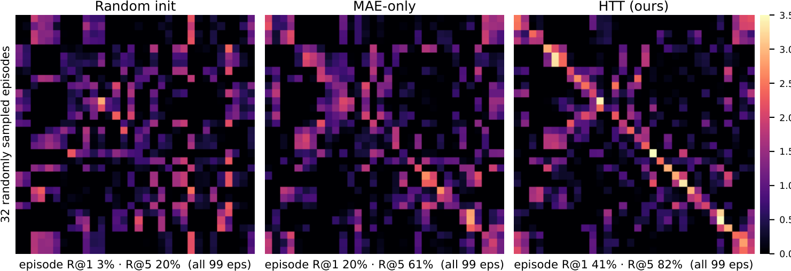

> **논문:** Jianxin Bi, Qiang Wang, Jayaram Reddy, Kelvin Lin, Soibkhon Khajikhanov, Ruihan Gao, Harold Soh. *Heterogeneous Tactile Transformer.* CoRL 2026 포스터, arXiv:2606.29948 (v2, 2026-10-13).
> 공식 코드는 GitHub jxbi1010/HTT(CC BY-NC 4.0)에 있습니다. 이 글의 그림은 논문 그림 두 장(출처 표기)과 우리가 그린 그래프입니다.

## 논문이 묻는 것

광학식 촉각 센서(GelSight 계열)는 이미지를, 배열식 센서(Xela, TAC-02)는 센서 소자별 시계열을 냅니다. 그래서 한 센서에서 배운 모델을 다른 센서에 못 씁니다. HTT는 센서별 인코더와 모든 센서가 공유하는 9층 트렁크를 두고, 센서별 마스크 복원(MAE)과 **같은 접촉을 동시에 본 센서 쌍 사이의 교차 예측 손실**로 사전학습합니다. 쌍 데이터(HPT)는 UMI 그리퍼의 양 손가락에 센서를 하나씩 달아 모았습니다.

*논문 그림 2의 B1, B2 패널. © 저자, CC BY 4.0, 출처 arXiv:2606.29948. 힘은 수직 40 N까지, 슬립 라벨은 slide가 85%입니다.*

## 이 글에서 확인한 것

**1. 개선의 대부분은 구조에서 옵니다.** 논문은 HTT 구조를 사전학습 없이 지도학습한 기준선 SPH를 v2에서 추가했습니다. Scratch에서 HTT까지의 센서 평균 개선 중 구조가 57–82%, 사전학습이 −1–38%, 정렬이 4–19%입니다. 슬립에서는 MAE(51.62)가 SPH(51.90)보다 낮아 사전학습 효과가 보이지 않습니다.

*그래프 (우리가 그림). 표 1과 표 2의 센서 평균입니다.*

**2. 정렬 손실의 효과는 시드 3개로는 구분하기 어렵습니다.** HTT 대 MAE를 시드 3개(가정) Welch로 비교하면 12칸 중 보정 전 p < 0.05가 5칸, Holm 보정 후 2칸입니다. 그중 9DTact 힘에서는 오히려 MAE가 낫습니다(0.574 대 0.606 N, p = 0.0024). 본문이 강조한 TAC-02 슬립 +12.0은 p = 0.10입니다(HTT 쪽 시드 SD 7.27).

*그래프 (우리가 그림). 시드 수는 부록 C가 밝힌 3개(AnyTouch, SPH)를 전체에 가정했습니다. 파랑은 HTT가, 빨강은 MAE가 낫다는 뜻입니다.*

**3. 실로봇은 과제마다 다릅니다.** toy screw는 HTT 36/40 대 wrench 18/40으로 확실합니다(Fisher p = 3e-5). grasp tofu는 22/40 대 14/40으로 p = 0.115이고, 80% 검정력에는 팔당 약 96회가 필요합니다. 본문의 "slip 1/3 감소(8/20 대 12/20)"는 p = 0.34이고 20회 분모가 40회 표와 맞지 않습니다. 실로봇에는 SPH, MAE, Scratch 조건이 없어 이득이 정렬에서 왔는지 구조에서 왔는지 가를 수 없습니다.

*그래프 (우리가 그림). 표 3의 성공 횟수와 Wilson 95% 구간입니다(조건당 40회).*

**4. "1.6M 쌍 프레임"은 같은 데이터를 두 번 센 값입니다.** 공개 데이터셋 카드의 통계로 다시 세면 슬라이딩 213k프레임이 힘과 슬립에 두 번 들어갑니다. 고유 프레임은 1.37M이고, 실제로 쌍으로 묶인 프레임은 0.95M, 사전학습에 쓴 프레임은 0.71M입니다(그 중 91%가 배열 센서 시점). 학습 쌍 표본은 51,700개이고 논문 설정으로 약 250 에폭을 돕니다. 평가 분할도 작아서 분류 테스트는 쌍당 40 에피소드, 힘과 슬립 테스트는 센서당 약 10 에피소드입니다.

*그래프 (우리가 그림). 데이터셋 카드 통계로 다시 그린 구성입니다.*

**5. 그림 3의 검색 점수는 객체 수준 정보만으로도 비슷하게 나올 수 있습니다.** 논문은 Procrustes 사상 뒤 9DTact 에피소드로 Xela 짝을 찾는 R@1/R@5가 무작위 초기화 3/20%, MAE만 20/61%, HTT 41/82%로 오른다고 보입니다. 그러나 99개 에피소드가 30개 물체에서 나왔다면, 같은 물체의 후보 중 임의로 고르는 검색자도 기대 R@1이 약 29%, R@5가 약 94%입니다. 합성 임베딩 토이(객체 코드만 공유)에서도 R@1 32–41%, R@5 74–88%가 나옵니다. 이 지표만으로는 에피소드별 대응과 객체 수준 대응을 가를 수 없습니다.

*논문 그림 3. © 저자, CC BY 4.0, 출처 arXiv:2606.29948. 32개 에피소드를 표시한 유사도 행렬입니다.*

**6. 공식 코드의 사전학습 레시피는 논문 본문과 다릅니다.** 코드 README는 공개 체크포인트를 만든 "정확한 레시피"라고 밝힙니다. 논문은 MAE만 먼저 학습한 뒤 정렬 가중치를 최대 0.1까지 올린다고 쓰지만, 코드는 정렬을 step 0부터 켜고 방향별 0.01/0.02로 시작합니다. MAE 손실에 센서별 가중(1.5, 1.0, 1.0, 0.7), 정렬의 소스 마스킹, lr 4e-4, 배치 512도 논문에 없습니다. 공개 체크포인트는 60,000스텝 중 34,000스텝 시점입니다.

**7. 라벨 정의도 논문 설명과 다릅니다.** 슬립 라벨은 CUSUM 상한 통계가 처음 임계값을 넘은 프레임부터 접촉이 끝날 때까지가 전부 slide입니다(연속 프레임 조건 없음, 기준 구간 앞 25%). 힘 라벨은 ±20 N으로 클리핑되는데 논문의 수직 힘 범위는 40 N입니다.

## 구현 가능성

**전체 재현은 맥 한 대에서는 어렵습니다.** 사전학습 코드는 CUDA가 없으면 오류를 내고, 실로봇(Sharpa 손, ACT 정책), ManiFeel, 그림 3의 검색 코드는 저장소에 없습니다. 공개 체크포인트(69 MB)로 임베딩을 뽑고 소규모 하류 평가를 하는 것은 다운로드와 설치만 허용되면 가능해 보입니다(17M 파라미터). 작은 토이는 CPU에서 수 초에 돌았습니다.

## 한계

- 표의 "±"를 시드 3개의 표본 SD로 가정했습니다(논문은 AnyTouch와 SPH에만 밝힘). 시드 3개 검정은 검정력이 낮습니다.
- 데이터셋 통계는 공개 데이터셋 카드에서 옮겼고 데이터 파일은 받지 않았습니다. 객체 분포는 카드에 없어 균등 배정으로 가정했습니다.
- 공식 코드는 실행하지 않고 정적으로 읽었습니다. 논문 표가 이 코드의 어떤 설정에서 나왔는지는 확인할 수 없습니다.
- 토이의 임베딩은 합성입니다. 가능성의 확인이지 논문 결과의 반증이 아닙니다.

재계산과 토이 스크립트, 분석 문서는 함께 공개한 저장소에 있습니다.

## 자료

- [통합 리포트 PDF](report/report_public.pdf)
- [01. 논문 분석: Heterogeneous Tactile Transformer (HTT)](analysis/01_paper_analysis.md)
- [02. 선행연구, 공개 자원, 학회 상태](analysis/02_prior_work.md)
- [03. 수치 재계산, 일관성 검사, 토이 검사, 주장 판정](analysis/03_analysis.md)
- [04. 공식 코드 대조와 구현 가능성](analysis/04_code_verification.md)
