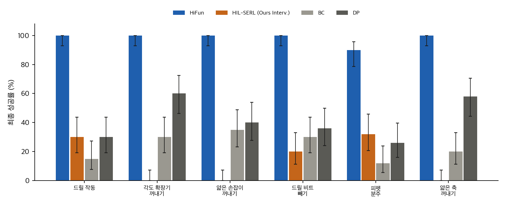
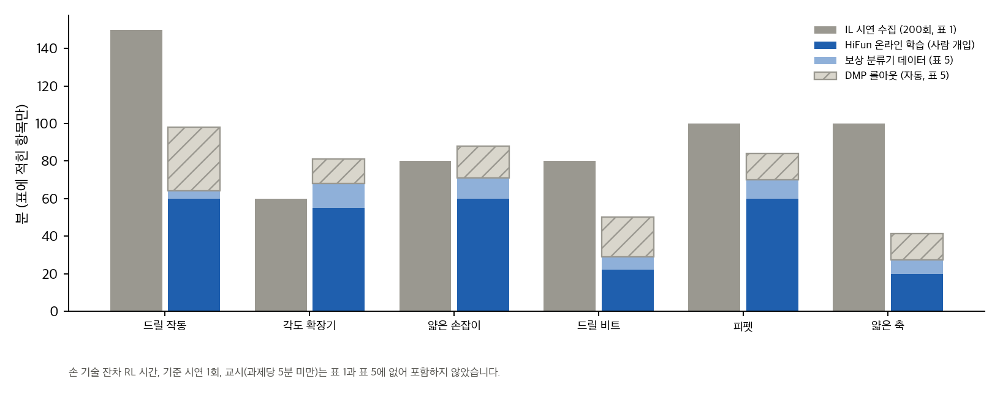
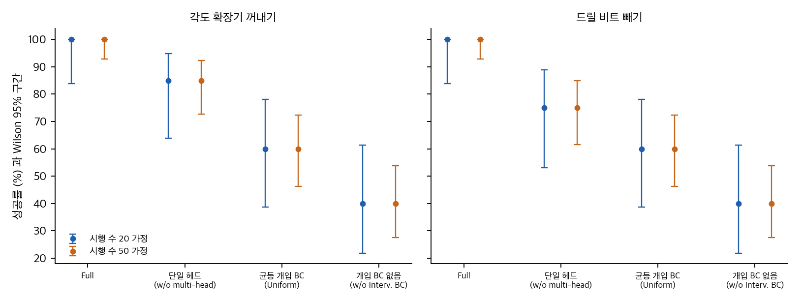
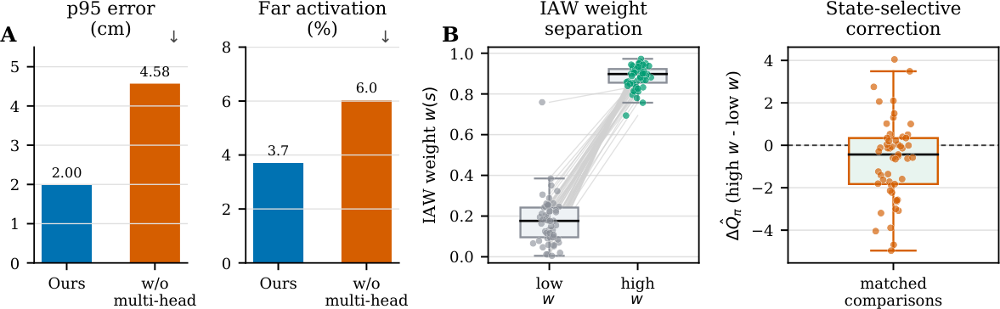
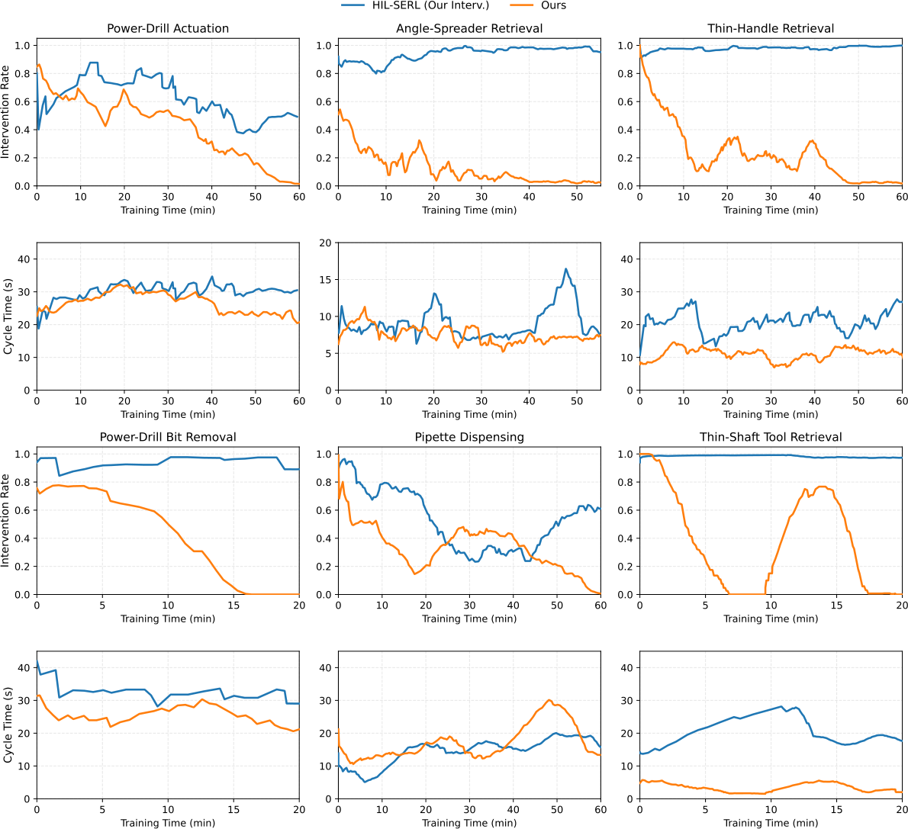
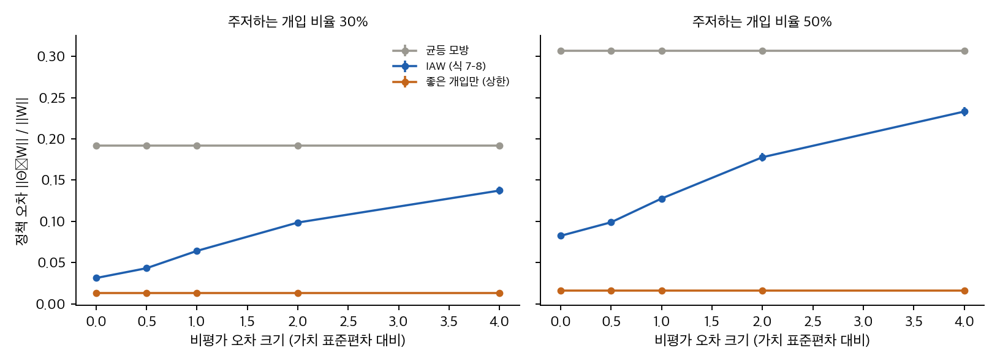
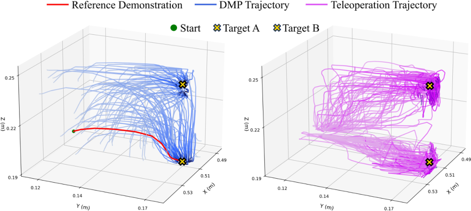

> **논문:** Linyi Huang, Guowei Huai, Weibin Liu, Shulong Jiang, Ping Tan, Weixuan Zhang, Hui Zhang, Jie Song. *HiFun: a Hierarchical Framework for Efficient Functional Dexterous Manipulation Learning.* CoRL 2026 포스터, arXiv:2610.19518 (v1, 2026-10-14).
> 프로젝트 페이지는 위 링크에 있습니다. 코드 주소로 적힌 저장소는 2026-11-26에 확인하지 못했습니다. 이 글의 그림은 논문 그림 세 장(출처 표기)과 우리가 그린 그래프입니다.

## 논문이 묻는 것

다지 손으로 도구를 쓰는 과제(드릴, 피펫, 좁은 틈에서 도구 꺼내기)는 접촉이 정밀해야 하고, 팔과 손가락이 타이밍을 맞춰야 하고, 어긋났을 때 회복해야 합니다. 시뮬레이션은 이 접촉을 정확히 모사하기 어렵고, 전 자유도 시연은 모으기 어렵습니다. 실로봇 RL에 사람 개입(HIL-SERL 계열)을 붙여도 손가락 12개 관절을 한 번에 탐색하고 교정하기는 부담이 큽니다.

HiFun은 이 부담을 둘로 나눕니다. 먼저 손으로 직접 교시한 참조 동작에 SAC 잔차를 얹어 **손 기술**을 학습하고 얼립니다. 그 위에서 조정 정책이 팔의 6D 증분과 손 기술의 활성 강도 α만 학습합니다. 사람 개입도 손가락 관절이 아니라 팔과 "기술 호출 버튼"으로 합니다. 조정 정책에는 세 가지가 더해집니다. 기준 시연 1개에서 시작 자세만 무작위로 바꾼 DMP 롤아웃 100개(오프라인 버퍼), 접근과 활성의 가치를 따로 배우는 다중 헤드 비평가, 개입을 가치 차이로 가중하는 IAW입니다.

## 이 글에서 확인한 것

**1. 표 1의 산술은 모두 맞고, 기준선과의 격차는 확실합니다.** 열 평균 8개가 일치하고, 평균 98.3%는 295/300(과제당 50회 가정)으로 Wilson 95% 구간이 96.2–99.3%입니다. 과제별 Fisher p는 평평한 HIL-SERL, BC, DP 모두에 대해 1.8e-7 이하입니다. 홀수 퍼센트(BC 15, 35 등)는 부록 B.3의 반 점 규칙이 필요한 값입니다.

*그래프 (우리가 그림). 표 1을 다시 그렸습니다. 시행 수 50 가정, 0.5 크레딧은 분수 성공 수로 처리했습니다.*

**2. "한 시간 온라인 학습"은 조정 정책 미세조정 시간입니다.** 표 1의 온라인 시간은 20–60분(평균 46.2분)입니다. 손 기술을 학습하는 시간, 기준 시연(Gello), 교시(기준 궤적당 5분 미만)는 표에 없고, 표에 적힌 항목(분류기 8.75 + DMP 18.8 + 온라인 46.2)을 합치면 평균 73.75분입니다. 그래서 "총 소요 시간이 IL 시연 수집(평균 95분)보다 짧다"는 비교는 이 표만으로는 확정되지 않습니다.

*그래프 (우리가 그림). 손 기술 RL 시간, 기준 시연, 교시, 리셋은 표에 없어 포함하지 않았습니다.*

**3. 절제 표는 시행 수에 따라 결론이 갈립니다.** 표 2에는 시행 수가 없습니다. 20회(교란 평가)로 읽으면 다중 헤드 비평가 제거(100 → 85, 각도 확장기)는 p = 0.23이고, 50회(본 평가)로 읽으면 0.012입니다. 드릴 비트(100 → 75)는 0.047에서 2.3e-4입니다. IAW 항을 빼는 변형(균등 BC 60, 개입 BC 없음 40)은 두 가정 모두 보정 후에도 유의합니다. 100%와 85%를 80% 검정력으로 가르려면 팔당 약 52회가 필요합니다.

*그래프 (우리가 그림). 같은 값을 시행 수 20과 50으로 읽은 구간입니다.*

**4. "약 4배 적은 수집 시간"은 개수가 다른 두 묶음의 비입니다.** DMP 롤아웃은 100개, 사람 시연은 200개이고(표 1 설명), 시간비 3.8–4.6배는 궤적당으로 환산하면 1.9–2.3배입니다. 또 DMP 쪽에도 기준 시연 1개가 필요합니다.

**5. 손 기술의 필요성은 과제에 따라 다릅니다.** 표 3(20회)에서 잔차 손 기술은 6개 과제 모두 20/20이고 직접 교시 재생은 5/120입니다. 텔레옵 재타게팅(DexPilot*, AnyTeleop*)은 각도 확장기, 얇은 손잡이, 드릴 비트, 얇은 축에서 크게 낮지만 드릴 작동(18, 19/20)과 피펫(20/20)에서는 구분되지 않습니다.

**6. IAW의 가중치 분리는 식 7의 정의가 만드는 방향입니다.** 그림 8B는 약한 개입과 강한 개입의 가중치 평균이 0.175와 0.884로 갈리고, 가중치가 높은 개입이 정책 가치가 낮은 상태에서 나온다고 보입니다. 이 방향은 A_I = Q̂(s, a_I) − Q̂(s, ā_π)의 정의에서 이미 기대되는 것이고, 오른쪽 패널의 중앙값은 약 −0.4, 사분위 범위는 0을 걸칩니다(그림 판독 값).

*그림 8 (논문 원문). © 저자, CC BY 4.0, 출처 arXiv:2610.19518.*

## 개입률 곡선

그림 7은 온라인 학습 중 개입률을 보여 줍니다. HiFun은 모든 과제에서 끝 지점에 약 0.03 이하로 내려가고(그림 판독 값), HIL-SERL(Ours Interv.)은 대부분 0.9 이상이거나 높게 유지됩니다. 피펫(약 0.15 → 0.48 → 0.02)과 얇은 축(0 → 0.77 → 0)은 중간에 다시 올랐다가 내려갑니다. 이 곡선은 학습 중 개입률이며 평가 성공률과는 다른 시행입니다.

*그림 7 (논문 원문). © 저자, CC BY 4.0, 출처 arXiv:2610.19518.*

## 토이로 본 것: 개입 품질이 섞일 때 IAW

식 7–8의 가중 모방이 품질이 섞인 개입에서 균등 모방보다 낫고, 비평가가 부정확할 때 이점이 어떻게 줄어드는지 numpy 토이로 봤습니다(한 단계 선형 회귀, 가정은 문서에 있습니다). 좋은 개입과 "주저하는" 약한 개입(목표 쪽으로 0.4배만 움직임)을 섞고 비평가에 무작위 오차를 넣었습니다.

*그래프 (우리가 그림). 시드 200개 평균 ± 표준오차. 약한 개입 30%와 50% 두 설정입니다.*

약한 개입 30%에서 정책 오차는 균등 모방 0.192, IAW 0.031(비평가 오차 0)에서 0.137(가치 표준편차의 4배)로 움직입니다. 약한 개입이 없으면 IAW가 약간 불리합니다(0.017 대 0.011). 즉 이점은 개입 품질이 섞여 있고 비평가가 어느 정도 맞을 때 생깁니다. 이 토이는 논문의 SAC 손실이나 실로봇 데이터를 쓰지 않았습니다.

## 데이터 증강 그림

부록 A의 그림 4는 DMP 롤아웃(파랑)이 한 기준 시연에서 퍼져 나가는 모양을 보여 주며, 사람 시연(보라)보다 넓은 접근 영역을 덮는 것으로 설명됩니다. 정성적 그림이라 같은 개수로 정규화한 분포 비교는 없습니다.

*그림 4 (논문 원문). © 저자, CC BY 4.0, 출처 arXiv:2610.19518.*

## 구현 관점

- **공식 코드:** 프로젝트 페이지가 가리키는 저장소(`Hly-123/HiFun_code`)를 2026-11-26에 확인하지 못했습니다. 코드와의 대조는 하지 못했습니다.
- **빠진 정보:** 활성 임계 τ, r_bonus, r_penalty, IAW의 Norm과 τ_I, 잔차 크기 λ_res의 스케줄, DMP 계수, 평가 판정 주체, 표 2의 시행 수가 본문에 없습니다.
- **실로봇 재현:** Franka, Sharpa 또는 XHand 손, 손끝 힘, Gello가 필요합니다.
- **축소판 구현:** 접근-활성 시뮬 과제에서 SAC + 다중 헤드 + IAW + DMP를 구현하는 것은 소형 시뮬에서 가능해 보입니다(약 500–900줄, 추정). 손 기술의 실제 접촉 학습은 이 범위 밖입니다.

저자에게 확인하면 좋은 것은 표 2와 Skill-HIL의 시행 수, 평가에서 성공을 판정한 주체, 손 기술 학습 시간을 포함한 총 소요 시간, 그림 5a의 총 목표 Q의 정의(그림 판독 값으로 두 헤드 합의 약 절반), IAW의 정규화입니다.

## 자료

- [통합 리포트 PDF](report/report_public.pdf)
- [01. 논문 분석: HiFun (arXiv:2610.19518 v1)](analysis/01_paper_analysis.md)
- [02. 선행 연구와 자료](analysis/02_prior_work.md)
- [03. 수치 재계산, 일관성 검사, 토이 (V1–V16, K1–K15, 토이 T1)](analysis/03_analysis.md)
- [04. 주장 검증과 구현 가능성 (공식 코드 확인 안 됨)](analysis/04_claim_verification.md)
