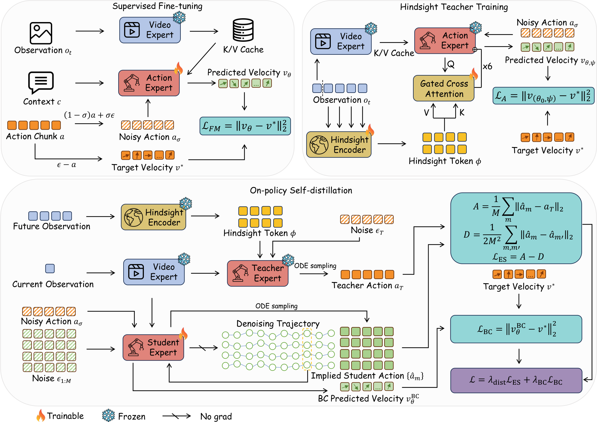
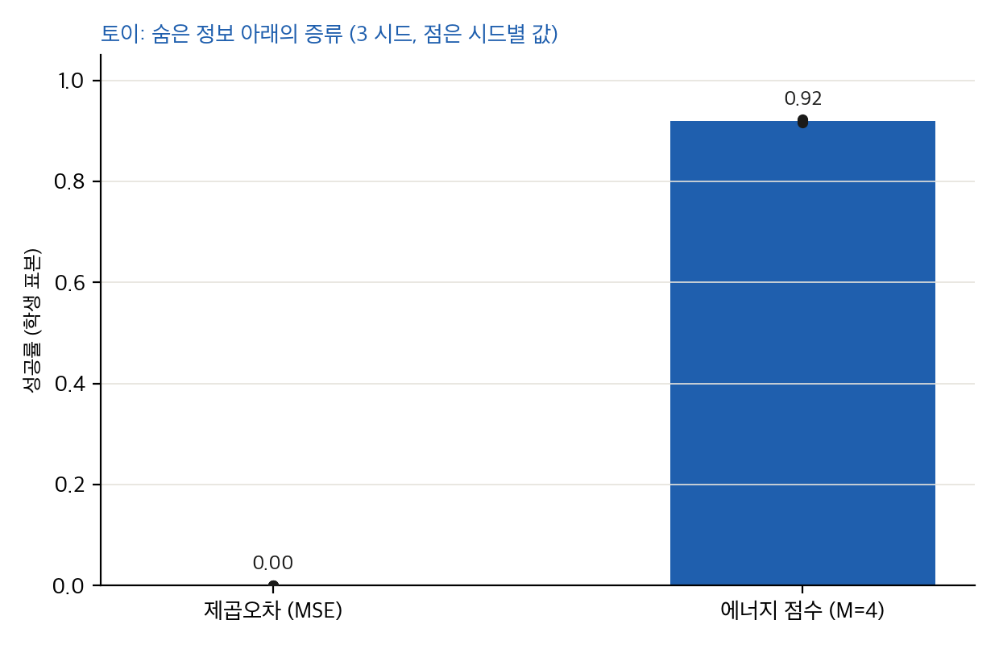
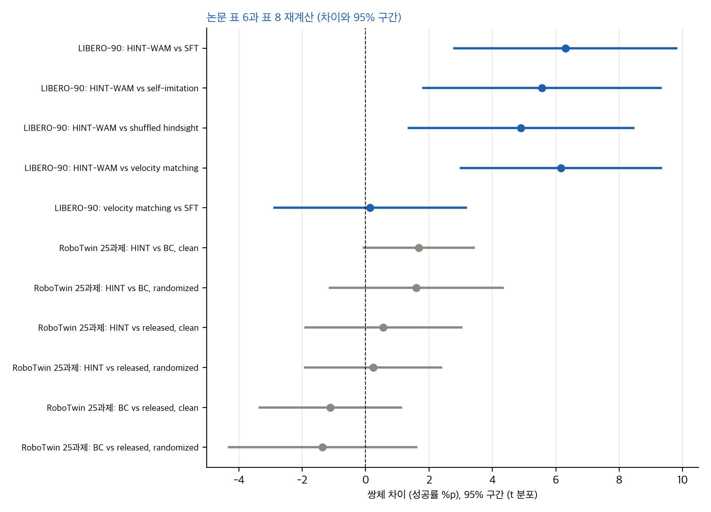
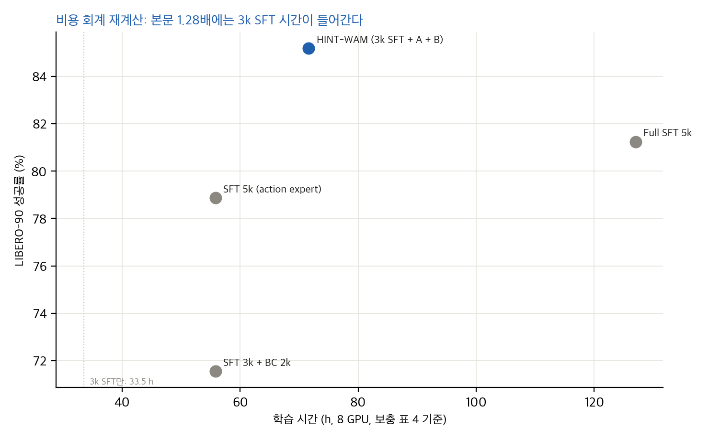
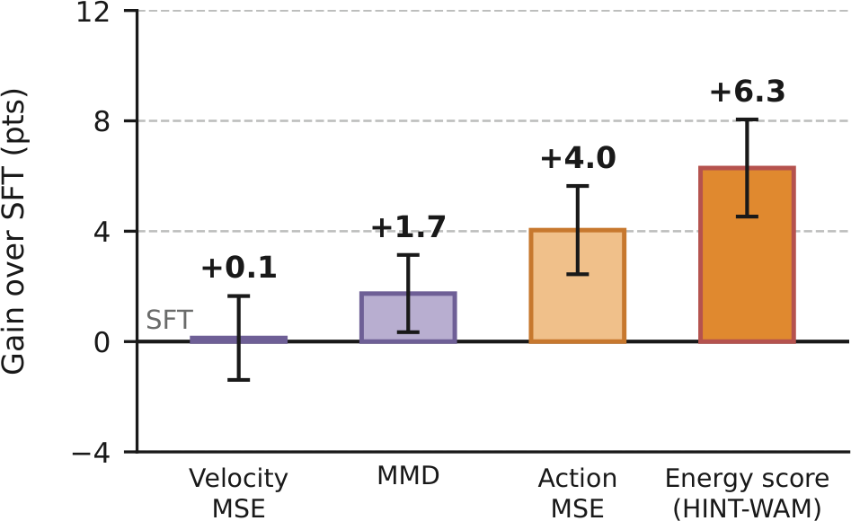

> **논문:** Phuong Tuan Dat, Qi Li, Xinchao Wang. *HINT-WAM: Hindsight-Informed Training for World Action Models.* arXiv:2611.24789 (v1, 2026-11-18). 학회 표기 없음.
> 공식 코드는 GitHub tuandattt/hintwam_code에 있고, LICENSE 파일은 MIT입니다. 이 글의 그림은 논문 그림 두 장(출처 표기)과 우리가 그린 그래프입니다.

## 논문이 묻는 것

세계 행동 모델(WAM)은 행동을 만들면서 미래 영상도 예측해서, 로봇 조작에서 일반화와 데이터 효율을 보여 주었습니다. 과제에 맞추려면 사후학습이 필요합니다. 흔한 방법은 세 가지입니다.

- **모방 미세조정(SFT).** 시연 행동에서만 학습합니다. 흐름 정합 행동 전문가는 잡음 낀 시연 행동만 보고, 자기 샘플러가 만든 중간 상태는 보지 못합니다.
- **온폴리시 강화학습.** 자기 행동을 쓰지만 보상이 희소하면 탐색과 신용 할당이 어렵습니다.
- **외부 교사 증류.** 별도의 강한 교사를 두면 계산이 커집니다.

HINT-WAM은 네 번째 길을 택합니다. 시연에는 미래 영상이 있습니다. 이것을 특권 정보(hindsight)로 씁니다. 같은 모델이 미래를 보는 교사가 되고, 학생은 배포 때 쓸 입력만 봅니다. 학생은 자기 샘플러가 지나가는 상태에서 교사의 행동 분포를 따라갑니다.

*그림 2 (논문 원문). © 저자, CC BY 4.0, 출처 arXiv:2611.24789 (v1).*

## 핵심은 에너지 점수

교사는 하나의 행동 표본만 냅니다. 학생은 자기 ODE를 여러 번 돌려 여러 표본을 얻습니다. 목적함수는 제곱오차가 아니라 에너지 점수입니다.

L_ES = (1/M) Σ‖â_m − a_T‖₂ − (1/2M²) Σ‖â_m − â_m'‖₂

제곱오차로 교사 표본 하나를 맞추면, 최적해는 교사의 조건부 평균입니다. 교사가 미래에 따라 두 모드를 가지는데 학생은 미래를 못 보면, 평균 행동은 어느 모드에서도 맞지 않습니다. 에너지 점수는 첫 항이 표본을 교사 쪽으로 당기고, 둘째 항이 학생 표본끼리 밀어내서 분포 전체를 맞춥니다. 노름이 제곱이 아닌 L2 노름이어야 엄밀 적합 규칙이 됩니다. 논문과 공식 코드는 이 점에서 일치합니다.

우리가 만든 토이에서도 같은 일이 보입니다. 숨은 변수에 따라 두 모드 가운데 하나가 맞는 설정에서, 제곱오차 학생은 두 모드의 평균(성공률 0.00)에 붕괴했고, 에너지 점수 학생은 두 모드를 모두 맞췄습니다(0.92, 3 시드).

*그래프: 우리가 만든 토이(논문 보충 J와 같은 설정, CPU에서 약 10초).*

## 재계산에서 확인한 것

논문의 주요 평균과 차이를 다시 계산했습니다. LIBERO-90에서 HINT-WAM은 SFT보다 6.30 %p 높습니다(85.18 대 78.88). 쌍체 t는 3.58이고 95% 구간은 +2.8부터 +9.8까지입니다. 연속 학습 표의 평균 10개와 본문 차이도 모두 맞습니다.

그러나 세 가지를 확인해야 합니다.

1. **시드가 하나입니다.** 학습 시드는 42 하나이고, 검정은 과제 90개의 차이만 봅니다. 학습 시드 변동은 포함되지 않습니다. 부호 검정은 p = 0.087로 약합니다.
2. **기준선 값 몇 개가 격자에 맞지 않습니다.** 과제 90개 × 시도 50회라면 성공률 평균은 0.0222 %p 간격의 값만 될 수 있습니다. 기준선 SFT 78.88, 셔플 80.28, 재생 SFT 76.70, RoboTwin Full SFT 84.12와 83.24가 그렇습니다. 오기인지 평가 설정의 차이인지는 과제별 원자료가 있어야 구분됩니다.
3. **표의 t 값 하나가 맞지 않습니다.** 에너지 점수와 velocity matching의 차이는 t 3.62로 보고되지만, 평균과 SE에서 계산하면 3.87입니다. 결론은 같습니다.

*그래프: 우리가 그림(논문 표 6과 표 8의 값에서 계산).*

## 비용

보고된 단계별 시간으로 다시 계산했습니다. 본문은 "4.4 h + 34 h"만 쓰고 SFT의 1.28배라고 합니다. 그러나 1.28은 3,000스텝 SFT(33.5 h)를 포함했을 때 나옵니다. 전체는 71.6 h입니다. 같은 비용을 Full SFT(127 h)와 비교하면 0.56배입니다.

*그래프: 우리가 그림(보충 표 4의 보고된 초당 스텝 시간 기준. 실측이 아님).*

## 절제: 목적함수 비교의 교란

그림 4는 velocity matching, MMD, action-space MSE, 에너지 점수를 비교합니다. 공식 설정을 보면 velocity matching은 감독 점을 3개 쓰고, 에너지 점수는 1개만 씁니다. 본문 설명에는 이 차이가 없습니다. 그래서 6.16 %p 차이의 일부가 감독 점 개수 때문일 수 있습니다. 같은 감독 점으로 맞춘 대조 실험이 필요합니다.

*그림 4 (논문 원문). © 저자, CC BY 4.0, 출처 arXiv:2611.24789 (v1).*

## 공식 코드와 논문의 차이

공식 저장소(커밋 6a49a33, 2026-11-19)를 정적으로 읽었습니다. 에너지 점수, implied action, 교사 ODE 표본, 행동 복제 앵커, 게이트 적응기, 인코더 구조, 스텝 수, 학습률이 논문과 맞습니다. 다른 점도 있습니다.

- Stage A의 유효 배치는 코드에서 256이고, 논문 표 3에서는 192입니다.
- 게이트 초기값을 코드 문서는 0이라고 쓰지만, 설정값 α = 1에서는 tanh(1) ≈ 0.76입니다. 출력은 가중치 0 초기화 때문에 여전히 0이라 기능에는 문제가 없습니다.
- 논문 본문은 3,921개 시연 전부로 사후학습한다고 쓰지만, 코드는 10%를 검증용으로 떼어 놓습니다.
- 보충 J 토이의 스크립트는 저장소에 없습니다. 연속 학습의 재생 설정과 평가 코드도 없습니다. 평가기는 Fast-WAM 저장소를 씁니다.

## 구현 가능성 (Apple M4 Pro, CUDA 없음)

**공식 설정 재현은 이 맥에서 불가능합니다.** SFT 3,000스텝, 교사, 증류까지 8개의 24 GB GPU에서 약 72시간이 필요하다고 보고되었습니다. 5B 비디오 전문가와 LIBERO-90, RoboTwin 데이터, 시뮬레이터 평가기도 필요합니다.

**축소 구현은 조건부로 가능합니다.** 수 M 파라미터의 흐름 정합 정책을 MPS에서 LIBERO 한 스위트에 맞춰 SFT, 행동 복제, 에너지 점수를 비교할 수 있습니다. 설치와 데이터 다운로드가 필요하고, 노력은 1–2주로 추정합니다.

## 한계

- 단일 학습 시드입니다. 시드 반복 실험이 없습니다.
- 온폴리시는 행동 샘플러에 대해서만 씁니다. 관측은 시연에서 옵니다. 폐루프 누적 오차는 다루지 않습니다.
- RoboTwin에서는 공식 체크포인트가 같은 데이터로 학습되어 헤드룸이 작습니다. 랜덤 설정의 BC 대비 차이는 통계적으로 확인되지 않습니다(p = 0.24).
- 교사는 반드시 학생과 같은 SFT 가중치에서 와야 합니다. 약한 체크포인트를 쓰면 학생이 SFT보다 나빠졌습니다(보충 자료).

## 출처와 라이선스

- 논문은 arXiv에 CC BY 4.0으로 공개되어 있습니다(arXiv 라이선스 페이지 확인). 원문 PDF에 저작권 표시는 없습니다.
- 논문 그림 두 장은 저작자 표기와 함께 실었습니다("© 저자, CC BY 4.0, 출처 arXiv:2611.24789"). 시뮬레이터 장면과 실로봇 사진은 넣지 않았습니다.
- 공식 코드는 GitHub tuandattt/hintwam_code입니다. LICENSE 파일은 MIT입니다. 이 글에서는 코드를 내려받아 실행하지 않았고, 정적으로만 읽었습니다.
- 가중치는 받지 않았습니다. 표 값과 본문 수치는 인용과 재계산을 위해 옮겼습니다. 그래프, 토이, 분석 문서와 스크립트는 이 글의 작성자가 만들었습니다.

## 자료

- [통합 리포트 PDF](report/report_public.pdf)
- [HINT-WAM: Hindsight-Informed Training for World Action Models (arXiv:2611.24789) 논문 분석](analysis/01_paper_analysis.md)
- [HINT-WAM 선행연구와 공식 저장소 (arXiv:2611.24789)](analysis/02_prior_work.md)
- [HINT-WAM 재계산과 검정 (arXiv:2611.24789 v1)](analysis/03_analysis.md)
- [HINT-WAM 공식 코드 대조 (arXiv:2611.24789 v1)](analysis/04_code_verification.md)
