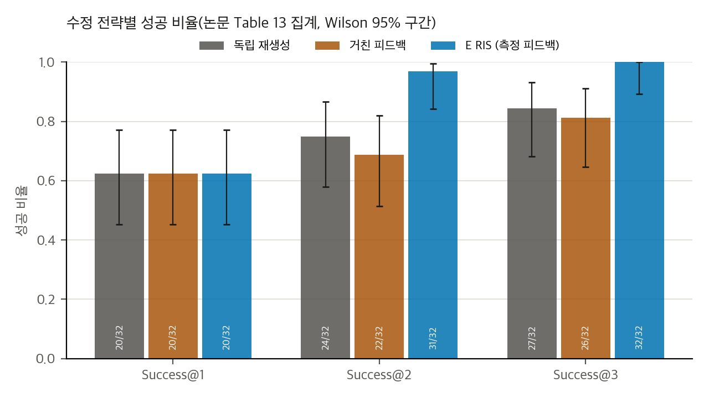
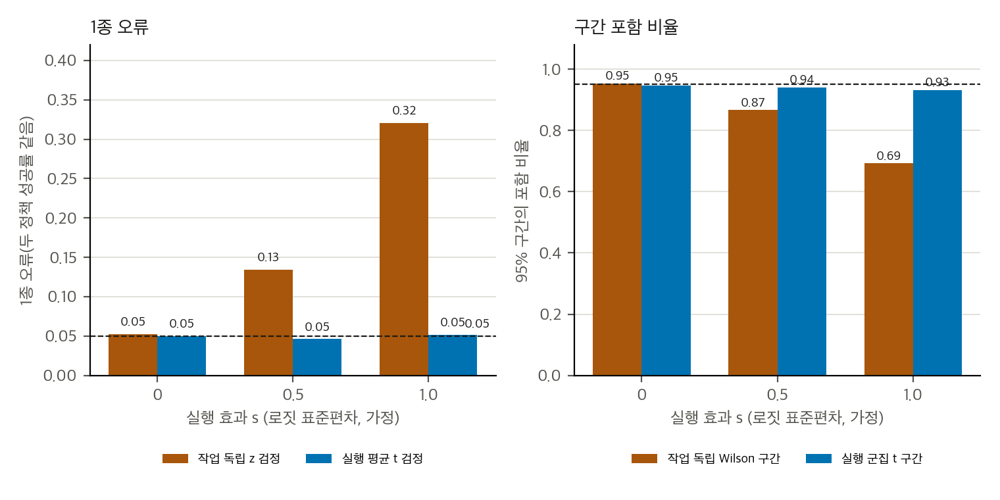
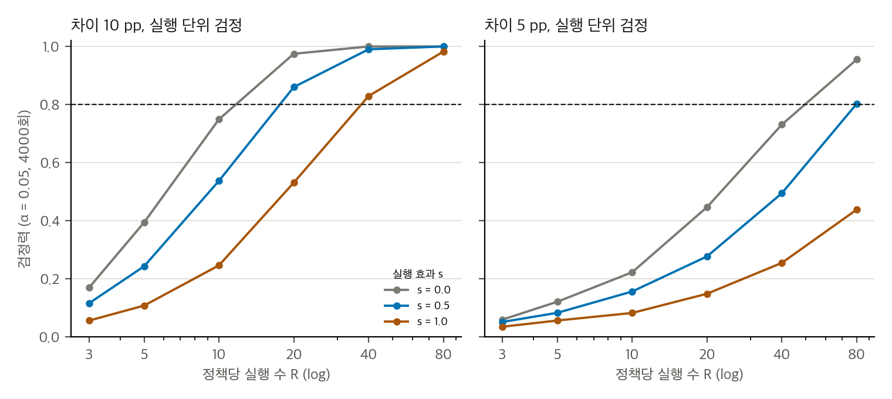

> **논문:** Holiday Robotics 외 13인. *HolidayFactory 1.0: Simulating, Generating, and Evaluating Industrial Robot Tasks.* arXiv:2611.11789 (v1, 2026-11-09). 학회 채택 표기는 확인하지 못했습니다(프리프린트).
> 논문 그림은 라이선스(arXiv 비독점 배포, CC BY 아님) 때문에 싣지 않았습니다. 아래 그래프는 논문 표의 집계 값과 직접 만든 토이로 그렸습니다.

---

## 논문이 묻는 것

공장 작업은 보통 리셋에서 시작하는 에피소드가 아닙니다. 이전 작업이 남긴 상태가 다음 작업을 바꿉니다. 저자들은 이 문제를 세 질문으로 나눕니다. 접촉과 구동과 감지를 어떻게 시뮬레이션할지, 과제 조건의 월드를 어떻게 만들지, 상태가 이어지는 반복 작업에서 성능을 어떻게 잴지입니다.

서론의 계산이 이 문제를 잘 보여 줍니다. 작업 하나의 성공률이 95%라도 20개를 연속으로 성공할 확률은 36%입니다. 99%여도 82%입니다.

논문은 세 부분을 제시합니다.

- **HOLIDAY-SIM:** Newton의 희소 SDF 위에서 수압 패치 접촉을 구현하고, 압력 법칙을 확장하고, 원시-쌍대 솔버(CDMM)를 붙입니다. 액추에이터의 전기·열·마찰 상태도 넣고, 자기 촉각 피부 판독도 계산합니다.
- **에이전트 월드:** 자산 생성기(ERIS), 장면 생성(ISG), 평가 생성이 있습니다. 평가는 사람이 확인한 뒤 결정론적 컴파일러가 만듭니다.
- **24/7-BENCH:** 컨베이어 적재, 플로우랙 적재, 카트 밀기, 지그 적재, 프레스 작업, 밸브 조작, 바코드 분류의 7개 작업입니다. 처리량, 지연, 실패, 미완료, 작업당 모터 에너지를 잽니다.

## 무엇이 없는가

읽고 나서 가장 먼저 찾게 되는 것은 **정책 비교 결과**입니다. 저자들은 결론에서 "정책을 persistent run으로 비교한 적이 없다"고 적었습니다. 벤치마크라면 정책 여러 개가 순위를 가질 것이라고 기대하지만, 논문은 그 기대를 채우지 않습니다.

두 번째는 **실물 검증**입니다. 접촉 모델, 액추에이터, 촉각 모델은 수치 기준과 비교했습니다. 본문도 "실물 로봇 측정과 비교한 결과는 없다"고 밝힙니다.

세 번째는 **공개 자료**입니다. 논문 본문에 코드 링크가 없고, 조직의 GitHub 공개 저장소는 0개이고, 프로젝트 사이트에도 코드나 자산 링크가 없습니다. 논문은 "오픈소스 생태계에 기여한다"고 씁니다. 실제로 공개된 것은 논문 PDF뿐입니다.

## 표 수치는 맞지만, 표본이 작습니다

논문의 표 사이 수치는 모두 맞습니다. 탈락률 47%(34/72), 콜라이더 재작성 22%(346/1597), 백본별 Δ, 비용 비율을 다시 계산해 일치를 확인했습니다. 문제는 **표본**입니다.

자산 생성 피드백 실험(표 13)은 같은 1차 자산 32개를 세 전략으로 고친 결과입니다. 헤드라인은 측정 피드백 100%, 독립 재생성 84%, 거친 피드백 81%입니다.

*그림 1. 표 13 집계. 수정 전략별 Success@t와 Wilson 95% 구간(n = 32). 같은 1차 자산을 쓰는 쌍 설계입니다.*

쌍 설계라서 불일치 쌍을 세어야 맞는 검정을 할 수 있습니다. 그런데 독립 재생성 대비 차이는 불일치 5쌍이 모두 한 방향인 경우로 정해지고, 정확 McNemar p는 0.0625입니다. 유의수준 0.05를 넘습니다. 차이가 가장 분명한 곳은 **1차 실패 12건의 회복**입니다. 측정 피드백은 11/12, 독립 재생성은 4/12를 고쳤고, Fisher 검정 p는 0.009입니다.

백본 다섯 개에서 측정 피드백이 독립 재생성보다 25–35 pp 높았습니다. 쌍 검정 p는 모두 0.035 이하입니다. 이 결과가 가장 일관된 근거입니다. 다만 과제 20개가 군집을 이루는 구조는 반영되지 않았습니다.

## 장면과 평가 생성: 검증이 의도를 보장하지 않습니다

ISG 실험은 계획 검사를 빼면 모든 결정론적 검사를 통과한 후보가 1/10으로 줄고, 전체 ISG는 5/10이라고 보고합니다. 차이는 방향은 맞지만 유의하지 않습니다(p = 0.14). 피드백은 5/18에서 16/18로 성공을 늘렸습니다(p = 0.0005). 이 실험은 작은 표본이고, 같은 모델이 계획과 비평을 맡아서 교란이 있습니다.

평가 생성 실험(그림 19)은 더 흥미롭습니다. 검증 피드백은 직접 생성된 평가의 수용률을 6/12에서 12/12로 올렸지만, 기록 15개에 대한 판정은 **단 하나도** 바꾸지 못했습니다. 질문으로 명세를 확인하는 방식은 15개 기록과 모두 맞았습니다. 그런데 이 실험에서 질문에 답하는 사용자는 정답 명세를 들고 있는 시뮬레이션 사용자입니다. 사람이 답했을 때 같은 결과가 나올지는 알 수 없습니다.

요점은 이것입니다. **실행 가능성과 일관성은 자동으로 확인되지만, 과제 의도는 라벨 없이 확인되지 않습니다.** 논문도 이 점을 한계로 인정합니다.

## 토이: 작업을 독립으로 세면 검정이 과하게 기각합니다

반복 작업의 평가는 작업을 단위로 세기 쉽습니다. 그런데 작업이 이전 상태를 물려받으면 같은 실행 안의 작업은 독립이 아닙니다. 이 점을 간단한 모형으로 확인했습니다.

모형은 실행마다 성공률이 흔들리는 로짓 효과를 넣고, 실행당 작업 20개를 뽑습니다. 값은 모두 가정입니다. 논문에 없는 설계 값입니다.

*그림 2. 토이. 정책당 실행 10회에서 작업 독립 검정의 1종 오류(왼쪽)와 실행 효과가 없을 때의 구간 포함 비율(오른쪽). 실행 효과 s가 커질수록 작업 독립 검정은 명목 5%를 크게 넘습니다.*

실행 효과가 커지면 작업 독립 검정의 1종 오류는 0.13(s = 0.5), 0.32(s = 1.0)까지 부풀어 오릅니다. 실행 단위 검정은 0.05 근처를 지킵니다. 작업을 독립으로 세면 95% 구간도 덜 덮습니다. s = 1에서 0.69까지 떨어집니다.

## 얼마나 많은 실행이 필요한가

같은 토이에서 실행 단위 검정의 검정력을 계산했습니다. 정책 두 개의 성공률 차이가 10 pp일 때 검정력 0.8을 얻으려면, 실행 효과가 작을 때 정책당 실행 20회, 클 때 40회가 필요합니다. 차이가 5 pp이면 80회가 필요합니다. 실행 효과가 클 때는 80회에서도 검정력이 0.44에 그칩니다.

*그림 3. 토이. 실행 단위 검정의 검정력을 정책당 실행 수에 따라 그림. 왼쪽은 차이 10 pp, 오른쪽은 5 pp. 점선은 0.8. 실행당 작업 20개, 기준 성공률 0.8은 가정입니다.*

결과적으로 이 논문이 보고한 것으로는 정책 간 차이를 판단할 수 없습니다. 정책 결과가 없기 때문입니다. 이 토이는 그 결과가 나올 때 실행을 몇 번 해야 하는지 가늠하는 용도입니다.

## 구현할 수 있는가

공식 재현은 불가능합니다. 코드, 자산, 장면 파일이 없고, 자동 생성 파이프라인은 LLM 호출이 필요합니다. 논문 엔진은 GPU 병렬 실행을 전제하므로 CUDA 환경이 유리합니다. 이 맥에서 Warp의 CPU 경로가 되는지는 확인하지 않았습니다. 실물 FRIDAY 로봇도 없습니다.

CPU로 할 수 있는 것은 **평가 프로토콜**입니다. 작업 이벤트(연속 K_hold 스텝 판정), 처리량 계산, 실행 단위 검정, 쌍 검정의 실현 가능 범위가 여기에 듭니다. 작업 이벤트와 지표 계산은 수일 규모로 구현할 수 있다고 봅니다(추정, 검증 안 함).

## 정리

HolidayFactory 1.0은 산업 작업 평가의 문제를 잘 짚었습니다. 리셋 없는 반복, 접촉과 액추에이터의 상태, 검증 루프가 있는 생성이 그 축입니다. 하지만 지금 공개된 증거로는 벤치마크가 정책을 구별하는지, 실물과 맞는지 말할 수 없습니다.

읽는 사람이 챙길 것은 세 가지입니다. 반복 작업의 신뢰구간은 **실행을 단위로** 잡을 것, 쌍 설계의 헤드라인 차이는 **불일치 쌍 수**와 함께 볼 것, 자동 검증이 통과했다는 말이 **과제 의도가 맞다는 말은 아님**을 기억할 것입니다.

## 자료

- [통합 리포트 PDF](report/report_public.pdf)
- [HolidayFactory 1.0: Simulating, Generating, and Evaluating Industrial Robot Tasks (arXiv:2611.11789v1) 논문 분석](analysis/01_paper_analysis.md)
- [HolidayFactory 1.0: 선행연구, 대안, 이 저장소와의 관계](analysis/02_prior_work.md)
- [HolidayFactory 1.0: 수치 재계산, 유의성, 유도, 토이](analysis/03_analysis.md)
- [HolidayFactory 1.0: 주장 검증, 공개 증거, 구현 가능성](analysis/04_claim_verification.md)
