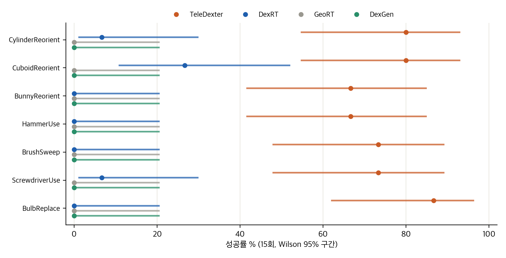
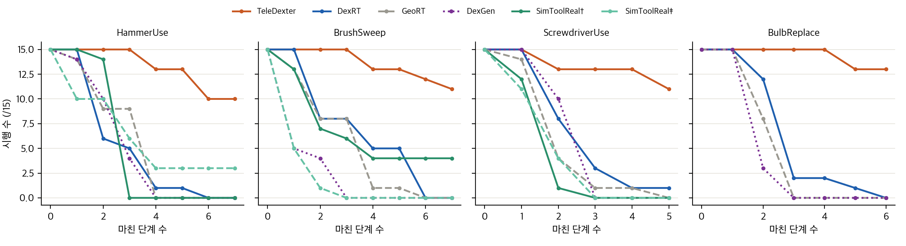
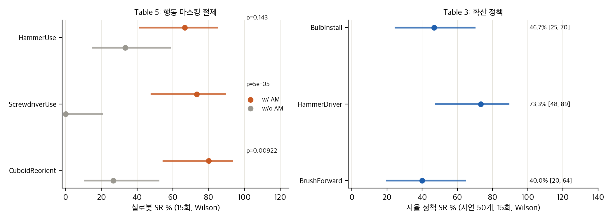
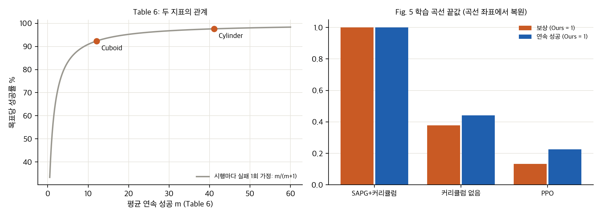

> **논문:** Puhao Li, Zeyuan Chen, Yingying Wu, Pengkun Wei, Yuyang Li, Tianyu Wang, Jiaxiao Shi, Mingrui Yu, Baoxiong Jia, Song-Chun Zhu, Tengyu Liu, Siyuan Huang. *Towards Human-level Dexterous Teleoperation.* CoRL 2026 포스터, arXiv:2607.11481 (v1, 2026-07-13, 단일 버전).
> 논문 그림은 라이선스(arXiv 비독점 배포) 때문에 싣지 않았습니다. 그림과 영상은 [프로젝트 페이지](https://bigai-dex.github.io/blog/teledexter/)에서 볼 수 있습니다. 이 글의 그래프는 논문 표의 수치로 그렸고, 시행 수는 논문의 칸당 15회로 가정했습니다. 공식 코드는 2026-11-24에 찾지 못했습니다. Fig. 5와 Fig. 6의 값은 PDF 그림의 벡터 좌표에서 복원한 값입니다.

## 한 줄 요약

조작자가 손끝 위치와 물체 자세를 목표로 주면, 시뮬레이션 RL로 학습한 저수준 제어기가 접촉 동역학을 맡습니다. 사람 손-물체 참조 궤적을 프레임별로 따르지 않고 **연속 부분목표**를 순서대로 도달하게 학습하며, 희소 목표 도달 보상과 밀집 추적 보상을 섞고 **무작위 행동 마스킹**을 더해 제로샷으로 실로봇에 옮깁니다. SharpaWave 손 7개 과제의 평균 성공률이 75.2%이고 기준선은 0–5.7%입니다.

## 1. 표를 다시 계산하면

표 1의 34칸은 SR이 k/15, TP가 (단계 합)/(15N)이라는 정수 조건을 모두 만족하고, 평균 행도 모두 맞습니다. 합산하면 TeleDexter 79/105(Wilson 구간 66.2–82.5%), DexRT 6/105, GeoRT와 DexGen 0/105입니다.

*그림 1. 표 1 과제별 성공 횟수(15회 가정)와 Wilson 95% 구간.*

과제별로 가장 높은 텔레옵 기준선과 비교하면 Fisher p는 Cuboid 0.009, 나머지 여섯 과제는 0.0005 이하입니다. SimToolReal은 텔레옵 방법이 아니고 세 과제에서만 평가되었는데, 이를 포함하면 HammerUse(10/15 대 3/15)와 BrushSweep(11/15 대 4/15)의 p가 0.025, 0.027(Holm 보정 후 0.051)입니다. 칸마다 15회라 Wilson 구간이 ±20 %p 안팎이므로, 칸 단위 순위(예: 66.7 대 73.3)는 구분되지 않습니다. 0/15 기준선과 구분되려면 5/15 이상이어야 합니다.

## 2. Fig. 6을 정수로 복원해 표와 맞춰 보면

부록 Fig. 6의 단계별 생존 시행 수는 PDF 벡터 좌표에서 모두 정수로 복원됩니다. 곡선 값의 합과 마지막 값으로 SR과 TP를 계산하면 22칸 중 20칸이 표 1과 정확히 일치합니다. 두 칸은 다릅니다. BrushSweep의 SimToolReal†는 표 TP 41.9(44/105), 그림 합 40.0(42/105)이고, ScrewdriverUse의 GeoRT는 표 25.3(19/75), 그림 합 26.7(20/75)입니다. 어느 쪽이 맞는지는 저자 확인이 필요합니다.

*그림 2. Fig. 6의 단계별 생존 시행 수(복원한 정수). 기준선은 처음으로 손 안 재배향이나 finger gaiting이 필요한 단계에서 줄어듭니다.*

본문 서술과 그림이 한 시행 단위로 다른 곳도 있습니다. A.3의 "By stage 4 no teleoperation baseline retains any trial"에 대해 그림에서는 DexRT가 단계 4, 5에 1/15를 유지하고, "all methods pick up the hammer"에 대해 단계 1을 마친 시행 수는 DexGen 14, GeoRT 14, SimToolReal‡ 10입니다. BulbReplace의 "only failures at final placement (13/15)"는 그림에서 단계 5(배치를 위한 회전)에서 2시행이 빠지는 것으로 읽힙니다.

## 3. 행동 마스킹과 자율 정책

*그림 3. 왼쪽: 표 5의 행동 마스킹 유무(15회). 오른쪽: 표 3의 자율 확산 정책(시연 50개, 15회).*

마스킹을 빼면 ScrewdriverUse가 11/15에서 0/15(p = 5×10⁻⁵), CuboidReorient가 12/15에서 4/15(p = 0.009)로 내려가고, HammerUse는 10/15에서 5/15(p = 0.14)입니다. 합산 33/45 대 9/45입니다. 다만 절제한 sim-to-real 요소는 마스킹 하나뿐이어서, 부록 C.8의 "single most impactful sim-to-real intervention we tested"라는 순위는 표로 확인되지 않습니다. 도메인 무작위화나 관측 지연을 하나씩 뺀 비교가 있으면 확인할 수 있습니다. 표 5의 "w/o AM" CuboidReorient 칸(26.7 / 51.1)은 표 1의 DexRT CuboidReorient 칸과 같은 쌍입니다(SR 4/15, TP 23/45로 가능한 값). 저자 확인이 필요합니다. Fig. 2의 "86% ... 57%"는 HammerUse의 TP(86.7, 57.1)와 맞고, 세 과제 평균은 TP 86.7 대 48.1입니다.

자율 정책(표 3)은 시연 50개로 BulbInstall 7/15, HammerDriver 11/15, BrushForward 6/15를 얻습니다. 구간은 각각 25–70%, 48–89%, 20–64%이고 비교할 기준선은 없습니다("기존 텔레옵으로는 같은 데이터를 모을 수 없다"는 이유).

## 4. any-to-any 지표와 학습 곡선

*그림 4. 왼쪽: 표 6의 목표당 성공률과 평균 연속 성공 m의 관계(곡선은 m/(m+1)). 오른쪽: 그림 5 학습 곡선 끝값(곡선 좌표에서 복원, Ours = 1).*

부록 A.1의 시험은 물체 이탈이나 20초 정체로 끝나므로 목표당 성공률은 평균 연속 성공 m에서 m/(m+1)로 정해집니다. 보고된 41.1과 97.6%, 12.1과 92.3%가 이 관계와 맞습니다(97.62, 92.37). 두 지표는 같은 정보입니다. 목표 풀은 학습에 쓴 참조 프레임 전체이고, 도달 판정(2 cm, 20°)은 학습의 부분목표 허용오차(1 cm, 10°)보다 느슨합니다. 시행 간 편차는 보고되지 않았습니다.

부록 Fig. 5(Hammer 학습 곡선)의 복원값에서 커리큘럼 없음은 보상과 연속 성공 모두 Ours 아래이고(끝값 0.57 대 1.51, 24 대 55), A.2의 "faster initial progress"는 이 곡선에서 보이지 않습니다. Ours는 1.8×10¹⁰ 스텝에서도 상승 중이고 10¹⁰ 스텝의 보상은 끝값의 약 36%여서, 3.1절과 C.9의 "약 10¹⁰ 스텝에 수렴, 약 1일"과 다른 실행·물체의 값일 수 있습니다.

## 5. 본문과 부록 사이에서 확인이 필요한 곳

- 커리큘럼: 본문은 세 축(중력, 허용오차, 부분목표 간격), 부록은 네 노브(간격, 마스킹 지속, 밀집 물체 가중, 중력)입니다. 허용오차 완화 일정은 부록에 없고 표 8은 고정값(1 cm, 3 cm, 10°)입니다.
- 프레임 속도: 부분목표 간격을 "60 Hz 참조 속도"에서 40–80프레임으로 적고, 참조 데이터는 30 Hz MoCap(600프레임 = 20 s)이며 시뮬 제어 주파수는 적혀 있지 않습니다.
- 밀집 물체 항은 (1−σ_t)로 가중되고 "full value late"라고 쓰지만 σ_min = 0.7이라 배율의 최댓값은 0.3입니다.
- 표 4의 Ours 에피소드 길이가 세 물체에서 373–379로 좁아 최대 길이가 상한일 수 있으나 상한은 적혀 있지 않습니다. 희소 평가의 도달 부분목표 배율은 12.5–69배입니다("orders of magnitude").
- "human-level"은 사람과의 직접 비교(성공률, 소요 시간, 지연) 없이 7과제 완주율 75%, 단계 진행률 87%로 표현되었습니다. DexGen 기준선은 공식 구현이 없어 재구현했고, AnyGrasp-to-AnyGrasp RL을 TeleDexter의 제어기로 대체했습니다(부록 D).

## 6. 구현 관점

공식 코드가 없고, 학습은 Isaac Gym 62,400 환경, 4 × RTX 5090, 물체당 약 1일, 실험은 Franka FR3 + SharpaWave/LeapHand + 광학 MoCap입니다. 논문 수치의 재현은 일반 노트북으로는 어렵습니다. 보상(식 2, 5–8), 부분목표 판정, 행동 마스킹, 커리큘럼은 수십 줄 단위의 모듈이라 소형 시뮬레이터에서 비교 실험으로 옮길 수 있습니다. 재구현에는 허용오차 일정, 시뮬 주파수, PD 이득, 손 모델, 최대 에피소드 길이처럼 논문에 없는 값을 정해야 합니다.

## 자료

- [통합 리포트 PDF](report/report_public.pdf)
- [01. 논문 분석: Towards Human-level Dexterous Teleoperation (TeleDexter)](analysis/01_paper_analysis.md)
- [02. 선행연구와 관련 자료: TeleDexter (arXiv:2607.11481)](analysis/02_prior_work.md)
- [03. 수치 재계산과 일관성 점검 (V1–V14, K1–K14)](analysis/03_analysis.md)
- [04. 주장 검증과 구현 가능성](analysis/04_claim_verification.md)
