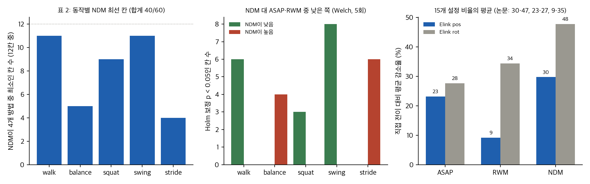
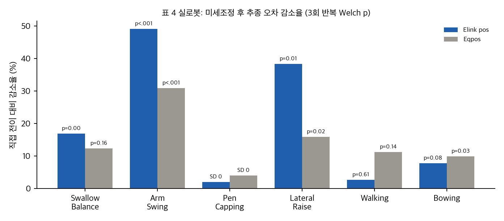
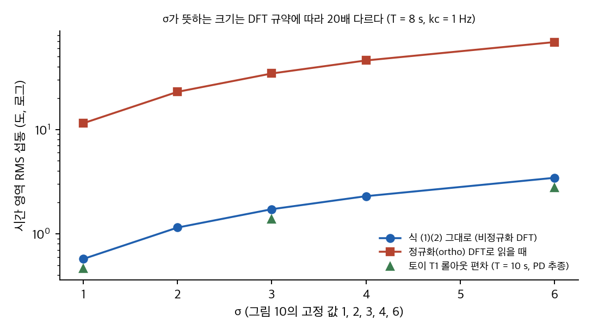
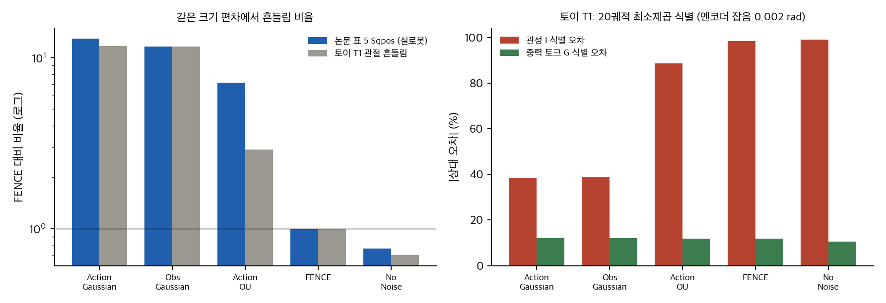

# 03. 수치 재계산, 일관성 검사, 토이 실험

재계산 스크립트는 `analysis/recompute.py`(수 초), 결과는 `recompute_results.json`입니다. 표 값은 `analysis/table_data.py`에 논문 표 2, 3, 4, 5, 7을 옮겨 적었습니다. 이 문서의 검사 번호는 V(재계산), K(일관성), 토이는 T1, T2입니다.

## 0. 가정

- **시행 수.** 표 2와 표 3, 표 7은 "5 random trials"(표 2 캡션, 표 7 캡션)이므로 n = 5로 둡니다. 표 4는 "3회 반복"(5.2절)이므로 n = 3입니다. 표 5의 시행 수는 논문에 없어 **n = 3을 가정**합니다(표 4와 같은 과제와 같은 로봇 설정). 이 가정이 바뀌면 p 값이 달라지므로 아래 표에 "(n = 3 가정)"을 붙였습니다.
- **검정.** 보고된 평균과 SD에서 Welch t 검정(양측)을 계산합니다. SD가 두 군 모두 0이면 검정하지 않습니다. 시행 5개나 3개로는 정규성을 검사할 수 없고, 칸마다 독립 검정이라 여러 칸을 함께 볼 때는 Holm 보정을 따로 적습니다. SD가 "표본 SD인지 모집단 SD인지"는 논문에 없어 표본 SD로 읽었습니다.
- **그림 판독 값은 쓰지 않았습니다.** 그림 3, 4, 10–14의 곡선은 수치 표가 없어 재계산하지 않았습니다(`04` C 항목에서 "그림 판독 필요"로 표시).
- 논문이 내는 정확한 정의(Sqpos, Sroll-pitch, Elink pos 등)는 본문에 식이 없어 값만 비교했습니다.

## 1. 재계산 결과

### 1.1 표 2: 시뮬 비교 (V1–V6)

15개 설정 × 4개 지표 = 60칸(표 2).

**V1. "60개 중 40개 최선"(5.1.1절).** 표시된 값 기준으로 세었습니다.

| 비교 집합 | NDM이 최솟값(동률 포함) | NDM이 단독 최솟값 |
|---|---|---|
| Direct, ASAP, RWM, NDM (PPO w/ Disturb. 제외) | **40**/60 | 38 |
| PPO w/ Disturb. 포함 5개 | 19/60 | 18 |

40이라는 수는 PPO w/ Disturb.를 비교에서 뺄 때 재현됩니다. 본문은 이 제외를 적지 않습니다. 동작별로는 walk 11/12, balance 5/12, squat 9/12, swing 11/12, stride 4/12입니다(V6).

**V2. 직접 전이 대비 감소율(5.1.1절).** 설정별 `방법 / Direct` 비율의 평균에서 1을 뺀 값:

| 방법 | Elink pos 감소 | Elink rot 감소 | 논문 |
|---|---|---|---|
| ASAP | 23.2% | 27.7% | 23%, 27% |
| RWM | 9.2% | 34.4% | 9%, 35% |
| HumanoidNDM | 29.8% | 47.8% | 30%, 47% |
| (참고) PPO w/ Disturb. | 41.8% | 37.9% | 본문에 없음 |

논문의 6개 수치가 모두 "설정별 비율의 평균"으로 재현됩니다. 합계의 비율(`Σ방법/ΣDirect`)로 계산하면 NDM은 30.6%, 46.4%로 거의 같습니다. 점프(표 7)까지 넣으면 NDM은 32.1%, 52.0%입니다.


<p class="cap">그래프: 표 2 재계산. 왼쪽은 동작별로 HumanoidNDM이 Direct, ASAP, RWM, NDM 중 최솟값인 칸 수, 가운데는 NDM 대 ASAP·RWM 중 낮은 쪽의 Holm 보정 Welch 결과(n = 5), 오른쪽은 직접 전이 대비 평균 감소율입니다. 우리가 그린 그래프이며 값은 논문 표 2에서 계산했습니다.</p>

**V3. "PPO w/ Disturb.와 대등"(5.1.1절).** NDM이 PPO w/ Disturb.보다 낮은 칸은 23/60이고, PPO 값의 110% 이내인 칸은 40/60입니다. 지표별 비율의 평균은 Elink pos 1.22, Elink rot 0.93, Eqpos 1.03, Ekey qpos 1.06입니다(PPO 쪽에 SD가 없어 검정하지 않음). 반대로 PPO w/ Disturb.가 Direct Transfer보다 높은 칸이 6개 있습니다(walk extra weight Ekey qpos 3.83 대 3.81, balance extra weight Eqpos 3.61 대 3.55, balance scaled KP Eqpos 3.39 대 3.32, squat small friction의 Elink rot 0.17 대 0.10, Eqpos 1.94 대 1.70, Ekey qpos 4.67 대 4.00). 교란을 알고 학습한 정책이 상한이 되지는 않습니다. "대등"은 지표와 동작에 따라 갈립니다.

**V4. NDM 대 ASAP·RWM 중 낮은 쪽(칸별 Welch, n = 5).** 59칸을 검정할 수 있었습니다(swing small friction의 Elink rot는 NDM·RWM이 모두 0.03 ± 0.00이라 제외).

| 결과 | 칸 수 |
|---|---|
| NDM 평균이 더 낮음 | 38/60 |
| 그중 보정 전 p < 0.05 | 26 |
| Holm 보정 후 NDM이 유의하게 낮음 | **17** (walk 6, squat 3, swing 8) |
| Holm 보정 후 NDM이 유의하게 높음 | **10** (balance 4, stride 6) |

balance와 stride에서 NDM이 ASAP·RWM보다 유의하게 높은 칸이 10개이고 낮은 칸은 0개입니다. 본문의 "balance와 stride에서는 다른 방법과 비슷"은 평균으로는 맞지만, 칸별 검정에서는 ASAP가 앞서는 칸이 있습니다. 예를 들어 balance scaled KP의 Elink pos는 NDM 3.82 ± 0.27, ASAP 2.61 ± 0.22(보정 p = 0.003), stride small friction의 Eqpos는 NDM 3.73 ± 0.04, ASAP 3.19 ± 0.04(p < 0.001)입니다.

**V5. NDM 대 Direct Transfer.** 60칸 모두 NDM이 낮습니다(평균 기준). Direct의 SD가 대부분 0.00이라 검정은 하지 않았습니다. 개선 폭이 작은 칸은 있습니다(squat small friction Elink pos 2.13 → 2.09, −1.9%).

**V6. 동작별 최선 칸(4개 방법).** 위 V1 표와 같습니다. "walk, squat, swing에서 분명한 우위"는 11, 9, 11/12로 맞고, "balance, stride에서 대등"은 5, 4/12입니다.

### 1.2 표 7: 점프 (V7)

- 4개 방법 비교에서 NDM이 최솟값인 칸은 **11/12**입니다(예외: extra weight Elink pos에서 ASAP 3.18, NDM 3.31, p = 0.11). Direct보다 모든 12칸에서 낮습니다.
- ASAP·RWM과의 Welch 24개 비교 중 p < 0.05가 17개입니다. scaled KP Ekey qpos(NDM 5.78 대 ASAP 5.98, p = 0.43, RWM 5.81, p = 0.88)와 small friction Elink pos·rot(4.28 ± 0.98, 0.46 ± 0.19)는 구분되지 않습니다.
- 본문 서술은 "모든 교란에서 추종 성능을 지속적으로 향상"입니다. Direct 대비로는 12/12로 맞습니다. 기준선과의 차이는 small friction에서 구분되지 않는 지표가 있습니다.

### 1.3 표 3: FENCE를 다른 프레임워크에 적용 (V8)

표 3의 설정(동작, 교란)은 적혀 있지 않습니다. ASAP 3.68, RWM 4.42의 Elink pos 값은 표 2의 어느 칸에서도 같은 값이 나오지 않습니다(재계산 `V8_table3_matches_in_table2`가 빈 목록).

| 방법 | Elink pos | Eqpos | Sqpos (×10⁻³) | Sroll-pitch (×10⁻⁴) |
|---|---|---|---|---|
| ASAP | 3.68 ± 0.20 | 3.03 ± 0.10 | 4.79 ± 6.47 | 0.95 ± 3.06 |
| ASAP w/ FENCE | 3.53 ± 0.18 (p = 0.25) | 3.13 ± 0.08 (p = 0.12) | 5.84 ± 6.27 (+22%, p = 0.80) | 1.23 ± 4.25 (+29%, p = 0.91) |
| RWM | 4.42 ± 0.23 | 2.68 ± 0.11 | 27.44 ± 13.82 | 11.06 ± 9.73 |
| RWM w/ FENCE | 4.23 ± 0.35 (p = 0.34) | 2.72 ± 0.13 (p = 0.61) | 5.43 ± 5.12 (−80%, p = 0.020) | 1.48 ± 4.19 (−87%, p = 0.095) |

- p는 n = 5 Welch 입니다. 성능 지표는 두 프레임워크 모두 FENCE 적용 전후가 구분되지 않습니다("성능 유지"와 일치).
- ASAP의 무작위 리셋 대비 FENCE의 Sqpos는 평균이 22% 큽니다(SD가 평균과 비슷해 구분되지 않음). 본문은 "무작위 리셋과 비슷한 안정성"이라고 씁니다. 두 값이 같은지 다른지를 이 표로는 판단할 수 없습니다.
- RWM의 행동 가우시안 잡음 대비 Sqpos 감소는 p = 0.02(n = 5), Sroll-pitch는 p = 0.095입니다.
- Sqpos와 Sroll-pitch의 SD가 평균과 같거나 더 큰 칸이 많아 비음수 지표의 분포가 한쪽으로 치우친 것으로 보입니다. Welch 검정의 가정이 약합니다.

### 1.4 표 4: 실로봇 (V9, n = 3)

| 과제 | 지표 | Direct → NDM | 변화 | Welch p |
|---|---|---|---|---|
| Swallow Balance | Elink pos | 5.34 → 4.44 | −16.9% | 0.002 |
| | Eqpos | 3.40 → 2.98 | −12.4% | 0.16 |
| | 체공 시간 (s) | 0.00 → 1.90 ± 0.61 | | 0.033 |
| Arm Swing | Elink pos | 5.85 → 2.98 | −49.1% | < 0.001 |
| | Eqpos | 3.33 → 2.30 | −30.9% | < 0.001 |
| | 팔 높이 (m) | 0.98 → 1.40 | +42.9% | < 0.001 |
| Pen Capping | Elink pos | 6.96 → 6.82 | −2.0% | 검정 불가 (SD 0.00) |
| | Eqpos | 3.50 → 3.36 | −4.0% | 검정 불가 |
| | 말단 거리 (cm) | 3.50 → 0.00 | | 검정 불가 |
| Lateral Raise | Elink pos | 7.54 → 4.65 | −38.3% | 0.009 |
| | Eqpos | 5.23 → 4.40 | −15.9% | 0.015 |
| | 팔 높이 (m) | 1.06 → 1.35 | +27.4% | 0.006 |
| Walking | Elink pos | 4.12 → 4.01 | −2.7% | 0.61 |
| | Eqpos | 3.67 → 3.26 | −11.2% | 0.14 |
| | 편향각 (°) | 38 ± 17 → 5 ± 3 | | 0.074 |
| Bowing | Elink pos | 4.40 → 4.06 | −7.7% | 0.083 |
| | Eqpos | 4.45 → 4.01 | −9.9% | 0.028 |
| | 소음 (dB) | 73 ± 8 → 55 ± 5 | | 0.039 |


<p class="cap">그래프: 표 4 실로봇 추종 오차의 직접 전이 대비 감소율과 Welch p(3회 반복). Pen Capping은 SD가 0.00이라 검정하지 않았습니다. 우리가 그린 그래프입니다.</p>

- **과제 지표(세 번째 열)**: 6개 모두 NDM 쪽이 좋고, 5개에서 검정이 가능하며 4개(Swallow, Arm Swing, Lateral Raise, Bowing)가 p < 0.05입니다. Walking은 p = 0.074입니다(3회, 단측이 아닌 양측).
- **추종 오차**: Walking의 Elink pos −2.7%와 Pen Capping의 −2.0%, −4.0%는 크기가 작습니다. 본문의 "6개 과제 모두에서 명확한 개선"은 과제 지표 기준으로는 방향이 맞고, 추종 오차 기준으로는 4개 과제에서 구분되는 개선(Swallow, Arm Swing, Lateral Raise, Bowing의 Eqpos)이라고 읽는 것이 정확합니다.
- **PPO w/ Disturb.와의 비교(무게 교란 3과제)**: Swallow Elink pos 4.44 대 4.72(p = 0.22), Eqpos 2.98 대 2.90(p = 0.80), 체공 1.90 대 0.40(p = 0.047). Arm Swing Elink pos 2.98 대 2.72(NDM이 9.6% 높음, p < 0.001), Eqpos 2.30 대 2.34(p = 0.14), 팔 높이 1.40 대 1.43(p = 0.10). Pen Capping은 SD 0.00이라 검정 불가(Elink pos 6.82 대 6.58, Eqpos 3.36 대 3.27). 본문 "비슷하거나 더 낫다(예: Swallow Balance)"는 과제 지표와 Swallow Elink pos에서는 맞고, Arm Swing과 Pen Capping의 추종 오차에서는 NDM이 약간 높습니다.
- **SD 0.00.** Pen Capping은 세 방법 모두 ± 0.00이고 Arm Swing NDM의 Elink pos도 2.98 ± 0.00입니다. 3회 반복에서 무엇이 변하는지(미세조정 시드인지 최종 정책의 평가 반복인지)가 논문에 없어 SD의 의미를 판단하지 못합니다(K8).

### 1.5 표 5: 탐색 방식의 실로봇 안정성 (V10, n = 3 가정)

| 방법 | Sqpos | FENCE 대비 | p | Sroll-pitch | FENCE 대비 | p |
|---|---|---|---|---|---|---|
| FENCE | 0.099 ± 0.018 | 1 | | 0.126 ± 0.023 | 1 | |
| Action Gaussian | 1.275 ± 0.313 | 12.9배 | 0.023 | 1.678 ± 0.455 | 13.3배 | 0.027 |
| Action OU | 0.707 ± 0.180 | 7.1배 | 0.027 | 0.739 ± 0.210 | 5.9배 | 0.036 |
| Obs Gaussian | 1.151 ± 0.315 | 11.6배 | 0.028 | 1.033 ± 0.218 | 8.2배 | 0.018 |
| No Noise | 0.076 ± 0.005 | 0.77배 | 0.15 | 0.106 ± 0.008 | 0.84배 | 0.27 |

세 가지 탐색 방식과의 차이는 크고 n = 3에서도 p < 0.05입니다. FENCE는 No Noise보다 Sqpos가 1.30배, Sroll-pitch가 1.19배이고 구분되지 않습니다("거의 No Noise만큼 안정"과 일치). 시행 수가 다르면 p 값이 바뀌므로 저자에게 확인이 필요합니다.

### 1.6 설정 산술과 계산 시간 (V11, V14)

| 항목 | 계산 | 값 |
|---|---|---|
| 상태 차원 | 3(ω) + 2(roll-pitch) + q + q̇ + 1(h) = 64이려면 q가 29차원 | 29-DoF 가정 시 64. 23-DoF이면 52 |
| 행동 차원 | 부록 A.5 | 23 (6차원은 정책이 내지 않는 것으로 읽힘) |
| 투영 입력 | 64 + 23 | 87 (A.5와 일치) |
| 디코더 입력 | z(64) + s̃(64) + a(23) | 151 (A.5와 일치) |
| NDM 파라미터 수 | 투영 5,632 + 위치 576 + 인코더 2층 38,048 + 디코더 305,664 + 머리 5개 164,160 | **514,080** (우리 PyTorch 구현의 `numel`과 같음) |
| 반복 시간 | 3 s(학습) + 10 s(수집) | 13 s. 200반복 = 43.3분 → "1시간 내"와 일치 |
| 반경·방향 빈 | 2 × 16 | 이웃당 32개 빈 |

### 1.7 σ의 크기와 UCB 보너스 (V12, V13)

- **σ 규약.** 식 (1)은 비정규화 DFT이고 식 (2)는 역변환입니다. 이 규약에서 `Z_k ~ CN(0, σ²)`인 켤레 대칭 잡음의 시간 영역 RMS는 `σ·sqrt(2·kc_idx)/T`입니다(kc_idx = ⌊kc·T·dt⌋). T = 8 s(400스텝, dt = 0.02), kc = 1 Hz(kc_idx = 8)이면 σ = 1, 3, 6에서 각각 0.57°, 1.7°, 3.4°입니다. DFT를 정규화(ortho)로 읽으면 11.5°, 34°, 69°입니다. 두 규약의 값이 20배 차이가 납니다. 그림 10은 σ ∈ {1, 2, 3, 4, 6}을 쓰고 "σ = 1은 탐색 부족, σ = 6은 과도"라고 하는데, 어느 규약인지에 따라 같은 σ가 0.57°–3.4°일 수도, 11.5°–69°일 수도 있습니다. 토이 T1은 식 (1)–(2) 그대로 구현해서 이 공식이 PD 추종 결과와 맞는지 확인했습니다(§3.1).


<p class="cap">그래프: 식 (1)–(2)의 σ가 DFT 규약에 따라 시간 영역 RMS 몇 도인지(T = 8 s, kc = 1 Hz)와 토이 T1 롤아웃의 편차(T = 10 s). 우리가 그린 그래프입니다.</p>

- **UCB 보너스(식 9, β = 0.05).** N = 200, n_i = 1이면 0.115, n_i = 5이면 0.051, n_i = 20이면 0.026입니다. 보상 `S`는 [0, 1]의 점유 비율이라 수준 사이 보상 차이가 0.05 안팎이면 보너스와 같은 크기입니다. 수준 목록 Σ(K와 값)와 R은 표 6에 없습니다.

### 1.8 격차 폐쇄율 (V15)

`Direct`와 `PPO w/ Disturb.` 사이에 격차가 있는 칸(격차가 Direct 값의 3% 초과)에서 `(Direct − 방법) / (Direct − PPO)`의 평균:

| 지표 | ASAP | RWM | NDM |
|---|---|---|---|
| Elink pos (15칸) | 0.53 | 0.10 | 0.66 |
| Elink rot (14칸) | 0.61 | 0.94 | 1.15 |
| Eqpos (12칸) | 0.16 | 0.68 | 0.89 |
| Ekey qpos (12칸) | 0.65 | 1.07 | 1.20 |

1을 넘는 값은 NDM이 PPO w/ Disturb.보다 낮은 칸이 평균에 들어 있다는 뜻입니다. 격차가 작은 칸(10% 이하)이 표 2에 7개 있어 비율의 분산이 큽니다. 비교용 요약으로만 씁니다.

## 2. 일관성 검사 (K 항목)

| ID | 위치 | 관찰 | 영향 |
|---|---|---|---|
| K1 | 표 6 | 학습률 감쇠 계수 1.0, 최종 학습률 1e-7, 시작 1e-4가 함께 적혀 있음. 감쇠 계수 1.0이면 학습률이 변하지 않으므로 "최종 학습률"이 쓰이는 방식을 알 수 없음 | 재구현 시 불명 |
| K2 | 부록 A.5, 표 6 | 상태 64차원은 q·q̇가 29차원일 때, 행동 23차원은 23-DoF일 때의 값으로 읽힘 | 6개 관절(허리 roll·pitch, 손목 pitch·yaw ×2로 추정)의 처리가 논문에 없음 |
| K3 | 식 (3) | 합은 t = 1..T−1이고 정규화는 1/T | 표기 차이. 점유율의 최댓값이 (T−1)/T |
| K4 | 식 (3) 대 식 (7)–(8) | 본문(4.1절)의 `C`는 가중치가 없고, 부록 A.1.1의 `C̄`는 오차 가중, 팔마다 최근 버퍼 `B_i` | 밴딧 보상의 정확한 정의가 부록에만 있음 |
| K5 | 식 (1)–(2), 표 6 | `kc`는 인덱스, 표 6은 1.0 Hz. σ의 DFT 정규화가 없음 | σ의 시간 영역 크기가 규약에 따라 20배 이상 달라짐(V12) |
| K6 | 표 3 | 동작·교란이 적혀 있지 않고 값이 표 2의 어느 칸과도 같지 않음 | 표 3을 표 2와 연결할 수 없음 |
| K7 | 표 3과 표 5 | 표 3의 Sqpos는 ×10⁻³, Sroll-pitch는 ×10⁻⁴ 단위. 표 5의 단위는 없음 | 시뮬과 실로봇 흔들림 값을 직접 비교할 수 없음 |
| K8 | 표 4, 부록 D | "3개의 독립 시행"인데 Pen Capping의 모든 칸과 Arm Swing NDM Elink pos가 ± 0.00. 반복에서 무엇이 변하는지 적혀 있지 않음 | SD의 의미와 검정 가능 여부가 불명 |
| K9 | 표 4 Pen Capping | Direct의 Eqpos(3.50 ± 0.00)와 말단 거리(3.50 ± 0.00)가 같은 값 | 단위가 다른 두 지표의 값이 겹침. 확인 필요 |
| K10 | 표 4 | 실로봇의 Elink pos, Eqpos를 어떻게 측정했는지 적혀 있지 않음(MoCap은 쓰지 않는다고 함). 링크 위치는 관절 엔코더와 FK로 얻은 값일 수 있음 | 실로봇 오차가 "참값 대비"인지 "기준 궤적 대비"인지 불명 |
| K11 | 표 2 | PPO w/ Disturb.에는 SD가 없고 6칸에서 Direct보다 높음 | "대등" 비교의 기준이 상한이 아님(V3) |
| K12 | 표 2 | Direct Transfer의 SD가 거의 0.00 | 직접 전이 대비 검정은 의미가 약함 |
| K13 | 5.1.1절 | "40/60 최선"이 PPO w/ Disturb.를 비교에서 뺀 수임(V1) | 비교 집합을 본문에 명시하지 않음 |
| K14 | 부록 D | "실패한 실행 없음"과 "충돌·모터 과열로 중단되면 최근 체크포인트에서 재개"가 함께 있음 | 3회 반복의 정의와 관련 |
| K15 | 참고문헌 | [25]와 [44]가 같은 논문 | 사소 |
| K16 | 표 6 | 수준 수 K와 값 Σ, 반경 R(동작별), 행동 스케일 c, PD 이득, 정책 구조, 에피소드 길이, 정책 에폭 수가 없음 | 재구현에 필요한 값이 빠져 있음 |
| K17 | 5.1절 | ASAP·RWM은 설정마다 격자 탐색해 "최적 구성"을 보고. 선택 기준(평가 지표인지 별도 검증인지)이 없음 | 선택을 같은 평가로 했다면 기준선에 유리. 방향은 논문에 불리하게 작용하므로 우위 판단은 보수적 |
| K18 | 부록 D | 반복 13 s 중 수집 10 s에 복귀까지 포함, 반복당 궤적 1개로 보임(200반복 = 200궤적) | 동작 길이가 10 s 안에 들어가야 함. Walk(4걸음 + 복귀)는 가능한 범위 |

## 3. 토이 실험

### 3.1 토이 T1: 탐색 방식별 흔들림과 파라미터 식별 (`toy_fence.py`, 수 초)

**질문.** (a) 같은 크기의 관절 편차를 만드는 조건에서 기준 궤적 저주파 섭동(식 1–2)이 행동 잡음보다 흔들림이 작은가(표 5의 방향)? (b) 저주파 섭동만으로 부하 파라미터가 식별되는가?

**설정(모두 이 토이의 값, 논문 값이 아님).** 1자유도 링크, 부하 1.5 kg, 팔 길이 0.3 m(전체 관성 0.185 kg·m², 중력 토크 계수 G = 4.41 N·m), PD(Kp = 40, Kd = 1.5), 50 Hz 제어, 기준 궤적 0.25 Hz 정현파 진폭 0.5 rad, 10 s 롤아웃 20개, 엔코더 잡음 0.002 rad. 각 방식의 잡음 크기를 RMS 편차 0.05 rad에 맞춰 이분 탐색한 뒤(실제 편차 0.043–0.051), 흔들림은 관절 2차 차분 평균(s_q)과 토크 변화율(s_τ)로 재고, 파라미터는 `τ = I q̈ + b q̇ + G sin q`의 최소제곱(중앙 차분)으로 추정했습니다. FENCE는 식 (1)–(2)를 비정규화 DFT로 그대로 구현했습니다(kc = 1 Hz).

| 방식 | 잡음 크기 | RMS 편차 (rad) | s_q (FENCE = 1) | s_τ (FENCE = 1) | I 식별 오차 | G 식별 오차 |
|---|---|---|---|---|---|---|
| No Noise | - | 0 | 0.70 | 0.95 | −99.1% | −10.6% |
| FENCE | σ = 5.86 | 0.051 | 1 | 1 | −98.3% | −11.8% |
| Action Gaussian | 0.093 | 0.050 | 11.7 | 104 | −38.3% | −12.0% |
| Action OU | 0.073 | 0.043 | 2.9 | 8.9 | −88.7% | −11.9% |
| Obs Gaussian | 0.092 | 0.049 | 11.6 | 103 | −38.7% | −12.0% |


<p class="cap">그래프: 왼쪽은 논문 표 5의 Sqpos 비율과 토이 T1의 관절 흔들림 비율(FENCE = 1, 로그 축), 오른쪽은 토이 T1의 관성·중력 토크 식별 오차입니다. 우리가 그린 그래프입니다.</p>

**읽기.**
- (a) 같은 크기의 편차에서 저주파 기준 섭동의 흔들림이 가장 작고(No Noise의 1.4배), 행동·관측 가우시안은 약 12배, OU는 약 3배입니다. 표 5(실로봇, 13배·12배·7배·1.3배)와 같은 순서입니다. 토이는 1자유도 선형 PD라 값 자체의 일치는 의미가 없고, "저주파 섭동은 PD가 거르지 않고 따라가 흔들림이 작다"는 기전만 확인합니다.
- (b) 저주파 섭동과 No Noise는 관성 I를 거의 식별하지 못합니다(오차 약 −98%). 가속도 정보가 엔코더 잡음에 묻히기 때문입니다. 가우시안 계열은 −38%, OU는 −89%입니다. 중력 토크 G는 모든 방식에서 −11~−12%로 같은 편향이 있어(최소제곱의 변수 오차 편향으로 보임) 탐색 방식을 구분하지 못합니다. 토이의 식별기는 논문의 이력 기반 NDM과 다르므로 "저주파 탐색은 동적 파라미터 정보가 적다"는 방향만 시사하고, NDM이 같은 한계를 가진다는 결론은 아닙니다. 부록 H의 "사전학습이 도움이 되지 않음"과 6절의 "방향성 있는 탐색이 필요"는 이 방향과 맞닿아 있습니다.
- 한계: 1자유도, 선형 PD, 잡음 크기를 편차로 맞춘 비교, 한 설정입니다. σ와 RMS 편차의 관계(σ = 1, 3, 6에서 0.008, 0.024, 0.048 rad)는 §1.7 공식(0.009, 0.027, 0.054 rad, T = 10 s)과 10% 이내로 맞았습니다.

### 3.2 토이 T2: NDM 구조의 계산 시간 (`toy_ndm_cost.py`, 약 10초)

**질문.** 부록 D의 "NDM과 정책 최적화 한 반복 약 3 s(RTX 4090)"가 부록 A.5의 구조와 표 6의 설정에서 이 맥 CPU/MPS로도 같은 자릿수인가?

**설정.** 부록 A.5의 NDM을 PyTorch로 그대로 구성(트랜스포머 2층 d = 64, 4 헤드, d_ff = 16, MLP 64 → 512 → 512, 머리 5개, 파라미터 514,080개). 정책은 논문에 구조가 없어 은닉 256의 MLP 3층으로 가정했고, 미분 가능 FK와 보상 항은 생략했습니다. NDM 미니배치 = 512 × Lw = 8, 정책 미니배치 = 512 × Lπ = 128(NDM을 통과해 역전파). 반복당 NDM 32 + 정책 2 미니배치, 에폭 1회로 가정. 각 미니배치를 워밍업 후 2회 측정했습니다.

| 기기 | NDM 미니배치 | 정책 미니배치 | 반복 추정 | 논문 |
|---|---|---|---|---|
| CPU (이 맥) | 0.106 s | 1.85 s | **7.1 s** | 약 3 s (RTX 4090) |
| MPS (이 맥) | 0.028 s | 0.45 s | **1.8 s** | |

**읽기.** 계산량이 이 맥에서도 같은 자릿수이고, MPS는 논문의 4090 수치보다 짧게 나왔습니다(FK, 실제 손실 항, 정책 구조, 에폭 수를 가정했으므로 정확한 비교가 아님). 로봇 쪽 수집(10 s)이 반복 시간의 대부분이므로 계산이 병목은 아닙니다. 이 결과는 "학습과 정책 갱신은 이 맥에서 돌릴 수 있다"는 구현 가능성 판단의 근거입니다(`04` §4).

## 4. 재실행

```bash
python3 analysis/recompute.py          # 수 초, V1-V15
python3 analysis/toy_fence.py          # 수 초, 토이 T1
python3 analysis/toy_ndm_cost.py       # 약 10초, 토이 T2 (PyTorch 필요, MPS 있으면 함께 측정)
python3 analysis/plot_figures.py       # 그래프 네 장 (report/figures/own_*.png)
```
