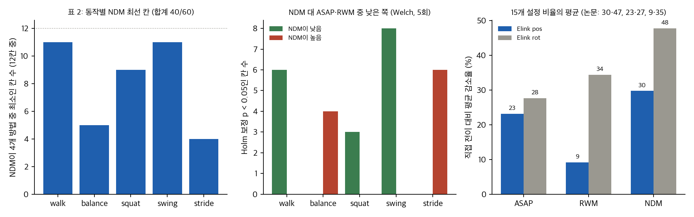
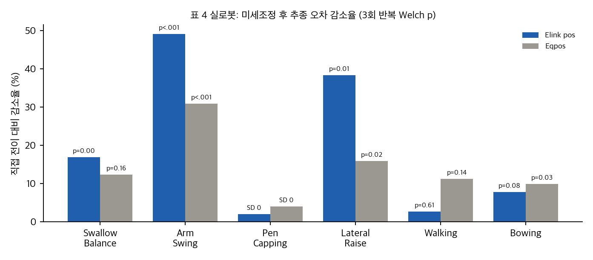
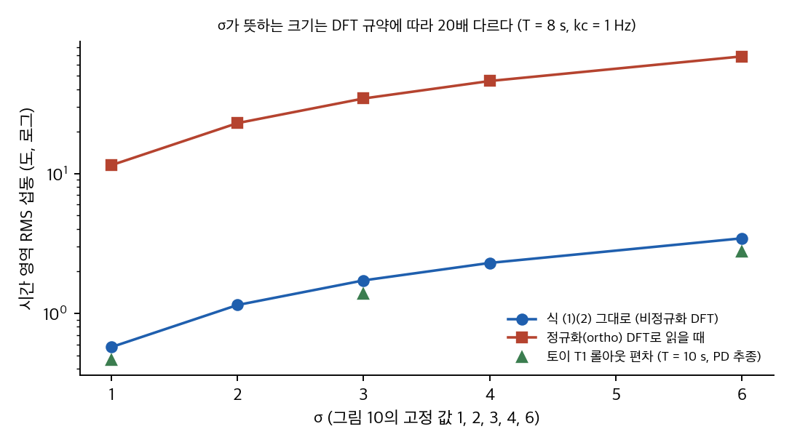
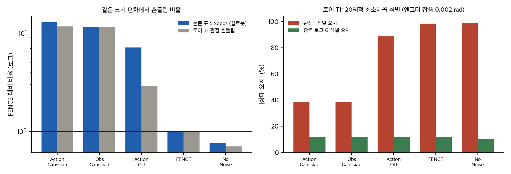

> **논문:** Chao Chen, Zhenrong Wang 외. *HumanoidNDM: Closing the Training-Deployment Gap of Motion Tracking via Humanoid Neural Dynamics Model.* CoRL 2026 포스터, arXiv:2610.34126 (v1, 2026-10-25, 버전은 하나).
> 프로젝트 페이지의 코드 링크가 가리키는 GitHub 저장소는 2026-11-24 기준 커밋이 없는 빈 저장소입니다. 이 글의 그림은 모두 우리가 그린 그래프이고, 논문 그림은 쓰지 않았습니다.

## 논문이 묻는 것

시뮬레이션에서 학습한 인간형 동작 추종 정책은 실제 로봇에서 추가 하중, 마찰, 구동기 차이를 만나면 성능이 떨어집니다. 시뮬 파라미터를 다시 맞추는 대신 **실제 데이터로 정책을 직접 고치자**는 것이 이 논문의 입장입니다. 방법은 세 단계 루프입니다.

1. **수집(FENCE).** 기준 궤적의 관절 위치를 푸리에 변환해 1 Hz 이하 성분에만 복소 가우시안 잡음을 더하고 되돌립니다. 정책은 이 섭동된 궤적을 추종합니다. 섭동의 세기 σ는 "정책 주변을 얼마나 덮었는가"를 보상으로 하는 UCB 밴딧이 인접 수준 사이에서 고릅니다.
2. **모델.** 고유수용 신호만 쓰는 이력 기반 신경 동역학 모델(NDM)입니다. 트랜스포머 2층과 5개 머리, 파라미터 약 51만 개(부록 A.5로 계산)이고, 미분 가능 FK로 링크 자세 오차까지 손실에 넣습니다.
3. **정책.** NDM을 통해 128단계 롤아웃을 만들고 추종 손실을 모델 기울기로 직접 역전파해 정책을 갱신합니다.

Unitree G1에서 6개 과제(종아리·손에 하중, 탄성 밴드, 물 양동이, 손상된 모터 등)를 실험하고, 반복마다 데이터 수집 약 10초, 학습 약 3초(RTX 4090)로 200반복이 1시간 안에 끝난다고 보고합니다.

## 이 글에서 확인한 것

### 1. "60칸 중 40칸 최선"은 어떤 비교에서 나온 수인가

표 2는 5개 동작 × 3개 교란 × 4개 지표 = 60칸입니다. Direct Transfer, ASAP, RWM, HumanoidNDM 중 최솟값을 세면 **40칸**(단독으로는 38칸)이 맞습니다. 교란을 알고 학습한 "PPO w/ Disturb."까지 넣으면 19칸입니다. 직접 전이 대비 감소율(링크 위치 30%, 링크 회전 47%, ASAP 23%·27%, RWM 9%·35%)은 설정별 비율의 평균으로 모두 재현됩니다.

동작별로는 최선 칸이 walk 11, swing 11, squat 9, balance 5, stride 4(각 12칸 중)입니다. 칸마다 Welch 검정을 하고 Holm으로 보정하면(5회 시행) NDM이 ASAP·RWM 중 낮은 쪽보다 **유의하게 낮은 칸이 17개**(walk 6, squat 3, swing 8), **유의하게 높은 칸이 10개**(balance 4, stride 6)입니다. 본문은 balance와 stride를 "다른 방법과 비슷하다"고 쓰는데, 평균 차이는 작지만 ASAP가 앞서는 칸이 있습니다. 예를 들어 balance의 scaled KP에서 링크 위치 오차는 NDM 3.82 ± 0.27, ASAP 2.61 ± 0.22입니다.

*그래프 1. 표 2를 다시 계산한 결과. 우리가 그린 그래프이며 값은 논문 표 2(5회 시행, mean ± std)에서 계산했습니다.*

"PPO w/ Disturb.와 대등하다"는 서술은 지표에 따라 갈립니다. NDM이 더 낮은 칸은 23/60, PPO 값의 110% 이내인 칸은 40/60이고, 링크 위치 오차는 평균 1.22배입니다. PPO w/ Disturb.가 Direct Transfer보다 오히려 높은 칸이 6개 있어, 이 기준선이 상한은 아닙니다.

### 2. 실로봇: 과제 지표는 방향이 맞고, 일부 칸은 검정이 안 됩니다

표 4는 3회 반복입니다. 과제별 지표(체공 시간, 팔 높이, 편향각, 소음 등)는 **6개 모두 NDM 쪽이 좋고**, 검정이 가능한 5개 중 4개가 p < 0.05입니다(Welch, n = 3). Walking의 편향각은 38° → 5°이지만 p = 0.074입니다. 추종 오차는 과제마다 크기가 다릅니다. Arm Swing은 링크 위치 오차가 49% 줄지만, Walking은 2.7%(p = 0.61), Pen Capping은 2.0%와 4.0%이고 이 과제는 모든 칸의 표준편차가 0.00이라 검정을 할 수 없습니다. 무게 교란 세 과제에서 "PPO w/ Disturb.와 비슷하거나 더 낫다"는 서술은 Swallow Balance의 체공 시간(1.90초 대 0.40초, p = 0.047)에서는 맞고, Arm Swing의 링크 위치 오차에서는 NDM이 9.6% 높습니다(p < 0.001).

*그래프 2. 표 4의 추종 오차 감소율과 3회 반복 Welch p. 우리가 그린 그래프입니다.*

3회 반복에서 무엇이 바뀌는지(미세조정 시드인지, 같은 정책의 평가 반복인지)와 실로봇의 링크 오차를 MoCap 없이 어떻게 얻었는지는 논문에 적혀 있지 않습니다. 저자 확인이 필요한 부분입니다.

### 3. FENCE의 이득과 σ의 크기

표 5(실로봇 가로 올리기)에서 행동 가우시안, 행동 OU, 관측 가우시안 잡음은 FENCE보다 관절 흔들림 지표가 5.9–13.3배 큽니다(시행 수를 3으로 가정하면 p < 0.04). FENCE와 잡음 없음의 차이는 1.19–1.30배이고 구분되지 않습니다(p = 0.15, 0.27, 시행 수 3 가정). 표 3에서는 FENCE를 ASAP와 RWM에 넣어도 미세조정 성능이 구분되지 않고, ASAP의 무작위 리셋 대비 흔들림 지표는 22% 크지만 표준편차가 평균과 비슷해 판단하기 어렵습니다. 표 3은 어떤 동작과 교란의 결과인지 적혀 있지 않습니다.

σ가 실제로 얼마인지는 논문만으로 정해지지 않습니다. 식 (1)–(2)를 비정규화 DFT로 읽으면 σ = 1–6은 시간 영역 RMS 약 0.6°–3.4°이고, 정규화 DFT로 읽으면 11.5°–69°입니다(T = 8 s, kc = 1 Hz 가정). 부록 F는 "σ = 1은 탐색 부족, σ = 6은 과도"라고 쓰는데, 어느 규약이냐에 따라 같은 값이 20배 다른 크기가 됩니다. 수준 목록, 동작별 이웃 반지름, 정책 구조도 표 6에 없어서, 코드 공개 전에는 재구성이 어렵습니다.

*그래프 3. 식 (1)–(2)의 σ와 시간 영역 섭동 크기의 관계(T = 8 s, kc = 1 Hz)와 토이의 롤아웃 편차. 우리가 그린 그래프입니다.*

### 4. 토이로 본 저주파 섭동의 흔들림과 정보량

1자유도 링크(부하 1.5 kg, PD 추종)에서 네 가지 탐색을 같은 크기의 관절 편차(RMS 0.05 rad)로 맞춰 비교했습니다. 관절 흔들림은 FENCE가 가장 작고(잡음 없음의 1.4배), 행동·관측 가우시안은 약 12배, OU는 약 3배였습니다. 표 5의 순서와 같습니다. 반면 20개 궤적으로 최소제곱 식별을 하면 FENCE와 잡음 없음은 관성을 거의 식별하지 못했고(오차 −98%), 가우시안 계열은 −38%였습니다. 중력 토크는 모든 방식에서 같은 편향이 있었습니다. 토이는 선형 1자유도라 논문의 NDM에 대한 결론은 아니고, "저주파 탐색은 가속도 정보가 적다"는 방향만 시사합니다.

*그래프 4. 왼쪽은 논문 표 5의 Sqpos 비율과 토이의 관절 흔들림 비율(FENCE = 1), 오른쪽은 토이의 관성·중력 토크 식별 오차. 우리가 그린 그래프입니다.*

NDM 구조 자체의 계산량도 확인했습니다. 부록 A.5를 PyTorch로 그대로 구성하면 파라미터가 514,080개이고, 128단계 롤아웃을 포함한 한 반복의 계산 시간 추정이 CPU 7.1초, Apple GPU(MPS) 1.8초였습니다(정책 구조와 FK 생략을 가정). 논문의 약 3초(RTX 4090)와 같은 자릿수입니다.

## 논문에 적힌 것과 적히지 않은 것

- 적힌 것: 5개 동작 × 3 교란의 시뮬 비교, 6개 과제의 실로봇 결과, 이중 공간 손실과 이력 입력의 절제(그림 4), 점프에서의 적용(표 7: 직접 전이보다 12/12칸에서 낮고 4개 방법 중 11/12칸 최선).
- 수치 표가 없어 재계산하지 못한 것: 절제 곡선(그림 4, 15–19), 적응 σ 대 고정 σ(그림 10–12), 사전학습 효과(그림 14).
- 적히지 않은 것: σ의 DFT 규약과 수준 목록, 이웃 반지름, 정책 구조·행동 스케일·PD 이득, 표 6의 학습률 감쇠(계수 1.0과 최종 1e-7이 함께 있음), 상태 64차원과 행동 23차원의 관계, 표 5의 시행 수, 표 3의 설정.

## 구현 가능성

이 글을 쓴 환경(Apple M4 Pro, CUDA 없음)에서 전체 재현은 어렵습니다. 실로봇은 G1과 안전 장비가 필요하고, 공식 코드가 없어 논문 그대로의 구현은 처음부터 짜야 합니다. 시뮬 축소판(MuJoCo CPU와 PyTorch)은 구현할 수 있고, 모델 학습과 정책 갱신의 계산량은 위 추정대로 이 환경에서도 같은 자릿수입니다. 노력은 약 3–5주로 추정하며 측정하지 않았습니다.

## 마무리

- 표 2의 40칸 최선과 직접 전이 대비 감소율은 재현됩니다. 우위의 크기는 동작에 따라 갈리고, balance와 stride에서는 ASAP·RWM이 앞서는 칸이 있습니다.
- 실로봇은 과제 지표의 방향이 모두 맞습니다. 3회 반복이라 Walking과 Bowing의 일부 칸은 구분이 약하고, Pen Capping은 표준편차가 0.00이라 검정이 안 됩니다.
- FENCE의 안정성 이득은 다른 잡음 대비 5.9–13.3배이고 잡음 없음과는 구분되지 않습니다. σ의 크기와 나머지 설정값은 코드나 저자 확인이 필요합니다.
- 코드가 올라오면 σ 규약, 이웃 반지름, 학습률 스케줄, 6개 관절의 처리, 실로봇 오차 계측을 먼저 확인할 값으로 보고 있습니다.

재계산과 토이 스크립트는 함께 올린 자료(`recompute.py`, `toy_fence.py`, `toy_ndm_cost.py`)에 있습니다.

## 자료

- [통합 리포트 PDF](report/report_public.pdf)
- [01. 논문 분석: HumanoidNDM (arXiv:2610.34126)](analysis/01_paper_analysis.md)
- [02. 선행연구와 관련 저장소](analysis/02_prior_work.md)
- [03. 수치 재계산, 일관성 검사, 토이 실험](analysis/03_analysis.md)
- [04. 주장 검증과 구현 가능성 (공식 코드 없음)](analysis/04_claim_verification.md)
