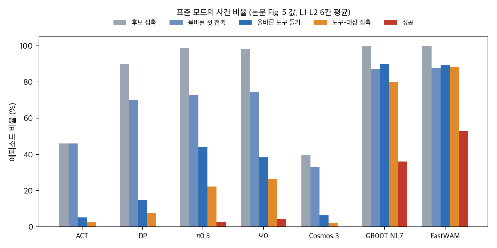
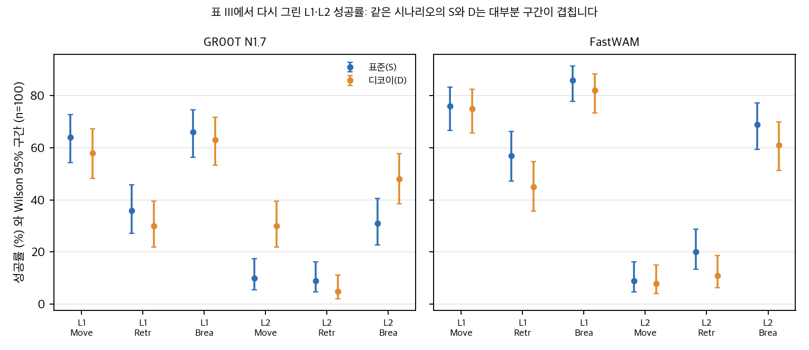
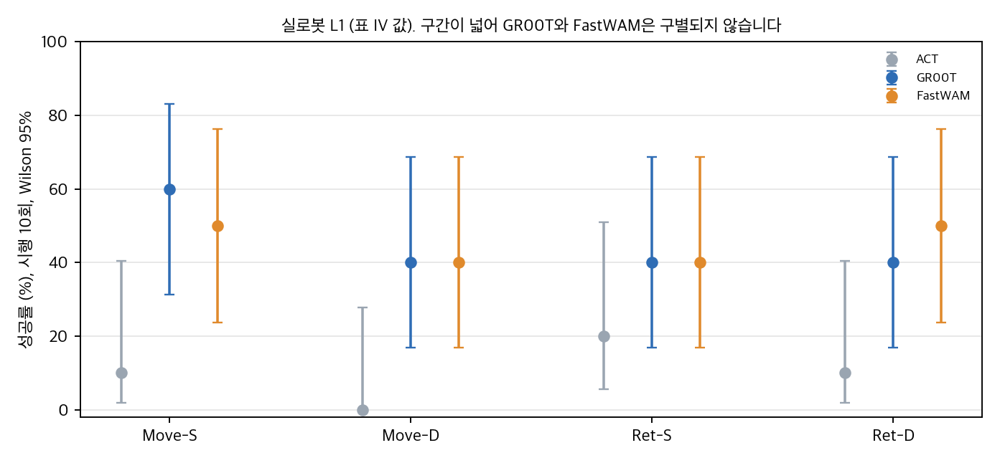

> **논문:** Kyochul Jang, Seohyeon Park, Ohchul Kwon, Sangjun Park, Junhyeok Choi, Seungyeop Yi, Chaeyun Kim, Sangkyu Lee, Idan Szpektor, Avi Caciularu, Jongmin Park, Youngjae Yu. *HumanoidToolBench: Benchmarking Humanoid Tool Use from Selection to Mobile Execution.* arXiv:2610.02089 (v1, 2026-10-01). 학회 표기는 찾지 못했습니다.
> 공식 코드는 GitHub SNU-PI/HumanoidToolBench(MIT, 평가 도구)에 있습니다. 논문은 arXiv 비독점 배포 라이선스(CC 아님)라서 이 글에는 논문 그림을 싣지 않고 우리가 다시 그린 그래프만 넣었습니다.

## 논문이 묻는 것

휴머노이드가 신체 한계를 넘는 일을 하려면 도구를 고르고, 잡고, 필요하면 걸으면서 써야 합니다. 이 논문은 세 시나리오(BallMove, BallRetrieve, IceBreak), 세 실행 수준(L0 선택·집기, L1 정지 사용, L2 이동 사용), 두 도구 모드(표준 S, 한 속성만 다른 경쟁 도구를 더한 디코이 D)로 18개 과제를 만들고, 시연 3,094개(ToolBook)로 학습한 정책 7개를 시뮬에서, 3개를 Unitree G1 실로봇에서 평가합니다. 정책마다 학습은 한 번이며 시뮬 칸은 100 에피소드입니다.

## 이 글에서 확인한 것

**1. 정책 사이의 격차와 정지에서 이동으로의 낙폭은 분명합니다.** 표 III에서 GR00T N1.7과 FastWAM이 나머지를 크게 앞서고, L1에서는 FastWAM이 여섯 칸 모두 가장 높습니다. 같은 정책이 L1에서 L2로 가면 FastWAM BallMove 표준은 76%에서 9%로 떨어집니다(칸당 100 에피소드 가정 Fisher p = 3e-23). 다만 L2는 이동뿐 아니라 목표와 공의 배치도 바뀌므로(저자도 §V에서 언급, 공식 코드의 L2 배치로도 확인) 낙폭 전부를 이동의 효과로 읽을 수는 없습니다.

**2. 집은 뒤 끝내지 못하는 패턴이 그림 5에서 보입니다.** 표준 모드의 L1·L2 평균에서 GR00T N1.7은 올바른 도구를 드는 비율이 90.0%인데 성공은 36.0%, FastWAM은 89.2%와 52.8%입니다. 약한 정책(DP, π0.5)은 후보에 닿고도(89.8%, 98.8%) 드는 단계(15.0%, 44.2%)에서 줄어듭니다.

*그래프: 우리가 그린 그래프. 논문 그림 5의 숫자 라벨(표준 모드, L1·L2 6칸 평균)을 다시 그렸습니다.*

**3. 디코이 효과는 방향만 일관됩니다.** GR00T N1.7과 FastWAM은 L1 여섯 칸 모두에서 D가 S보다 낮습니다. 하지만 칸별 차이는 1–12 %p이고 Fisher p는 0.12–1.0(시행 수 100 가정, 비대응 근사)이며, L1을 풀링해도 p는 0.25(GR00T)와 0.15(FastWAM)입니다. GR00T의 L2에서는 D가 오히려 높습니다(풀링 50/300 대 83/300, p = 0.0016). 논문이 쓴 "디코이는 최종 성공보다 초기 선택에 더 영향을 준다"는 올바른 첫 접촉(87.3 → 77.2, 87.7 → 74.7)의 큰 변화와 성공(36.0 → 39.0, 52.8 → 47.0)의 작은 변화에 근거하며, 이 평가 크기에서는 성공의 변화도 ±10 %p 구간 안입니다.

*그래프: 우리가 그린 그래프. 표 III 값을 칸당 100 에피소드로 가정해 Wilson 95% 구간을 붙였습니다. 파랑은 표준(S), 주황은 디코이(D)입니다.*

**4. 실로봇은 ACT 대비에서만 구별됩니다.** 표 IV(시행 10회)를 정책별로 40회 풀링하면 ACT 4/40, GR00T N1.7 18/40, FastWAM 18/40입니다. ACT와 강한 정책의 차이는 p = 0.0009이고 GR00T와 FastWAM은 p = 1.0입니다. 시뮬 L1 공 과제 4칸의 평균은 FastWAM 63.2%, GR00T 47.0%였으나 실로봇에서는 둘 다 45.0%입니다. 실로봇 정책은 시뮬 학습 뒤 91개 실로봇 시연으로 5,000 업데이트를 더 학습한 것이어서(sim+real) 적응 단계의 기여는 비교군이 없어 분리되지 않습니다.

*그래프: 우리가 그린 그래프. 표 IV의 시행 10회 값과 Wilson 95% 구간입니다.*

**5. L1·L2 성공은 올바른 도구 사용을 요구하지 않는 조건입니다.** 공식 코드(정적으로 읽음)에서 BallMove·BallRetrieve의 성공은 공 중심이 반지름 0.12 m 원 안에 있는 것이고, IceBreak는 두 블록이 깨지고 조각이 흩어지는 것입니다. 올바른 도구를 들었는지는 성공 조건이 아니며, 필요 도구가 아니면 닿지 않도록 배치 상수로 설계되어 있습니다. 그래서 FastWAM BallMove 표준의 L0 성공(64%)보다 L1 성공(76%)이 높은 칸이 가능합니다. "도구 선택과 완료 사이의 격차"를 읽을 때 이 정의를 함께 보아야 합니다.

**6. 숫자 검사.** ToolBook 합계(1,803 + 1,200 + 91 = 3,094), 그림 5 대 표 III의 6칸 평균(14행 중 13행), 그림 5 값의 정수 가능성(70개 중 67개), 프로젝트 페이지 표와의 일치는 맞습니다. 그림 5의 Ψ0 표준 행 일부(후보 접촉 98.1, 올바른 첫 접촉 74.4, 도구-대상 접촉 26.6)는 정수 %의 6칸 평균 형식이 아니고, 성공 4.3은 표 III에서 계산한 4.2와 다릅니다(차이 0.1 %p). 집계 방식은 저자 확인이 필요합니다. 또 3,094라는 숫자는 L1·L2 성공 시연의 앞부분을 L0 궤적으로 따로 센 것이어서, 서로 다른 시도는 2,050개(시뮬 1,959 + 실로봇 91)입니다.

**7. 탐침 두 개.** 미학습 도구에서 올바른 첫 접촉은 BallMove 85 → 74%(p = 0.079), BallRetrieve 59 → 36%(p = 0.0018)로 둘 다 낮아지는 방향이고 BallRetrieve에서만 5% 수준에서 분명합니다(각 100 에피소드 가정). 지시 탐침은 고정된 IceBreak 장면 하나에서 원래 지시 77%, 바꿔 쓴 지시 70%, 무관한 문장 84%로, 무관한 지시에서도 성공이 유지된다는 점은 분명하지만 세 값 사이 차이는 대부분 구별되지 않습니다(원래 대 무관 p = 0.28). 저자도 지시 추종 여부를 가리려면 장면과 지시가 충돌하는 조건이 필요하다고 씁니다.

## 공식 코드와 구현 가능성

공식 저장소는 평가 도구입니다(환경 18개, 성공 판정, HTTP 정책 서버, 영상 검증, ACT·DP 로더). 학습 코드, 강한 정책 5개의 체크포인트·어댑터, 탐침 코드는 없고 ACT와 DP 체크포인트만 공개되어 있습니다. 시드 10000–10099, 3,000 스텝(50 Hz), 0.08 m 들기, 1초 유지, 디코이 사양, 32/36차원 입출력은 논문과 맞습니다. 논문에 없는 규칙으로는 IceBreak의 파괴 기준(접촉력 × 물리 스텝 0.042 N·s 이상, 접근 속도 0.5 m/s 이상, 조각 0.03 m 이상 분산), 실로봇 기록의 35차원 행동 계약(시뮬은 36차원)이 있습니다. 논문(2026-10-01) 이후인 2026-10-21 커밋이 메시 10개의 충돌체를 교체했고, 코드 주석은 수정 전에 시드 10000–10099 중 BallMove 3개, IceBreak 2개에서 정답 도구가 접근 불가였다고 적습니다. 논문 수치가 어느 코드 판으로 얻어졌는지는 저장소에 표기되어 있지 않습니다.

환경은 Linux x86_64와 NVIDIA GPU(EGL)를 전제하고 한 조건(100 에피소드)에 GPU 약 2시간이 걸린다고 README가 안내합니다. GPU가 없는 기기에서는 평가를 돌릴 수 없고, 이 글의 수치는 모두 논문 표와 그림에서 재계산한 것입니다.

## 한계

시뮬 칸의 시행 수 100은 논문 서술이며 대응(같은 시드) 자료가 없어 S 대 D, L1 대 L2 비교는 비대응 근사로 계산했습니다. 정책당 학습 1회이므로 모든 구간은 학습 시드 변동을 포함하지 않습니다. 공식 코드는 정적으로만 읽었고(실행하지 않음), 배치 상수가 실제 동역학에서 도구 없이 성공을 허용하는지는 확인하지 못했습니다. 프로젝트 페이지(2026-11-23)에는 v1에 없는 LLM 에이전트 실험이 추가되어 있으며 이 글에서는 다루지 않았습니다.

## 자료

- [통합 리포트 PDF](report/report_public.pdf)
- [01. 논문 분석: HumanoidToolBench](analysis/01_paper_analysis.md)
- [02. 선행연구, 가까운 대안, 코드 저장소](analysis/02_prior_work.md)
- [03. 수치 재계산, 일관성 검사, 주장 판정](analysis/03_analysis.md)
- [04. 공식 코드 대조와 구현 가능성](analysis/04_code_verification.md)
