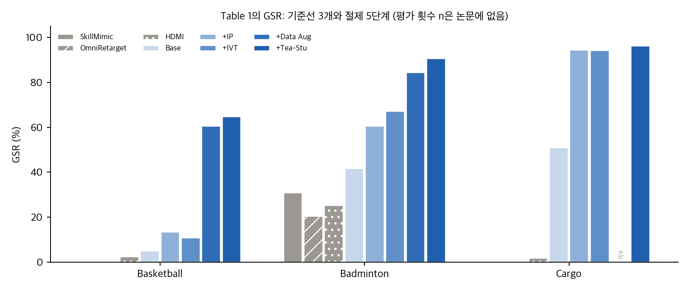
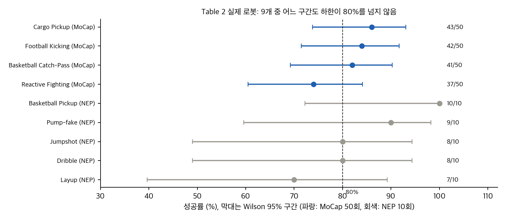

# 01. 논문 분석: HumanX (arXiv:2602.02473)

원문은 `paper/paper.pdf`(arXiv v2, 2026-10-09, 17쪽)이고, 텍스트는 `paper/paper.txt`(`pdftotext -layout`)입니다. 쪽 번호는 v2 PDF 쪽 번호입니다. 본문은 1–9쪽(참고문헌 9–13쪽), 부록은 14–17쪽입니다. 부록에는 표 3, GSR 평가 설정, 보상 식, 관측과 무작위화 표, 외력 지각, PD 제어기, MoCap 신호 손실이 있습니다.

## 0. 버전과 기본 정보

| 항목 | 내용 |
|---|---|
| 제목 | HumanX: Toward Agile and Generalizable Humanoid Interaction Skills from Human Videos |
| 저자 | Yinhuai Wang\*, Qihan Zhao\*, Yuen Fui Lau\*, Runyi Yu, Hok Wai Tsui, Qifeng Chen†, Jingbo Wang†, Jiangmiao Pang, Ping Tan† (HKUST, Shanghai AI Laboratory). \*동등 기여, †교신 |
| arXiv | 2602.02473, cs.RO (cs.LG 교차) |
| 버전 | v1 2026-02-02 (24,530 KB, 13쪽, 2단 IEEE 양식) · **v2 2026-10-09 (24,355 KB, 17쪽, 현재 버전, CoRL 양식)** |
| 학회 | **CoRL 2026 포스터.** corl.org 공식 채택 목록(저장소의 `conferences/corl2026/papers.json`: 포스터, Tue 11/10 5:00–6:30 PM, 번호 183)에서 확인. v2 첫 쪽 하단에 "10th Conference on Robot Learning (CoRL 2026), Austin TX, USA", GitHub 설명과 프로젝트 페이지도 CoRL 2026 표기. arXiv comments 칸은 비어 있음 |
| 공식 코드 | https://github.com/wyhuai/HumanX (83 stars, 2026-10-22 마지막 push, 커밋 `02634bf`). 시뮬레이션 쪽만 공개 (`04` 참조) |
| 프로젝트 페이지 | https://wyhuai.github.io/human-x/ (초록이 v1 문구) |
| 라이선스 | arXiv abs 페이지 "view license"가 `arxiv.org/licenses/nonexclusive-distrib/1.0/`을 가리킵니다 (비독점 배포, **CC BY 아님**). PDF 첫쪽·끝쪽·본문에서 ©, copyright, All rights reserved, 기업 고지는 찾지 못했습니다 (pdftotext 검색). 그림 게시 불가 |

### 0.1 v1 → v2 차이

두 버전의 PDF를 `pdftotext`로 뽑아 대조했습니다. **Table 1의 모든 수치와 Table 3 수치는 두 버전이 한 자리까지 같습니다.** 달라진 것은 다음입니다.

| 항목 | v1 (2026-02-02) | v2 (2026-10-09) |
|---|---|---|
| 초록의 기술 수 | "10 different skills", "full-stack framework", "without task-specific rewards" | "**9** different skills", "unified framework", "without per-task design" |
| 초록의 결론 | "over **8×** higher generalization success", "scalable and **task-agnostic** pathway" | "higher generalization success", "scalable pathway **within a class of anchorable interactions**" (8×는 본문 5절에만 남음) |
| 실제 로봇 표 | Table III에 **Spin Move (NEP) 9/10** 포함 (10개 기술) | 표 2에서 Spin Move 삭제 (9개) |
| 상대 운동 보상 | "relative motion reward" r^rel (상대 위치 + 선택적 상대 회전) | "**Interaction Vector (IV)**" 보상 r^iv (위치 벡터 L2 오차), 지문 추가: 손가락 끝·라켓 모서리 같은 확장 점 |
| 절제 행 이름 | +DI (Disturbed Initialization), +IT (Interaction Termination) | +**IP** (Interaction Perturbation: 초기화 교란 + 로봇·물체 외력), +**IVT** (IV-based Termination). **수치는 같음** |
| 한계 | 결론에 한계 없음 | 6절에 한계 단락 추가 (제자리 재배향, 변형 물체, 손가락 손 없음, MoCap 의존) |
| 삭제된 문장 | "SR 약간 감소는 단일 시연 과적합이 줄어든 자연스러운 절충", "NEP는 날아오는 공 받기 같은 비접촉 상호작용은 못 다룬다" | 둘 다 없음 |
| 부록 | 보상 식, 외력 지각, 표 IV 정도 | 다중 패턴(표 3), GSR 설정(7.2), 확률적 조기 종료(7.6), PD 제어기(7.7), MoCap 손실 모사(7.8), 무작위화 표(그림 14) 추가 |
| 그림 11/12 설명 | "sustained random external forces 없이" | "Interaction Perturbation 없이" |
| 참고문헌 | 약 66개 | 77개 (SAM 3D, ViRAL, DreamControl, PhysHSI 등 추가) |

핵심은 **수치가 그대로인 채 주장의 범위와 이름이 바뀐 것**입니다. v1의 +DI는 "초기화 교란"이었고 v2의 +IP는 "초기화 교란 + 외력"으로 정의가 넓어졌지만 표 값은 같습니다(`03` V13, C3).

## 1. 문제와 주장

로봇이 사람 영상에서 상호작용 기술(농구, 축구, 배드민턴, 상자 들기, 싸움)을 배우려면 (a) 영상에서 물리적으로 그럴듯한 사람-물체 상호작용(HOI) 데이터를 얻어야 하고, (b) 그 데이터로 일반화되는 정책을 학습해야 합니다. 저자들은 기존 방법이 "텔레오퍼레이션 데이터가 비싸거나, 과제별 보상 설계가 필요하다"고 보고(1절, 2쪽), 두 구성 요소를 제안합니다.

- **XGen** (3절): 단안 영상 한 편에서 로봇 HOI 데이터를 *재구성*이 아니라 *합성*으로 만들고 증강합니다.
- **XMimic** (4절): 로봇과 물체의 **상대 운동(Interaction Vector)** 을 우선하는 모방 학습 틀. 교사-학생 구조.

주장: 한 편의 영상에서 9개 기술을 배워 Unitree G1에서 zero-shot으로 수행하고, 일반화 성공률(GSR)이 기존 방법보다 높습니다. 범위는 "anchorable interactions"(안정적 파지나 점 접촉으로 앵커를 정의할 수 있는 상호작용)로 한정됩니다(v2 초록, 6절).

## 2. 방법

### 2.1 XGen (3절, 3–4쪽, 그림 2–4)

세 단계입니다.

1. **영상 → 로봇 동작:** GVHMR([11])로 SMPL 자세를 얻고 GMR([38])로 G1에 리타게팅합니다(키포인트 정렬, 골격 스케일, IK).
2. **상호작용 합성:** 프레임을 접촉 전·접촉·접촉 후로 나눕니다(t < t_s, t_s ≤ t ≤ t_e, t > t_e). 접촉 구간에서는 *앵커*(두 손바닥 중점, 또는 발 같은 한 부위)와 물체 사이의 상대 변환 ϕ를 보존해 물체 궤적을 만듭니다. 물체 메시와 초기 ϕ는 SAM 3D([12])로 추정하거나 수동으로 줍니다. 접촉과 force-closure 목표([65–67])로 로봇 자세를 다듬습니다. 비접촉 구간(공이 날아가는 부분)은 물리 시뮬레이터(Isaac Gym [68])로 합성하고, 접촉 전 구간은 시간을 거꾸로 시뮬레이션하며 **감쇠 계수를 뒤집습니다**.
3. **증강:** (1) 물체 메시 크기 변경·교체, (2) 접촉 구간 물체 궤적의 이동·스케일, (3) 비접촉 구간의 초기 속도 무작위화. 그림 3–4에 예가 있고, 실험에서는 영상 하나당 50개 클립으로 증강합니다(5절).

### 2.2 XMimic (4절, 5쪽, 그림 5)

**교사-학생.** 교사 π_tea^i는 기술별 데이터 D_i로 PPO 학습하며 특권 관측(참조 몸 위치, 물체 상태)을 받습니다. 학생은 D = ∪D_i 위에서 RL 보상과 **BC 손실**(교사 행동 모방)을 함께 쓰고, 비대칭 actor-critic을 씁니다. 정책은 가우시안 π(a|s) = N(φ_π(s), Σ_π), Σ_π 학습 가능, 행동은 PD 제어기로 토크가 됩니다(식 10–13).

**Interaction Vector.** 몸 키포인트 k에서 물체 중심까지의 벡터 u^(k) = u_k − u_o를 IV로 부르고, 참조와 시뮬레이션의 IV 오차 e^iv = ‖u − û‖₂ (식 5)로 보상 r^iv를 만듭니다. 손가락 끝·라켓 모서리 같은 점을 몸 키포인트에 더합니다(4절).

**보상(7.3, 식 1–7).** r = r^body + r^obj + r^iv + r^c + r^reg. 각 항은 γ·exp(−λ·e) 꼴(식 3)이고, r^body는 위치·회전·관절·속도·AMP, r^c는 접촉 그래프 일치(식 6–7), r^reg는 정칙화입니다.

**세 가지 상호작용 우선 설계:**
- *IV imitation reward*: 상대 운동을 직접 보상해 물체가 참조에서 벗어나도 밀한 신호를 줍니다.
- *IV-based Termination (IVT)*: IV 오차가 크면 조기 종료하되 **확률적**으로 적용합니다(엄격 ↔ 관대).
- *Interaction Perturbation (IP)*: 에피소드 초기 로봇 루트·관절·물체 위치 교란, 접촉 중 물체와 로봇에 무작위 외력.

**배포(4절).** *NEP*(No External Perception): 학생 학습 때 물체 관측을 뺍니다. 고유감각만으로 슛, 레이업, 드리블, 페이크 턴어라운드 페이드어웨이를 합니다. *MoCap*: 물체 위치를 Noitom 광학 모캡(14대, 5×5×2.6 m)이 줍니다. 모캡의 간헐적 프레임 손실은 학생 학습 때 마스킹으로 모사합니다(7.8: 거리 임계 아래는 손실 확률·길이가 큰 모드 B, 위는 모드 A).

**외력 지각(7.4, 식 8–9).** 부유 베이스 휴머노이드의 운동 방정식 τ = Mq̈ + Cq̇ + G + τ_f + J_ext^T F_ext에서 J^T F_ext = τ − (Mq̈ + Cq̇ + G + τ_f)이므로, q, q̇ 이력(가속도 대리), 명령 토크(PD 오차)가 관측에 있으면 정책이 외력을 암묵적으로 추정할 수 있다는 이론적 논거입니다. 검증 실험(외력 프로빙 등)은 없습니다(`03` C13).

### 2.3 설정 (5절, 6–7쪽, 7.5–7.7)

- 시뮬레이션: Isaac Gym, RTX 4090 한 장, 병렬 환경 16,384개, 정책당 20,000 iteration. 영상은 iPhone 16.
- 배포: 정책과 MoCap 100 Hz, PD 제어기 1 kHz. PD 이득 k_p = Iω², k_d = 2Iζω, ζ = 2, ω = 10 Hz, 행동 스케일 α = 0.25·τ_max/k_p (식 11–13).
- 무작위화(그림 14): 외력 구간 U(1,2) s, 몸 외력 U(−50, 50) N, 물체 외력 U(−2, 2) N, 속도 교란 ±0.5, 마찰 U(0.5, 1.25), 질량·PD 이득 0.9–1.1, 토크 RFI 0.1.

## 3. 실험

### 3.1 시뮬레이션 (Table 1, 6쪽)

세 과제(농구 캐치-슛, 배드민턴 타격, 화물 들기)에서 기준선 3개(SkillMimic, OmniRetarget, HDMI)와 XMimic 절제 5단계를 비교합니다. 지표는 원본 시연에서의 성공률 SR, 일반화 성공률 GSR, 물체 위치 오차 E_o, 키 바디 위치 오차 E_h(평균 ± 표시, 정의 없음). 성공 기준: 농구는 골대 중심 20 cm 이내, 배드민턴은 타격률, 화물은 목표 높이 10 cm 이내. GSR 분포(7.2): 농구와 배드민턴은 공 초기 위치 ±0.3 m 균일 교란(농구는 목표 골대 위치도 바뀜), 화물은 로봇 정면 반경 3 m 반원 안 무작위 배치.

| 방법 | 농구 SR | 농구 GSR | 배드민턴 SR | 배드민턴 GSR | 화물 SR | 화물 GSR |
|---|---|---|---|---|---|---|
| SkillMimic | 0.0 | 0.0 | 68.2 | 30.9 | 0.4 | 0.0 |
| OmniRetarget | 0.0 | 0.0 | 75.8 | 20.4 | 0.0 | 0.0 |
| HDMI | 53.1 | 2.4 | 90.0 | 25.3 | 95.8 | 1.8 |
| XMimic (Base) | 93.4 | 4.9 | 97.1 | 41.6 | 100 | 50.9 |
| + IP | 86.8 | 13.5 | 94.0 | 60.5 | 100 | 94.5 |
| + IVT | 93.4 | 10.9 | 100 | 67.2 | 99.6 | 94.3 |
| + Data Aug | 77.6 | 60.6 | 100 | 84.4 | / | / |
| + Tea-Stu | 86.8 | 64.7 | 100 | 90.6 | 99.3 | 96.3 |

(오차 열 E_o, E_h는 `analysis/recompute.py`와 `03`에 있습니다.)

본문의 해석(6쪽): SkillMimic의 곱셈 보상은 정칙화와 균형 잡기 어렵고, OmniRetarget은 몸·물체 추종 보상을 합산해 몸 모방에 치우치며, HDMI는 접촉 보상으로 단일 시연은 잘 맞추나 과적합한다. 최종 모델의 평균 GSR은 80%를 넘고 HDMI의 약 8배입니다.

그림: 우리가 그린 그래프. Table 1의 GSR (논문 값을 다시 그림).

### 3.2 다중 패턴 (표 3, 14쪽)

축구 킥과 배드민턴 타격에서 영상 3편(서로 다른 패턴)을 증강해 학습합니다. 교사-학생 없이 GSR 74.2%(축구)와 52.4%(배드민턴), 있으면 93.1%와 84.3%입니다.

### 3.3 실제 로봇 (표 2, 8쪽, 그림 8–11)

| 모드 | 기술 | 성공 / 시도 |
|---|---|---|
| MoCap | 농구 캐치-패스 | 41 / 50 |
| MoCap | 화물 들기 | 43 / 50 |
| MoCap | 축구 킥 | 42 / 50 |
| MoCap | 반응형 싸움 | 37 / 50 |
| NEP | 점프슛 | 8 / 10 |
| NEP | 드리블 | 8 / 10 |
| NEP | 페이크 턴어라운드 | 9 / 10 |
| NEP | 농구 줍기 | 10 / 10 |
| NEP | 레이업 | 7 / 10 |

NEP의 성공은 "공을 떨어뜨리지 않고 균형을 유지하며 전체 시퀀스를 마친 경우"입니다(5절). 슛이 들어갔는지는 성공 기준이 아닙니다. 서술 사례: 인간과 10회 이상 연속 농구 패스, 14회 이상 연속 축구 킥, 사람이 화물을 빼앗아 바닥에 두면 로봇이 걸어가 다시 집음(그림 10). 그림 11은 IP 없이 학습하면 균형을 잃고, 모캡 손실 모사 없이 학습하면 물체 신호가 끊길 때 무너진다는 정성적 설명입니다.

그림: 우리가 그린 그래프. Table 2 성공률과 Wilson 95% 구간 (시도 수는 논문 값).

## 4. 한계 (논문 6절, 8쪽)

제자리 재배향(in-hand reorientation) 불가, 변형 물체(만두 빚기, 사과 깎기, 옷 입히기) 불가, 손가락 손 미사용, MoCap 기반 지각은 다양한 물체에 약하고 배포 비용이 큽니다. 향후 자기중심 시각을 계획합니다.

## 5. 주장과 근거의 간격 (요약)

자세한 숫자와 판정은 `03_analysis.md`, 코드 대조는 `04_code_verification.md`입니다.

1. **"8배"는 산술은 맞으나 기준선과 횟수에 기대고 있습니다.** 평균 GSR 83.9% 대 HDMI 9.83%는 8.5배입니다(V1). 작업별 최고 기준선과 비교하면 7.2배이고 배드민턴은 2.9배입니다. 시뮬레이션 평가 횟수 n과 ±의 정의는 논문에 없습니다.
2. **IV 보상의 효과는 분리돼 있지 않습니다.** Base가 기준선보다 낫다고 하지만 Base에서 IV 보상만 뺀 절제가 없어, 관측·무작위화·학습 설정 차이와 섞여 있습니다(C2).
3. **절제에서 가장 큰 이득은 데이터 증강(+Data Aug)과 IP이고, IVT는 일관되지 않습니다.** 농구 GSR은 +IVT에서 −2.6점, 화물은 −0.2점입니다(V3, C3).
4. **다섯 영역 중 배드민턴은 실제 로봇 결과가 없습니다.** 초록은 "5개 영역에서 9개 기술을 G1에 zero-shot"이라고 하지만 표 2는 4개 영역입니다(V11, C5).
5. **실제 로봇 성공률은 9개 모두 Wilson 하한이 80%에 못 미칩니다.** 전체 205/250 = 82.0%(구간 76.8–86.3%)이고, NEP는 시도가 10회입니다(V5–V8).
6. **XGen은 논문 설명보다 수동 편집 도구에 가깝습니다.** 공개된 XGen은 웹 편집기이고, 증강 생성기와 시뮬레이터 기반 비접촉 합성은 공개 코드에 없습니다(`04` D2–D5).
