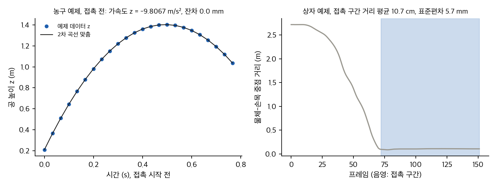

# 03. 수치 재계산과 주장 판정: HumanX (arXiv:2602.02473)

HumanX는 학습된 모델이 아니라 두 개의 파이프라인(XGen, XMimic)을 제안하는 논문이라서 식 유도 대신 **표 수치 재계산**, 표 사이 일관성, 공개 XGen 예제 데이터 점검을 합니다. 모든 계산은 CPU에서 몇 초 안에 끝나고 재현은 없습니다(학습, 공식 코드 실행 없음).

| 스크립트 | 내용 | 결과 파일 |
|---|---|---|
| `analysis/recompute.py` | 표 1–3 평균·배율·Wilson 구간·Fisher·카이제곱 (표준 라이브러리, 1초 미만) | `recompute_results.json` |
| `analysis/feasibility.py` | 표 1 퍼센트 값의 정수 분모 가능성 | `feasibility_results.json` |
| `analysis/xgen_example_check.py` | 공개 XGen 예제 npz의 포물선·앵커 거리 점검 (numpy, 수 초) | `xgen_example_check_results.json` |
| `analysis/plot_figures.py` | 그래프 세 장 | `report/figures/own_*.png` |

번호 규칙: **V**는 재계산·일관성 점검, **C**는 주장 판정입니다. 논문에는 시뮬레이션 평가 횟수 n, 시드 수, ±의 정의가 없어서 시뮬레이션 열의 검정은 하지 않았습니다. 시도 수가 명시된 실제 로봇 열(10회, 50회)만 구간 추정과 검정을 합니다.

## 1. Table 1 (시뮬레이션) 재계산

### V1. 평균 GSR과 "약 8배"

본문(6쪽): "최종 모델이 80%를 넘는 평균 GSR, HDMI의 약 8배."

| 기준 | 계산 | 값 |
|---|---|---|
| 최종(+Tea-Stu) 세 과제 평균 | (64.7 + 90.6 + 96.3)/3 | **83.9%** (80% 초과: 맞음) |
| HDMI 평균 | (2.4 + 25.3 + 1.8)/3 | 9.83% |
| 평균 대 평균 | 83.9 / 9.83 | **8.53배** (맞음) |
| 작업별 최고 기준선 평균 | (2.4 + 30.9 + 1.8)/3 = 11.7% | 83.9 / 11.7 = **7.17배** |
| 작업별 배율 (대 HDMI) | 농구 27.0 · 배드민턴 3.6 · 화물 53.5 | 배율 평균 **28배** |
| 작업별 배율 (대 최고 기준선) | 농구 27.0 · 배드민턴 **2.9** · 화물 53.5 | |

"8배"는 평균들의 비로 맞지만 (a) HDMI가 세 과제 모두에서 최고 기준선은 아닙니다(배드민턴은 SkillMimic 30.9%가 최고). (b) 배율은 분모가 1.8–2.4%인 두 과제에서 커지는 것이고 배드민턴에서는 2.9–3.6배입니다. (c) 평가 횟수 n이 없습니다(C1).

### V2. 최종 모델이 최고가 아닌 열

12개 열(3과제 × SR, GSR, E_o, E_h) 중 최종 모델(+Tea-Stu)이 최고인 열은 **6개**입니다.

| 열 | 최종 | 최고 | 비고 |
|---|---|---|---|
| 농구 SR | 86.8 | 93.4 (Base, +IVT) | 최종이 −6.6 |
| 농구 E_o | 0.85 m | 0.69 m (Base) | HDMI 0.70보다도 나쁨 |
| 농구 E_h | 7.83 cm | 6.36 cm (Base) | OmniRetarget 7.83과 같은 값(V4) |
| 배드민턴 E_h | 0.09 m | **0.07 m (HDMI)** | 기준선이 최종 모델보다 좋음 |
| 화물 SR | 99.3 | 100 (Base, +IP) | |
| 화물 E_h | 8.67 cm | 6.58 cm (Base) | |

GSR 세 열은 모두 최종 모델이 최고입니다. 오차 지표(E_o, E_h)는 일반화 평가(GSR)가 아닌 "원본 시연" 평가에서 잰 값이고, 최종 모델이 원본 시연을 가장 잘 추종하는 것은 아닙니다. v1의 "SR이 약간 줄어드는 것은 단일 시연 과적합이 줄어든 자연스러운 절충" 문장이 v2에서 삭제돼 이 절충이 본문에 설명되지 않습니다.

### V3. 절제 증분

인접 행 사이 변화(점)입니다. n이 없어서 표본 오차만 가정한 두 비율 z 검정의 p를 n = 100 / 500 / 4096에서 병기합니다(독립 가정, 시드 변동 제외. `recompute.py` V3b).

| 과제 | 단계 | ΔSR | ΔGSR | GSR p (n=100 / 500 / 4096) |
|---|---|---|---|---|
| 농구 | Base → +IP | −6.6 | +8.6 | 0.035 / 2.5e-6 / ≈0 |
| 농구 | +IP → +IVT | +6.6 | **−2.6** | 0.57 / 0.21 / 3.2e-4 |
| 농구 | +IVT → +Data Aug | −15.8 | **+49.7** | ≈0 |
| 농구 | +Data Aug → +Tea-Stu | +9.2 | +4.1 | 0.55 / 0.18 / 1.3e-4 |
| 배드민턴 | Base → +IP | −3.1 | +18.9 | 0.0075 / 2.3e-9 / ≈0 |
| 배드민턴 | +IP → +IVT | +6.0 | +6.7 | 0.32 / 0.028 / 2.8e-10 |
| 배드민턴 | +IVT → +Data Aug | 0.0 | +17.2 | 0.0045 / 2.2e-10 / ≈0 |
| 배드민턴 | +Data Aug → +Tea-Stu | 0.0 | +6.2 | 0.19 / 0.003 / 2.2e-17 |
| 화물 | Base → +IP | 0.0 | **+43.6** | ≈0 |
| 화물 | +IP → +IVT | −0.4 | **−0.2** | 0.95 / 0.89 / 0.69 |
| 화물 | +IVT → +Tea-Stu | −0.3 | +2.0 | 0.50 / 0.14 / 1.9e-5 |

읽는 법: GSR을 올리는 큰 요인은 **IP(화물 +43.6, 배드민턴 +18.9, 농구 +8.6)** 와 **데이터 증강(농구 +49.7, 배드민턴 +17.2)** 이고, **IVT는 과제마다 부호가 다릅니다**(농구 −2.6, 화물 −0.2, 배드민턴 +6.7). 교사-학생은 +2–6점으로 작습니다. 일반화의 대부분이 "초기 교란 + 데이터 증강"에서 오고, 논문이 이름을 붙인 IV 보상·IVT의 기여는 이 절제로는 분리되지 않습니다(C2, C3). 또한 +Data Aug의 SR은 농구에서 15.8점 떨어집니다.

### V4. 중복 셀

농구 E_h 열의 **OmniRetarget "7.83 (± 0.95)"과 +Tea-Stu "7.83 (± 0.95)"는 평균과 표준편차가 모두 같습니다.** v1 Table I에도 같은 값입니다. 서로 다른 학습 설정의 두 결과가 평균은 소수 둘째 자리까지, 표준편차까지 같은 것은 드문 일치입니다. 어느 쪽이 맞는지는 원자료 없이 판단할 수 없어 저자 확인이 필요합니다. 그 밖의 중복은 평균만 같고 ±가 다릅니다(농구 E_o 0.70: HDMI ± 0.11, +IP ± 0.08) 또는 반올림 영향이 큰 값(배드민턴 E_h 0.10 세 번)입니다.

### V12. 정수 분모 가능성

퍼센트가 소수 첫째 자리까지 보고돼서 한 열이 공통 n을 가진다고 가정하면 가능한 n에 하한이 생깁니다 (`feasibility.py`).

| 열 | 값별 최소 n 중 최대 | 모든 값을 만족하는 최소 공통 n |
|---|---|---|
| 농구 SR | 61 (93.4) | 228 |
| 농구 GSR | 46 (10.9) | 467 |
| 배드민턴 SR | 50 (94.0) | 418 |
| 배드민턴 GSR | 77 (41.6) | 598 |
| 화물 SR | 223 (0.4, 99.6) | 283 |
| 화물 GSR | 55 (1.8, 94.5) | 383 |
| 표 3 GSR | 51 (84.3) | 248 |

결론: 각 열이 공통 n을 쓴다면 **n ≥ 약 230–600**이어야 합니다. 이는 환경 수(코드 README 4,096, 논문 16,384)의 병렬 평가라면 자연스럽고, n = 1,000 / 2,048 / 4,096 / 16,384에서 모든 열이 가능합니다. 즉 일관성 위반은 없고, "n이 최소 수백"이라는 정보뿐입니다. 화물 SR 0.4%/99.6%는 n ≥ 223이 필요합니다.

## 2. Table 2 (실제 로봇) 재계산

### V5. 기술별 Wilson 95% 구간

| 기술 | 성공/시도 | 성공률 | Wilson 95% |
|---|---|---|---|
| 농구 캐치-패스 (MoCap) | 41/50 | 82% | 69.2–90.2 |
| 화물 들기 (MoCap) | 43/50 | 86% | 73.8–93.0 |
| 축구 킥 (MoCap) | 42/50 | 84% | 71.5–91.7 |
| 반응형 싸움 (MoCap) | 37/50 | 74% | 60.4–84.1 |
| 점프슛 (NEP) | 8/10 | 80% | 49.0–94.3 |
| 드리블 (NEP) | 8/10 | 80% | 49.0–94.3 |
| 페이크 턴어라운드 (NEP) | 9/10 | 90% | 59.6–98.2 |
| 농구 줍기 (NEP) | 10/10 | 100% | 72.2–100 |
| 레이업 (NEP) | 7/10 | 70% | 39.7–89.2 |
| (v1에만) Spin Move (NEP) | 9/10 | 90% | 59.6–98.2 |

### V6. 풀링과 "80% 초과"

| 묶음 | 성공/시도 | 성공률 | Wilson 95% |
|---|---|---|---|
| MoCap 4개 | 163/200 | 81.5% | 75.5–86.3 |
| NEP 5개 (v2) | 42/50 | 84.0% | 71.5–91.7 |
| NEP 6개 (v1, Spin Move 포함) | 51/60 | 85.0% | 73.9–91.9 |
| 전체 9개 (v2) | 205/250 | **82.0%** | 76.8–86.3 |

서론의 "NEP 평균 80% 초과"와 MoCap의 같은 서술은 점추정으로 맞습니다(84.0%, 81.5%). 구간 하한은 NEP 71.5%, MoCap 75.5%입니다. NEP 대 MoCap은 Fisher p = 0.84로 구별되지 않습니다.

### V7. MoCap 네 작업의 동질성

41, 43, 42, 37 / 50의 카이제곱 동질성 검정: χ² = 2.75, df = 3, **p = 0.43**. 가장 낮은 싸움 37/50과 가장 높은 화물 43/50은 Fisher p = 0.21입니다. 작업 사이 차이는 이 시도 수로는 구별되지 않습니다.

### V8. 80% 대비 구간 하한

기술별 Wilson 하한이 80%를 넘는 것은 **0개**입니다(최고 하한은 화물 들기 73.8%). 10회 시도의 NEP는 구간 폭이 약 40–50점입니다. 80% 모양의 성공률 하한을 ±10점으로 좁히려면 기술당 약 60회가 필요합니다(Wilson 근사).

### V9. 쌍별 검정

레이업 7/10 대 줍기 10/10: Fisher p = 0.21. 싸움 37/50 대 화물 43/50: p = 0.21. 어느 쌍도 구별되지 않습니다.

## 3. 다중 패턴과 표 사이 일관성

### V10. 표 3 대 표 1

교사-학생 이득: 축구 +18.9점(74.2 → 93.1), 배드민턴 +31.9점(52.4 → 84.3). 단일 패턴(표 1)에서는 배드민턴 +6.2점(84.4 → 90.6), 농구 +4.1점. "다중 패턴에서 교사-학생의 이득이 더 크다"는 서술은 수치로 맞습니다. 한 가지 교락이 있습니다. 다중 패턴 w/o Tea-Stu(52.4%)는 단일 패턴 +Data Aug(84.4%)보다 32.0점 낮은데, 다중 패턴 학습 데이터의 양(영상 3편 × 증강 수)과 학습 설정이 적혀 있지 않습니다. 같은 배드민턴 과제에서 w/ Tea-Stu 84.3%는 단일 패턴 90.6%보다 6.3점 낮습니다(패턴 다양성의 대가로 볼 수 있으나 평가 분포가 같은지 알 수 없음). 표 3에는 SR이 없습니다.

### V11. 기술·영역 개수

초록 v2: "다섯 영역(농구, 축구, 배드민턴, 화물, 반응형 싸움)에서 9개 기술을 배우고 **물리 G1에 zero-shot 전이**". 표 2의 9개 기술은 농구 6개(NEP 5 + 캐치-패스), 축구 1, 화물 1, 싸움 1로 **네 영역**입니다. 배드민턴은 시뮬레이션(표 1, 표 3)에만 있고 실제 로봇 결과도 그림 1의 목록에도 없습니다. v1도 같은 구조(영역 5, 기술 10 중 배드민턴 없음)였고 v2에서 Spin Move를 빼 10 → 9가 됐습니다. 본문 1절의 "9가지 기술(농구, 축구, 배드민턴, 화물, 싸움에 걸침)" 서술과 합쳐 읽으면 배드민턴이 실제 로봇에서 검증된 것처럼 보이지만 근거가 없습니다(C5).

### V13. v1 ↔ v2 표 대조

Table 1의 8행 × 12열 값과 ±는 v1과 v2에서 **전부 같습니다**(`pdftotext` 대조). Table 3의 4값도 같습니다. 표 2는 Spin Move 한 행만 삭제됐습니다. 행 이름은 +DI → +IP, +IT → +IVT로 바뀌었지만 수치는 그대로입니다. v1의 DI는 "초기화 교란"만이었고 v2의 IP는 "초기화 교란 + 로봇·물체 외력"으로 정의돼서, v2에서 이름만 확장했거나 v1의 DI 실험에 이미 외력(DR 항목의 "sustained random external forces")이 있었을 수 있습니다. 어느 쪽인지 문서만으로 알 수 없습니다(C3).

### V14. 표기·참조 불일치

- 7.3 식 (1)은 r_t = r^body + r^obj + **r^rel** + r^c + r^reg이고 바로 다음 문장은 **r^iv**를 설명합니다(v1 이름이 남음).
- 7.3 "Tab. 13 provides a summary"의 표는 **Figure 13**(그림 표기)입니다.
- 표 1 머리글 단위: 농구 E_o(m), E_h(cm) · 배드민턴 E_o(m), E_h(**m**) · 화물 E_o(cm), E_h(cm). 과제마다 단위가 달라 열을 가로로 비교할 수 없습니다.
- 7.6 "Interaction Termination (IT)" (v1 이름) 대 본문 "IV-based Termination (IVT)".
- 1절 "9 diverse skills"와 초록 "9 different skills"는 맞지만 프로젝트 페이지 초록은 "10 skills", "over 8×", "task-agnostic"(v1 문구)입니다.
- 그림 13의 학생 관측에 `Skill Label`이 있으나 본문 4절 학생 설명("proprioception and optional object observations")에는 없습니다.

### V15. 학습 계산량

논문은 정책당 20,000 iteration, 환경 16,384개를 말하고 iteration당 스텝 수는 말하지 않습니다. 공식 설정의 `num_steps_per_env = 24`를 쓰면 20,000 × 24 × 16,384 ≈ **7.9 × 10⁹ 환경 스텝**이고 정책 100 Hz로 7.9 × 10⁷ 초(약 2.5년)의 로봇 시간입니다. README의 4,096 환경이면 약 2.0 × 10⁹ 스텝(0.62년)입니다. 벽시계 시간은 논문에 없습니다.

## 4. 공개 XGen 예제 점검 (toy 없음, 데이터 점검)

공개된 XGen 예제 npz 두 개로 논문 3절의 두 성질을 점검했습니다(`xgen_example_check.py`, pickle은 읽지 않음).

그림: 우리가 그린 그래프. 공개 XGen 예제 두 개의 접촉 전 공 높이(왼쪽)와 접촉 구간 물체-손목 중점 거리(오른쪽).

- **접촉 전 궤적은 정확한 포물선입니다.** `basketball_catch_hoi.npz`의 접촉 시작 전 24프레임(30 fps)에 2차 곡선을 맞추면 가속도 (x, y, z) = (0.0, 0.0, **−9.8067**) m/s², 잔차 0.0 mm이고 저장된 속도와 유한 차분의 최대 차이는 2.4×10⁻⁷ m/s입니다. 논문은 "시뮬레이터에서 역방향으로 시뮬레이션하며 감쇠 계수를 뒤집는다"고 쓰는데, 공개 데이터는 항력 없는 해석적 포물선(g = 9.80665)과 구별되지 않습니다(`04` D4).
- **접촉 구간에서 물체와 손목 중점 거리는 거의 일정합니다.** `box_pick_robot_only_synth_hoi.npz`의 접촉 구간(프레임 72–151)에서 평균 10.65 cm, 표준편차 5.7 mm, 범위 22.9 mm입니다(손목 중점은 `ee_pos_w` 0, 1번을 손목으로 가정한 근사). 접촉 최적화가 팔 관절만 조정하므로 상대 변환 ϕ 보존은 근사적으로 성립합니다. 접촉 전 구간은 정지(`hold`) 모드라 물체 이동이 0.0 mm입니다.
- 두 예제는 파일 하나씩이라 일반화할 수 없습니다. XGen이 만든 데이터의 물리적 그럴듯함(침투, 힘 폐쇄)을 정량화하는 지표는 논문에도 코드에도 없습니다(C10).

## 5. 주장 판정

| 번호 | 주장 (논문 위치) | 근거 | 판정 |
|---|---|---|---|
| C1 | 평균 GSR 80% 초과, HDMI의 약 8배 (5절, 6쪽) | 83.9% 대 9.83% = 8.53배 (V1). 최고 기준선 대비 7.2배, 배드민턴 2.9배. n, 시드, ± 정의 없음 | **산술은 지지, 일반성은 제한** |
| C2 | IV 보상이 기존 보상보다 상호작용 성능이 낫다. Base 대 기준선 (5절) | Base에서 IV 보상만 뺀 절제가 없고 기준선은 관측·학습 설정·무작위화가 다를 수 있음(기준선 설정 서술 없음). Base는 농구 SR 93.4 대 HDMI 53.1이나 GSR은 4.9 대 2.4 | **지지 안 됨(교락)** |
| C3 | IP, IVT, Data Aug, Tea-Stu가 각각 GSR을 높인다 (표 1) | IP와 Data Aug는 큼. IVT는 농구 −2.6, 화물 −0.2, 배드민턴 +6.7로 과제마다 다름(V3). v1→v2에서 행 정의가 바뀌고 값은 그대로(V13) | **IP·Data Aug 지지, IVT 불일치, Tea-Stu 작은 이득** |
| C4 | 실제 로봇에서 "높은 성공률로 신뢰성 있게" (5절) | 9개 기술 전체 205/250 = 82.0% (76.8–86.3). 기술별 Wilson 하한 40–74% (V5, V8). NEP는 10회 | **점추정은 맞으나 기술별로는 확정 못 함** |
| C5 | 다섯 영역 9개 기술이 G1에 zero-shot 전이 (초록) | 표 2는 네 영역. 배드민턴 실제 로봇 결과 없음 (V11) | **배드민턴에 대해 지지 안 됨** |
| C6 | NEP: 외부 감각 없이 슛·레이업 등을 한다 (5절) | 성공 기준이 "공을 떨어뜨리지 않고 균형 유지" 뿐이고 **슛이 들어갔는지는 기준이 아님**. 공 시작 위치·골대 위치 조건 불명 | **정의에 의존, 슛 성공은 미측정** |
| C7 | MoCap 상호작용이 지속적이다: 10회 이상 연속 패스, 14회 이상 연속 킥 (5절) | 성공 기준(catch-pass, kick, fighting)이 정의되지 않음. 연속 횟수는 최고 사례(성공률 82%, 84%와의 관계 불명) | **일화적** |
| C8 | 기술마다 영상 한 편, 보상 설계 없이 (v2: "without per-task design") | 앵커 종류, 접촉 프레임, 물체 메시·크기, 속도 범위, 접촉 신체(축구는 발) 등 **과제별 설정이 남음**(`04` D2, 공개 README의 `hoi_contact_bodies` 예). 증강으로 영상당 50개 클립. 다중 패턴은 영상 3편 | **부분: 보상 코드는 공통, 데이터 설정은 과제별** |
| C9 | 데이터 증강으로 서로 다른 물체·높이·거리에 일반화 (3절, 그림 3–4) | GSR은 공 위치 ±0.3 m와 화물 반원 배치만 평가(7.2). 물체 모양·크기 변경 일반화는 정량 평가 없음(그림 3 정성) | **위치 일반화만 정량** |
| C10 | XGen이 "물리적으로 그럴듯한" 데이터를 만든다 (초록, 3절) | 침투, 힘 폐쇄, 지속 접촉 지표 없음. 공개 예제는 포물선·거리 일정을 만족 (4절). 합성이 아니라 재구성이 문제였다는 비교 실험 없음 | **정량 근거 없음** |
| C11 | 적응적 폐루프 행동 (그림 10) | 사례 하나(화물 뺏기 후 재집기), 반복 횟수 없음 | **일화적** |
| C12 | IP와 모캡 손실 모사가 배포 안정성에 핵심 (그림 11) | 정성적 설명뿐, 실제 로봇 절제 성공률 없음 | **정성적** |
| C13 | 고유감각으로 외력을 암묵적으로 지각할 수 있다 (7.4, 식 9) | 이론적 논거. "나머지 항은 거의 상수" 서술은 M(q), C, G가 q에 의존해 부정확하나 q가 관측에 있어 학습 가능성은 성립. 정책이 외력을 실제로 인코딩하는지 검사(프로빙) 없음. NEP 성공은 간접 근거 | **논거만, 실험 없음** |
| C14 | 교사-학생이 다중 패턴에서 더 크게 돕는다 (7.1) | +18.9, +31.9점 대 단일 +4–6점 (V10). 다중 패턴 데이터량 불명 | **지지(교락 있음)** |
