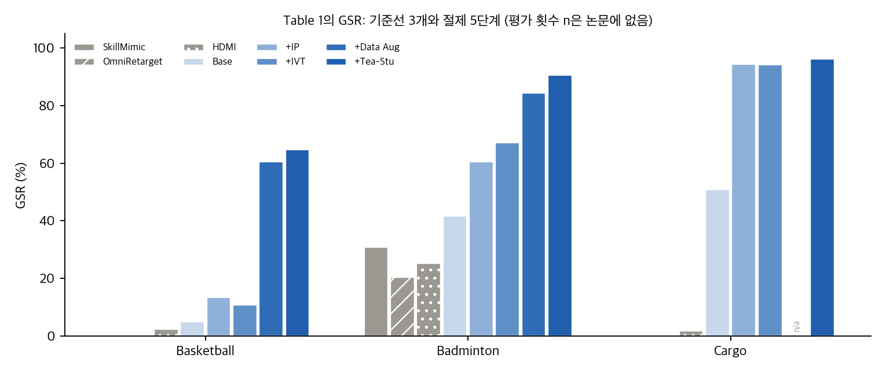
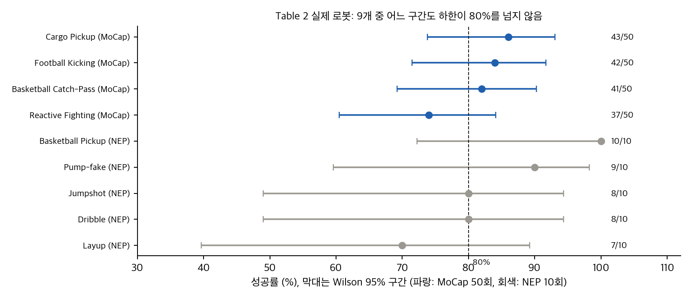
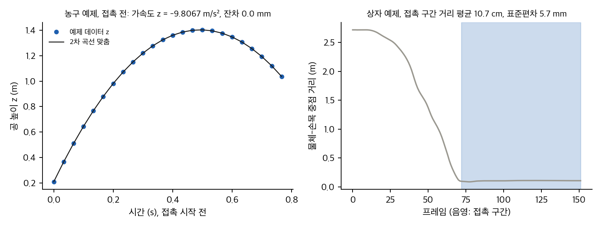

> **논문:** Yinhuai Wang, Qihan Zhao, Yuen Fui Lau, Runyi Yu, Hok Wai Tsui, Qifeng Chen, Jingbo Wang, Jiangmiao Pang, Ping Tan. *HumanX: Toward Agile and Generalizable Humanoid Interaction Skills from Human Videos.* CoRL 2026 포스터, arXiv:2602.02473 (v2, 2026-10-09).
> 공식 코드는 GitHub wyhuai/HumanX에 있습니다(Apache-2.0 + Commons Clause). 이 글의 그림은 모두 우리가 그린 그래프입니다. 논문은 arXiv 비독점 배포 라이선스라서 논문 그림은 싣지 않았습니다.

## 논문이 묻는 것

휴머노이드가 농구, 축구, 배드민턴, 상자 들기 같은 **물체와 상호작용하는 기술**을 사람 영상에서 배우려면 두 가지가 필요합니다. 영상에서 물리적으로 그럴듯한 사람-물체 상호작용 데이터를 얻는 것, 그리고 그 데이터로 일반화되는 정책을 학습하는 것입니다. 기존 방법은 텔레오퍼레이션 데이터가 비싸거나 과제마다 보상을 설계해야 했습니다.

HumanX는 두 부품을 제안합니다.

- **XGen:** 단안 영상 한 편에서 로봇 상호작용 데이터를 *재구성*이 아니라 *합성*합니다. 손바닥 중점 같은 앵커와 물체의 상대 변환을 보존해 물체 궤적을 만들고, 접촉 전후의 공 궤적은 시뮬레이터로 만들며, 물체 크기와 궤적을 바꿔 증강합니다.
- **XMimic:** 몸 점에서 물체 중심으로 가는 벡터(Interaction Vector, IV)를 모방 보상으로 쓰고, IV 오차가 크면 확률적으로 조기 종료하며, 초기 상태와 외력을 교란하는 교사-학생 학습입니다.

저자들은 이 틀로 Unitree G1에서 9개 기술을 보였고 일반화 성공률(GSR)이 기존 방법의 약 8배라고 말합니다.

## 이 글에서 확인한 것

**1. "약 8배"는 산술로 맞지만 범위가 좁습니다.** 세 과제 평균 GSR은 최종 모델 83.9%, HDMI 9.83%로 8.53배입니다. 작업별 최고 기준선과 비교하면 7.2배이고 배드민턴은 2.9배입니다. 배율이 큰 것은 기준선 GSR이 1.8–2.4%인 농구와 화물 과제입니다. 표 1은 시뮬레이션 평가 횟수 n과 ±의 정의를 적지 않았습니다. 퍼센트가 소수 첫째 자리까지 나오므로 열마다 공통 n이 있다면 최소 230–600회 이상이어야 하고, 이는 병렬 환경 수(4,096–16,384)와 모순되지 않습니다.

*그래프 (우리가 그림). 논문 표 1의 GSR 값입니다. 화물 과제의 "+Data Aug"는 논문에서 "/"로 비어 있습니다.*

**2. 일반화의 큰 몫은 데이터 증강과 교란이고, 이름을 붙인 IV 조기 종료는 일관되지 않습니다.** 농구 GSR은 증강에서 +49.7점, 화물은 초기·외력 교란에서 +43.6점 오릅니다. IV 기반 종료(IVT)는 농구 −2.6, 화물 −0.2, 배드민턴 +6.7점입니다. 또 Base에서 IV 보상만 뺀 절제가 없어서 "IV 보상이 기존 보상보다 낫다"는 주장은 기준선과의 설정 차이와 섞입니다. v1에서 v2로 가며 표 1의 모든 수치는 그대로인데 절제 행 이름과 정의(+DI → +IP: 외력 포함)가 바뀌었습니다.

**3. 실제 로봇은 점추정은 80%대이지만 구간이 넓습니다.** 9개 기술 전체는 205/250 = 82.0%(Wilson 95% 구간 76.8–86.3%)입니다. 기술별로 보면 하한이 80%를 넘는 것은 하나도 없습니다. NEP(외부 감각 없음) 기술은 시도가 10회라 구간 폭이 40–50점입니다. 더 중요한 점은 NEP의 성공 기준이 "공을 떨어뜨리지 않고 균형을 유지한 채 시퀀스를 마친 경우"라서 **슛이 들어갔는지는 측정하지 않는다**는 것입니다. MoCap 과제(캐치-패스, 킥, 싸움)는 성공 기준이 정의돼 있지 않습니다.

*그래프 (우리가 그림). 논문 표 2의 성공/시도 수로 계산한 Wilson 95% 구간입니다. 파랑은 MoCap 50회, 회색은 NEP 10회입니다.*

**4. 다섯 영역 중 배드민턴은 실제 로봇 결과가 없습니다.** 초록은 "5개 영역에서 9개 기술을 G1에 zero-shot 전이"라고 쓰지만 표 2의 9개 기술은 농구 6개, 축구, 화물, 싸움의 네 영역입니다.

**5. 표 안에 같은 값이 두 번 나옵니다.** 표 1 농구 키 바디 오차 열에서 OmniRetarget과 최종 모델이 모두 "7.83 (± 0.95)"입니다(v1도 같음). 평균과 표준편차가 모두 같은 것은 복사 오류일 가능성이 큽니다.

## 공개 코드와 논문의 대조

공식 저장소(커밋 02634bf)를 정적으로 읽었습니다. 코드를 실행하거나 설치하지 않았습니다.

- **일치한 것:** PD 이득과 행동 스케일이 논문 식(k_p = Iω², k_d = 2Iζω, ζ = 2, ω = 10 Hz, α = 0.25·τ_max/k_p)과 상대 오차 10⁻¹⁰ 수준으로 맞습니다. 보상 합산 구조, 교사·학생 관측 구성, DAgger식 BC 손실, 모캡 손실 모사도 일치합니다.
- **공개 범위가 좁습니다.** 시뮬레이션 학습·평가만 공개돼 있고 실로봇 배포가 없습니다. XGen은 사람이 브라우저에서 접촉 프레임을 찍는 **웹 편집기**이고, 논문이 말한 데이터 증강 생성기와 시뮬레이터 기반 비접촉 합성은 없습니다. 예시 모션은 농구 2개, 축구 1개, 상자 1개뿐입니다.
- **설정이 다릅니다.** IV 조기 종료는 기본값이 꺼져 있고 README 플래그로 켜며(접촉 프레임, 양손, 0.2 m, 스텝당 0.02), 외력은 몸통에만 걸리고 물체 외력 코드는 없습니다. 외력 간격은 정수 난수라 항상 1초입니다. 물체 크기·질량 무작위화는 기본 꺼짐입니다. 표 1의 성공률·GSR 평가 코드도 없습니다.
- **라이선스:** Apache-2.0에 Commons Clause가 붙어 판매와 유료 서비스 제공이 금지됩니다(`setup.py`는 BSD-3-Clause로 표기해 불일치).

공개된 XGen 예제 데이터를 직접 점검해 보면, 농구 캐치 예제의 접촉 전 공 궤적은 가속도 −9.8067 m/s², 잔차 0.0 mm의 **정확한 포물선**입니다. 논문은 시뮬레이터에서 시간을 거꾸로 돌리고 감쇠를 뒤집는다고 쓰는데, 공개 데이터는 항력 없는 해석적 포물선과 구별되지 않습니다.

*그래프 (우리가 그림). 왼쪽은 농구 캐치 예제의 접촉 전 공 높이와 2차 곡선 맞춤, 오른쪽은 상자 예제의 물체-손목 중점 거리입니다(접촉 구간 평균 10.65 cm, 표준편차 5.7 mm).*

## 이 맥에서 구현할 수 있는가

전체 재현은 불가능합니다. 실제 로봇은 G1과 광학 모캡 14대가 필요하고 배포 코드가 없습니다. 공식 학습·평가는 Linux, NVIDIA GPU, Isaac Gym Preview 4를 전제하므로 Apple Silicon에서는 돌릴 수 없습니다. 반면 IV 보상·접촉 보상·IV 종료를 점 질량 팔과 공 같은 작은 환경에서 다시 구현하는 것은 며칠 규모로 가능하다고 봅니다(추정, 미측정). XGen 편집기는 numpy, mujoco, joblib만 있으면 CPU에서 열 수 있지만 사람이 UI를 조작해야 합니다.

## 한계와 미확인

- 시뮬레이션 평가 횟수, 시드 수, ±의 정의, 기준선 학습 설정이 논문에 없어 표 1의 차이에 대한 검정은 하지 않았습니다.
- 표 1 농구 키 바디 오차의 중복 값은 원자료 없이 어느 쪽이 맞는지 알 수 없습니다.
- 공개 코드는 정적으로만 읽었고 동작은 확인하지 않았습니다. 코드에 없는 부분(증강 생성기, 평가 코드)이 비공개인지 아직 공개 전인지는 알 수 없습니다.
- 영상에서 로봇 동작을 얻는 앞단(GVHMR, 리타게팅)은 파이프라인 밖이라 점검하지 않았습니다.

## 자료

- [통합 리포트 PDF](report/report_public.pdf)
- [01. 논문 분석: HumanX (arXiv:2602.02473)](analysis/01_paper_analysis.md)
- [02. 선행연구와 구성 요소 출처: HumanX (arXiv:2602.02473)](analysis/02_prior_work.md)
- [03. 수치 재계산과 주장 판정: HumanX (arXiv:2602.02473)](analysis/03_analysis.md)
- [04. 논문 ↔ 공식 코드 대조: HumanX (arXiv:2602.02473)](analysis/04_code_verification.md)
