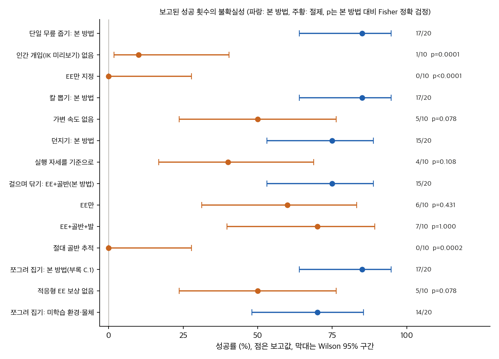
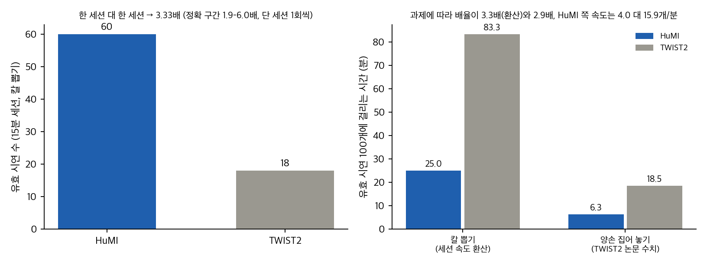
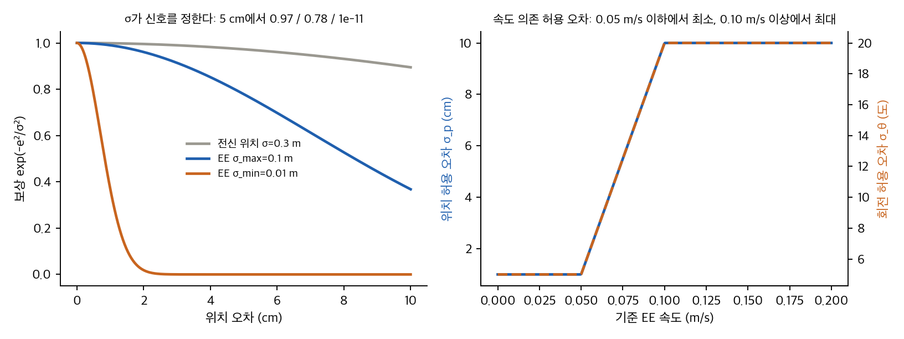
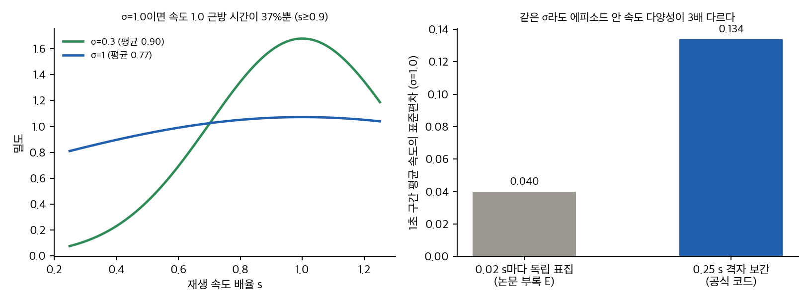
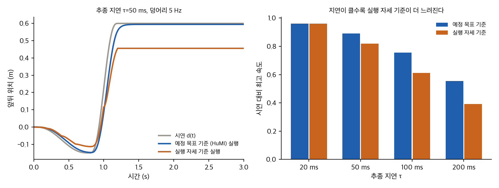

# 03. 수치 재계산과 일관성 검사

재계산은 `analysis/recompute.py`(수 초, numpy·scipy)가 `recompute_results.json`으로 저장합니다. 토이는 `analysis/toy_chunk_anchor.py`(1초 미만, numpy)입니다. 논문에는 원시 롤아웃 기록이 없으므로 "적힌 성공 횟수와 시도 수"만 입력으로 씁니다. 검정은 서로 독립인 두 비율에 대한 Fisher 정확 검정(양측), 구간은 Wilson 95%, 차이의 구간은 Newcombe-Wilson입니다. 이 검정은 **서로 다른 학습 한 번씩**의 결과를 비교하므로, 학습 시드 변동은 반영하지 못해 실제 불확실성은 더 큽니다.

## 1. 재계산 항목 K1–K13

### K1. 보고된 퍼센트와 성공 횟수의 정수 사슬 (§4, 부록 C)

논문에 적힌 14개 칸(성공/시도, 퍼센트)을 모두 확인했고 **모두 정수 비율과 일치**합니다(85=17/20, 10=1/10, 50=5/10, 75=15/20, 40=4/10, 60=6/10, 70=7/10 및 14/20, 0=0/10). 시도 수는 본 방법 20회, 절제 10회가 기본이며 "EE+골반+발"(10회)과 TWIST2 매칭 예산(시도 수 미기재)이 예외입니다. 본 방법의 Wilson 95% 구간은 17/20이 64–95%, 15/20이 53–89%, 14/20이 48–85%입니다(그림 아래 `own_ablation_ci.png`).

### K2. 절제 8개 대 본 방법 (Fisher, Holm)

| 비교 | 본 방법 | 절제 | 차이(%p) [95% 구간] | Fisher p | Holm p |
|---|---|---|---|---|---|
| 단일 무릎: 인간 개입 없음 | 17/20 | 1/10 | +75.0 [38.0, 87.8] | 1.3e-4 | 8.0e-4 |
| 단일 무릎: EE만 지정 | 17/20 | 0/10 | +85.0 [50.2, 94.8] | 9.5e-6 | 6.7e-5 |
| 칼 뽑기: 가변 속도 없음 | 17/20 | 5/10 | +35.0 [1.3, 63.1] | **0.078** | 0.31 |
| 던지기: 실행 자세 기준 | 15/20 | 4/10 | +35.0 [−1.1, 62.0] | **0.108** | 0.31 |
| 걷기: EE만 | 15/20 | 6/10 | +15.0 [−16.9, 46.9] | **0.43** | 0.43 |
| 걷기: EE+골반+발 | 15/20 | 7/10 | +5.0 [−24.1, 38.3] | 1.00 | - |
| 걷기: 절대 골반 추적 | 15/20 | 0/10 | +75.0 [39.7, 88.8] | 2.0e-4 | 1.0e-3 |
| 쪼그려: 적응형 EE 보상 없음(부록 C.1) | 17/20 | 5/10 | +35.0 [1.3, 63.1] | **0.078** | 0.31 |

**해석.** 인간 개입(IK 미리보기), 전신 명세(EE만 지정), 절대 골반 추적 세 효과는 확실합니다(세 개 모두 0/10 또는 1/10이라 차이가 큽니다). 그러나 본문이 "가변 속도 증강이 오차를 줄이고 양손 협응을 돕는다", "적응형 EE 보상의 결정적 역할", "실행 자세 기준은 모멘텀을 줄인다"고 쓰는 세 절제는 **표본 크기로는 우연과 구분되지 않습니다**(점 추정 +35%p인데 시도 10회 대 20회, p = 0.08–0.11). 신뢰구간 하한이 0 부근이라 효과가 없다는 뜻이 아니라 판정을 못 한다는 뜻입니다. 같은 칼 뽑기 개선(+35%p)을 확정하려면 팔당 약 33회씩이 필요합니다(모의 추정, 85% 대 50%, 검정력 80%. 보고된 20 대 10회에서는 검정력이 약 47%).

### K3. 키포인트 인터페이스 비교와 "동등" 서술 (§4.1.4)

| 비교 | 값 | Fisher p | 차이 95% 구간(%p) |
|---|---|---|---|
| EE+골반(15/20) 대 EE+골반+발(7/10) | 75% 대 70% | 1.00 | [−24, +38] |
| EE만(6/10) 대 EE+골반(15/20) | 60% 대 75% | 0.43 | [−47, +17] |
| EE만(6/10) 대 EE+골반+발(7/10) | 60% 대 70% | 1.00 | [−45, +28] |

본문은 "EE만은 접근 단계에서 실패하고 몸 키포인트를 더한 둘은 비슷하다"는 인과를 읽어 냅니다. 그러나 세 인터페이스의 성공률 차이는 모두 검정할 수 없는 범위(구간이 ±20–45%p)이고, "동등하다"를 보이려면 동등성 검정이 필요합니다. 75% 대 60%를 80% 검정력으로 구분하려면 팔당 약 165회가 필요하며(모의 추정), 보고된 20 대 10회에서의 검정력은 약 11%입니다. 이 절의 서술은 "관찰했다" 수준으로 읽어야 합니다. 이 인터페이스 선택에서 **통계적으로 지지되는 것은 절대 골반 추적 0/10뿐**입니다.

### K4. 일반화 70% (§4.2)

14/20의 Wilson 95% 구간은 **48–86%**(Clopper–Pearson 46–88%)입니다. 정의역 내 쪼그려 집기 성공률은 본문에 없고 부록 C.1에 17/20이 있습니다. 이 둘을 비교하면 −15%p [−39, +11], Fisher p = 0.45로 **정의역 내와 미지 설정을 구분할 수 없습니다**(차이가 없다는 증거는 아닙니다). 20회는 환경 4곳 × 5회로 군집되어 있어, 환경 내 상관(ICC)을 0.1 / 0.3으로 가정하면 유효 표본이 14.3 / 9.1로 줄고 70%의 구간이 45–88% / 35–88%가 됩니다. 환경별, 물체별 성공 횟수는 적혀 있지 않아 어느 환경이나 물체에서 실패했는지 알 수 없습니다.

### K5. 수집 효율 (§4.3, 부록 C.2)

| 항목 | 논문 값 | 재계산 | 판정 |
|---|---|---|---|
| 15분 유효 시연 수 | HuMI 60, TWIST2 18 (v3) | 60/18 = 3.33배 | "3배 이상"과 일치 |
| v1/v2의 에피소드 수 | 62 대 28, 채택률 96.7% 대 64.3% | 60/62 = **96.77%**(반올림 96.8%), 18/28 = 64.29% | 96.7은 반올림이 아니라 **절단** 값이거나 분모가 다름. v3의 60/18은 v1/v2와 호환됨 |
| 유효 시연당 시간 비 | 30.0% | (15/60)/(15/18) = 0.300 | 일치 |
| 칼 뽑기 시연 100개에 걸리는 시간 | 본 방법 약 22분 (§4.3) | 세션 속도(4.0개/분)로는 25.0분 | 22분이면 4.55개/분으로 세션보다 14% 빠름. 같은 사람, 같은 정의의 "유효"인지 알 수 없음 |
| 매칭 예산에서 TWIST2가 모은 시연 수 | 같은 총 시간 | 22분 × 1.2개/분 ≈ **26개**(추정) | HuMI 약 100개 대 TWIST2 약 26개로 학습 데이터 양이 다름 |
| 매칭 예산 성공률 | 85% 대 50% | 17/20 대 5/10 → p = 0.078, 17/20 대 10/20 → p = 0.041 | TWIST2 시도 수가 없어 결론이 시도 수에 의존 |
| 양손 집어 놓기 시연 100개 | 6.3분 대 18.5분 (2.94배) | HuMI 15.9개/분 | 칼 뽑기(4.0개/분)와 4배 차. 18.5분은 TWIST2 논문 보고값(작업자·장비·유효 정의가 다를 수 있음) |
| 단일 무릎 15분 50개 | 18 s/개 | 900/50 = 18 | 일치. TWIST2는 0개(제어기 한계) |

15분 세션이 사람 한 명, 한 번뿐이라면 60 대 18의 이항 구간(1.9–6.0배)은 개수의 우연만 반영하고 **작업자 간 변동은 포함하지 않습니다**. 즉 "3배"는 칼 뽑기라는 한 과제에서 한 세션의 점추정이며 과제 의존이 큽니다. "유효"의 정의도 v1/v2에서는 "정책이 재생할 수 있어야 한다"였고 v3에서는 명시가 없습니다. HuMI는 사람이 IK 미리보기를 보며 동작하고 TWIST2는 로봇을 직접 조작한다는 점에서 두 시스템은 "수집 대상의 의미"가 다릅니다(HuMI의 유효는 운동학적 가능성, TWIST2는 로봇이 실제 수행한 궤적).

### K6. 칼끝 추종 오차 (그림 6b)

15.7 ± 7.5 mm(본 방법)와 21.2 ± 6.4 mm(가변 속도 없음). 오차 막대가 SD인지 SE인지, n이 얼마인지 적혀 있지 않습니다(그림에서 읽은 값). SD로 가정하면 효과 크기는 d = 0.79이고 Welch 검정은 성공 롤아웃 17 대 5에서 p = 0.15, 전체 20 대 10에서 p = 0.049입니다. SE로 가정하면 p ≈ 0.58입니다. 본 방법의 상대 표준편차가 48%로 커서 "5.5 mm 감소"는 한 롤아웃 안에서의 변동보다 작습니다. 본문은 "추종 오차를 줄이고 조정을 돕는다"고 쓰지만 이 수치만으로는 확정되지 않습니다.

### K7. IK 미리보기 (부록 A.2, 그림 10)

미리보기 없이 모은 20개 중 6개(30%, Wilson 15–52%)만 가능, 14개(70%)가 불가능 프레임을 포함합니다(정수 일치). 미리보기 쪽 100%는 n이 없습니다. 손-골반 거리 변화 76.7 → 90.7 cm(+14.0 cm, +18.3%)는 평균만 있고 분산과 시연자 수가 없습니다. "운동학적 실패를 모두 없앴다"는 서술은 n 미기재 상태입니다.

### K8. 보상 σ의 의미 (부록 E, 표 1)

전신 위치 보상 σ = 0.3 m에서 5 cm 오차의 보상은 **0.973**, 1 cm는 0.999로 센티미터 정밀도를 거의 밀어 주지 않습니다. 반대로 σ_p^min = 0.01 m에서는 2 cm에서 0.018, 3 cm에서 1.2e-4, 5 cm에서 1.4e-11로 **초기 학습 때는 보상이 사라집니다**. 이것이 본문(§3.2)이 말하는 "EE 허용 오차를 곧바로 조이면 전신 균형을 해친다"와 "커리큘럼이 필요하다"의 수치적 이유로 보입니다(추정, 논문은 이 계산을 보이지 않음). 보간 구간은 기준 EE 속도 0.05–0.10 m/s로 매우 좁아서, 걷기·던지기처럼 EE가 계속 0.1 m/s를 넘는 구간에서는 σ가 거의 항상 최댓값(0.1 m, 20°)이고, 게이트(기준 골반 속도 0.02 m/s 미만일 때만 EE 보상)가 걷기 구간에서 EE 보상 자체를 끕니다(`04` §2).

### K9. 가변 속도 분포 (부록 E)

속도 s ∼ N[0.25,1.25](1, σ²)에서 σ = 1.0이면 평균이 **0.77**이고 s ≥ 0.9인 시간이 37%, s ≤ 0.5인 시간이 22%입니다(σ = 0.3은 평균 0.90, 54%). 즉 최종 σ = 1.0 설정에서 제어기는 대부분의 시간 시연보다 느린 기준을 추종하도록 학습되고, 실제 배포 속도(1×)와 가까운 구간의 비중은 3분의 1입니다. 던지기처럼 고속 동작에는 이 불일치가 효과를 줄일 수 있습니다(가설, 논문은 던지기에 가변 속도 절제를 하지 않음). 재표집 간격은 논문(0.02 s마다 독립 표집)과 공식 코드(0.25 s 격자를 보간)가 다르고, 1초 구간 평균 속도의 표준편차가 0.040 대 0.134로 3.4배 차이가 납니다(`04` D4).

### K10. 학습 예산 (코드 기본값, 부록 E에는 없음)

교사 PPO 50,000 반복 × 24 스텝 × 4,096 환경 = **4.9 × 10⁹ 환경 스텝**(50 Hz 기준 시뮬 시간 약 27,000시간), 학생 5,000 반복 = 4.9 × 10⁸. 논문이 "10,000–15,000 스텝"이라 쓴 커리큘럼은 공통 스텝 240,000–360,000(= 반복 10,000–15,000, 전체의 20–30%)에 해당합니다. 논문에는 학습 시간, GPU 수, 과제별 학습 횟수가 없습니다.

### K11. 시간 기준 일관성

고수준 행동 지평 48스텝 ÷ 20 Hz = 2.4 s이지만 클라이언트가 보내는 덩어리는 2.0 s(10웨이포인트, 0.2 s 간격 = 제어 10스텝)입니다(`04` D13). 저수준 이력 25스텝 = 0.5 s. 데이터 59.94 Hz ÷ 3 = 19.98 ≈ 20 Hz. 표 3의 "관측 빈도 20 Hz"와 코드의 `obs_down_sample_steps=[3,15]`는 맞습니다.

### K12. 공개 데이터와 논문 시연 수

HF의 LeRobot 데이터셋 에피소드 수는 Proposal(= 단일 무릎) 103, Walk-Clean-Table 105, Unsheathe 105, Toss 104, Squat-Pick-Ground 410입니다. 논문 부록 F.3은 과제당 100개, 쪼그려 집기 350개(7×50)입니다. 공개본이 3–5개, 쪼그려 집기는 60개 더 많습니다(`04` D11). 추가분이 미지 환경 평가용인지는 확인하지 못했습니다.

### K13. 같은 17/20

본 방법의 17/20이 단일 무릎 줍기(§4.1.1), 칼 뽑기(§4.1.2), 쪼그려 집기(부록 C.1)에서 모두 나옵니다. 참값 85%에서 한 칸이 17이 될 확률은 24%이고, 세 칸이 독립이라는 가정에서 모두 17일 확률은 1.4%입니다. 어느 쪽으로도 결론을 낼 근거는 아니며, 표기와 성공 횟수를 저자에게 확인할 항목으로만 남깁니다.

## 2. 토이 V1: 덩어리 기준 자세 (§3.3, 그림 4, §4.1.3)

`analysis/toy_chunk_anchor.py`. 1축 위치, 저수준 제어기를 1차 지연(시정수 τ)으로 두고, 고수준 정책이 완벽히 모방한다고 가정합니다. 5 Hz로 덩어리를 바꿀 때 기준을 이전 예정 목표(HuMI)로 잡을 때와 측정된 실행 자세로 잡을 때를 비교합니다. 결과(던지기 시연, 최고 속도 3.5 m/s):

| τ | 예정 목표 기준 최고 속도 | 실행 자세 기준 최고 속도 | 실행 기준의 최대 목표 되돌림 | 실행 기준의 마지막 위치 부족 | 해석 이득 (등속 구간) |
|---|---|---|---|---|---|
| 20 ms | 0.96 | 0.96 | 61 mm | 5.7 cm | 0.90 |
| 50 ms | 0.89 | 0.82 | 139 mm | 14.4 cm | 0.75 |
| 100 ms | 0.76 | 0.61 | 212 mm | 25.8 cm | 0.57 |
| 200 ms | 0.55 | 0.39 | 274 mm | 38.0 cm | 0.37 |

**읽는 법.** (a) 실행 자세를 기준으로 삼으면 덩어리가 바뀔 때마다 목표가 추종 지연만큼 뒤로 튑니다(그림 4의 빨간 선). 등속 구간에서 한 덩어리의 실제 진행량은 1 − (τ/T)(1 − e^(−T/τ)) 배(T = 0.2 s)로 줄고, 이 값은 시뮬레이션과 방향이 맞습니다. (b) 오차는 덩어리마다 누적되어 마지막 위치가 모자랍니다. 시각 피드백이 없는 빠른 던지기 구간이 가장 민감하다는 논문의 서술(§4.1.3)과 방향이 같습니다. (c) 이 토이는 메커니즘만 확인합니다. 40% 대 75%(p = 0.11)라는 실로봇 차이를 설명하거나 확인하는 것은 아닙니다. 실제 G1의 추종 지연, 정책 오차, 시각 피드백은 들어 있지 않습니다. τ = 20–50 ms에서도 되돌림이 6–14 cm로 나타나는 것은 토이의 시연 속도가 빠르기 때문이며, 실제 G1의 EE 속도에서는 더 작을 것입니다.

## 3. 요약

| 번호 | 한 줄 결론 | 근거 |
|---|---|---|
| K1 | 보고된 14개 칸이 모두 정수 비율과 일치 | 정수 사슬 |
| K2 | 큰 효과 3개는 확실, 가변 속도·실행 자세·적응형 EE 보상은 p = 0.08–0.11 | Fisher, Holm |
| K3 | 키포인트 인터페이스 비교는 검정력 약 11%라 판정 불가 | 모의 검정력 |
| K4 | 70% 미지 설정은 구간 48–86%, 정의역 내와 구분 불가 | Wilson, Fisher |
| K5 | 3배는 한 세션·한 과제 점추정, 96.7%는 절단 값, 매칭 예산은 데이터 양이 다름 | 정수 사슬, 환산 |
| K6 | 추종 오차 감소는 오차 막대의 뜻과 n에 따라 p = 0.05–0.58 | Welch |
| K7 | IK 미리보기 30% 정수 일치, 100%의 n 없음 | 정수 사슬 |
| K8 | σ = 0.3 m는 5 cm에서 0.97, σ = 0.01 m는 3 cm부터 소멸 | 계산 |
| K9 | 속도 σ = 1.0이면 평균 0.77, 재표집 간격이 논문과 코드에서 다름 | 분포 계산 |
| K10 | 교사 4.9e9 환경 스텝, 커리큘럼은 반복 단위 10–15천 | 코드 기본값 |
| K11 | 예측 2.4 s 중 2.0 s만 사용 | 코드와 부록 |
| K12 | 공개 데이터가 논문 시연 수보다 많음 | HF 메타데이터 |
| K13 | 같은 17/20 세 번은 우연 가능, 표기 확인 | 이항 확률 |
| V1 | 실행 자세 기준은 지연에 비례해 느려지고 위치가 누적해서 모자람(토이) | 시뮬 |
