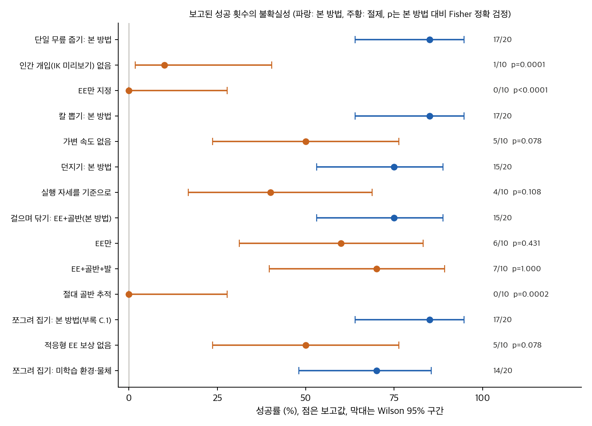
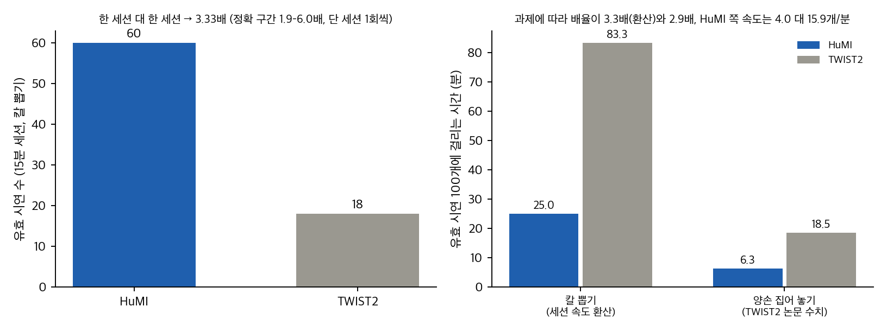
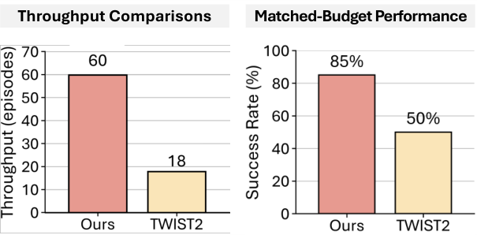
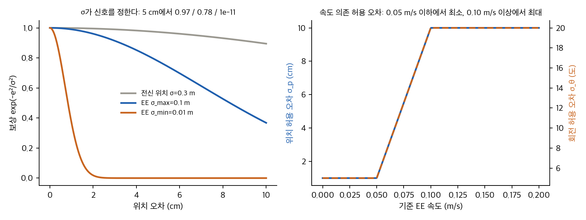
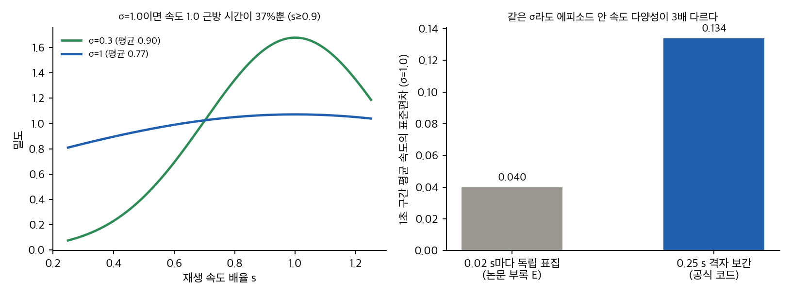
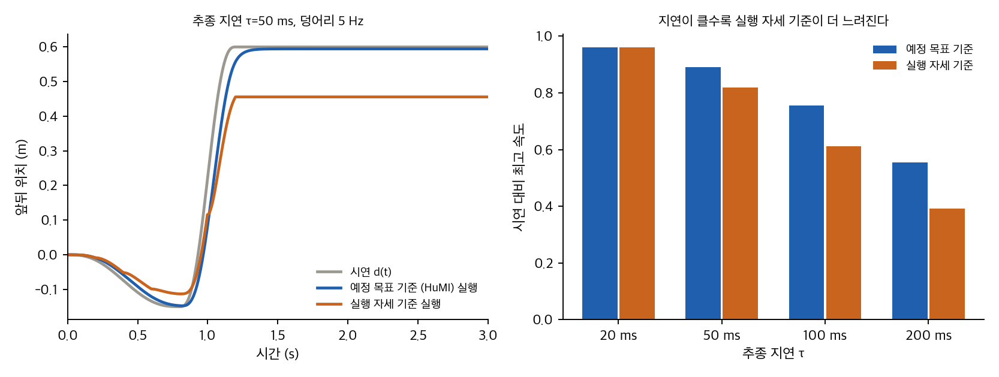
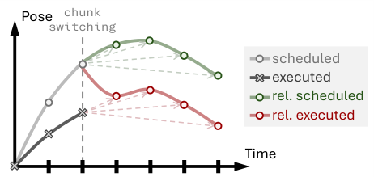

> **논문:** Ruiqian Nai 외. *HuMI: Humanoid Whole-Body Manipulation from Humanoid-Free Demonstrations.* CoRL 2026 포스터, arXiv:2602.06643 (v3, 2026-11-06). 라이선스 CC BY 4.0.
> 공식 코드(MIT, 커밋 37a85a6)를 정적으로만 읽었고 실행하지 않았습니다. 논문 그림은 그림 4와 7(그래프) 두 장만 출처를 적어 싣고, 나머지는 우리가 그린 그래프입니다.

## 논문이 묻는 것

휴머노이드가 쪼그리고, 무릎 꿇고, 던지고, 걸으며 닦는 전신 조작을 하려면 보통 시뮬 RL이나 텔레오퍼레이션이 필요합니다. HuMI는 로봇 없이 사람이 그리퍼 두 개와 Vive 추적기 다섯 개(그리퍼, 골반, 발)를 차고 시연하게 하고, 그 궤적에서 계층 정책을 학습합니다. 사람 동작은 척도 조정 없이 IK 목표로 쓰고, 시연자는 실시간 IK 미리보기로 로봇이 도달할 수 있는지 보면서 움직입니다. 저수준 제어기는 속도에 따라 EE 허용 오차를 줄이는 보상과 재생 속도를 무작위로 늦추는 증강으로 학습하고, 고수준 정책은 5 Hz로 키포인트 덩어리를 냅니다.

주장은 다섯 과제에서의 성공(85, 85, 75, 75%, 미지 환경 70%), 텔레옵 대비 3배의 수집 효율입니다.

## 이 글에서 확인한 것

**1. 큰 효과 세 개는 확실하고 세 개는 판정할 수 없습니다.** 인간 개입(IK 미리보기) 없음 1/10, EE만 지정 0/10, 절대 골반 추적 0/10은 본 방법(15–17/20)과 Holm 보정 후에도 p < 0.001입니다. 반면 가변 속도 5/10(p = 0.078), 실행 자세 기준 4/10(p = 0.108), 적응형 EE 보상 5/10(p = 0.078)은 +35%p인데 시도가 10회 대 20회라 우연과 구분되지 않습니다. 이 셋을 확정하려면 팔당 약 33회가 필요합니다(모의 추정).

*그래프 (우리가 그림). 점은 논문이 적은 성공 횟수, 막대는 Wilson 95% 구간, 오른쪽은 본 방법 대비 Fisher 정확 검정 p입니다.*

걷기 과제의 인터페이스 비교(EE만 6/10, EE+골반 15/20, EE+골반+발 7/10)는 어느 쌍도 검정되지 않고, 75% 대 60%를 구분할 검정력이 보고된 시도 수에서 약 11%입니다. "몸 키포인트를 더하면 접근이 좋아진다"는 해석은 관찰로만 읽어야 합니다.

**2. "70% 미지 환경"은 14/20이고 구간이 48–86%입니다.** 정의역 내 쪼그려 집기(부록의 17/20)와 비교하면 p = 0.45라 차이도 동등함도 보이지 못합니다. 20회는 환경 4곳 × 5회라서 환경 내 상관이 0.1만 되어도 구간이 45–88%로 넓어집니다. 환경별·물체별 성공 횟수는 없습니다.

**3. "3배 수집 효율"은 한 세션·한 과제 점추정입니다.** 칼 뽑기 15분 세션에서 유효 시연 60개 대 18개(3.33배)이고 정확 구간은 1.9–6.0배지만 세션이 한 번씩이라 작업자 변동은 들어 있지 않습니다. 양손 집어 놓기에서는 시연 100개에 6.3분 대 TWIST2 논문 보고 18.5분(2.94배)이고, HuMI의 분당 시연 수가 4.0(칼)과 15.9(집어 놓기)로 과제에 따라 4배 다릅니다. 이전 버전의 채택률 96.7%는 60/62 = 96.77%의 절단 값이었습니다. 같은 총 시연 시간(약 22분)에서 85% 대 50%라는 비교는 HuMI가 약 100개, TWIST2가 약 26개(추정)로 모은 데이터 양이 다르고 TWIST2 시도 수가 적혀 있지 않습니다.

*그래프 (우리가 그림). 왼쪽은 15분 세션의 유효 시연 수, 오른쪽은 유효 시연 100개에 걸리는 시간입니다. 칼 뽑기 쪽은 세션 속도로 환산한 값입니다.*

*그림: 논문 그림 7 (© Ruiqian Nai 외, CC BY 4.0, 출처 arXiv:2602.06643)을 잘라 씀. 오른쪽 막대의 시도 수는 적혀 있지 않습니다.*

## 코드와 논문이 어긋나는 곳

공식 저장소를 정적으로 읽어 논문 부록과 대조했습니다. 보상 가중치, σ 범위, 이력 길이, 5 Hz/50 Hz, 학습률과 에폭, "이전 예정 자세를 덩어리 기준으로"라는 인터페이스는 일치합니다. 어긋나는 값은 다음입니다.

| 항목 | 논문 | 코드 |
|---|---|---|
| 반발 계수 무작위화 | U[0.3, 1.2] | (0.0, 0.5) |
| 기본 관절 오프셋 | + U[0.0, 0.5] | ±0.01 |
| 리셋 시 기저 선속도(xy) | ±0.05 | ±0.5 |
| 가변 속도 재표집 | 0.02 s마다 독립 표집 | 0.25 s 격자를 선형 보간 |
| 커리큘럼 | 선형, 위치·회전 σ_min | 이차 곡선, 위치 σ만 |

코드 쪽 값이 물리적으로 자연스러워서(반발 계수가 1을 넘지 않고, 관절 오프셋이 보정 오차 규모) 논문 표 2에 오기가 있을 가능성이 크지만, 어느 쪽이 실험에 쓰였는지는 알 수 없습니다. 또 코드에는 논문이 말하지 않는 설정이 있습니다: 행동 지연 0–60 ms와 학생 관측 잡음, 기준 관절 위치에서 출발하는 잔차 교사, 종료 임계, IK의 무게중심 과제와 과제별 가중치, 배포 시 7 Hz 저역 통과 필터입니다. 배포 필터에는 29관절 순서의 인덱스가 25차원 행동에 그대로 쓰여 왼쪽 어깨 두 관절이 필터에서 빠지는 것으로 읽히는 부분이 있습니다(정적 읽기, 효과 미측정).

## 보상의 σ와 가변 속도를 숫자로 보면

*그래프 (우리가 그림). 왼쪽은 위치 오차별 보상 exp(−e²/σ²), 오른쪽은 기준 EE 속도에 따른 허용 오차입니다.*

전신 위치 σ = 0.3 m에서는 5 cm 오차의 보상이 0.97이라 센티미터 정밀도를 밀어 주지 못하고, EE의 최소 허용 σ = 0.01 m에서는 3 cm부터 보상이 1.2e-4 이하라 학습 초기에는 신호가 사라집니다. 논문이 "EE 허용 오차를 곧바로 조이면 전신 균형을 해친다"고 쓰는 이유가 이 숫자로 설명되는 것으로 보입니다(추정, 논문은 이 계산을 보이지 않습니다). 가변 속도는 최종 σ = 1.0에서 평균 재생 속도가 0.77이고 시연 속도(0.9 이상)에 가까운 시간은 37%뿐입니다. 재표집 간격이 코드(0.25 s 보간)와 논문(0.02 s)에서 다르면 한 에피소드 안의 속도 다양성이 3배 이상 달라집니다.

*그래프 (우리가 그림). 왼쪽은 잘린 정규분포의 속도 밀도, 오른쪽은 σ = 1.0에서 1초 구간 평균 속도의 표준편차입니다.*

## 작은 토이: 덩어리 기준 자세

고수준 정책이 새 덩어리를 이을 때 기준을 실행된 자세로 잡으면 추종 지연만큼 목표가 뒤로 되돌려집니다. 1축 위치, 1차 지연 추종기, 완벽한 모방을 가정한 토이에서 지연 50 ms, 5 Hz이면 이전 예정 목표를 기준으로 한 실행의 최고 속도는 시연의 0.89배, 실행 자세를 기준으로 하면 0.82배이고 마지막 위치가 14 cm 모자랐습니다. 지연이 클수록 격차가 커집니다. 논문의 던지기 절제(75% 대 40%)는 p = 0.11이라 실험이 이 메커니즘을 확인한 것은 아니고, 토이는 방향만 보여 줍니다.

*그래프 (우리가 만든 토이). 왼쪽은 시연과 두 기준의 실행 위치, 오른쪽은 추종 지연별 시연 대비 최고 속도입니다.*

*그림: 논문 그림 4 (© Ruiqian Nai 외, CC BY 4.0, 출처 arXiv:2602.06643)를 잘라 씀. 빨간 선은 실행된 자세를 기준으로 할 때, 초록 선은 이전 예정 자세를 기준으로 할 때입니다.*

## 이 맥에서 구현할 수 있는가

**논문 결과의 재현은 불가능합니다.** 실로봇(Unitree G1, Vive 추적기, GoPro, 커스텀 그리퍼)이 필요하고, 저수준 학습은 Isaac Lab + CUDA에서 4,096 환경, 환경 스텝 약 4.9e9이며, 고수준 학습도 CUDA·DDP·bf16을 전제합니다. Apple M4 Pro(24 GiB, MPS)에서 가능한 것은 공개 소형 데이터(가장 작은 것 126 MB)로 하는 오프라인 IK 점검(설치와 다운로드 뒤)과 핵심 메커니즘의 소형 MuJoCo 재구현입니다. 노력은 점검 1–2일, 메커니즘 비교 1–2주, G1 소규모 추종 RL 4–8주로 추정합니다(측정 전).

## 읽을 때 조심할 것

- 모든 검정은 학습 한 번씩의 독립 시행을 가정해 낙관적입니다. 시드 반복, 초기 조건 무작위화, 체크포인트 선택 규칙이 논문에 없습니다.
- 그림 6의 칼끝 추종 오차(15.7±7.5 대 21.2±6.4 mm)는 오차 막대의 뜻과 n이 없어 p가 0.05–0.58 사이에서 움직입니다.
- 토이는 우리가 만든 1축 모형입니다. 실제 G1의 지연, 정책 오차, 시각 피드백은 들어 있지 않습니다.

## 정리

HuMI의 설계(5점 시연, 사람-루프 IK 미리보기, 이전 예정 자세 기준, 맹점 키포인트의 상대 추적)는 간결하고, 가장 큰 세 효과는 이 표본으로도 분명합니다. 반면 세 절제와 키포인트 인터페이스 비교, 3배 수집 효율의 일반성, 미지 환경 70%의 하한은 아직 열려 있습니다. 공개 코드는 논문의 설정을 대부분 담고 있으나 표 2의 일부 값은 코드와 다르니, 재현에는 코드 쪽 값을 기준으로 삼고 저자에게 확인하는 편이 안전합니다.

## 자료

- [통합 리포트 PDF](report/report_public.pdf)
- [01. 논문 분석: HuMI](analysis/01_paper_analysis.md)
- [02. 선행 연구와 코드 지형](analysis/02_prior_work.md)
- [03. 수치 재계산과 일관성 검사](analysis/03_analysis.md)
- [04. 공식 코드 대조와 구현 가능성](analysis/04_code_verification.md)
