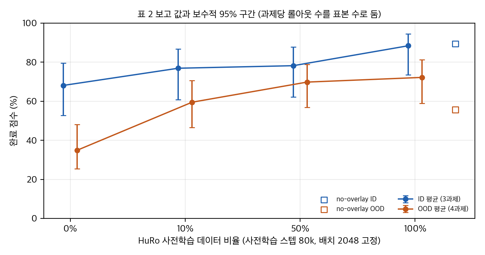
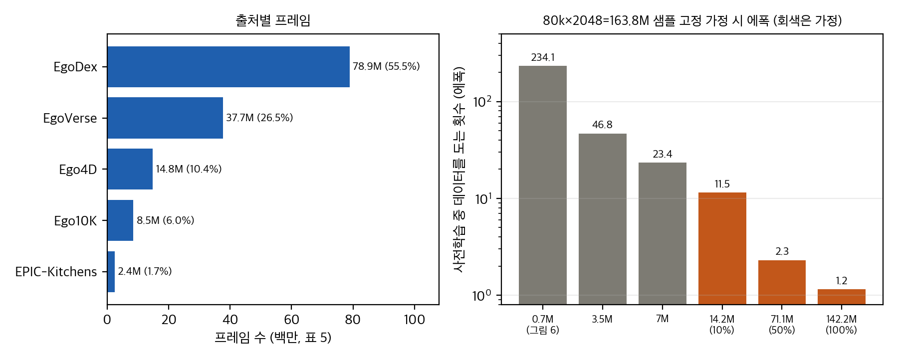
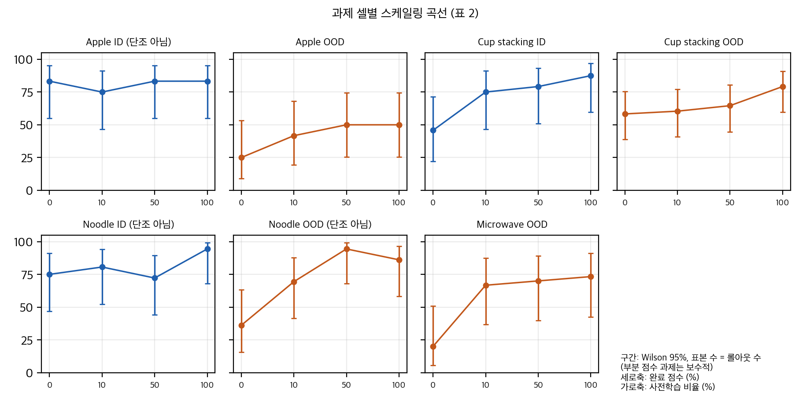

# 03. 수치 재계산, 일관성 검사, 주장 판정

재현(학습, 로봇 실행)은 하지 않았습니다. 논문 v5의 표와 본문 값을 `analysis/recompute.py`로 다시 계산했습니다. 결과는 `analysis/recompute_results.json`입니다. 작은 CPU toy 하나(`analysis/toy_alignment_invariance.py`)가 있습니다. 항목 번호는 수치·일관성 검사 **V1–V22**, 주장 판정 **C1–C11**, 공식 코드 대조 `04`의 **D1–D15**입니다.

## 0. 방법과 가정

- **표 값은 논문에서 옮겼고**(표 2, 3, 4, 5, 6, 7, 8, 9, 10과 그림 3, 5, 6의 숫자 라벨), 롤아웃 수는 부록 A(표 1, A.2), §4.4, E.1의 서술을 씁니다.
- **논문은 시행 수 외의 원자료(롤아웃별 점수, 시드)를 공개하지 않았습니다.** 그래서 구간과 검정은 보고된 값에서 만들었고, 가정을 아래처럼 명시합니다.
  - **롤아웃 수준(보수적):** 과제 셀을 롤아웃 수 `n`개의 이진 시행처럼 다룹니다. 점수가 [0, 1] 범위이므로 이 분산은 상한이라 구간이 넓게 나옵니다.
  - **하위 목표 수준(낙관적):** 롤아웃 × 하위 목표를 독립 시행으로 다룹니다. 한 롤아웃 안의 하위 목표는 상관되어 있으므로 구간이 지나치게 좁습니다. 두 가정 사이에 실제가 있습니다.
- 집계(ID 평균, OOD 평균)는 과제별 Beta(k+0.5, n−k+0.5) 사후 표본의 비가중 평균 차이로 시뮬레이션했습니다(20만 번). Jeffreys 사전분포가 사후 평균을 50% 쪽으로 약간 당기므로 평균 차이는 보고 차이보다 약간 작게 나옵니다(예: OOD 100% 대 0%, 보고 37.3, 시뮬 34.4). **구간 폭과 구간이 0을 포함하는지만 봅니다.**
- Wilson 구간, Fisher 정확 검정(양측)은 scipy입니다. 다중 비교 보정은 하지 않았고, 비교는 사전에 정한 것(논문 주장)만 골랐습니다.

## 1. 표 2 재계산 (부록 A.3)

### 1.1 평균 (V1)

ID 평균은 사과, 컵 쌓기, 컵 누들 3과제의 비가중 평균, OOD 평균은 사과, 컵 쌓기, 컵 누들, 전자레인지 4과제의 비가중 평균, Overall은 둘의 평균입니다(A.3).

| 모델 | ID 재계산 (보고) | OOD 재계산 (보고) | Overall 재계산 (보고) |
|---|---|---|---|
| π0.5 | 68.53 (68.5) | 27.95 (28.0) | 48.24 (48.2) |
| GR00T N1.6 | 66.67 (66.7) | 37.40 (37.4) | 52.03 (52.0) |
| 0% PT | 68.03 (68.1) | 34.85 (34.9) | 51.44 (51.5) |
| 10% PT | 76.87 (76.9) | 59.55 (59.5) | 68.21 (68.2) |
| 50% PT | 78.23 (78.2) | 69.75 (69.8) | 73.99 (74.0) |
| no-overlay | 89.37 (89.4) | 55.72 (55.7) | 72.55 (72.5) |
| 100% PT | 88.40 (88.4) | 72.15 (72.2) | 80.28 (80.3) |

**V1 결론:** 일곱 행 모두 0.1점 안에서 재현됩니다. 0% PT의 ID 68.03 대 68.1은 표에 반올림해 적은 셀 값(83.3, 45.8, 75.0)을 평균한 탓이고, 정확한 비(83.33, 45.83, 75.0)로는 68.06입니다. 초록의 51.5→80.3, 68.1→88.4, 34.9→72.2는 표 2와 일치합니다.

### 1.2 이득이 어디서 오는가 (V14, V15)

- **V14, OOD 평균은 ID 평균과 과제 집합이 다릅니다.** 100% 대 0%의 이득은 ID +20.4(3과제), OOD +37.3(4과제)입니다. 전자레인지(OOD 전용, 20.0→73.3, +53.3)가 OOD 평균 이득에 13.3점을 기여하고, 이를 뺀 3과제 OOD 이득은 +32.0입니다. 초록의 "OOD 34.9→72.2"는 전자레인지가 들어간 값입니다. 전자레인지는 롤아웃 10회뿐이고 0% PT에서 20.0(6/30)이라 기준점이 낮습니다.
- **V15, 과제 셀별 단조성:** 0→10→50→100%에서 비감소인 셀은 7개 중 4개입니다(사과 OOD, 컵 쌓기 ID·OOD, 전자레인지 OOD). 사과 ID(83.3, 75.0, 83.3, 83.3: 이득 0), 컵 누들 ID(75.0, 80.6, 72.2, 94.4), 컵 누들 OOD(36.1, 69.4, 94.4, 86.1)는 단조가 아닙니다. 평균 곡선은 매끈하지만 과제별로는 들쭉날쭉합니다 (그림 `own_task_cells.png`).
- **포화 형태:** OOD 이득의 66%가 10% 부분집합에서 이미 나옵니다(34.9→59.5). 50%→100%에서 OOD는 +2.4, ID는 +10.2입니다. "규모가 클수록 계속 좋아진다"기보다 **OOD는 10%에서 대부분 확보되고 ID는 100%에서 마지막 도약**이 있습니다.

## 2. 정수 가능성 검사

각 셀 값이 `k/(롤아웃 × 만점)` (소수 첫째 자리 반올림)로 나올 수 있는지 봅니다.

### 2.1 표 2 (V2, V3)

| 열 | 서술 분모 | 서술 분모로 모든 셀 가능? | 모든 셀을 만족하는 최소 분모 |
|---|---|---|---|
| Apple ID, OOD | 12 (이진, 12회) | 가능 | 12 |
| **Cup Stacking ID** | 36 (12회 × 3) | **불가 (3셀)** | **24** (48, 72) |
| **Cup Stacking OOD** | 72 (24회 × 3) | **불가 (6셀)** | **48** (96, 144) |
| Cup-Noodle ID, OOD | 36 (12회 × 3) | 가능 | 36 |
| Microwave OOD | 30 (10회 × 3) | 가능 | 30 |

**V2, 컵 쌓기 14셀 중 9셀이 서술된 분모로는 정수가 되지 않습니다.** 불가능한 셀: π0.5 OOD 47.9, GR00T OOD 64.6, 0% PT ID 45.8, 10% PT OOD 60.4, 50% PT ID 79.2, 50% PT OOD 64.6, no-overlay ID 87.5, no-overlay OOD 64.6, 100% PT ID 87.5. 나머지 5셀은 우연히 가능합니다. 분모를 롤아웃 × **2**로 두면(ID 24, OOD 48) 14셀이 모두 맞습니다. 반 점 부분 점수(만점 3, 0.5 단위: 분모 72, 144)로도 맞습니다. 두 설명은 값만으로 구별되지 않습니다.
→ A.2는 컵 쌓기를 "세 하위 목표, 마지막은 쌓은 컵을 넘어뜨리지 않고 내려놓기"로 서술하는데, 표 값은 이 서술(정수 하위 목표 점수)과 맞지 않습니다. 점수 환산 규칙을 저자에게 확인해야 합니다. 오타라면 단순하지만, 부분 점수 규칙이 서술과 다르다면 컵 쌓기 셀의 해석이 달라집니다.
**V3:** 사과, 컵 누들, 전자레인지의 35셀은 서술 분모로 모두 정수가 됩니다. 컵 누들과 전자레인지는 하위 목표 3개 환산이 맞습니다.

### 2.2 표 4 (V4)

표 4(OOD, 별도 환경): 컵 쌓기 No PT 31.9, HRDT 5.6, VITRA 0.0, Ours 70.8. 컵 누들 No PT 16.7, HRDT 37.5, VITRA 9.7, Ours 66.7.
- 컵 쌓기: 분모 72(= 24회 × 3)로 모두 가능(23/72, 4/72, 0, 51/72). A.2의 OOD 24회 서술과 일치하지만, **표 2의 컵 쌓기 OOD는 같은 24회로 분모 48이 필요**하므로 서로 어긋납니다.
- 컵 누들: 37.5(=13.5/36)와 9.7(=3.5/36)이 12회 × 3(36)으로는 불가능합니다. 72(= 24회 × 3) 이상이 필요합니다. 표 4는 "부록 A의 롤아웃 프로토콜"(컵 누들 OOD 12회)을 따랐다고 했지만, 값은 24회 규모입니다. 별도 환경 재평가에서 롤아웃을 늘렸을 수 있으나 본문에 없습니다.

### 2.3 Diverse Pick-and-Place와 부록 E (V5, V6)

- **V5:** 그림 5(ID 36회, OOD 18회, 롤아웃당 만점 2 → 분모 72, 36), 그림 6, 표 3, E.3의 모든 값이 정수 가능합니다. 예: 61.1 = 44/72, 50.0 = 18/36, 97.2 = 70/72, 41.7 = 15/36, 77.8 = 28/36.
  교차 일치: 그림 6의 공통 시작점 63.9/25.0은 표 3의 No PT와 같고, E.3의 ALLEX-only 86.1/63.9는 표 3의 HuRo-EEF+Hand와 같습니다. 부록 D의 "0.7M 혼합 83.3/63.9"는 그림 6의 HuRo 0.7M 값과 같습니다. 반면 §4.4(그림 5)의 No PT 25.0/13.9는 다른 환경이라 다릅니다(§4.5는 "별도 물리 환경"). 서술과 일치합니다.
- **V6, 표 7(OpenArm):** 모든 셀이 12.5%의 배수(조건당 8회)이고, ID 평균(3과제), OOD 평균(2조건), Overall이 모두 재현됩니다. 예: HuRo PT (62.5+75+75)/3 = 70.8, (75+75)/2 = 75.0, 전체 72.9.

## 3. 구간과 검정

### 3.1 사과 과제 (이진, 12회; V16)

OOD 25.0(3/12), 41.7(5/12), 50.0(6/12): 0% 대 100%는 Fisher p = 0.40, 0% 대 10%는 p = 0.67, 100% 대 no-overlay(6/12 대 4/12)는 p = 0.68입니다. ID는 10/12 대 10/12로 차이가 없습니다. 12회짜리 셀 하나는 25 대 50의 차이도 구별하지 못합니다. Wilson 95%는 3/12가 [8.9, 53.2]에 걸칩니다.

### 3.2 집계 평균 차이 시뮬레이션 (V17)

| 비교 | 지표 | 롤아웃 수준(보수적) 평균 차이 [95% 구간] | P(차이>0) | 하위 목표 수준(낙관적) P |
|---|---|---|---|---|
| 100% − 0% | ID | +18.8 [1.4, 35.9] | 0.98 | 0.999 |
| 100% − 0% | OOD | +34.4 [18.0, 49.9] | 1.00 | 1.00 |
| 10% − 0% | OOD | +22.6 [5.6, 38.9] | 0.995 | 1.00 |
| 100% − 10% | ID / OOD | +10.6 [−6.1, 27.6] / +11.8 [−4.7, 28.2] | 0.89 / 0.92 | 0.95 / 0.97 |
| 100% − 50% | ID / OOD | +9.4 [−7.3, 26.1] / +2.3 [−13.4, 17.9] | 0.87 / 0.62 | 0.94 / 0.65 |
| 50% − 10% | ID / OOD | +1.3 [−17.1, 19.6] / +9.5 [−6.9, 25.8] | 0.55 / 0.87 | 0.57 / 0.94 |
| 100% − no-overlay | OOD | +15.2 [−1.2, 31.3] | 0.965 | 0.994 |
| no-overlay − 10% | OOD | −3.4 [−20.3, 13.8] | 0.345 | 0.288 |
| 100% − GR00T N1.6 | ID / OOD | +20.1 [2.4, 37.4] / +32.0 [15.8, 47.2] | 0.99 / 1.00 | 1.00 / 1.00 |
| 100% − π0.5 | ID / OOD | +18.3 [2.6, 33.1] / +40.9 [25.2, 55.5] | 0.99 / 1.00 | 1.00 / 1.00 |
| 0% − GR00T N1.6 | ID / OOD | +1.3 [−18.1, 20.5] / −2.4 [−18.4, 13.6] | 0.55 / 0.38 | 0.57 / 0.35 |

**읽는 법.** 0%와 100%의 차이는 두 가정 모두에서 0을 포함하지 않습니다. 인접 단계(10→50→100%) 차이와 시각 로봇화 효과는 보수적 가정에서 0을 포함하고, 낙관적 가정에서야 경계를 넘습니다. 즉 **"사전학습이 도움이 된다"는 성립하고, "더 많을수록 더 낫다"의 세부 형태는 이 데이터로 확정되지 않습니다.**

### 3.3 Diverse Pick-and-Place와 표 3 (V18)

물체 단위(롤아웃당 2점, 한 물체 성공 1점을 독립 시행으로)와 롤아웃 단위(보수적) 두 가지로 Fisher를 계산했습니다.

| 비교 | 값 | 물체 단위 p | 롤아웃 단위 p |
|---|---|---|---|
| 그림 5 ID: V+A 61.1 대 No PT 25.0 | 44/72 대 18/72 | <1e−4 | 0.004 |
| 그림 5 ID: V+A 대 Visual-only 31.9 | 44/72 대 23/72 | 0.0008 | — |
| 그림 5 OOD: V+A 50.0 대 No PT 13.9 | 18/36 대 5/36 | 0.002 | 0.075 |
| 그림 5 OOD: V+A 대 Visual-only 22.2 | 18/36 대 8/36 | 0.026 | — |
| 그림 6 OOD 7M: HuRo 83.3 대 I2V 55.6 | 30/36 대 20/36 | 0.020 | 0.146 |
| 그림 6 OOD: HuRo 0.7M 63.9 대 I2V 7M 55.6 | 23/36 대 20/36 | 0.63 | — |
| 그림 6 ID: HuRo 0.7M 83.3 대 I2V 7M 80.6 | 60/72 대 58/72 | 0.83 | — |
| 표 3 OOD: HuRo-EEF+Hand 63.9 대 Fixed-EEF+Hand 61.1 | 23/36 대 22/36 | 1.0 | 1.0 |
| 표 3 OOD: HuRo-EEF+Hand 대 No PT 25.0 | 23/36 대 9/36 | 0.002 | — |
| E.3 OOD: 공동 77.8 대 ALLEX-only 63.9 | 28/36 대 23/36 | 0.30 | — |

### 3.4 표 7 OpenArm (조건당 8회, 풀링 ID 24회 / OOD 16회; V19)

풀링 횟수(k): No PT 13/24, 7/16; HRDT 18/24, 9/16; VITRA 8/24, 2/16; visual-only 15/24, 4/16; no-overlay 15/24, 10/16; HuRo PT 17/24, 12/16. Fisher: OOD HuRo 대 visual-only 12/16 대 4/16 p = 0.012, HuRo 대 no-overlay p = 0.70, HuRo 대 HRDT p = 0.46, HuRo 대 No PT p = 0.15; ID HuRo 대 HRDT 17/24 대 18/24 p = 1.0. 본문 "HuRo가 OOD에서 더 낫다"는 방향만 맞고 유의하지 않습니다.

## 4. 데이터셋과 처리 산술

- **V7, 표 5:** 프레임 합 142.3M(표기 142.2M, 반올림), 시간 합 1,316.8 = 표기와 같습니다. 프레임을 시간으로 바꾸면 142.2M/(30×3600) = 1,316.7 h로 맞습니다. 출처별 시간도 맞습니다(EgoDex 730.6 대 730.8 등). 본문 §3.1.4의 비율(56/27/10/6/2)은 반올림 합 101%이고 표(55.5/26.5/10.4/6.0/1.7)는 합 100.1%입니다. **공개 가능한 4개 출처(EgoDex 제외)는 프레임의 44.5%입니다.**
- **V8, 표 8:** 구성 합이 모두 맞습니다(89.8+6.0+47.3 = 143.1, 77.9+3.6+38.6 = 120.1). 배수 9.5×, 8.0× 맞습니다(15분 기준 9.54, 8.01). §E.3의 "로봇별 계산은 전체의 10.6%, 5.5%"는 행동 변환(6.0, 3.6분)만으로는 4.2%, 3.0%이므로 나머지가 오버레이 시간이라는 뜻입니다. 역산하면 오버레이는 EPIC에서 9.2분(시각 변환의 19.5%), Ego4D에서 3.0분(7.8%)이고, 두 출처 사이 2.5배 차이는 해상도 차이(456×256 대 342×256, 화소 1.33배)만으로는 설명되지 않습니다. 표에 오버레이 시간이 따로 없어 확인하지 못합니다.
- **V9, 표 9 ↔ 표 5 시간 불일치:** EPIC은 96.2 h × 17.3% × 98.1% = 16.3 h, Ego4D는 1,589.1 h × 6.9% × 97.0% = 106.4 h로 유도되는데, 표 5의 최종 시간은 22.3 h, 136.6 h로 각각 1.37배, 1.28배입니다. 표 9의 "원본 시간"이 최종 데이터셋에 쓴 부분집합과 같은 정의인지 본문에 없습니다. 같은 정의라면 설명되지 않는 차이입니다. 참고로 F.2의 입력 총량 3,298.6 h에서 EgoDex(730.8/0.889 = 822 h)와 EgoVerse(348.7/0.927 = 376 h)의 입력을 역산하면 Ego10K 입력은 415 h, 유지율 18.9%로 나옵니다(검증 불가).
- **V10, 에피소드 평균 길이:** 142.2M 프레임 ÷ 630K 에피소드 = 225.7 프레임(7.52 s)입니다. 공식 코드 stage 6의 청크 창은 **최대 210 프레임(7.0 s)**이므로(`04` D4) 이 값은 코드 기본 설정으로 만들 수 없습니다. 창이 210 이하라면 에피소드는 최소 677K개여야 합니다. "about 630K"(초록), "over 630K"(§1) 표기와 맞지 않습니다. EgoDex(55.5%)는 다른 경로로 만들어졌으므로(`04` D2) 이 차이가 그 때문일 수 있습니다. 확인되지 않았습니다.
- **V11, 표 10:** 감사 표본 합 60+60+60+56+52 = 288, 62.5% = 180/288, 55.2% = 159/288(정수 일치). 95% Wilson [56.8, 67.9]와 [49.4, 60.8]입니다. 즉 **저자 스스로 보고하는 바로 궤적의 37.5%는 관절 한계 위반, 44.8%는 비잡기 자기 접촉**이 있습니다. 카메라 궤적 진단은 시도 129편 중 115편만 채점되었습니다(89.1%).
- **V13, 에폭 혼입:** 사전학습이 모든 변형에서 80k 스텝 × 2048 = 163.8M 샘플로 고정이므로 10% 부분집합(14.2M)은 약 11.5 에폭, 50%는 2.3, 100%는 1.15, EgoDex 단독(78.9M)은 2.1 에폭입니다. 그림 6의 예산(0.7M, 3.5M, 7M)도 같은 스텝이라면 234, 47, 23 에폭입니다("학습 설정 고정"이라고만 서술). **"데이터 규모"와 "반복 횟수/다양성"이 함께 변하는 설계**입니다. 데이터가 작을수록 과적합 위험이 큰 쪽으로 불리하므로 규모 효과를 과대평가할 수 있습니다. 반대로 컴퓨트를 맞춘 비교이므로 컴퓨트 효율 관점에서는 정당합니다. 어느 쪽을 주장하는지 본문이 구분하지 않습니다.

- **V12, v1 ↔ v5:** 표 2의 일곱 행이 두 판본에서 같은 값입니다(텍스트 파싱 비교). 수치 변경은 없습니다.
- **표 6 비율(참고):** 10→100% 구간에서 고유 동사 1.84배, 고유 V-O 3.0배, 지시 샘플 10.0배, OpenImages 커버리지 0.664→0.687(+0.023). 혼합 50% 대 EgoDex 단독의 커버리지 차이 +0.062입니다. 커버리지 지표의 절대 차이가 작아 "넓은 커버리지가 성능을 설명한다"는 해석은 상관 수준입니다.

## 5. 본문 서술 대 표 (V20, V21, V22)

- **V20, 기준 모델 대비:** 본문 "100% PT가 π0.5와 GR00T N1.6을 ID와 OOD 모두에서 이긴다"(§4.2)는 **평균에서만** 맞습니다. 과제 셀별로는 π0.5가 사과 ID(91.7 대 83.3)와 컵 쌓기 ID(91.7 대 87.5)에서 높고, GR00T N1.6이 사과 ID(83.3 대 83.3, 동률)에서 같거나 높습니다. 100% PT가 π0.5를 이기는 셀은 7개 중 5개입니다. 또 0% PT(사전학습 없음)가 두 기준과 구간 안에서 같으므로(V17 마지막 행), 이득은 "HuRo 사전학습"에서 오는 것이 맞지만 기준 모델 대비는 비교 조건이 같지 않아(미세조정 설정, 행동 모듈) 해석이 제한됩니다.
- **V21, 10% 오버레이 대 100% no-overlay:** 초록과 §1의 "10% 오버레이 부분집합이 100% no-overlay를 능가한다"는 OOD 59.5 대 55.7(+3.8)입니다. 시뮬레이션에서 차이 −3.4 [−20.3, 13.8], P(no-overlay > 10%) = 0.35로 **같다고 봐도 되는 수준**입니다. 본문의 "clear benefit"(§4.3)은 100% 대 no-overlay OOD +15.2 [−1.2, 31.3]에 기댄 것이고, 이것도 보수적 구간에서 0을 포함합니다. ID는 no-overlay가 오히려 1점 높습니다(89.4 대 88.4).
- **V22, 부록 D의 "혼합 50% 대 EgoDex 단독":** 78.2/69.8 대 63.9/54.2는 표 2에 EgoDex 단독 행이 없고 과제별 값도 없어 **검증할 수 없습니다.** ID 평균 63.9는 표 3의 No PT ID(63.9)와 같은 숫자입니다(우연일 가능성이 높지만 다른 과제 집합이라 비교는 아닙니다). EgoDex 단독은 출처 다양성과 사람 영상 종류가 함께 달라서, "다양성이 성능을 낳는다"를 분리하지 못합니다.

## 6. Toy: 정렬 변환이 행동 표현에 들어가는가 (T1)

`analysis/toy_alignment_invariance.py` (numpy, 1초 미만). 식 (2), (7)의 정렬 `T_ξ^{B←W}`(이동 + yaw)를 카메라와 손목에 함께 곱하면, §3.2의 "현재 손목 자세에 대한 `C_obs` 기준 상대 목표"가 어떻게 변하는지 200개 무작위 궤적(H = 40)으로 확인했습니다.

- **상대 손목 행동의 편차 1.8e−15**(수치 오차)입니다. 즉 정렬 `ξ`는 행동 값에 직접 들어가지 않습니다. IK 도달 가능성(관절 한계, 작업 공간)을 통해서만 간접적으로 영향을 줍니다.
- yaw 정렬은 중력 벡터를 보존하고(변화 0), pitch가 섞이면 0.40만큼 바뀝니다. 논문이 정렬을 이동 3 + yaw로 제한하고 GeoCalib로 중력을 먼저 맞추는 이유와 일치합니다.
- **해석(추정):** 표 3의 "카메라 운동 인지 로봇화"가 Fixed-EEF 대비 주는 이득은 상대 행동 표현이 아니라 (1) 관측에서 로봇 팔이 그려지는 위치의 일관성, (2) IK 해가 도달 가능 영역에 들어가는 정도에서 나옵니다. 그런데 표 3의 OOD 차이(63.9 대 61.1)가 1/36 수준이라 이 효과의 크기는 확정되지 않습니다(C7).

## 7. 주장 판정 (C1–C11)

| # | 주장 (출처) | 판정 | 근거 |
|---|---|---|---|
| C1 | 로봇화 데이터가 늘수록 ID와 OOD가 오른다 (§4.2, 표 2) | **방향은 지지, 세부 형태는 미확정** | 100% 대 0%는 ID +18.8 [1.4, 35.9], OOD +34.4 [18.0, 49.9] (V17). 인접 단계 구간은 0 포함, 4/7 셀만 단조 (V15), OOD 이득의 66%가 10%에서 발생, 에폭 혼입 (V13). 전자레인지가 OOD 평균을 키움 (V14) |
| C2 | 시각 로봇화가 OOD 견고성을 높인다 (§4.3) | **약하게 지지** | OOD +15.2 [−1.2, 31.3], ID 동률(−0.9), 10% 오버레이 대 100% no-overlay는 +3.8 (V21). OpenArm OOD 12/16 대 10/16, p = 0.70 (V19). 방향은 일관되나 크기는 불확실. no-overlay는 인페인팅 없는 원본이라 오버레이 효과만의 분리는 아님 |
| C3 | 행동 지도가 시각 전이만보다 훨씬 낫다 (§4.4, 그림 5) | **지지 (OOD는 롤아웃 단위로 경계)** | ID 44/72 대 23/72 p = 0.0008, OOD 18/36 대 8/36 p = 0.026 (물체 단위). 롤아웃 단위 보수적: No PT 대비 OOD p = 0.075 (V18). OpenArm OOD 12/16 대 4/16 p = 0.012 (V19). "Visual-only"는 행동 헤드 재초기화라 사전학습된 행동 헤드의 효과와 행동 지도의 효과가 같은 조작으로 묶임 |
| C4 | 100% PT가 π0.5, GR00T N1.6보다 낫다 (§4.2, 그림 3c) | **평균은 지지, 과제별은 엇갈림** | 평균 +18~20 / +32~41 점 (V17). 사과 ID, 컵 쌓기 ID는 기준 모델이 같거나 높음 (V20). 기준 모델은 행동 모듈이 사전학습된 채 미세조정되어 조건이 다름 |
| C5 | HuRo가 영상 생성(I2V+IDM) 데이터보다 확장 효율이 좋다 (§4.5, 그림 6) | **부분 지지** | OOD 7M 30/36 대 20/36 p = 0.020 (물체 단위), 롤아웃 단위 0.15 (V18). "HuRo 0.7M ≥ I2V 7M"은 ID 83.3 대 80.6 p = 0.83, OOD 63.9 대 55.6 p = 0.63으로 구별 안 됨. "I2V는 3.5M→7M에서 OOD 이득이 없다"는 한 점의 동률(55.6, 55.6). HuRo ID도 0.7M→3.5M에서 83.3 동률이지만 본문이 언급하지 않음. I2V+IDM 구성(모델, 품질) 세부가 부족하고 단일 실행 |
| C6 | 로봇화 데이터가 사람 도메인 데이터(H-RDT, VITRA 변형)보다 낫다 (부록 C, 표 4) | **방향 지지, 분모 불명확** | 컵 쌓기 70.8 대 5.6/0.0 (큰 차이), 컵 누들 66.7 대 37.5/9.7. 단 컵 누들 37.5와 9.7은 서술된 12회로 정수가 아님 (V4). 두 비교 모델은 저자가 적응한 변형이고 별도 환경. OpenArm ID에서는 HRDT 75.0이 HuRo 70.8보다 높음 (표 7) |
| C7 | 카메라 운동 인지 로봇화가 고정 외부 파라미터보다 낫다 (부록 B, 표 3) | **미확정** | HuRo-EEF+Hand 대 Fixed-EEF+Hand: ID 86.1 대 80.6, OOD 63.9 대 61.1 (23/36 대 22/36, p = 1.0) (V18). 손 목표 추가의 효과(OOD 50.0→61.1)가 더 큼 |
| C8 | 혼합 출처가 단일 출처(EgoDex)보다 프레임당 효율이 좋다 (부록 D.2) | **검증 불가** | 표 2에 대응 행이 없고 과제별 값 없음 (V22) |
| C9 | 다중 임베디먼트 공동 사전학습이 이득을 준다 (부록 E.3) | **미확정** | OOD 28/36 대 23/36, p = 0.30 (V18). 공동 설정은 데이터가 2배(논문도 서술) |
| C10 | 파이프라인 품질 진단 (표 10, F.3) | **내부 일관, 한계는 저자가 인정** | 표본 수와 비율이 정수로 일치 (V11). 관절 한계 위반 37.5%, 자기 접촉 44.8% 궤적, 그래서 "사전학습 지도, 실행 가능한 시연이 아님" (§6). 진단 대부분이 EgoDex 재실행(카메라, 손)이거나 소표본 |
| C11 | HuRo는 기존 로봇화 영상 사전학습(H2R, Masquerade)보다 한 자릿수 크기 이상 크다 (§1) | **검증 불가** | 비교 대상의 규모 수치가 논문에 없음 |

## 8. 이 분석의 한계

- 시행 수 외 원자료가 없어 구간은 가정에 의존합니다(§0). 부분 점수 셀의 실제 분산은 두 가정 사이입니다.
- 컵 쌓기 환산 규칙(V2)과 표 4 컵 누들 롤아웃 수(V4)는 저자 확인이 필요합니다.
- 논문 그림의 숫자 라벨(그림 3, 5, 6)을 눈으로 읽어 옮겼습니다(표 2와 교차 확인한 부분 제외).
- 코드 대조(`04`)는 정적 읽기이고, 학습·평가 코드가 공개되지 않아 학습 설정은 대조할 수 없습니다.
