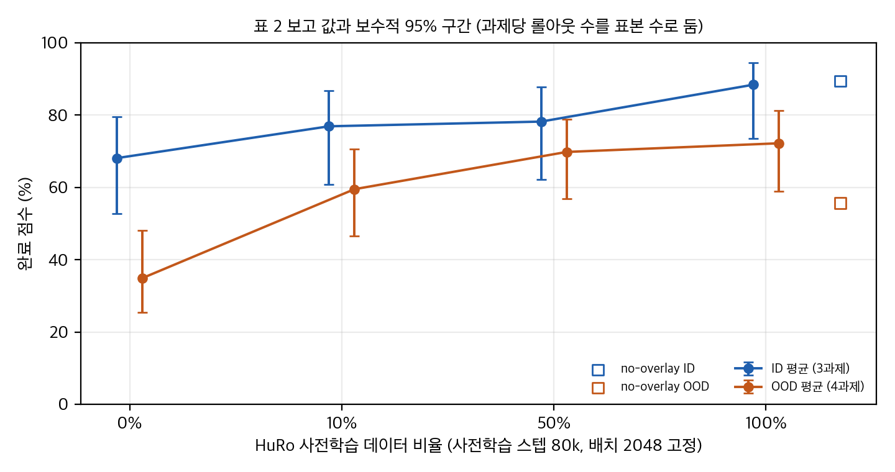
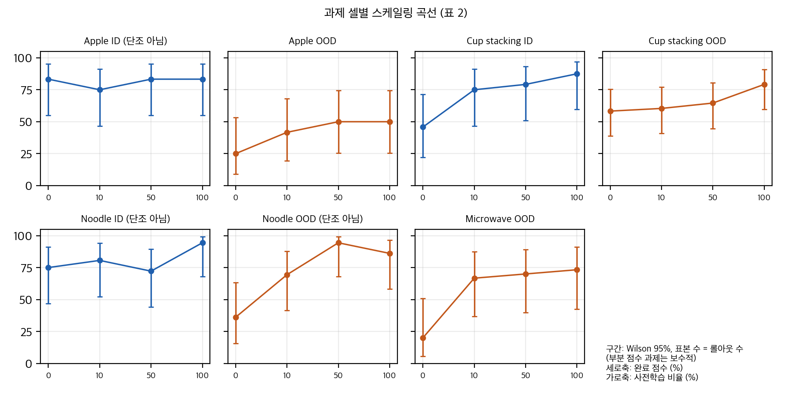
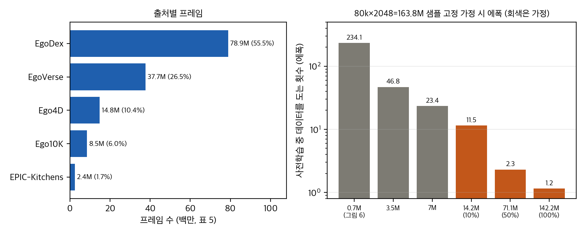

> **논문:** Jinho Jeong, Se June Joo 외 5명. *HuRo: Robotizing Human Videos for Scalable VLA Pretraining.* CoRL 2026 포스터, arXiv:2609.10706 (v5, 2026-09-25).
> 공식 코드는 GitHub 3587jjh/HuRo에 있습니다(파이프라인만, 비상업 제한 의존성 포함). 이 글의 그래프는 논문의 표 수치로 우리가 그린 것입니다. 논문 그림은 넣지 않았습니다(논문 라이선스가 arXiv 비독점 1.0이라 CC BY가 아닙니다).

## 논문이 묻는 것

사람 영상은 많고 다양하지만 로봇 학습에 바로 쓰기 어렵습니다. 관측에는 사람 팔이 보이고, 행동은 사람 손 동작입니다. HuRo는 egocentric 영상 다섯 출처(142M 프레임)를 두 방향으로 로봇 형식으로 바꿉니다. 시각은 사람 팔을 지우고 렌더링한 로봇(ALLEX)을 덮어 씌우고, 행동은 손 동작을 IK로 로봇 관절 궤적으로 바꿉니다. 이렇게 만든 약 630K 에피소드로 GR00T-N1.6-3B 기반 정책을 사전학습한 뒤 실로봇 네 과제로 평가합니다. 헤드라인은 전체 완료 점수 51.5%에서 80.3%, OOD 34.9%에서 72.2%입니다.

## 확인한 것

**1. 사전학습이 도움이 된다는 방향은 맞습니다.** 100%와 0%의 차이는 ID +18.8, OOD +34.4이고 보수적 95% 구간이 0을 포함하지 않습니다. 하지만 10%, 50%, 100% 사이의 인접 차이는 구간 안에 들어가고, 과제 셀 7개 중 4개만 단조입니다. OOD 이득의 66%는 10% 부분집합에서 이미 나옵니다.

*그래프: 논문 표 2의 보고 값과 보수적 95% 구간(과제당 롤아웃 수를 표본 수로 둠). 우리가 그린 그래프입니다.*

**2. 과제별로 보면 들쭉날쭉합니다.** 사과 ID는 이득이 없고, 컵 누들은 단조가 아닙니다. 평균 OOD에는 롤아웃 10회뿐인 전자레인지 과제(+53점)가 13점을 기여합니다.

*그래프: 과제 셀별 완료 점수와 Wilson 95% 구간. 우리가 그린 그래프입니다.*

**3. 컵 쌓기 점수의 분모가 서술과 맞지 않습니다.** 부록은 컵 쌓기를 "롤아웃 12/24회, 하위 목표 3개"로 서술하는데, 표 2의 컵 쌓기 14셀 중 9셀은 이 분모로 정수가 되지 않습니다. 분모를 롤아웃 x 2로 두거나 반 점 부분 점수를 허용하면 모두 맞습니다. 표 4의 컵 누들 37.5와 9.7도 12회로는 만들 수 없습니다.

**4. "규모"가 에폭과 섞여 있습니다.** 사전학습이 모든 변형에서 80k 스텝 x 배치 2048로 고정이라 10% 부분집합은 약 11.5 에폭, 100%는 약 1.15 에폭을 돕니다. 데이터 양과 반복 횟수가 함께 바뀌는 설계입니다.

*그래프: 출처별 프레임 수(논문 표 5)와, 스텝을 고정했다고 가정할 때 부분집합별 에폭 수. 우리가 그린 그래프입니다.*

**5. 시각 로봇화는 약하게, 행동 지도는 분명하게 지지됩니다.** 100%와 no-overlay의 OOD 차이는 +15.2 [-1.2, 31.3]이고 ID는 동률입니다. "10% 오버레이가 100% no-overlay를 능가한다"는 59.5 대 55.7로 구간 안입니다. 반면 행동까지 사전학습한 쪽은 시각만 전이한 쪽보다 Diverse Pick-and-Place에서 분명히 높습니다.

## 공식 코드와 논문의 차이

공식 코드(커밋 082fb40)는 정적으로만 읽었습니다.

- **범위:** 공개된 것은 원시 영상에서 LeRobot 데이터셋까지의 파이프라인 10단계뿐입니다. VLA 학습·평가 코드와 체크포인트는 없습니다.
- **EgoDex:** 프레임의 55.5%인 최대 출처는 이 파이프라인이 아닌 다른 경로(제공된 정답 주석과 비공개 시각 코드)로 만들어졌고 공개되지 않았다고 저자의 풀 리퀘스트가 밝힙니다.
- **청크 길이:** 코드의 창은 최대 210프레임이고 50% 겹칩니다. 논문 통계(142.2M 프레임 / 630K 에피소드 = 평균 226프레임)와 맞지 않습니다.
- **미기재 설정:** 키포인트 평활화, 이상치 가중, 목적항 가중치, 허리와 목 자유도 최적화가 코드에 있고 논문에는 없습니다.
- **품질:** 관절 한계는 연성 벌점뿐이며 투영하지 않습니다. 저자 보고로 궤적의 37.5%가 한계를 넘고 44.8%가 자기 접촉을 가집니다.
- **일치:** IK 목적항 구성, 행동 정의 a_t = s_{t+1}, 가림을 모델링하지 않는 렌더링은 논문과 같습니다.

## 재현 가능성

CUDA 24GB 이상, RT 코어 GPU와 Isaac Sim이 필요해 이 맥(Apple M4 Pro)에서는 파이프라인도 학습도 재현할 수 없습니다. 통계 재계산과 코드 정적 대조는 완료했고, 분석 문서와 재계산 스크립트는 함께 공개합니다.

## 자료

- [통합 리포트 PDF](report/report_public.pdf)
- [01. 논문 분석: HuRo (arXiv:2609.10706)](analysis/01_paper_analysis.md)
- [02. 선행 연구, 대안, 구성 요소, 저장소](analysis/02_prior_work.md)
- [03. 수치 재계산, 일관성 검사, 주장 판정](analysis/03_analysis.md)
- [04. 공식 코드 대조와 구현 가능성](analysis/04_code_verification.md)
