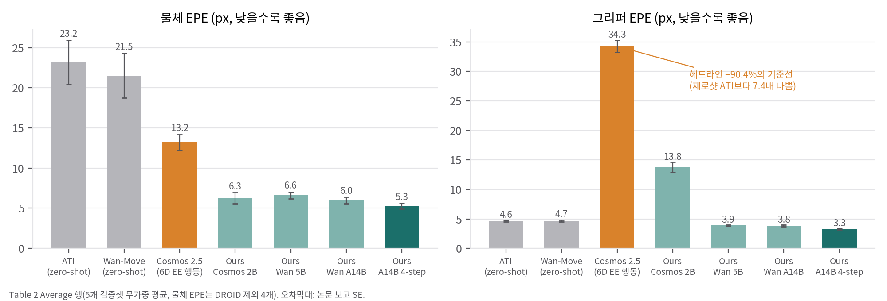

# 01. 논문 분석: Hydra-0 (arXiv:2608.18077)

- 제목: *Hydra-0: Action Flow for Generalist World Modeling and Control*
- 저자: Hongyu Li, Bowen Wen, Xinghao Zhu, Yixuan Wang, Yilun Du, Yunzhu Li, George Konidaris, Stan Birchfield, Soha Pouya, Chenran Li, Yan Chang (NVIDIA, Brown, Columbia, Harvard)
- 공개: arXiv v1 2026-08-18, 기술 보고서. 라이선스는 **arXiv 비독점 배포 라이선스**(CC BY 아님)이고, 본문에 "© 2026 NVIDIA. All rights reserved."라고 적혀 있습니다.
- 코드: **공개되지 않았습니다**("Code — coming soon"). 프로젝트 페이지를 호스팅하는 `nvidia-isaac/video_to_data` @ `7eb9721`은 같은 그룹의 다른 파이프라인(Video to Data)이고, Hydra-0 모델 코드는 들어 있지 않습니다.
- 프로젝트: https://nvidia-isaac.github.io/video_to_data/hydra-0/ (논문에 없는 RoboLab 에피소드 단위 수치가 실려 있음)

---

## 1. Abstract (한 줄 요약과 주장)

**한 줄 요약:** 로봇의 행동을 관절각이나 엔드이펙터 명령이 아니라 **이미지 평면 위 점들의 궤적(action flow)** 으로 표현하고, 이를 조건으로 하는 비디오 world model을 여러 embodiment(사람 손, UMI 그리퍼, 단팔·양팔 로봇)의 영상으로 함께 학습합니다.

주장은 네 가지입니다.

1. **action flow는 공통 인터페이스다.** 영상에서 추적으로 얻을 수 있고(학습), 배포할 때는 Isaac Lab에서 명령을 실행해 로봇 표면 점을 카메라로 투영해서 얻습니다.
2. **백본에 관계없이 이식된다.** Cosmos 2.5와 Wan2.2에 모두 적용됩니다. 최고 설정은 기준선(Cosmos 2.5 + 6D EE 행동) 대비 그리퍼 움직임 오차를 90.4%, 물체 움직임 오차를 60.2% 줄입니다.
3. **open-loop 정책 평가에 쓸 수 있다.** RoboLab의 5개 정책 × 6개 과제(300 에피소드)에서 재생 성공률과 기준 성공률의 Pearson r이 0.96입니다.
4. **역방향 모드(world action model)가 있다.** 사람 시연에서 뽑은 원하는 물체 flow를 주면, 모델이 그에 맞는 로봇 동작을 생성하고, 학습된 action head가 이를 실행 가능한 명령으로 바꿉니다.

---

## 2. Method

### 2.1 action flow의 정의와 구성 (§2.1, Eq. 1)
- **정의:** N개 점의 H스텝 궤적이고, 각 점은 x_{n,t} = (u, v)와 가시성 m_{n,t} ∈ {0,1}를 가집니다.
- **기하 기반 구성 (배포, 메타데이터가 있는 로봇 데이터):**
  - 첫 관측에서 보이는 로봇 표면 점 X̄_n을 링크 ℓ(n)에 붙입니다.
  - 그 점을 x_{n,t} = π(K [I 0] T_CW T_ℓ(n)(q_t) X̄_n)로 투영합니다.
  - 가시성은 깊이 > 0, 화면 안, 렌더 깊이 버퍼와 3×3 이웃에서 1.2 cm 이내일 때 1입니다(자기 가림 처리).
- **영상 기반 구성 (학습, 메타데이터가 없는 데이터):**
  - AllTracker로 128×128 격자의 dense track을 얻습니다.
  - SAM 3 마스크로 embodiment, object, 미할당으로 나눕니다.
- **학습 시 샘플링:** 조건을 4가지 모드 None / Embodiment / Object / All 중 하나로 고르고, 확률은 0.05 / 0.40 / 0.40 / 0.15입니다. Embodiment와 Object 모드는 1–128개 track을, All 모드는 256–1024개를 씁니다. Object 모드가 나중에 역방향 모드의 근거가 됩니다.

### 2.2 조건 주입 (§2.2, Eq. 3–4, 부록 8.4)
- **특징 전파:** 첫 프레임 latent s_0에서 track 출발점의 특징 h_n을 bilinear로 뽑고, 각 latent 시간 k의 목적지 셀 p̃ 주변으로 Gaussian 가중치 w = m_0·m_k·exp(−220‖p̃ − x̃_{n,k}‖²)를 줘서 퍼뜨립니다(셀마다 가중치 상위 K=2개만 사용, 정규화 없음).
- **존재 게이트:** g = clip(Σw, 0, 1)이고, 조건은 C_motion = (M, g)입니다. 설계는 ATI와 Wan-Move를 따릅니다.
- **백본별 주입 방식:**
  - Cosmos 2.5: 17채널 부가 입력을 zero-init patch projection으로 더합니다.
  - Wan2.2 I2V-A14B: 기존 visual condition 경로(16+4채널)에 넣고, MoE의 고잡음 expert에만 적용합니다.
  - Wan2.2 TI2V-5B: 49채널을 concat합니다.
- **학습 대상:** DiT patch embedding과 q·k·v·o, FFN의 rank-64 LoRA만 학습합니다. 손실은 표준 flow matching(Eq. 5)입니다.

### 2.3 빠른 롤아웃 (§2.3)
LongLive-2.0 방식으로 블록 causal 자기회귀 변환을 하고(KV cache, 청크 7 latent), DMD2로 4-step 학생 모델을 증류합니다. action flow는 전체 창 좌표로 한 번 계산한 뒤 청크 오프셋에서 잘라 써서 재기준(re-anchoring)을 막습니다.

### 2.4 정방향과 역방향 (§2.4)
- **정방향(정책 평가):** 기록된 엔드이펙터 궤적에서 만든 그리퍼 flow로 미래 영상을 생성합니다. **정책이 생성 영상을 보고 다시 행동하지 않는** open-loop 재생입니다.
- **역방향(WAM):**
  - 원하는 물체 flow만 조건으로 주면 모델이 로봇 동작이 담긴 영상 latent를 만듭니다.
  - 그 DiT 토큰에서 action/state head(mean pool + attention pool → 2층 MLP)가 명령을 읽어 냅니다.
  - 학습 손실은 L_WAM = L_flow + 0.1(L_act + L_state + 0.1·L_vel)이고, 실제 로봇의 성공·실패 궤적 쌍으로 rank-32 LoRA와 head를 학습합니다.

### 2.5 데이터 (Table 1)
7개 소스, 1,565,634개 창(81프레임, 약 5 s), 2,201.7 h입니다. 주로 변형 물체(천, 케이블, 로프, 봉투, 종이) 상호작용이고, **ABC-130k가 67.0%** 를 차지합니다. 정적 창과 그리퍼가 멈춘 창은 50 px 기준으로 걸렀습니다. EgoDex는 CC-BY-NC-ND입니다.

---

## 3. Experiments

### 3.1 다중 embodiment 예측 (Table 2, 데이터셋당 검증 클립 100개 × 5개)

| 모델 (Average 행) | PSNR | 물체 EPE | 그리퍼 EPE | FVD |
|---|---|---|---|---|
| ATI (zero-shot) | 17.01 | 23.19 | 4.62 | 444 |
| Wan-Move (zero-shot) | 16.35 | 21.53 | 4.67 | 408 |
| Cosmos 2.5 (6D EE 행동, 미세조정) | 15.62 | 13.23 | **34.28** | 406 |
| Ours (Cosmos 2.5 2B) | 18.41 | 6.27 | 13.80 | 277 |
| Ours (Wan2.2 A14B) | 20.76 | 6.00 | 3.83 | 194 |
| Ours (Wan2.2 A14B 4-step) | **21.84** | **5.27** | **3.29** | **156** |

### 3.2 데이터 효율 (Fig. 7, IWS 6개 과제)
0% 데이터(제로샷)에서 mid-training(MT)이 사전학습만 한 모델(PT)보다 6개 과제 모두에서 LPIPS, 물체 EPE, FVD가 낫습니다. 100%에서도 LPIPS와 FVD는 6개 과제 모두, 물체 EPE는 4개 과제에서 가장 낮습니다. 대부분의 이득은 데이터 20%에서 이미 나옵니다. 다만 수치 표가 없고 그래프로만 제시됩니다.

### 3.3 속도 (Table 3, H100 1장, 81프레임 480×832, VAE 디코드 제외)
양방향 교사 20.9 s, 자기회귀 교사 12.5 s, 4-step 학생 1.31 s(약 62 FPS, 16배)입니다.

### 3.4 RoboLab open-loop 정책 평가 (Fig. 8, 300 에피소드)
- **논문 수치:** Pearson r = 0.96, Spearman ρ = 0.93, MAE 5.7%p이고, 다섯 정책의 순위를 그대로 재현합니다.
- **프로젝트 페이지에만 있는 수치:**
  - 에피소드 단위 일치율 93.0%, Cohen's κ = 0.82
  - 오탐(FP) 10건, 미탐(FN) 11건
  - 전체 성공률 26.3%(시뮬레이션) vs 26.7%(RoboLab)

### 3.5 역방향 모드 (Fig. 10)
유연한 파이프 구부리기 과제 **1개**를 정성적으로만 보입니다. 성공률은 없습니다.

### 3.6 해석: 수치를 어떻게 읽을 것인가 (`03`, `04`에서 재계산)
1. **헤드라인 −90.4%는 기준선이 약한 데서 나옵니다.** 기준선(Cosmos 2.5 + 6D EE)의 그리퍼 EPE는 제로샷 ATI보다 **7.4배** 나쁩니다.
   - 같은 Cosmos 백본에서 조건 방식만 바꾼 통제 비교는 그리퍼 −59.7%, 물체 −52.6%입니다.
   - 최고 설정을 제로샷 ATI와 비교하면 그리퍼는 −28.8%뿐이고, 물체는 −77.3%입니다. 즉 **진짜 이득은 물체 움직임 예측에 있습니다.**
2. **그리퍼 EPE는 조건과 같은 공간에서 잰 지표입니다.** flow 조건 모델은 그리퍼가 어디로 가야 하는지를 픽셀로 직접 받으므로, 그리퍼 EPE에서 구조적으로 유리합니다. 물체 EPE가 더 공정한 지표입니다.
3. **"Hydra-0"은 하나의 모델이 아닙니다.** 결과마다 다른 설정이 쓰였습니다(`04` §2).
   - Table 2 최고는 LightX2V가 공개한 4-step I2V-A14B 체크포인트 기반입니다.
   - Table 3의 16배는 자체 자기회귀+DMD 학생입니다.
   - WAM은 50-step 자기회귀 교사입니다.
   - RoboLab에 쓴 모델은 명시되지 않았습니다(페이지 메타데이터에는 "LoRA step 6000").
4. **RoboLab의 "기준"은 실제 세계가 아니라 고충실도 시뮬레이터입니다.** RoboLab [52]는 시뮬레이션 벤치마크입니다. 실제 세계 평가는 천 접기의 정성적 예시(Fig. 9)뿐입니다.
5. **open-loop 재생은 결과 정보를 누설할 수 있습니다.** 실제로 실행된 궤적(예: 빈손으로 그리퍼를 닫고 물러나는 동작)에 성공·실패 정보가 이미 담겨 있을 수 있습니다. 그런데 "궤적만으로 성공을 맞히는" 기준선이 보고되지 않았습니다.

---

## 4. Limitations

### 4.1 저자가 밝힌 한계
WAM의 파지 위치가 센티미터 단위로 부정확합니다(깊이 인식 부족을 원인으로 추정). 생성 영상에서 파지·접촉 상태가 모호합니다. 손목 카메라 결과는 DROID 정성 예시 하나뿐입니다. 평가는 모두 open-loop이고 closed-loop은 향후 과제입니다.

### 4.2 분석하면서 추가로 발견한 한계
1. **배포할 때는 결국 로봇 기하와 카메라 보정이 필요합니다.** "embodiment에 무관하다"는 장점은 학습 쪽에만 해당합니다. 배포할 때는 URDF, 보정된 카메라, Isaac Lab 실행이 있어야 action flow를 만들 수 있습니다.
2. **2D 표현의 한계가 있습니다.** 깊이 방향(카메라 광축) 움직임은 flow에서 거의 보이지 않습니다. 저자들이 밝힌 "센티미터 단위 파지 오차"가 이 표현에서 구조적으로 나오는 결과일 가능성이 있습니다.
3. **Gaussian 전파의 등방성이 확실하지 않습니다.** β = 220은 "정규화된 latent 격자 좌표"에서 정의됩니다. 축별로 [0,1]로 정규화했다면 가로 52셀과 세로 30셀에서 퍼지는 폭이 픽셀로 다릅니다(`03` §3). 논문에서는 판단할 수 없습니다.
4. **재현할 수 없습니다.** 코드와 가중치가 없습니다. A14B mid-training에는 H100 32장으로 5일이 들었습니다.
5. **역방향 모드의 근거가 약합니다.** 과제 1개, 정성적 결과입니다. "과제별 전문가 시연이 필요 없다"고 하지만, 대상 로봇의 실제 궤적 쌍(성공과 실패)은 여전히 필요합니다.
