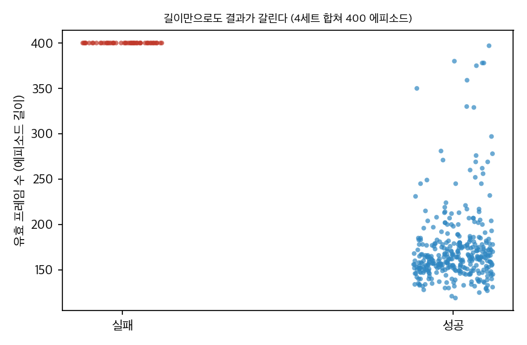

# 03. 재계산과 해석

GPU 없이 공개된 수치만으로 검증했습니다.
- `analysis/table_check.py` → `table_check_results.json`
- `analysis/plot_headline.py` → `report/figures/headline_epe.png`

---

## 1. 헤드라인 수치를 분해하면

| 비교 | 그리퍼 EPE 감소 | 물체 EPE 감소 | 무엇이 다른가 |
|---|---|---|---|
| 최고 설정 vs Cosmos 2.5 (헤드라인) | **90.4%** | **60.2%** | 조건 방식 + 백본(2B → 14B) + 4-step 체크포인트 |
| Ours (Cosmos 2B) vs Cosmos 2.5 (통제 비교) | 59.7% | 52.6% | 조건 방식만 |
| 최고 설정 vs ATI (제로샷 궤적 조건 모델) | 28.8% | 77.3% | 다중 embodiment mid-training + 백본 |
| 최고 설정 vs Wan-Move (제로샷) | 29.5% | 75.5% | 같음 |

**해석:**
- **기준선이 이례적으로 약합니다.** 6D EE 행동으로 미세조정한 Cosmos 2.5의 그리퍼 EPE(34.3 px)는 학습 없이 궤적만 받은 ATI(4.6 px)보다 7.4배 나쁩니다. 따라서 "90.4%"는 action flow 자체의 효과라기보다, **"행동을 픽셀로 주면 그리퍼가 그 픽셀을 따라간다"** 는 당연한 결과에 백본 크기 차이가 더해진 값입니다.
- **의미 있는 결과는 물체 EPE입니다.** 같은 백본에서 52.6%, 제로샷 궤적 모델 대비 75% 이상 줄었습니다. 물체가 어떻게 반응하는지는 조건에 직접 들어 있지 않으므로, 이 개선은 **다중 embodiment 학습이 상호작용 동역학을 배웠다**는 증거로 읽을 수 있습니다.

## 2. "4-step이 교사보다 좋다"는 이상한 결과

- 4-step 모델은 34칸 중 33칸에서 최고입니다.
- Average 행에서 50-step A14B 대비 차이를 z 점수로 보면 PSNR +6.6, SSIM +6.9, 그리퍼 EPE −3.3입니다. 즉 **4-step이 통계적으로 분명하게 더 좋습니다.**
- 증류한 학생이 교사보다 좋은 경우는 드뭅니다. 본문을 보면 이 4-step은 **LightX2V가 공개한 다른 체크포인트**(§4.2)에 같은 방법을 적용한 것이고, 자체 DMD 증류 결과(Table 3의 학생)가 아닙니다. 그래서 "증류가 품질을 올렸다"고 읽으면 안 되고, **다른 출발 가중치 비교**로 봐야 합니다.
- 한편 웹페이지는 "가장 좋고 가장 빠른 설정"이라고 쓰지만, 속도 측정(Table 3)은 다른 모델(자체 자기회귀 학생)에서 했습니다.

## 3. Gaussian 전파 폭 (Eq. 8)

- w = exp(−220·d²)가 0.5가 되는 거리는 d = √(ln 2 / 220) ≈ **0.056**(정규화 좌표)입니다.
- latent 격자는 30 × 52(480×832 / 16)입니다. 축별로 [0,1]로 정규화했다고 가정하면, 반값 반경은 다음과 같습니다.
  - 가로: 0.056 × 52 ≈ 2.9셀 ≈ 47 px
  - 세로: 0.056 × 30 ≈ 1.7셀 ≈ 27 px
  - 즉 **세로로 납작한 타원**이 됩니다.
- [−1,1] 정규화라면 각각 절반입니다. 논문만으로는 어느 쪽인지 알 수 없습니다.
- 셀마다 상위 K=2개 track만 쓰므로, track이 촘촘한 곳(All 모드, 256–1024개)에서도 한 셀의 특징은 최대 2개 track의 합입니다.

## 4. RoboLab 정책 평가 숫자의 정합성과 의미

### 4.1 숫자는 서로 맞는다

| 항목 | 값 | 재계산 |
|---|---|---|
| 기준 성공 수 | 26.7% × 300 | 80 |
| 시뮬레이션 성공 수 | 80 − FN 11 + FP 10 | 79 → 26.3% ✅ |
| 일치율 | (300 − 21) / 300 | 93.0% ✅ |
| Cohen's κ | (0.930 − 0.610) / (1 − 0.610) | 0.820 ✅ |
| 민감도 / 정밀도 | 69/80, 69/79 | 86.3% / 87.3% |
| MAE 5.7%p가 요구하는 불일치 수 하한 | 쌍별 차이 합 T = 17 | 실제 21 ≥ 17 ✅ |

### 4.2 무엇을 측정하는가
- **r = 0.96은 30개 점(정책-과제 쌍)의 상관입니다.** n=30일 때 95% 신뢰구간은 [0.917, 0.981]이고, 만약 정책 5개 단위였다면 [0.51, 0.997]입니다.
- **상관은 정책 간 차이가 주도합니다.** Fig. 8을 보면 많은 점이 (0, 0) 근처에 몰려 있고, π0.5와 Cosmos-3 Nano가 상관을 끌어올립니다. 정책 간 성공률 차이가 크면 시뮬레이터가 덜 정확해도 상관은 높게 나옵니다.
- **에피소드 단위 κ = 0.82가 더 엄밀한 지표입니다.** 이 값은 논문 본문에는 없고 웹페이지에만 있습니다. 참고로 "항상 실패"라고 답하는 무의미한 판정기도 정확도 73.3%를 얻습니다(κ = 0).
- **결과 누설 문제가 있습니다.** 실행된 궤적을 그대로 재생하므로, 성공과 실패의 차이가 이미 궤적에 들어 있을 수 있습니다. 예를 들어 실패한 시도는 물체 없이 그리퍼가 닫힌 채 끝나거나 재시도 동작이 들어 있습니다. world model이 기여한 부분을 분리하려면 **궤적만 보고 성공을 맞히는 분류기**와 비교해야 하는데, 이 기준선이 없습니다.
- **"기준"이 시뮬레이터입니다.** RoboLab [52]은 제목 그대로 "고충실도 시뮬레이션 벤치마크"입니다. 따라서 "neural simulator가 physics simulator의 판정을 재현한다"는 결과이고, 실제 세계 정책 평가의 정확도는 아직 측정되지 않았습니다.

## 5. 하이브리드 시뮬레이터라는 관점

배포 구조는 다음과 같습니다.
- **로봇(강체, 모델이 알려져 있음):** 물리 엔진(Isaac Lab)이 담당합니다.
- **환경(변형 물체, 접촉, 조명):** 학습된 비디오 모델이 담당합니다.
- **경계면:** 이미지 평면의 점 궤적입니다.

이것은 **grey-box 모델링**(알려진 물리 + 학습된 잔차)과 같은 철학입니다. PINN 연구 관점에서 보면, 경계면을 2D flow 대신 3D 점 궤적이나 접촉력으로 바꿀 때 얻는 것과 잃는 것을 따져 볼 만합니다.

## 추가 검증 (2026-11-11)

### 추가 검증 1: 궤적만으로 성공을 맞히는 분류기

**목적.** open-loop 평가에서 재생한 궤적에 결과 정보가 이미 들어 있는지 본다. 궤적만 보는 분류기가 높은 정확도를 내면, 세계 모형의 평가 상관은 모형 품질 대신 궤적의 결과 정보에서 올 수 있다. 이 검사는 Hydra-0 자체를 평가하지 않는다. RoboLab 데이터는 공개되지 않아서, 같은 질문을 공개 로봇 데이터로 바꿔 본다.

**데이터(대용).** Hugging Face의 공개 LeRobot 롤아웃 4세트 `ankile/square-01a-baseline-uniform-r{1,2,3,4}-policy-rollouts`(Apache-2.0, 게이트 없음)입니다. 시뮬레이션 nut-assembly("square") 과제이고, 세트마다 에피소드 100개, 프레임 단위 `success`·`reward`·`done` 플래그가 있습니다. 네 세트 합계 400 에피소드, 성공 348개(87%)입니다. 과제 구성으로 보아 robomimic Square와 같은 계열로 보이지만 출처는 확인하지 않았습니다. 받은 파일은 parquet 네 개로 합계 약 15.9 MB이며 `data/`(git 제외)에 있습니다. 다시 받는 명령은 `README.md`의 재현 데이터 절에 있습니다.

**설정.**
- 신호는 관측 상태 9, 행동 7, 환경 상태 14의 30개입니다. 유효 프레임(`is_valid`)만 씁니다.
- 특징은 신호별 평균, 표준편차, 최소, 최대, 첫 프레임, 마지막 프레임(180개)입니다. `success`, `reward`, `done`, `is_valid`는 특징으로 쓰지 않습니다.
- 분류기는 L2 정규화(λ = 1) 로지스틱 회귀(numpy 뉴턴법)이고, 표준화는 학습 폴드 기준입니다. 5겹 층화 교차검증을 seed 0–4로 되풀이했고, 검증 AUC는 폴드 밖 점수 전체로 계산했습니다.
- 대조군은 첫 프레임만 쓴 특징(초기 조건 누설 검사), 레이블 섞기, 에피소드 길이 하나입니다.
- 종료 전 구간만 쓰는 특징(처음 50·100 프레임, 모든 에피소드가 이 구간 동안 아직 끝나지 않음)을 따로 두었습니다. 성공 에피소드의 최소 유효 길이가 119 프레임이라 100 프레임은 모두에 있습니다.
- 스크립트 `analysis/extra_outcome_leak.py` → `analysis/extra_outcome_leak_results.json`, 그림 `report/figures/extra_outcome_leak.png`. numpy와 pyarrow 4스레드, 실행 1.8 s(다운로드 제외).

**결과.**

| 특징 | 교차검증 AUC (평균 ± sd, 5회) |
|---|---|
| 에피소드 길이 하나 | 1.000 (결과 없이 길이 순서만으로 완벽 분리) |
| 전체 궤적 요약, 길이 없음 | 0.9995 ± 0.0003 |
| 전체 궤적 요약, 길이 포함 | 0.9996 ± 0.0001 |
| 마지막 프레임만 | 0.974 ± 0.010 |
| 처음 100 프레임 요약 (종료 전) | 0.886 ± 0.009 |
| 처음 50 프레임 요약 (종료 전) | 0.782 ± 0.024 |
| 첫 프레임만 (초기 조건 대조) | 0.534 ± 0.025 |
| 레이블 섞기 (대조) | 0.485 ± 0.046 |

- 성공 에피소드는 중앙값 164 프레임(119–397)에 끝나고, 실패는 모두 400 프레임(시간 초과)입니다. 길이가 결과를 그대로 알려 줍니다.
- 첫 프레임과 레이블 섞기는 기대대로 0.5 근처입니다. 초기 조건 누설과 검사 설계 오류는 보이지 않습니다.

**결론.**
- 이 대용 데이터에서 궤적은 결과 정보를 많이 담고 있습니다. 종료 시점으로 거의 완벽하게 맞히고, 종료 전 처음 100 프레임만으로도 AUC 0.89입니다. 따라서 open-loop 재생에서 "궤적만 보는 기준선"을 빼면 세계 모형의 평가 신뢰도를 과대평가할 수 있습니다. 이 점은 §4.2의 "무엇을 측정하는가" 판단을 지지합니다.
- 다만 이 수치는 Hydra-0 또는 RoboLab의 r = 0.96을 설명하지 못합니다. 그 상관은 여러 정책에 걸친 값이고, 이 검사는 정책 한 계열의 롤아웃만 봅니다. 두 값을 직접 비교하면 안 됩니다.

**한계.**
- 대용 데이터는 시뮬레이션 과제이고, 정책 한 계열(baseline uniform)의 롤아웃 400개입니다. 실물 로봇 자료, 여러 정책, 세계 모형의 예측 궤적은 없습니다.
- 길이 특징이 결과를 그대로 알려 주는 것은 종료 규칙 때문입니다. 종료 규칙이 없는 평가 설정에서는 이 누설이 없습니다.
- 특징은 사람이 고른 요약 통계입니다. 시계열 모형을 쓰면 AUC가 더 올라갈 수 있습니다. 여기서는 상한이 아니라 간단한 기준선만 봤습니다.
- 표본이 400개이고 성공이 87%라서 불균형이 있습니다. 교차검증의 sd는 세트 간이 아니라 seed 간 변동입니다.

## 추가 검증 (2026-11-14): 정책 세트 간 일반화 (leave-one-set-out)

### 목적
2026-11-11 검증은 네 세트를 합쳐 5겹 교차검증을 했습니다. 그러면 같은 정책의 롤아웃이 학습과 평가에 함께 들어갑니다. 이번 검증은 세트 하나를 빼고 나머지로 학습해, **다른 정책의 궤적에서도** 궤적만으로 결과가 맞혀지는지 봅니다. world model 평가에서 쓰는 질문과 가깝게 하려는 것입니다.

### 데이터와 받은 양
- 대상: `ankile/square-01a-baseline-uniform-r{1,2,3,4}-policy-rollouts`(Apache-2.0, 게이트 없음). 2026-11-11에 받은 parquet 네 개를 그대로 썼습니다. 이번 회차에 새로 받은 양은 **0 MB**입니다.
- 파일 크기와 sha256은 `analysis/extra_outcome_leak_loso_results.json`의 `data.files`에 있습니다.
- 세트별 에피소드와 성공 수: r1 100개(성공 69), r2 100개(81), r3 100개(99), r4 100개(99).

### 설정
- 특징과 분류기는 `extra_outcome_leak.py`와 같습니다(에피소드 요약 180개, L2 로지스틱, λ = 1). 학습 세트를 표준화하고 평가 세트에 같은 변환을 적용합니다.
- 평가: 세트 하나를 뺀 뒤 나머지 세 세트(약 300 에피소드)로 학습하고, 뺀 세트의 AUC를 봅니다. 네 번 반복합니다.
- 대조: 첫 프레임만 쓴 특징.

### 결과 (AUC, 뺀 세트별)

| 특징 | r1 | r2 | r3* | r4* | 평균(4세트) |
|---|---|---|---|---|---|
| 궤적 요약(길이 제외, 180개) | 0.9991 | 1.0 | 1.0 | 1.0 | **0.9998** |
| 시작 구간 100 프레임만(종료 정보 없음) | 0.84 | 0.87 | 0.95 | 0.92 | **0.89** |
| 시작 구간 50 프레임만(종료 정보 없음) | 0.65 | 0.62 | 0.98 | 0.96 | **0.80** |
| 마지막 프레임만 | 0.99 | 0.78 | 1.0 | 1.0 | 0.94 |
| 길이만 | 1.0 | 1.0 | 1.0 | 1.0 | **1.0** |
| 첫 프레임만(대조) | | | | | 0.37 |

\* r3, r4는 실패 에피소드가 1개뿐입니다. 이 두 열은 AUC가 한 에피소드 순위에 좌우되므로 참고만 하세요. 세트 r1, r2만 보면 시작 구간 100 프레임 0.85, 시작 구간 50 프레임 0.64입니다.

### 해석
- **세트 간 일반화에서도 결과 누설은 그대로입니다.** 다른 정책의 롤아웃으로 학습해도 궤적 요약은 r1(실패 31개)에서 0.9991을 냅니다. 같은 정책끼리 섞은 교차검증 결과(0.9995)와 거의 같습니다. 그래서 2026-11-11의 "누설"은 특정 정책에 생긴 우연이 아닙니다.
- **길이 누설은 데이터의 구조입니다.** 성공 에피소드는 중앙값 164 스텝에서 끝나고, 실패는 모두 400 스텝(상한)까지 갑니다. 길이 하나로 AUC 1.0입니다. 이것은 정책의 능력이 아니라 종료 규칙에서 나옵니다. world model 평가에서 "시간 초과 = 실패"처럼 종료 규칙이 같다면 같은 누설이 생깁니다.
- **종료 정보를 빼도 시작 구간에서 결과가 맞혀집니다.** 시작 100 프레임만으로 r1, r2에서 0.85, 시작 50 프레임으로 0.64입니다. 이 값은 "길이 누설을 뺀 뒤에도 궤적에 결과 정보가 남는다"는 뜻입니다. 다만 "결과를 미리 아는 수준"인지는 이 데이터의 정책이 정해진 시간 안에 어디까지 가는지에 달려 있어, 이 검증으로 판단하지 않습니다.
- **대조군은 깨끗하지 않습니다.** 첫 프레임만 쓴 특징이 세트 간 평가에서 0.37입니다(0.5가 아니라). 세트마다 초기 조건과 성공률이 달라 생긴 체계적 차이로 보입니다. 그래서 세트 간 AUC의 기준선을 0.5로 가정하면 안 됩니다.

### 한계
- 대용 데이터입니다: 시뮬레이션 square(nut-assembly) 과제의 정책 롤아웃 400개입니다. RoboLab이나 world model 롤아웃은 아닙니다.
- 실패 수가 세트별로 1–31개로 고르지 않습니다. 평가 세트 AUC는 실패 수에 따라 흔들립니다.
- world model이 만든 궤적에 같은 분류기를 적용하는 단계는 하지 않았습니다. 그 출력이 이 맥에 없습니다. 이 검증은 "실제 롤아웃의 궤적에 결과 정보가 있는가"까지만 답합니다.
- 재현 명령: `python3 -I analysis/extra_outcome_leak_loso.py`(같은 폴더의 `extra_outcome_leak.py`와 `data/ankile_square_r*`가 필요합니다).
