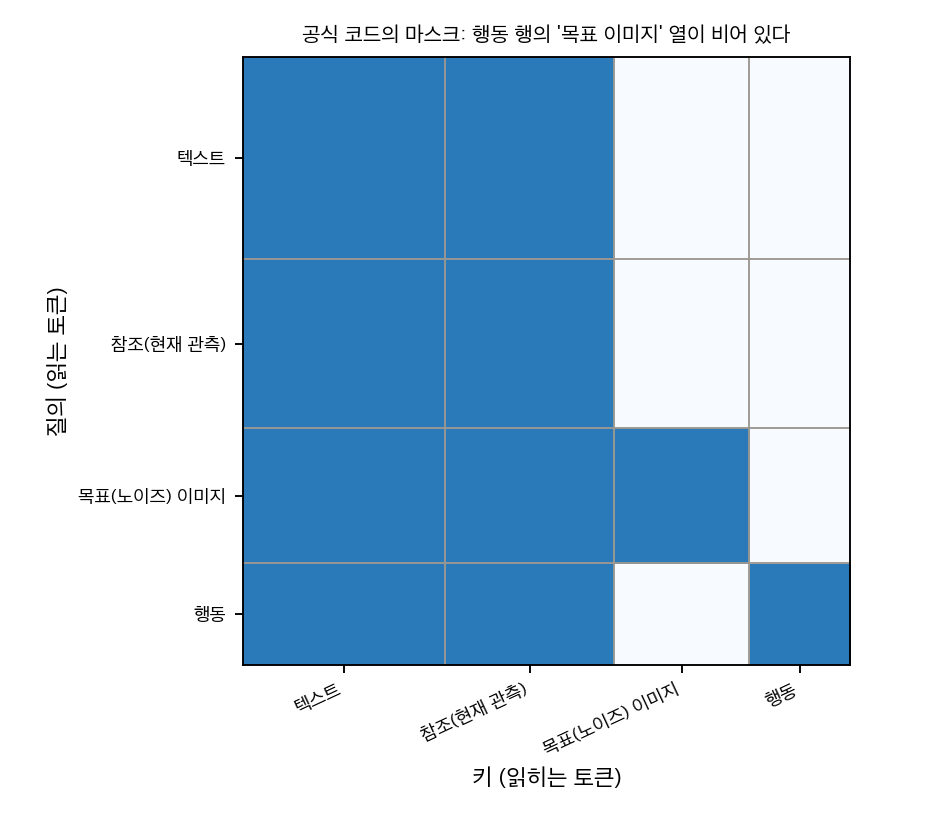
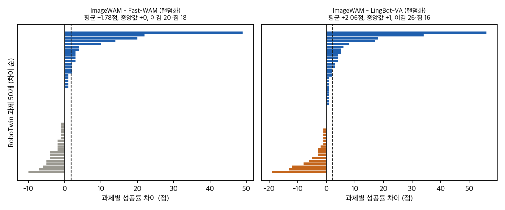
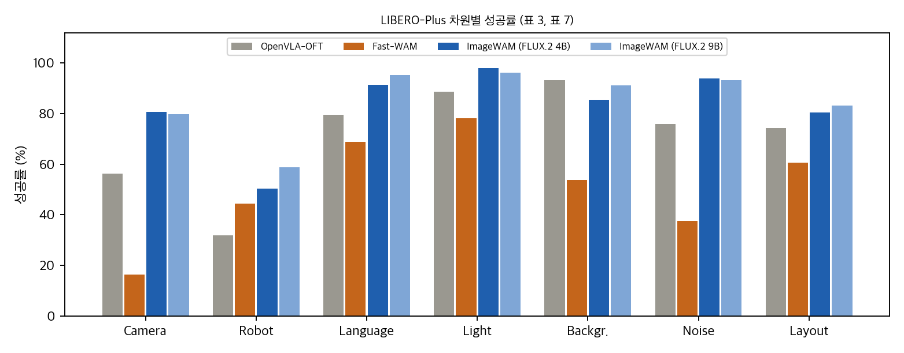
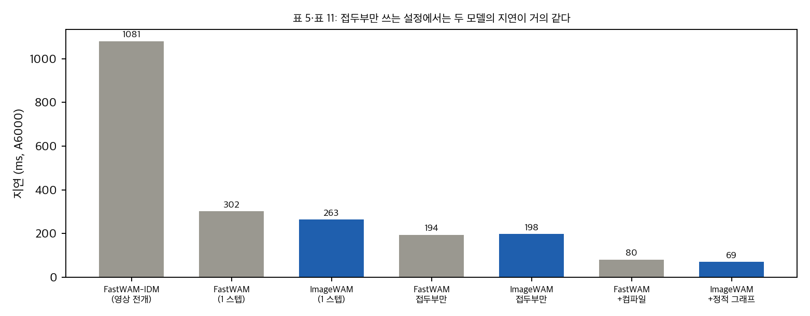
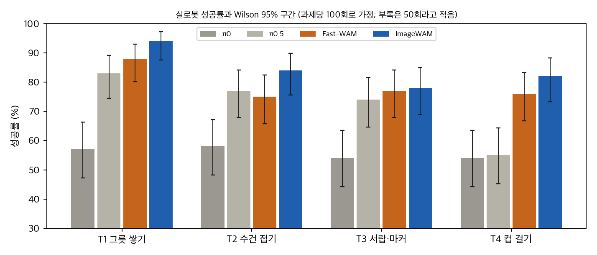

> **논문:** Yuyang Zhang, Wenyao Zhang 외. *ImageWAM: Do World Action Models Really Need Video Generation, or Just Image Editing?* CoRL 2026 포스터, arXiv:2606.19531 (v1, 2026-06-17).
> 공식 코드는 GitHub yuyangalin/ImageWAM(MIT)에 있습니다. 논문 라이선스가 CC BY가 아니어서 이 글의 그림은 모두 우리가 그린 그래프입니다.

## 논문이 묻는 것

월드 액션 모델(WAM)은 보통 비디오 생성 모델 위에 행동 전문가를 얹습니다. 논문은 미래 영상 전체를 만드는 것이 비싸고 행동과 무관한 세부를 배우게 한다고 보고, 이미지 편집 모델(OmniGen2, Ovis-U1, FLUX.2 klein)에 행동 전문가를 붙이면 정책 사전학습 없이도 비슷한 성능을 더 싸게 얻는다고 주장합니다. 보고 수치는 RoboTwin 93.38, LIBERO 98.4, LIBERO-Plus 83.1, 실로봇 84.5이고, FLOPs 1/6, 지연 1/4를 내세웁니다.

## 1. 공개 코드의 추론은 논문 설명과 다릅니다

논문 §3.4는 편집 노이즈 시점 τ*에서 편집 분기를 한 번 순전파해 얻은 KV 캐시를 행동 전문가가 읽는다고 씁니다. 공식 코드의 어텐션 마스크를 보면 행동 토큰은 텍스트와 현재 관측(참조 이미지) 토큰만 읽고 목표(노이즈) 이미지 토큰은 읽지 못합니다. 추론 때는 목표 토큰을 0개로 둔 채 접두부 캐시를 만들고 시간 임베딩도 0으로 둡니다.

*그래프 (우리가 그림). 저장소를 실행하지 않고 마스크 규칙만 옮겨 그렸습니다. 행이 읽는 토큰, 열이 읽히는 토큰입니다.*

즉 구조는 Fast-WAM의 접두부 캐시 방식과 같고, 편집 이미지의 denoising 경로는 행동 조건에 들어가지 않습니다. 학습에서는 접두부의 시간 변조만 임의 시점을 받고 추론은 0이라 학습과 추론이 다릅니다. 이것이 성능에 주는 영향은 측정하지 않았습니다.

## 2. RoboTwin: 비디오 WAM과 구분되지 않습니다

논문 표 1의 평균(93.38)은 표 12의 과제별 값에서 정확히 다시 계산됩니다. Fast-WAM의 과제별 값(Fast-WAM 논문 표 3)과 맞춰 과제 50개를 쌍체로 비교하면 랜덤화 설정에서 평균 +1.78점, 95% 구간 −0.36–4.46, 이긴 과제 20개, 진 과제 18개, 쌍체 t 검정 p = 0.16입니다. 중앙값 차이는 0이고, 차이가 큰 네 과제(Open Microwave 등)를 빼면 −0.35점입니다. 표 12의 기준선 다섯 열은 Fast-WAM 논문 값과 같아서 다시 평가한 것이 아닙니다.

*그래프 (우리가 그림). 랜덤화 설정의 과제별 성공률 차이입니다. 파란색은 ImageWAM이 높은 과제입니다.*

## 3. LIBERO와 LIBERO-Plus

LIBERO 평균 98.4는 Fast-WAM 97.6과 비교해 p = 0.09(스위트당 500회 가정)입니다. 유의한 곳은 LIBERO-Long(98.4 대 95.2, p = 0.006) 한 곳이고 Spatial과 Object에서는 오히려 낮습니다. 표 2에는 OpenVLA와 GR00T N1 행이 숫자까지 같은 복사 오류도 있습니다.

LIBERO-Plus의 51.5 대 83.1은 편집 대 비디오의 차이만이 아닙니다. 코드는 학습 때 색, 노이즈, 회전(±8°), 자르기 증강을 쓰는데 논문에는 없고, Fast-WAM 공식 저장소에는 영상 증강이 없습니다. 백본 크기와 사전학습도 다릅니다. 표의 Avg는 단순 평균이 아니라 과제 수 가중 평균으로 보이며 Fast-WAM 행만 단순 평균에 가깝습니다.

*그래프 (우리가 그림). 표 3과 표 7의 값입니다.*

## 4. 효율: "1/6, 1/4"의 기준

FLOPs 63.65 → 9.72(6.55배), 지연 1081 → 263 ms(4.11배)는 영상을 전개하는 IDM 변형 대비입니다. 같은 캐시 방식인 Fast-WAM 1스텝 대비는 1.36배, 1.15배이고, 접두부만 쓰는 설정에서는 ImageWAM 198 ms, Fast-WAM 194 ms로 같습니다.

*그래프 (우리가 그림). A6000 기준 값입니다. 컴파일 단계 수가 모델마다 달라 마지막 두 막대는 직접 비교하기 어렵습니다.*

## 5. 실로봇: 평가 횟수가 맞지 않습니다

부록은 과제당 50회라고 쓰지만 표 4의 값 6개(57, 83, 77, 55, 75, 77)는 홀수여서 50회로는 불가능합니다. 과제당 100회로 보면 ImageWAM 대 Fast-WAM은 합계 338/400 대 316/400, Fisher p = 0.054이고 과제별로는 모두 유의하지 않습니다. π0, π0.5보다 낫다는 것은 확인됩니다.

*그래프 (우리가 그림). 과제당 100회로 가정했습니다.*

## 6. 그 밖에

- 일반화 설정(Clean2Hard)은 18.3%이고, 저자 README에 따르면 합성 로봇 데이터로 사전학습한 뒤 59.0%입니다. "정책 사전학습이 필요 없다"는 분포 안 설정에 한정해서 읽어야 합니다.
- 공식 평가 스크립트의 LIBERO-Plus 기본값은 9B, 과제 20% 표집, 시행 1회로 논문 프로토콜과 다릅니다.
- 편집 사전학습이 이긴 이유를 가르는 절제(같은 구조에서 비디오 백본 대 편집 백본)가 없습니다.

## 재현과 한계

이 글은 표 재계산, 쌍체 검정, 코드 정적 대조만 했습니다. 학습, 체크포인트 다운로드, 공식 코드 실행은 하지 않았습니다. 평가 횟수를 밝히지 않은 기준선은 같은 횟수라고 가정했고 시드는 하나라 실제 불확실성은 보고된 값보다 큽니다. 계산 스크립트와 분석 문서는 함께 공개한 자료에 있습니다.

## 자료

- [통합 리포트 PDF](report/report_public.pdf)
- [01. 논문 분석: ImageWAM](analysis/01_paper_analysis.md)
- [02. 선행연구, 코드, 관련 분석](analysis/02_prior_work.md)
- [03. 수치 재계산, 일관성 검사, 주장 판정](analysis/03_analysis.md)
- [04. 공식 코드 대조와 구현 가능성](analysis/04_code_verification.md)
