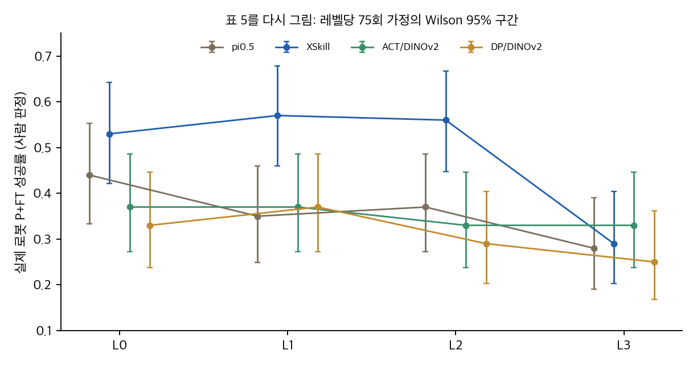
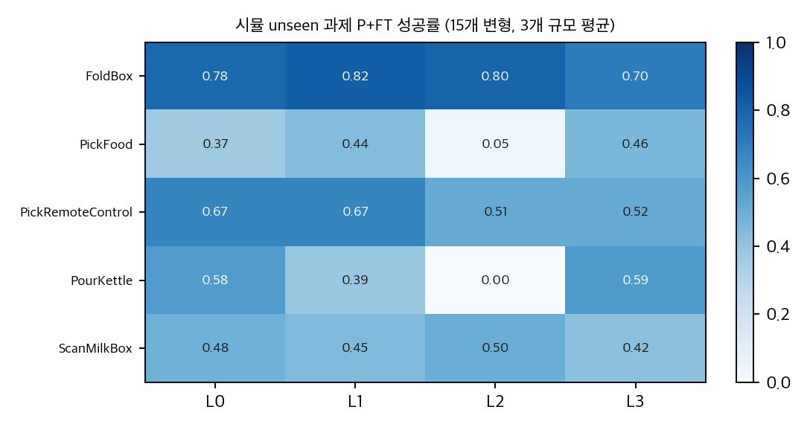
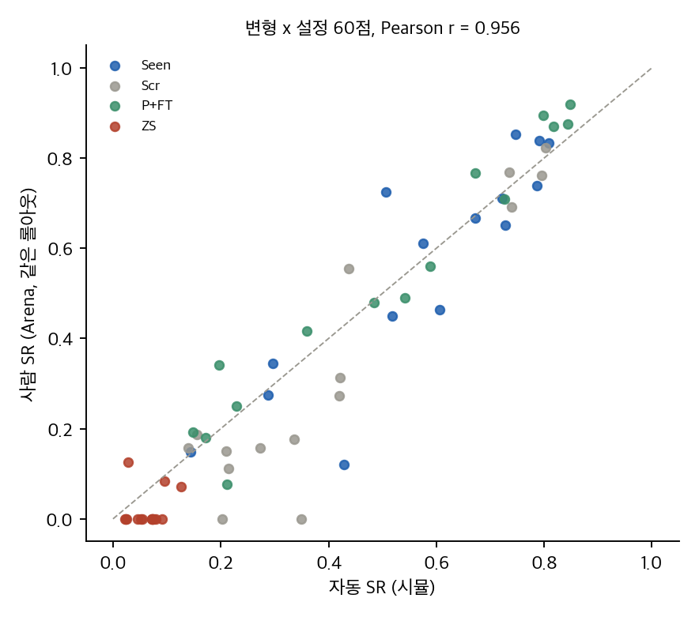

> **논문:** Xunzhe Zhou 외. *The Imitator Game: Benchmarking Robot Imitative Ability Beyond Action Prediction.* CoRL 2026 포스터, arXiv:2608.22301 (v1, 2026-08-23).
> 공식 코드는 GitHub imitator-game/The-Imitator-Game(MIT)에 있고 프로젝트 페이지는 imitator-game.github.io입니다. 이 글의 그래프는 모두 우리가 그렸습니다. 논문 그림은 라이선스(arXiv 비독점 배포) 때문에 싣지 않았습니다.

## 논문이 묻는 것

사람은 시연을 볼 때 동작이 아니라 의도를 따라 합니다. 주전자가 없으면 수도꼭지로, 숟가락이 없으면 젓가락으로 같은 목적을 이룹니다. 로봇 정책이 사람 영상에서 배울 때는 대개 궤적을 그대로 옮깁니다. 이 논문은 시연 장면과 로봇 장면의 차이를 네 단계로 벌려 어디서 궤적 재생이 통하지 않게 되는지 봅니다.

- **L0** 장면이 같습니다. **L1** 물체 배치만 다릅니다.
- **L2** 같은 범주지만 외형이나 형상이 다릅니다. **L3** 의미가 다른 물체로 바뀝니다(기능 대체).

같은 사람 영상 하나가 한 과제의 네 레벨에 모두 쓰이고 로봇 쪽 장면만 바뀝니다. 데이터는 실제 11.72K쌍과 시뮬 10K쌍(IG-10K), 평가는 시뮬 자동 지표와 사람이 두 롤아웃을 비교하는 Imitator Arena입니다. 9개 모델(15개 변형)을 같은 인터페이스에 맞춰 학습하고 평가합니다.

## 이 글에서 확인한 것

**1. 표들은 서로 맞고, 공개 기록으로 다시 만들어집니다.** 프로젝트 페이지가 셀 단위 기록(3,440행, 셀당 10회)을 공개합니다. 이 기록으로 표 3의 Seen, ZS, Scr, P+FT 8개 열을 15개 변형 모두 0.005 안에서 재구성했습니다. 표 5 평균 행, 표 4 P+FT 열, 표 9 사이의 교차 일치도 모두 맞습니다.

**2. 실제 로봇의 "L3 붕괴"는 한 모델이 만든 낙차입니다.** 실제 P+FT 4모델 평균은 L0–L2가 0.42/0.42/0.39이고 L3가 0.29입니다(독립 시도 가정 Fisher p = 0.0002). 그러나 모델별로 보면 XSkill이 0.56에서 0.29로 떨어질 뿐(p = 0.0016) 다른 세 모델은 L2와 L3가 구별되지 않고, XSkill을 빼면 L3 0.29 대 L0–L2 0.36으로 p = 0.052입니다.

*그래프 (우리가 그림). 표 5를 다시 그리고 레벨당 75회(5과제 x 5회 x 3규모)를 가정한 Wilson 95% 구간을 붙였습니다.*

**3. 시뮬에는 L3 붕괴가 없고, L2 하락에는 모든 기록이 0인 환경이 섞여 있습니다.** 시뮬 seen의 레벨 평균은 0.62/0.57/0.48/0.63으로 L2가 낮고 L3는 L0와 구별되지 않습니다(L3 − L0 = +0.004). unseen 과제 중 PourKettle의 L2는 공개 기록 127행(zero-shot, P+FT, Scr) 모두 성공률 0입니다. 같은 과제의 다른 레벨은 0.4–0.6이고 전체 50과제 표에서도 같습니다. 이 셀을 빼면 unseen P+FT의 L2는 0.37에서 0.46으로 오릅니다. 팔을 좌우로 바꾸는 시뮬 L2 설정 때문일 수 있지만 환경 문제를 먼저 배제해야 합니다.

*그래프 (우리가 그림). 공개 셀 기록의 15개 변형 x 3개 규모 평균입니다. PourKettle L2가 0.00입니다.*

**4. "P+FT가 처음부터 학습(Scr)보다 낫다"의 Scr는 여러 실행 중 최솟값입니다.** 프로젝트 페이지 자료와 공개 기록에 따르면 Scr는 변형 11개가 규모 표지 15/30/45마다 3번 실행되고 셀별 최솟값이 표 3에 들어갔으며, GR00T, π0.5, RDT-1B, OpenVLA는 1회 값입니다. 논문 본문은 이를 말하지 않습니다. 3회 평균으로 바꾸면 이득이 있는 변형이 12개에서 11개로 줄고 ACT/DINOv2의 이득은 +0.09에서 +0.04로 줄며 VQ-BeT/VideoMAE는 음수가 됩니다. 검정으로 보면 점추정 12개 중 8개만 유의합니다.

**5. 사람 판정의 수치에는 설명되지 않은 부분이 있습니다.** 화면 15,000개는 롤아웃 2개씩이라 슬롯이 30,000개인데 고유 롤아웃은 36,000개입니다. 실제 로봇 5,000 화면은 seen 2,500과 transfer 2,500으로만 나뉘는데 표 4는 실제 zero-shot의 승률을 보고합니다. 자동 SR과 사람 SR의 상관은 공개 60점으로 0.956이 나오지만 본문이 적은 0.858은 재현되지 않습니다. 평가자 간 일치도 통계는 없습니다(저자도 계획 단계라고 밝힘).

*그래프 (우리가 그림). 프로젝트 페이지가 공개한 변형 x 설정 60점입니다. zero-shot 점이 0 근처에 몰려 있습니다.*

**6. 정책이 시연 영상을 쓰는 정도는 모델마다 다릅니다.** 영상을 다른 과제의 것으로 바꾸면 DP는 0.67에서 0.03으로, π0.5는 0.73에서 0.15와 0.01로 떨어지지만 ACT와 XSkill은 성공률의 30–39%가 영상과 무관하게 남습니다. 표 10은 "45-task checkpoints"라고 쓰는데 original 행은 세 규모 평균과 일치해서 교체 행과 같은 기준인지 불분명합니다.

**7. 초록의 "모든 모델이 zero-shot 13% 미만"은 시뮬에만 맞습니다.** 시뮬 최댓값은 0.13이고 실제 로봇은 XSkill 0.29, ACT/DINOv2 0.26입니다.

## 공식 코드와 비교하면

커밋 3193957(2026-11-09)을 정적으로만 읽었습니다(실행하지 않음).

- ACT와 Diffusion Policy 런처는 10 에폭이고(논문 100), VQ-BeT의 GPT는 200 에폭, 배치 32입니다(논문 100, 256). RDT와 π0.5는 코퍼스 크기에 따라 에폭이 30/15/10으로 달라 연산이 일정하지만 논문은 "모두 10 에폭"이라 씁니다.
- PourKettle의 성공 판정은 논문의 "액체량 ≥ 20, 쏟은 양 ≤ 20"이 아니라 왼팔이 주전자를 쥔 채 컵 위에 한 번이라도 있으면 참인 래치입니다. Sub-SR은 완료 단계의 비율이 아니라 연속 피크 보상의 평균이고, 공개 기록에는 2,767개의 서로 다른 값이 있습니다.
- VLA 캡션은 영상별이 아니라 과제마다 53–65개의 패러프레이즈 중에서 무작위로 뽑습니다. 논문은 "고정, 결정적 캡셔너"라고 씁니다.
- Scr와 P+FT를 학습하는 런처와 집계 파이프라인은 저장소에 없습니다.

## 한계와 미확인

- 롤아웃 단위 성공 여부는 공개되지 않아서 p값은 시도가 독립이라는 가정의 값입니다. 같은 모델과 과제가 반복되므로 실제 불확실성은 더 큽니다.
- Scr 3회 실행이 시드 재실행인지 구성 차이인지 기록에 없습니다. 사람 판정의 분모와 화면 구성, 실제 로봇 롤아웃 기록도 복원하지 못했습니다.
- 데이터(약 880 GB), 자산, 체크포인트는 받지 않았고 시뮬 환경과 학습은 실행하지 않았습니다. 공식 시뮬(SAPIEN)은 Linux/Windows 전용이라 Apple 실리콘 맥에서는 돌리지 못합니다.

## 다시 계산하려면

`analysis/recompute.py`가 논문 표 수치와 프로젝트 페이지의 공개 파일(`data/`에 내려받아 텍스트로만 읽음)로 위 수치를 만듭니다. 수 초이고 numpy와 scipy만 필요합니다. 내려받는 명령은 스크립트 머리말에 있습니다. 전체 분석 문서와 공개 리포트는 같은 폴더의 `analysis/`와 `report/`에 있습니다.

## 자료

- [통합 리포트 PDF](report/report_public.pdf)
- [01. 논문 분석: The Imitator Game (arXiv:2608.22301)](analysis/01_paper_analysis.md)
- [02. 선행연구, 코드 자료, 이 저장소의 관련 분석](analysis/02_prior_work.md)
- [03. 수치 재계산과 일관성 검사](analysis/03_analysis.md)
- [04. 공식 코드 대조와 구현 가능성](analysis/04_code_verification.md)
