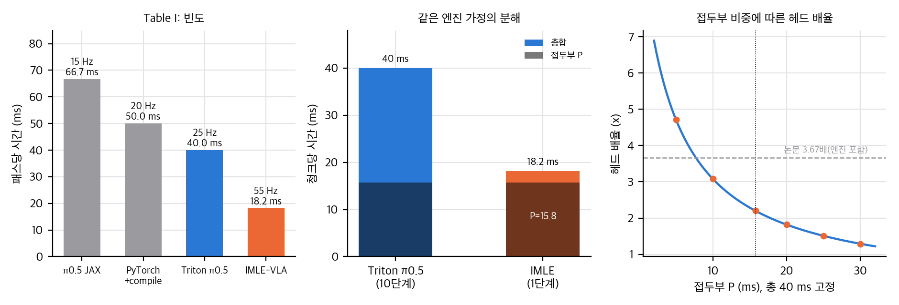
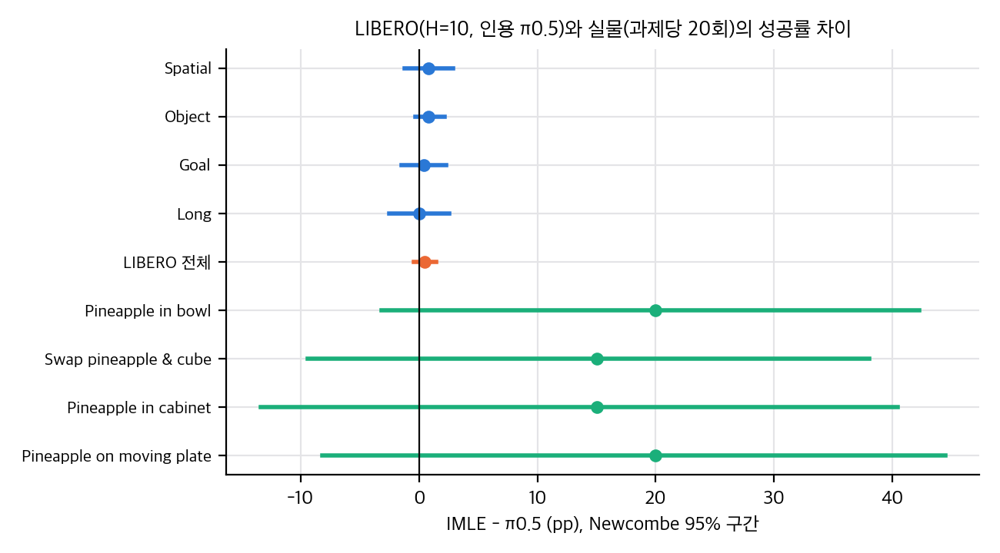
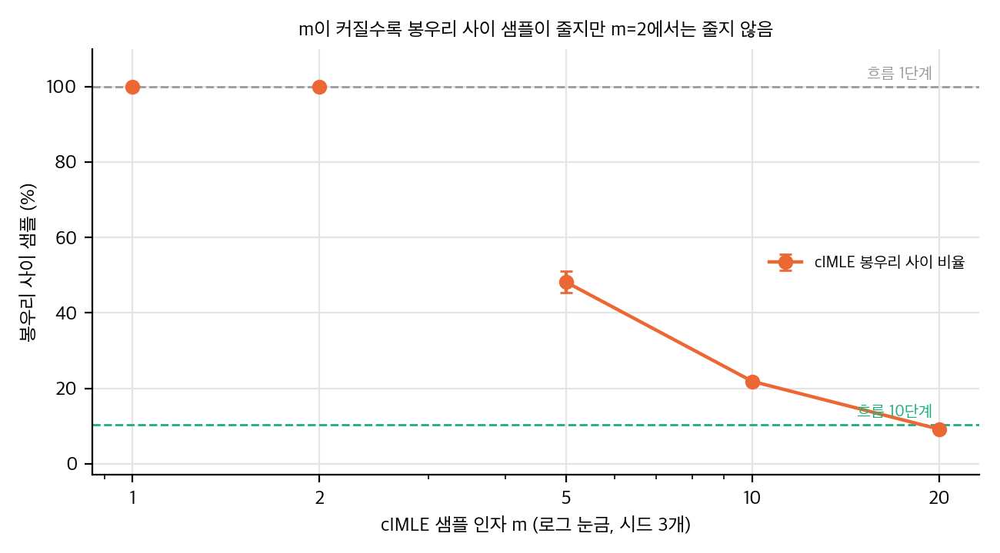
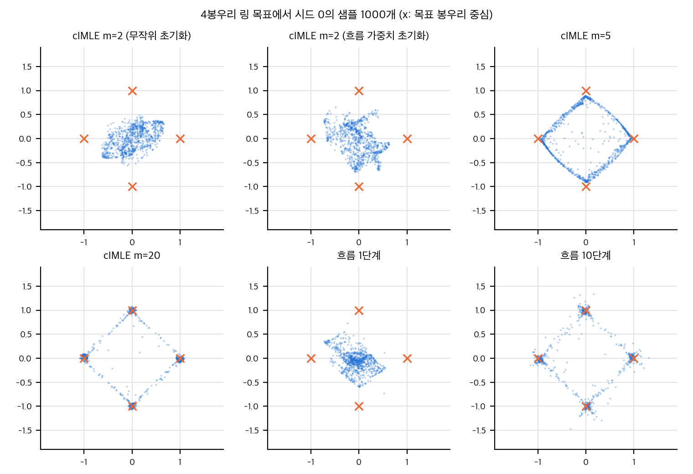

IMLE-VLA는 π0.5의 행동 헤드가 10번 도는 흐름 적분을 한 번의 순전파로 바꿉니다. 논문은 추론 빈도 15 Hz에서 55 Hz(3.67배), LIBERO 평균 98.0%, 실물 4과제 우세를 보고합니다. 이 글은 논문 숫자를 다시 계산하고, 공식 코드와 맞춰 보고, 작은 toy로 핵심 메커니즘을 확인한 결과입니다.

## 한 줄 요약

빈도 개선과 헤드 아이디어는 맞습니다. 다만 3.67배는 엔진 효과 1.67배와 헤드 효과 2.2배의 곱이며(같은 엔진 효율을 가정), 로그 기준으로 헤드 효과는 61%, 엔진 효과는 39%입니다. LIBERO 98.0%와 97.5%의 차이는 2000회 평가에서 검출되지 않고(p = 0.34), 실물 합산 우세(p = 0.015)는 과제별로 유의하지 않습니다.

## 1. 지연: 3.67배는 두 요인의 곱

논문의 15 Hz는 JAX, 55 Hz는 Triton·CUDA 그래프 엔진에서 측정했습니다. 같은 논문의 표에 있는 Triton π0.5(25 Hz)와 비교하면 헤드 효과는 2.2배입니다. 같은 엔진 효율이라는 가정이 필요하지만, 청크 시간을 접두부 P와 expert 1회 a로 나누면 P ≈ 15.8 ms, a ≈ 2.4 ms가 나옵니다. 이 역산에서 IMLE 시간의 약 87%는 VLM 접두부입니다.

## 2. 통계: LIBERO에서는 차이가 없고, 실물은 합산에서만 유의

LIBERO 평가는 2000회입니다. 인용된 π0.5 97.5%(1950회)와 IMLE 98.0%(1960회)의 차이는 10회이고, Fisher p = 0.34입니다. 이 설정에서 검출할 수 있는 최소 차이는 약 1.4pp입니다.

실물은 과제당 20회, 네 과제입니다. 합산 68/80 대 54/80은 p = 0.015입니다(층화 CMH도 같음). 과제별로는 Holm 보정 후 모두 유의하지 않습니다.

## 3. 실물 VLA-WC의 절대값

논문 표 V의 VLA-WC(성공 에피소드당 VLA 시간)를 패스 시간과 실행 지평으로 환산하면, 한 과제가 15 Hz 로봇 시간으로 12–52분이 됩니다. 이는 pick-and-place 에피소드 길이와 맞지 않습니다. 배율(3.9–6.6배)은 같은 집계라면 비교가 가능하지만, 절대값은 추론 시간으로 읽기 어렵습니다.

## 4. 공식 코드: 식은 맞고, 설정이 다릅니다

공식 저장소(Apache-2.0)의 손실과 샘플러는 논문 식 3–4와 Algorithm 1을 그대로 구현합니다. VLM 동결, 접두부 KV 캐시 한 번, 행동 expert 한 번도 일치합니다. 그러나 LIBERO 학습에는 EMA(0.999)가 있고(논문에 없음), 평가 체크포인트는 suite별 최고로 고른 것이며, H=30 모델은 m=5에 학습률 10배를 씁니다. 재현하려면 이 셋을 먼저 확인해야 합니다.

## 5. toy: m=2는 다봉을 지키는가

4봉우리 링을 한 번에 맞추는 작은 실험입니다(numpy, 시드 3개).

- L2 회귀(m=1)와 1단계 흐름은 샘플이 중심으로 붕괴합니다.
- m=2 cIMLE는 3000회와 15000회 모두 봉우리를 덮지 못했습니다. 흐름 가중치로 초기화해도 같았습니다.
- m=5는 네 봉우리를 덮지만 샘플 절반이 봉우리를 잇는 호 위에 남습니다.
- 10단계 흐름은 봉우리 사이 샘플이 약 10%입니다.

봉우리가 2개인 변형에서는 m=2가 덮었지만(시드 3개 모두), 봉우리 간격과 잡음을 바꿔도 4봉우리에서는 실패가 유지되고 8봉우리에서는 m=2도 m=5도 충분히 덮지 못했습니다. 필요한 m은 봉우리 수 근처로 보입니다. 조건부 설정에서도 m=2는 실패했습니다.

toy는 논문의 실제 행동 분포를 대표하지 않습니다. 그래도 "m=2면 다봉이 보존된다"는 주장은 이 설정에서 성립하지 않았고, 논문 본문의 "by construction" 표현은 유한 m에서 조심해서 읽어야 합니다.

## 정리

- 헤드를 1단계로 줄이는 아이디어는 쓸만한 방향입니다. 다만 가속 효과는 엔진과 분리해서 보고해야 합니다.
- LIBERO의 "최고 성공률"은 이 정도 차이로는 근거가 약합니다.
- 실물 결과는 방향은 일관되지만 과제 수와 시도 수가 적습니다.
- 재현은 GPU가 있어야 하고, 체크포인트 선택과 EMA를 맞춰야 의미가 있습니다.

논문: arXiv:2609.10915. 공식 코드: kianhk6/IMLE-VLA. 이 글의 분석 문서와 스크립트는 공개 저장소 `publish/git/`에 있습니다.

## 자료

- [통합 리포트 PDF](report/report_public.pdf)
- [01. 논문 분석: IMLE-VLA](analysis/01_paper_analysis.md)
- [02. 선행연구와 관련 자료](analysis/02_prior_work.md)
- [03. 재계산, 유의성, 지연 산술, 유도, toy](analysis/03_analysis.md)
- [04. 코드 대조: 논문 ↔ 공식 저장소](analysis/04_code_verification.md)
