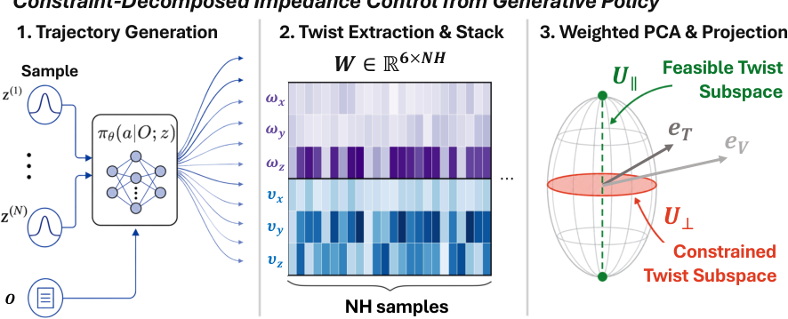
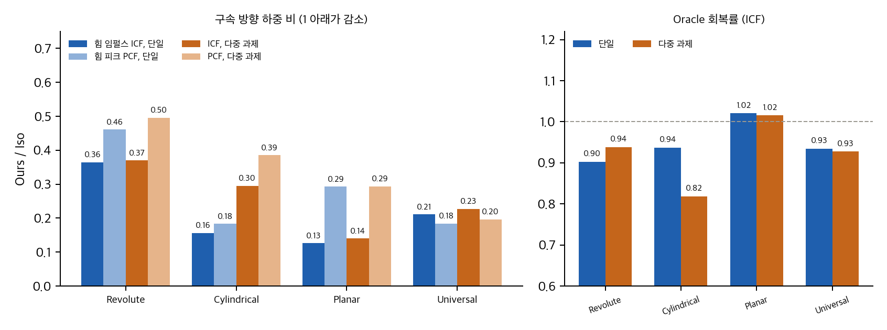
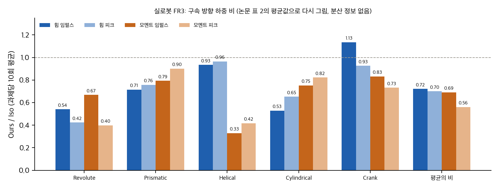
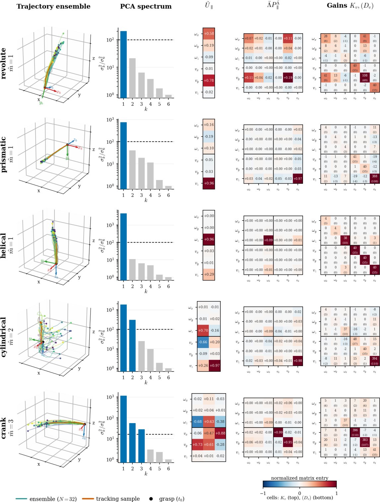

# 01. 논문 분석: Constraint-Decomposed Impedance Control (arXiv:2610.16316)

## 0. 기본 정보와 버전

| 항목 | 내용 |
|---|---|
| 제목 | Constraint-Decomposed Impedance Control from Generative Policy for Articulated Object Manipulation |
| 저자 | Kyungseo Park, Byeongdo Lim, Jungbin Lim, Minseok Choi, Frank C. Park (서울대학교, 제1저자 현 소속 KAIST) |
| 학회 | CoRL 2026 (10th Conference on Robot Learning, Austin) Spotlight. arXiv 댓글이 "Accepted to CoRL 2026, Spotlight. Please cite the CoRL 2026 (PMLR) version"이라 적고, 이 저장소의 `conferences/corl2026/papers.json`(corl.org 공식 목록 대조)에서 `in_official: true`, 세션 "S4 Touch, force and contact-rich manipulation", 2026-11-10, 포스터 168번입니다 |
| arXiv | 2610.16316, cs.RO, 2026-10-12 제출. **버전은 v1 하나뿐**입니다(arXiv abs 페이지의 제출 이력에 v1만 있고 `.../pdf/2610.16316v2`는 404). 분석 대상은 v1 (29쪽, PDF 11.4 MB) |
| 라이선스 | arXiv abs 페이지의 "view license" 링크가 `http://creativecommons.org/licenses/by/4.0/`입니다(2026-11-24 확인). PDF 본문에서 ©, copyright, All rights reserved, 회사 고지를 찾지 못했습니다 (`pdftotext`로 29쪽 전체 검색). 감사의 글에 연구비 기관과 Microsoft Research Asia가 나오지만 권리 표시는 아닙니다 |
| 코드 | 공식 저장소 `erickun0125/constraint-decomposed-impedance-control` (MIT, 시뮬레이션 전용). 자세한 내용은 `04_code_verification.md` |
| 프로젝트 페이지 | https://erickun0125.github.io/constraint-decomposed-impedance/ |

버전 차이: 없음(단일 버전). 논문 본문은 9쪽, 참고문헌 2쪽, 부록 A–J가 18쪽입니다. 부록에 방법의 수학적 근거(A–F), 게인 구성(G), 설정(H), 추가 결과(I, J)가 있습니다.

## 1. 풀려는 문제와 핵심 주장

문이나 서랍처럼 운동학적 구속이 있는 관절 물체를 학습 정책이 조작할 때, 정책 출력이 구속을 정확히 만족하지 못하면 높은 강성으로 추종하는 동안 큰 접촉력이 생깁니다(§1). 임피던스 제어는 구속 방향의 강성을 낮추면 되지만, 어느 방향이 구속인지 알아야 하고 모든 방향을 낮추면 구동 방향에서 힘을 전달하지 못합니다.

**핵심 아이디어(Abstract, §1, §4):** 생성형 정책(Diffusion Policy)이 같은 관측에서 뽑은 N개 궤적의 엔드이펙터 body twist를 모아 비중심 PCA를 하면, 그 우세 부분공간이 물체의 실현 가능 twist 부분공간(feasible twist subspace)의 추정치가 됩니다. 이 부분공간을 Λ̄-직교 사영으로 6×6 강성·감쇠에 반영해 feasible 방향은 높게, 보수 방향은 낮게 둡니다. 추정은 grasp 직후 한 번만 하고 게인을 고정합니다.

논문이 내세우는 주장 (각 주장의 판정은 `03` §9의 C 항목):

1. 궤적 앙상블이 feasible 부분공간을 충분히 정확히 추정한다(시뮬 SE 1.64–4.36°, 표 1).
2. 구속 위반 힘·모멘트가 등방(Iso) 임피던스 대비 줄고 과제 성공은 유지된다(표 1, 표 2).
3. 앙상블 크기와 다양성이 추정 정확도를 좌우하며(§5.3, 표 11, 12), 입력 잡음과 DDIM 단계 수에는 대체로 강건하다(표 13).
4. 사전 지식, 별도 인식 모듈, 물리적 탐색 없이 된다(§6).

## 2. 방법

*그림 1 위쪽 (논문 원문, 세 패널만 잘라 사용). © 저자, CC BY 4.0, 출처 arXiv:2610.16316 (v1).*

### 2.1 설정 (§3)

- **임피던스 제어(식 1–2):** M_v ė_V + D_v e_V + K_v e_T = F_ext, 피드백 F_fb = K_v e_T + D_v e_V, 토크 τ = Jᵀ F_cmd. 오차는 body 프레임의 이중 측지 오차 e_T = (log(R_bᵀ R_d)^∨, R_bᵀ(p_d − p_b))와 어드조인트(adjoint)로 수송한 twist 오차 e_V = Ad_{T_b⁻¹T_d} V_d − V_b입니다(식 9, 부록 A.3).
- **운동학(식 3–4):** k자유도 열린 체인에서 구속을 만족하는 body twist는 S(q) = span{B₁(q),…,B_k(q)}에 있습니다. 회전, 직선, 나사, 원통, 평면 관절은 S(q)가 q에 무관(configuration-independent)하고, 다관절 물체(커피 그라인더 크랭크, 유니버설 조인트)는 q에 따라 변합니다. 그래서 전역 포락선 S_env = span ∪_q S(q)를 추정 목표로 둡니다. 배치 독립이면 "feasible ⇔ V ∈ S_env"이고, 배치 의존이면 "feasible ⇒ V ∈ S_env"만 성립합니다(§3.2 끝).
- 배치 독립의 충분조건은 부록 B(Proposition B.1)에 있습니다. 생성자 집합이 se(3)의 Lie 부분대수이면 모든 q에서 S(q) ⊆ S입니다(표 3).

### 2.2 Algorithm 1 (§4.1–4.2)

1. N개 궤적 a⁽ⁱ⁾ = (T₁,…,T_H) ~ π(·|O)를 뽑습니다(시뮬 N=128, 실로봇 N=32, H=24, 간격 0.1 s).
2. 각 웨이포인트에서 body twist V_{b,t} = ½Δt · log(T_{t−1}⁻¹T_{t+1})^∨ (양 끝은 한쪽 차분). W ∈ R^{6×NH}.
3. W의 첫 좌특이벡터 u로 α = clip(‖u_v‖/‖u_ω‖, α_min, α_max)를 정합니다(식 34). G = blkdiag(α²I₃, I₃), L_α = blkdiag(αI₃, I₃).
4. L_α W = Ũ Σ̃ Ṽᵀ (SVD), U = L_α⁻¹Ũ. λ_k = σ̃_k²/(NH)는 grasp 점에서의 RMS 속도의 제곱입니다. 중심화하지 않는 이유는 목표 부분공간이 원점을 지나기 때문입니다(부록 D.3).
5. 차원 m = #{k : √λ_k > max(κ_rel √λ_6, v_abs)}, U_∥ = [u₁…u_m] (식 32). 절대 문턱 v_abs는 정책의 생성 한계 잔차를, 상대 문턱 κ_rel은 grasp 사슬의 변형·유격으로 바닥이 올라간 경우를 겨냥합니다(부록 D.1, H.1).
6. 관성 메트릭 Λ̄ = blkdiag(Ī I₃, m̄ I₃) (식 20, 부록 A.2). 사영 P_∥ = U_∥(U_∥ᵀΛ̄U_∥)⁻¹U_∥ᵀΛ̄, P_⊥ = I − P_∥ (식 8).
7. K_v = Λ̄(k_∥P_∥ + k_⊥P_⊥), D_v = Λ̄(d_∥P_∥ + d_⊥P_⊥) (식 10). 이 두 행렬은 Λ̄-직교 사영 덕에 대칭 반양정입니다(부록 E.3).
8. 게인 값(부록 G.1–G.2, 표 5, 6): (k, d)는 2차계 규칙 k = ω_n², d = 2ζ√k로 정하고, Iso는 k_∥ = k_⊥ = k₀, Ours·Oracle은 k_⊥ = r k₀, r = 0.1, d_⊥ = √r d₀(ζ 고정, 식 54)입니다. 시뮬 k₀ = 250, 실로봇 k₀ = 400.

**구성 요소의 의미.** Iso와 Ours는 feasible 방향의 임피던스가 같고 구속 방향만 Ours가 1/10(강성)·약 0.32(감쇠)입니다(부록 G.2). 따라서 "Ours가 Iso보다 구속 위반 하중을 줄인다"는 결과는 사실상 "구속 방향 강성을 낮추면 그 방향 하중이 줄어든다"는 방향을 맞게 골랐는가를 시험합니다. 방향 선택의 정확도는 Oracle(해석적 부분공간)과의 간극으로 따로 분리됩니다(§5, 부록 G.2).

### 2.3 수동성과 근거 (부록 E, F)

부록 F는 고정 투영과 고정 Λ̄ 하에서 작은 오차 영역의 국소 수동성을 보입니다. 논문 스스로 "전역 보존적 SE(3) 퍼텐셜이 아니며 완전한 관성 디커플링도 아니다"라고 한정합니다(§6 한계, 부록 E.2, F). 이 분석은 이론 검산이 아니라 수치 주장 검산이 목적이므로 `03` §6에서 부록 B·C의 대수적 주장(Lie 닫힘, 포락선 차원, 감쇠 규칙)만 수치로 확인했습니다.

## 3. 실험

### 3.1 시뮬레이션 (§5.1, 표 1, 부록 I)

- Isaac Sim, 날아다니는 그리퍼(flying gripper)가 회전(revolute), 원통(cylindrical), 평면(planar), 유니버설 조인트 물체를 조작합니다. 앞 셋은 배치 독립(feasible 차원 1, 2, 3), 유니버설은 배치 의존(국소 2, 포락선 3)입니다.
- 정책: Diffusion Policy(ResNet-18 + spatial softmax, 224×224 손목 RGB, 관측 이력 1, 예측/실행 24/16, 10 Hz), 물체마다 400개 스크립트 시연으로 처음부터 학습합니다(표 7, 8). 임피던스 제어기 150 Hz.
- 평가: 제어기마다 물체당 100회 시도(서로 다른 초기 배치). 단일 과제 정책과 다중 과제 정책(표 10)을 모두 평가합니다. 지표는 구속 보수 방향 힘의 임펄스 ICF와 95퍼센타일 PCF, 모멘트 ICM, PCM, 성공률 SR, 부분공간 오차 SE(식 55–56, 부록 H.3).

결과(표 1, `03` V1): ICF는 Iso 대비 0.13–0.37배, PCF는 0.18–0.46배, Ours는 Oracle이 만든 감소의 90% 이상을 회복합니다(우리 계산 최소 0.903). 다중 과제 정책에서도 ICF 0.14–0.37배입니다(표 10).

*그래프: 우리가 그림. 논문 표 1, 표 10의 평균값으로 비율을 다시 계산했습니다.*

### 3.2 실로봇 (§5.2, 표 2, 부록 J)

- Franka Research 3 + 손목 ATI Axia80 힘토크 센서. 회전, 직선, 나사, 원통 관절 물체와 커피 그라인더 크랭크(배치 의존, 국소 2, 포락선 3) 5개. 임피던스 제어 1 kHz.
- 정책은 리더-팔로어 원격조작 시연(회전·직선·나사 각 20개, 원통·크랭크 각 32개)으로 학습합니다. 샘플러는 DDPM 100단계, N=32, v_abs = 3 mm/s, κ_rel = 10(크랭크 4).
- 평가: 물체당 10회, 제어기당 50회. 초기 물체 배치와 로봇 베이스는 고정하고, Iso와 Ours 모두 모든 시행에서 성공하도록 게인과 충돌 감지 문턱을 조정했다고 밝힙니다(§5.2).

결과(표 2): 평균하면 ICF 0.72배, PCF 0.70배, ICM 0.69배, PCM 0.56배(우리 재계산은 평균의 비 0.721, 0.700, 0.691, 0.561로 일치, `03` V2). 배치 독립 4개 물체는 모든 지표가 개선되고, 크랭크는 ICF가 1.14배로 늘었습니다(저자는 고정 포락선이 현재 배치에서 구속인 방향에도 높은 임피던스를 준다고 설명합니다).

*그래프: 우리가 그림. 논문 표 2의 평균으로 비율을 다시 계산했습니다(괄호 값과 ±0.01 차이는 반올림 범위). 시행별 분산은 논문에 없어 구간은 그리지 않았습니다.*

### 3.3 추정 분석 (§5.3, 표 11–13)

- 앙상블 크기: 차원을 참값에 고정한 SE의 95퍼센타일이 N=1/2/4/8에서 78.9/23.1/8.59/7.23°이고 N=128에서 6.61°입니다. 차원 규칙이 모든 시도에서 맞는 것은 N ≥ 64부터입니다.
- 다양성: DTW 거리로 가장 다양한/덜 다양한 부분집합을 뽑아 재추정하면 k=2에서 SE 5.91° 대 19.7°입니다. k ≥ 32에서는 두 선택이 0.1° 이내로 수렴합니다.
- 잡음: 시연에 5 mm 위치 잡음을 넣고 학습한 정책의 SE는 3.1°(샘플에 직접 넣은 11.97°보다 낮음), 5° 방향 잡음은 10.6°입니다. 관측 이미지 섭동은 SE를 0.11° 이내로 유지하고, DDIM 단계를 100에서 4까지 줄여도 2.16 → 2.26°, 2단계에서는 87.4°로 무너집니다.
- 실행 시간: N=128 한 번 샘플링과 게인 계산이 RTX 5070 Ti에서 중앙값 70.1 ms, 최대 76.5 ms로 10 Hz 정책 주기에 들어갑니다.

### 3.4 실로봇 추정 시각화 (부록 H.1, 그림 5)

*그림 5 (논문 원문, 데이터 그래프만 사용). © 저자, CC BY 4.0, 출처 arXiv:2610.16316 (v1). 과제별로 앙상블, PCA 스펙트럼 σ̃²_k/σ̃²_6과 κ²_rel 문턱, 기저 U_∥, 사영 블록, 게인 행렬을 보여 줍니다. 크랭크의 세 번째 막대가 문턱(점선) 바로 위에 있습니다.*

## 4. 한계

논문이 밝히는 한계(§6): 앙상블이 feasible 방향을 충분히 덮어야 하며, 시연에 한 가지 방식만 있거나 정책이 소수 모드로 붕괴하면 실패할 수 있습니다. 시연이 거의 쓰지 않은 feasible 방향은 앙상블 크기와 무관하게 보이지 않으며, 접촉 wrench가 이를 드러낼 수 있다고 말합니다. 배치 의존 물체에서는 포락선이 순간 부분공간보다 덜 정밀해 개선이 작습니다. 게인 구성은 고정 투영 임피던스 쉐이핑이며 완전한 관성 디커플링이 아닙니다.

본 분석에서 추가로 보이는 점:

- **비교 대상이 Iso 하나입니다.** 실로봇은 Oracle도 없고, 인식 기반 방법이나 힘 피드백 기반 방법(ACP 등, 관련 연구에 인용)과의 비교가 없습니다. Iso와 Ours는 feasible 방향의 게인이 같으므로 "구속 방향 강성을 줄이면 구속 방향 하중이 줄어든다"는 기대와 부합하는 결과이고, 방향 선택 외의 요소(r 값 선택, 게인 조정 절차)를 분리한 실험은 r = 0.1 한 점뿐입니다(r 스윕 없음).
- **시뮬레이션 SR이 포화되어 있어** "과제 수행 유지"는 99–100% 대 99–100%로 구분되지 않습니다(표 1). 실로봇은 두 제어기가 모든 시행에서 성공하도록 조정했으므로 성공률 비교가 정의상 없습니다.
- **실로봇 통계 정보가 평균뿐입니다.** 물체당 10회, 초기 배치 고정, 표 2에 분산·구간이 없어 과제별 차이(예: 나사 ICF 0.93배, PCF 0.96배)가 시행 변동과 구분되는지 알 수 없습니다(`03` V2).
- **차원 문턱이 도메인과 물체에 따라 조정됩니다.** 시뮬 (5 mm/s, κ 4), 실로봇 (3 mm/s, κ 10), 크랭크 κ 4(포락선의 약한 방향을 남기기 위해, 부록 H.1). 부록은 문턱을 "배치 전에 보정할 수 있다"고 쓰지만, 보정에는 알려진 차원의 시험 시연이 필요합니다. "모든 시도에서 올바른 차원"(398/398, 50/50)은 이렇게 맞춘 문턱 아래의 결과입니다.
- **다양성은 시연 설계에 의존합니다.** 시뮬 시연은 좌표별 시점을 무작위화한 스크립트로 만들었고(부록 H.3 "고정 일정을 재생하면 추정이 의존하는 운동 다양성이 사라진다"), 실로봇은 원격조작 20–32개입니다. 시연 다양성을 줄였을 때의 추정 성능은 보고되지 않았습니다.
- **실로봇 revolute의 SE가 13.01°로 가장 크지만** ICF는 0.54배, PCF는 0.42배로 가장 큰 폭으로 줄었습니다(표 2). 부분공간 오차가 크기와 하중 감소가 단순 비례하지 않는다는 뜻이며, SE와 하중 감소의 관계를 시행별로 볼 자료는 없습니다.
- **추정 지연 시간은 시뮬레이션만** 보고됩니다. 실로봇 N=32, DDPM 100단계의 지연은 없습니다.
