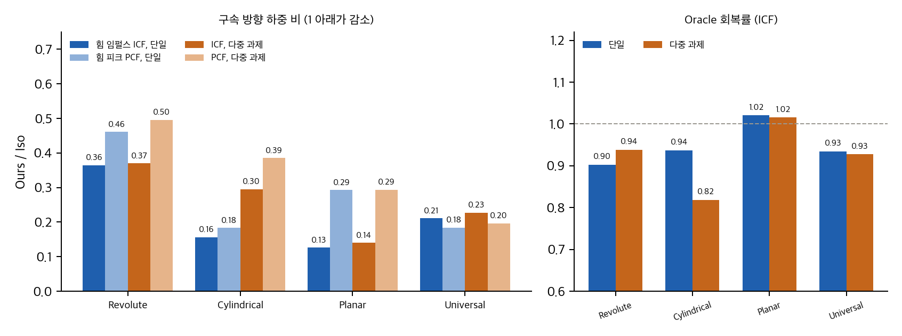
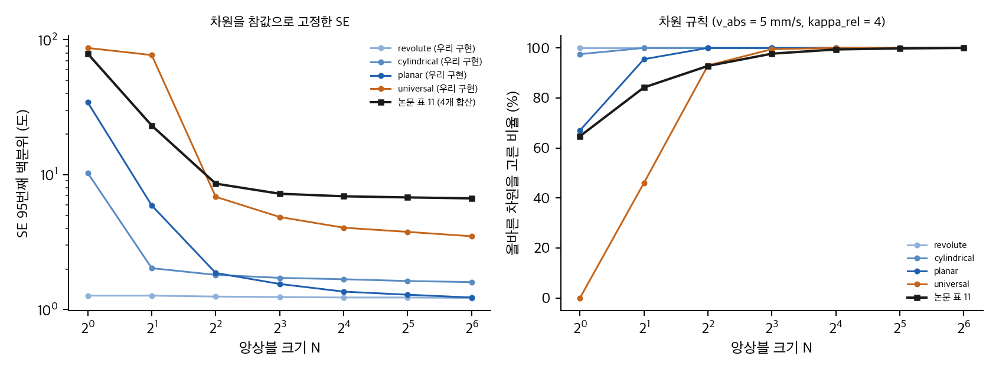
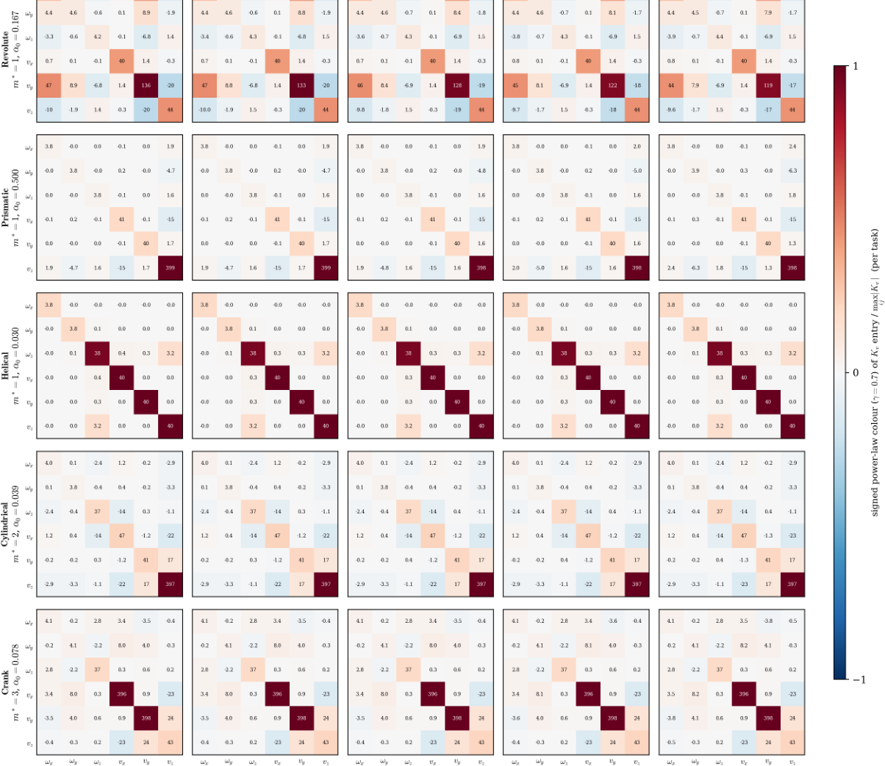

# 03. 수치 재계산, 일관성 점검, toy 검증

이 문서의 확인 항목은 **V1–V9**(표·본문 수치 재계산과 이론 검산), **K1–K5**(toy), 주장 판정은 **C1–C15**입니다. 재현(학습·시뮬 실행)은 하지 않았습니다. 논문 표 값은 `analysis/recompute.py`에 그대로 옮겨 계산했고, 모든 결과는 `analysis/recompute_results.json`, `check_theory_results.json`, `toy_ensemble_estimator_results.json`에 있습니다. 논문에 시행 수가 명시된 곳(시뮬 제어기당 100회, 실로봇 과제당 10회)만 그 수를 썼고, 명시되지 않은 시행 수나 분산은 가정할 때마다 "(가정)"이라고 적었습니다.

**원자료의 한계.** 논문은 표 1, 2, 9, 10, 14에 평균만 싣고 시행별 값, 표준편차, 신뢰구간이 없습니다. 따라서 평균 차이의 유의성 검정(Welch, 쌍체 t)은 불가능합니다. 가능한 검정은 비율 데이터(성공률)와 산술 일관성, 반올림 가능성 검사뿐입니다.

## 1. 시뮬레이션 표 1과 표 10 재계산 (V1)

시도 수 100회/제어기(§5.1, 부록 H.3). 표 1의 Iso/Ours/Oracle 값으로 Ours/Iso 비율과 Oracle 회복률 (Iso − Ours)/(Iso − Oracle)을 계산했습니다.

| 과제 | ICF 비 | PCF 비 | ICM 비 | PCM 비 | 회복률 ICF | 회복률 PCF |
|---|---|---|---|---|---|---|
| Revolute | 0.365 | 0.462 | 0.759 | 0.947 | 0.903 | 0.958 |
| Cylindrical | 0.156 | 0.184 | 0.688 | 0.875 | 0.937 | 0.970 |
| Planar | 0.126 | 0.293 | 0.649 | 0.793 | 1.021 | 0.993 |
| Universal | 0.211 | 0.184 | - | - | 0.935 | 0.962 |

- 본문 "force impulse falls to 0.13–0.37× of Iso and the peak force to 0.18–0.46×"는 계산값 0.126–0.365와 0.184–0.462에 반올림 범위로 일치합니다.
- "Ours recovers at least 90% of the Oracle's reduction ... in both force metrics"의 최솟값은 revolute ICF 0.903입니다. 일치하지만 여유는 0.3%p입니다. 표 값이 소수 둘째 자리에서 반올림되어 있어 이 최솟값은 ±0.01 정도 움직일 수 있습니다.
- 다중 과제(표 10): ICF 비 0.370, 0.295, 0.140, 0.227(본문 0.14–0.37× 일치), PCF 비 0.496, 0.385, 0.294, 0.197. 본문은 "0.20–0.49×"인데 revolute의 3.55 → 1.76은 0.496이라 반올림하면 0.50입니다. 표에 인쇄되지 않은 소수 자리의 차이일 수 있어 저자 확인이 필요한 정도의 차이입니다. 부록 I의 "at least 80%"는 계산 최솟값 0.819(cylindrical ICF)에 일치합니다(주 본문의 90%와 기준이 다름).
- 방향이 반대인 칸: 표 10 revolute PCM은 Iso .21, Ours .22(비 1.048)입니다. 본문 §5.1의 "Moment loads ... Ours still lowers the moment impulse"는 ICM에 대해서는 모든 칸에서 맞고, 부록 I의 "the improvements of Table 1 are preserved"는 이 한 칸을 제외하면 맞습니다.
- SR은 99–100%: Fisher 정확검정(Iso 대 Ours, 100대 100)은 네 과제 모두 p = 1.0이고 Wilson 95% 구간은 [94.6, 99.8] 또는 [96.3, 100]입니다. SR 합계는 Iso 397, Ours 398, Oracle 398입니다. 본문 부록 H.1의 "398 single-task trials in which the grasp succeeds (the grasp fails in one revolute and one planar trial)"는 Ours의 성공 합 398과 일치합니다(Ours 기준으로 grasp에 성공한 시도가 모두 목표 구간에 도달했다는 뜻). Iso의 cylindrical 실패 1건(99/100)은 Ours와 Oracle에는 없는 실패입니다.
- 표 9의 n_c는 모든 칸에서 min(SR)과 같거나 작습니다(단일 99/99/99/100, 다중 99/95/100/99). 다중 cylindrical의 min SR은 96이고 n_c는 95입니다.
- 논문 평균 SE의 4과제 평균은 2.63°(단일), 2.67°(다중)입니다.

## 2. 실로봇 표 2 재계산 (V2)

시도 수 10회/제어기/과제(가정 아님, §5.2). 표의 괄호 비율은 인쇄된 평균 두 개의 비와 반올림 오차 범위 안에서 모두 맞습니다(예: cylindrical PCM 0.45 → 0.37은 0.822인데 표기는 0.81이며, 두 평균이 각각 ±0.005 반올림되었다면 0.80–0.84가 가능). 0.005보다 크게 다른 칸 6개는 모두 이 범위 안입니다.

**평균 비율의 정의.** 본문 "0.72× and 0.70× ... 0.69× and 0.56×"는 물체 평균끼리의 비(평균의 비)입니다.

| 지표 | 평균의 비 | 비의 평균 | 본문 |
|---|---|---|---|
| ICF | 0.721 | 0.771 | 0.72 |
| PCF | 0.700 | 0.745 | 0.70 |
| ICM (prismatic 제외) | 0.691 | 0.645 | 0.69 |
| PCM (prismatic 제외) | 0.561 | 0.592 | 0.56 |

- 본문의 네 값은 평균의 비와 일치합니다. 물체별 비의 산술평균으로 읽으면 ICF 0.77, PCF 0.75입니다. 본문에 어느 쪽인지 정의가 없고, 평균이 큰 물체(revolute ICF 46.6 N·s)에 가중되는 방식이라는 점이 중요합니다.
- "배치 독립 4개 물체에서 모든 지표 개선": 16개 칸 모두 Ours < Iso입니다(맞음). 그러나 개선 폭이 ICF 0.53–0.93, PCF 0.42–0.96으로 작은 칸(helical ICF 0.93, PCF 0.96, prismatic PCM 0.90†)은 시행 변동과 구분할 수 없습니다.
- **구분 가능한 최소 비율(가정).** 두 군 10회씩, 시행별 변동계수 CV를 가정하고 로그정규 가정 t-검정으로 평균 비율이 구분되는 최소 크기를 계산하면 CV 0.2에서 0.83배, CV 0.3에서 0.76배, CV 0.5에서 0.64배입니다. 논문에 CV가 없으므로 이 숫자들은 가정 아래의 계산이고, 0.93–0.96배의 개선이 확인되려면 CV가 0.1 안팎으로 작아야 합니다.
- 본문 "SE of Ours is 2.89°–5.76° on four objects and 13.01° on revolute"는 표와 일치합니다.
- crank ICF는 Iso 20.8 → Ours 23.6으로 늘었습니다(표 기재 1.14, 계산 1.135).

## 3. 실로봇 진단 표 14 (V3)

표 14의 괄호 비율은 모두 반올림 범위에서 일치합니다. 본문 "(λ_f 0.91×, λ_m 0.81×, β_f 1.17×, β_m 1.29×)"은 물체 평균끼리의 비(평균의 비 0.911, 0.809, 1.168, 1.290)와 일치하고 비의 평균(0.883, 0.800, 1.265, 1.416)과는 다릅니다. 표 2와 같은 정의(평균의 비)를 쓴 것으로 보입니다.

## 4. 표 1, 2와 표 9, 14에서 되짚은 feasible 방향 하중 (V4)

λ_f = ICF/(ICF + J_∥)이므로 표의 평균에서 J_∥ = ICF·(1 − λ_f)/λ_f를 거꾸로 구할 수 있습니다. λ는 시행별 비율의 평균이고 ICF는 시행별 값의 평균이라 정확한 항등식은 아니며(평균의 비 ≠ 비의 평균), 대략의 값입니다. 두 제어기가 같은 관절 범위를 같은 진행으로 움직이면 feasible 방향의 임펄스는 비슷해야 합니다.

| 칸 | Iso | Ours | Oracle | 비고 |
|---|---|---|---|---|
| 시뮬 Revolute | 20.4 | 19.2 | 19.2 | 비슷 |
| 시뮬 Cylindrical | 30.1 | 26.8 | 26.0 | 비슷 |
| 시뮬 Planar | 7.2 | 7.3 | 7.0 | 비슷 |
| 시뮬 Universal | 4.85 | 2.83 | 2.75 | Iso가 약 1.7배 |
| 실 Revolute | 14.2 | 12.3 | - | |
| 실 Prismatic | 21.7 | 18.6 | - | |
| 실 Helical | 9.9 | 8.8 | - | |
| 실 Cylindrical | 25.9 | 30.7 | - | Ours가 1.19배 |
| 실 Crank | 28.1 | 26.7 | - | |

시뮬 universal에서 Iso의 feasible 방향 하중이 Ours, Oracle의 약 1.7배로 보입니다. λ가 소수 둘째 자리(.31 / .14 / .11)이므로 반올림 범위로도(.305–.315 대 .135–.145) 4.8–4.9 대 2.7–2.9로 같은 결론입니다. 가능한 원인은 평가 구간 길이나 접촉 상태가 제어기마다 달랐을 가능성, 평균의 비와 비의 평균의 차이 등이며, 시행별 자료 없이는 정할 수 없습니다. 이 칸에서 "같은 진행 구간에서 비교한다"는 가정이 성립하는지는 저자 확인이 필요합니다.

## 5. 앙상블 분석 표 11–13 (V5)

- **표 12의 백분율(`SE > 10°` 행)은 분모 400(= 4 물체 × 100 grasp)과 정합합니다.** 열두 값 16.0, 8.8, 2.8, 2.3, 1.8, 1.0, 1.0, 40.5, 28.0, 13.8, 9.5, 1.5 모두 소수 첫째 자리 반올림으로 정수 개수/400에 맞는 가장 작은 분모가 400입니다(다음은 600). 즉 DTW 선택 실험은 grasp 400개 기준입니다(시행 수 400 가정이 정합한다는 뜻이며, 논문이 400을 명시하지는 않습니다).
- **표 11의 올바른 차원 비율(64.7, 84.2, 92.8, 97.7, 99.4, 99.8, 100)은 분모 400으로는 표현되지 않고**(가능한 최소 분모 487), 부분집합을 grasp마다 여러 번 뽑은 평균이라는 뜻으로 읽힙니다. 부분집합 추출 횟수는 논문에 없습니다.
- 본문과 표의 값: 본문 78.9/23.1은 표 78.95/23.15(반올림 방향이 다름), 19.7/9.9/4.4는 표 19.73/9.93/4.45(4.45가 4.4로 쓰임), 41/28/14%는 표 40.5/28.0/13.8%와 일치합니다.
- 표 13의 비율(0.26, 0.66)은 3.10/11.97 = 0.259, 10.59/16.05 = 0.660과 일치합니다. 본문 "SE stays within 0.11° of the clean 2.10°"는 2.21 − 2.10 = 0.11입니다.
- **청정 기준값이 표마다 다릅니다.** 표 13에서 같은 "None" 조건이 (a) 직접 2.14 / 학습 2.02, (b) 2.10, (c) 10단계 2.14 / 100단계 2.16입니다. 표 12의 k=128은 2.34(물체별 중앙값의 평균), 표 1의 SE 평균은 2.63(평균, 4과제)입니다. 집계 방법과 시도 집합이 다른 값들로 보이며 모순은 아니지만, 같은 열에 놓고 비교하면 안 됩니다. "0.11° 이내"와 "2.16 → 2.26"은 각각 다른 기준값(2.10, 2.16)에 대한 차이입니다.

## 6. 이론 주장의 수치 검산 (V6–V8)

`analysis/check_theory.py` (수치, 1초 미만).

- **V6 (표 3, 부록 B):** 단일 관절 원시 요소 6개(회전, 직선, 나사, 원통, 구면, 평면)의 생성자 집합은 se(3) 브래킷(식 23)에서 닫혀 있습니다(Lie 부분대수). 비교용으로 넣은 두 반례(홈 자세의 평행 2R, 직교 2R)는 닫히지 않습니다. 표 3의 주장과 일치합니다.
- **V7 (표 4, 부록 C):** 곱의 지수 공식으로 B₁(q₂) = Ad_{exp(−B₂q₂)}B₁을 40개 각도에서 만들어 B₂와 함께 랭크를 계산했더니 U-joint 3, 평행 오프셋 crank 3, 문 경첩+레버 4로 표 4와 일치합니다(국소 차원은 모두 2). 식 (27)의 B₁(q₂)과 §3.2의 B₁(q) = (0,0,1, −l sin q₂, −l cos q₂, 0)ᵀ는 최대 차 1e-17로 같습니다.
- **V8 (식 54, 표 6):** d_⊥ = √r d_∥는 시뮬 7.66/24.21 = 0.3162, 실로봇 35.1/111 = 0.3162로 √0.1과 일치합니다.

## 7. 표 6 게인 값 (V9)

ζ = √(m̄/m_ref)에서 m_ref = 1 kg으로 보면 시뮬 ζ = √0.586 = 0.7655, 실로봇 √7.70 = 2.775로 표 6의 0.766, 2.775와 맞습니다. d_∥ = 2ζ√k₀는 시뮬 24.22(표 24.21), 실로봇 111.0(표 111), d_⊥는 7.66, 35.1로 일치합니다. ℓ_Λ = √(Ī/m̄)는 0.103, 0.307로 일치합니다. 정규화된 게인 k₀ = 250(시뮬)은 √(k₀/m̄) = 20.65 rad/s의 물리 고유진동수에 해당하고(`k`가 정규화 모델에서 ω_n² = 250이라 ω_n = 15.8 rad/s), 물리 질량 기준 감쇠비 ζ/√m̄ = 1.00으로 두 플랫폼 모두 물리 질량에 임계 감쇠입니다. 표 6의 캡션이 "ζ는 측정된 감쇠비가 아니다"라고 한정한 것과 일치합니다. 시도 수 정수 점검: 실로봇 50 = 5 × 10, 실로봇 시연 20 × 3 + 32 × 2 = 124, 시뮬 단일 정책 400 = 4 × 100.

## 8. Toy: 공식 예시 앙상블에 Algorithm 1을 직접 구현해 적용 (K1–K5)

공식 저장소가 제공하는 4개 앙상블(N=128, H=24, 각 물체 grasp 한 번)을 numpy 배열로만 읽고, 코드는 import하지 않았습니다. 논문 Algorithm 1(식 32–34, 8, 10)을 새로 구현했습니다(`analysis/toy_ensemble_estimator.py`, 약 3초). 기준 부분공간은 논문 부록 H.3의 정의(물체 좌표계의 나사 생성자를 grasp 시점의 TCP·물체 자세로 변환)로 만들었습니다. 한 물체당 앙상블이 하나라서 아래 값들은 grasp 100개의 평균인 논문 표와 직접 비교할 수 없고, 같은 크기 규모에 있는지를 보는 용도입니다.

**K1 차원과 SE.**

| 물체 | m (참값) | α (m) | RMS 속도, 상위 4개 (mm/s) | 문턱 (mm/s) | SE (도) | 논문 표 1 SE 평균 |
|---|---|---|---|---|---|---|
| revolute | 1 (1) | 0.239 | 208, 2.3, 1.3, 0.6 | 5.0 | 1.21 | 1.64 |
| cylindrical | 2 (2) | 0.150 | 130, 58, 1.9, 1.5 | 5.0 | 1.57 | 1.73 |
| planar | 3 (3) | 0.077 | 89, 62, 32, 2.8 | 5.0 | 1.15 | 2.78 |
| universal | 3 (3) | 0.078 | 52, 26, 7.7, 1.4 | 5.0 | 3.19 | 4.36 |

네 앙상블 모두 올바른 차원을 고르고, SE는 논문 평균보다 작은 1.1–3.2°입니다(앙상블 하나이므로 평균과 단순 비교 불가). **universal의 세 번째 방향은 7.7 mm/s로 문턱 5 mm/s보다 1.5배밖에 크지 않습니다.** 배치 의존 물체에서 차원 결정의 여유가 얇다는 점은 논문의 실로봇 crank(κ_rel = 4로 낮춘 이유, 부록 H.1, 그림 5의 세 번째 막대)와 같은 현상으로 보입니다.

**K2 앙상블 크기(부분표본, 200회 추출).** 차원을 참값으로 고정한 SE의 95퍼센타일은 N=4에서 revolute 1.25, cylindrical 1.81, planar 1.87, universal 6.86°(논문 4개 합산 8.59°)이고, 차원 규칙이 올바른 비율은 N=4에서 100/100/100/93%, N ≥ 16에서 모두 100%입니다(논문 합산 N=64에서 100%). universal은 N=2에서 46%, N=1에서 0%입니다. 평균하면 N=1에서 66%(논문 64.7%)로 가깝고 N ≥ 4에서는 우리 값이 더 높습니다(논문은 다른 grasp 400개를 합산하므로 꼬리가 두꺼움). 한 앙상블의 부분표본이라 grasp 사이 변동이 빠져 있어 꼬리를 과소평가합니다.

*그래프: 우리가 그림. 우리 구현으로 공식 예시 앙상블 4개를 N개로 줄여 재추정한 결과(색선)와 논문 표 11(검정, 4개 물체 합산).*

**K3 비중심 대 중심 PCA (부록 D.3 주장).** 참 차원으로 고정했을 때 중심 PCA의 SE는 revolute 1.19(비중심 1.21), cylindrical 2.57(1.57), planar 1.26(1.15), universal 3.67(3.19)입니다. 중심화는 cylindrical과 universal에서 SE를 키우지만 이 앙상블에서는 선택한 차원이 달라지지 않습니다. 논문은 "근사적으로 1자유도인 앙상블에서 중심 PCA가 진행 방향을 지운다"고 주장하는데(식 35), revolute(1자유도)에서는 두 방식이 같았습니다(1.19 대 1.21). 이 앙상블에서는 궤적 사이 차이가 커서 평균이 지배적이지 않기 때문으로 보이며, 일반 주장의 반증은 아닙니다.

**K4 특성 길이 민감도 (부록 H.1).** α를 0.25–4배로 바꾸고 차원을 고정할 때 부분공간의 최대 주각(Λ̄ 메트릭)은 revolute 0.003°, cylindrical 0.022°, planar 0.052°, universal 0.50°로 논문의 "at most 1.7° (실로봇)"보다 작습니다. 시뮬 앙상블에서도 α가 부분공간을 거의 바꾸지 않는다는 점을 확인합니다.

*그림 4 (논문 원문, 히트맵 데이터 그래프). © 저자, CC BY 4.0, 출처 arXiv:2610.16316 (v1). 과제별 한 번의 실로봇 시행에서 α/α₀ ∈ {0.25, 0.5, 1, 2, 4}에 따른 K_v 행렬입니다. 논문은 "모든 과제에서 스윕 동안 거의 변하지 않는다"고 서술합니다.*

**K5 게인 대수 (식 8, 10, 54).** 사영 P_∥의 멱등성 오차 ≤ 4.4e-16, K_v의 비대칭 ≤ 2e-14, 최소 고유값 > 0(0.265 이상), Λ̄-고유값은 정확히 {250 (m개), 25 (6 − m개)}이고 d_⊥/d_∥ = 0.3162 = √r입니다. 즉 구현 가능한 수식으로서 식 (8), (10), (54)는 서로 정합합니다. 예시: Iso의 회전 강성은 k₀·ℓ_Λ² = 2.65 N·m/rad이고 병진 강성은 250 N/m입니다(정규화 메트릭, 부록 A.2).

**주의.** m = 0이면 식 (8)–(10)을 문면대로 쓰면 U_∥가 비어 P_∥ = 0, K_v = r k₀ Λ̄(전 방향 저강성)가 됩니다. 이 경우 공식 코드는 Iso 게인을 유지합니다(`04` D2).

## 9. 주장 판정 (C1–C15)

| 번호 | 주장 (위치) | 판정 | 근거 |
|---|---|---|---|
| C1 | 시뮬 4과제에서 ICF 0.13–0.37×, PCF 0.18–0.46× (§5.1) | 일치 | V1, 반올림 범위 |
| C2 | Ours는 Oracle 감소의 ≥ 90%를 회복 (§5.1) | 일치 (최솟값 0.903, 여유 작음) | V1 |
| C3 | 다중 과제 정책에서도 ICF 0.14–0.37×, PCF 0.20–0.49× (§5.1, 부록 I) | 대체로 일치 (revolute PCF 0.496이 0.49로 표기) | V1 |
| C4 | 모멘트 하중도 줄어든다 (§5.1) | ICM은 일치, PCM은 표 10 revolute에서 .21 → .22 | V1 |
| C5 | SE가 작다 (1.64–4.36°) (§5.1) | 표와 일치, toy도 같은 규모 | V1, K1 |
| C6 | 실로봇 평균 ICF 0.72×, PCF 0.70×, ICM 0.69×, PCM 0.56× (§5.2) | 평균의 비로 일치 (비의 평균이면 0.77, 0.75, 0.65, 0.59) | V2 |
| C7 | 배치 독립 4개 물체에서 모든 지표 개선 (§5.2) | 평균은 맞음. 0.93–0.96배 칸은 분산 정보 없이 확인 불가 | V2 |
| C8 | crank ICF 1.14×의 원인은 고정 포락선 (§5.2, 부록 C) | 서술의 가능성. 순간 부분공간 Oracle이 없어 논문 안에서 검증되지 않음 | V2 |
| C9 | 올바른 차원 선택은 N ≥ 64에서 100% (§5.3) | 표 11 일치. toy는 N ≥ 16에서 100% | V5, K2 |
| C10 | 다양한 표본이 같은 크기에서 더 정확 (§5.3, 표 12) | 표와 본문 일치, 백분율은 분모 400과 정합 | V5 |
| C11 | 잡음에 강건 (표 13) | 수치 일치. 방향 5° 잡음은 SE 10.6°로 악화(논문도 명시) | V5 |
| C12 | N=128 샘플링과 게인 계산 70.1 ms (§5.3) | 코드에 측정 필드 존재(정적), 실행 미확인 | `04` D13 |
| C13 | 사전 지식, 별도 인식, 물리 탐색이 필요 없다 (§6) | 부분: v_abs, κ_rel, Λ̄ 파라미터를 알려진 차원 시연으로 보정해야 함 (부록 H.1) | 부록 H.1, K1 |
| C14 | 올바른 차원이 모든 시도에서 선택 (부록 H.1: 시뮬 398/398, 실 50/50) | SR 합 398과 일치. 실로봇은 물체별 κ_rel 조정 아래의 결과 | V1 |
| C15 | Abstract: "consistently reduces constraint-violating contact loads ... while maintaining task execution" | 표 2 crank ICF 1.14배와 표 10 revolute PCM 한 칸이 예외. 시뮬 SR은 포화라 유지 여부는 구분되지 않음 | V1, V2 |

## 10. 확인하지 못한 것

- 시행별 값, 분산, 구간이 없어 실로봇과 시뮬 하중의 통계적 유의성은 계산하지 못했습니다(V2).
- 표 9, 14의 하중 분수와 표 1, 2의 임펄스에서 되짚은 J_∥는 근사입니다(V4).
- 부록 F의 수동성 증명은 수식 검산을 하지 않았고, 대수 부분(V6–V8, K5)만 확인했습니다.
- toy는 한 물체당 앙상블 하나입니다. 표 11–13을 재현한 것이 아니라 같은 규모인지 본 것입니다.
- 논문 그림의 실로봇 수치, 영상(프로젝트 페이지)은 읽지 못했습니다.
