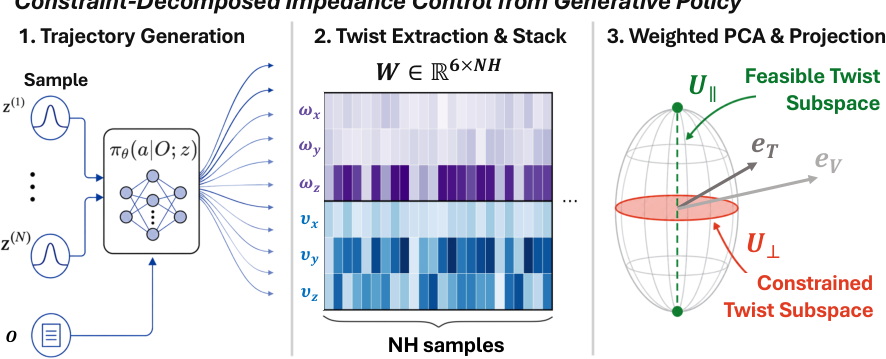
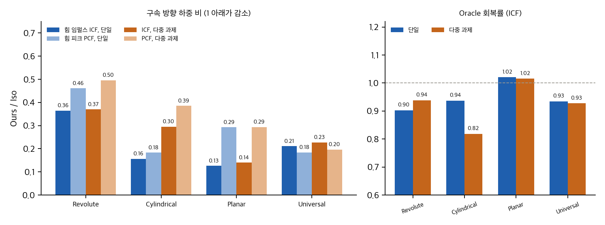
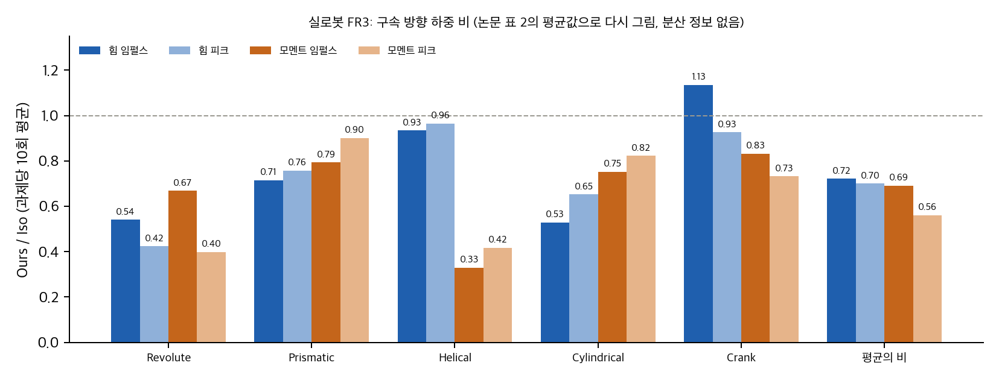
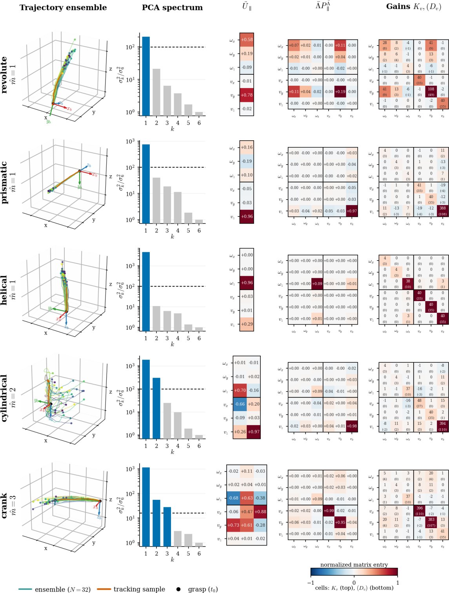
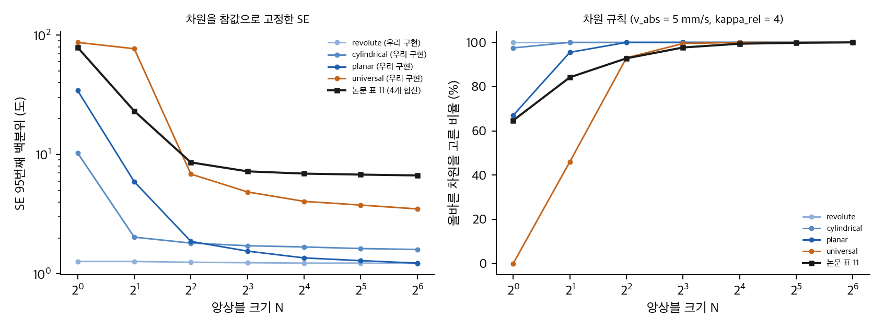

> **논문:** Kyungseo Park, Byeongdo Lim, Jungbin Lim, Minseok Choi, Frank C. Park. *Constraint-Decomposed Impedance Control from Generative Policy for Articulated Object Manipulation.* CoRL 2026 Spotlight, arXiv:2610.16316 (v1, 2026-10-12, 단일 버전).
> 공식 코드는 GitHub erickun0125/constraint-decomposed-impedance-control(MIT, 시뮬레이션 전용)에 있습니다. 이 글의 그림은 논문 그림 두 장(출처 표기)과 우리가 그린 그래프입니다. 코드는 읽기만 했고 실행하지 않았습니다.

## 논문이 묻는 것

문, 서랍, 나사처럼 운동학적 구속이 있는 물체를 학습 정책이 조작하면, 정책 출력이 구속을 정확히 지키지 못하는 만큼 접촉력이 커집니다. 임피던스 제어로 구속 방향의 강성을 낮추면 되지만, 어느 방향이 구속인지 알아야 하고 모든 방향을 낮추면 구동 방향에서 힘을 전달하지 못합니다.

이 논문의 답은 정책 자체에서 읽는 것입니다. 같은 관측에서 생성형 정책(Diffusion Policy)이 뽑은 N개 궤적의 엔드이펙터 body twist를 모아 비중심 PCA를 하면, 우세 부분공간이 물체의 실현 가능 twist 부분공간의 추정치가 됩니다. 이 부분공간에서는 강성을 유지하고 나머지에서는 낮추는 6×6 게인을 만듭니다. 추정은 grasp 직후 한 번만 하고 게인을 고정합니다.

*그림 1 위쪽 세 패널 (논문 원문). © 저자, CC BY 4.0, 출처 arXiv:2610.16316.*

게인은 K_v = Λ̄(k_∥ P_∥ + k_⊥ P_⊥)로, 사영 P는 관성 메트릭 Λ̄에 대해 직교합니다. 비교 대상 Iso는 모든 방향에서 같은 게인이고, Ours는 feasible 방향의 게인을 Iso와 같게 두고 보수 방향의 강성만 0.1배(감쇠는 √0.1배)로 낮춥니다. 시뮬레이션에는 해석적 부분공간을 쓰는 Oracle이 하나 더 있어 방향 추정 오차를 따로 볼 수 있습니다.

## 이 글에서 확인한 것

**1. 시뮬레이션 표의 산술은 맞습니다.** 구속 방향 힘 임펄스(ICF)는 Iso의 0.126–0.365배, 피크(PCF)는 0.184–0.462배이고, Ours는 Oracle이 만든 감소의 최소 0.903을 회복합니다(회전, 원통, 평면, 유니버설 네 과제, 표 1). 본문의 "0.13–0.37×", "at least 90%"와 일치하지만, 회복률의 여유는 0.3%p입니다. 다중 과제 정책(표 10)에서는 revolute PCF 비가 0.496이고 본문은 0.49로 적었습니다. 반올림 차이일 수 있어 저자 확인이 필요한 정도입니다.

*그래프: 우리가 그림. 논문 표 1, 표 10의 평균값에서 비율을 다시 계산했습니다.*

시뮬레이션 성공률은 제어기마다 99–100%(100회)로 Iso와 Ours가 구분되지 않습니다(Fisher p = 1.0). 그래서 "과제 수행을 유지한다"는 결과는 이 표에서는 확인할 수 있는 크기의 차이가 없다는 뜻입니다.

**2. 실로봇 평균은 어느 평균인지 정해야 읽힙니다.** 본문의 0.72/0.70/0.69/0.56배는 물체별 평균 임펄스·피크끼리의 비(평균의 비)로 정확히 재현됩니다. 물체별 비를 산술평균하면 ICF 0.77, PCF 0.75입니다. 표 2에는 시행별 분산이 없어(물체당 10회) 나사의 ICF 0.93배, PCF 0.96배 같은 작은 개선이 시행 변동과 구분되는지 알 수 없습니다. 시행별 변동계수를 0.2–0.5로 가정하면(가정) 10회 대 10회에서 구분되는 최소 비율은 0.83–0.64배입니다.

*그래프: 우리가 그림. 논문 표 2의 평균으로 비율을 다시 계산했습니다(괄호 값과 ±0.01 차이는 반올림 범위). 분산 정보가 없어 구간은 그리지 않았습니다.*

**3. Abstract의 "consistently"에는 예외가 있습니다.** 배치 의존 물체인 크랭크에서 ICF는 Iso 20.8 → Ours 23.6 N·s(1.14배)이고, 표 10 revolute PCM은 .21에서 .22입니다. 논문은 크랭크의 원인을 고정 포락선이 현재 배치에서 구속인 방향에도 높은 임피던스를 주기 때문이라고 설명하는데, 순간 부분공간을 쓰는 Oracle이 없어 논문 안에서 따로 확인된 것은 아닙니다. 실로봇은 두 제어기가 모든 시행에서 성공하도록 게인과 충돌 감지 문턱을 조정했다고 밝혀(§5.2) 성공률 비교는 없습니다.

**4. 차원 결정이 문턱에 의존하고, 그 문턱은 도메인과 물체별로 정해집니다.** 시뮬레이션은 (v_abs, κ_rel) = (5 mm/s, 4), 실로봇은 (3 mm/s, 10), 크랭크만 κ_rel = 4입니다(포락선의 약하게 자극된 방향을 남기기 위해, 부록 H.1). "모든 시도에서 올바른 차원"(시뮬 398/398, 실 50/50)은 이렇게 맞춘 문턱 아래의 결과입니다. 그림 5의 크랭크 PCA 스펙트럼에서 세 번째 막대가 문턱 바로 위에 있습니다.

*그림 5 (논문 원문, 데이터 그래프만 사용). © 저자, CC BY 4.0, 출처 arXiv:2610.16316.*

**5. 공개된 예시 앙상블 위에서 Algorithm 1을 새로 구현해 보았습니다.** 공식 저장소가 제공하는 네 앙상블(N=128, 물체당 grasp 하나)에 논문의 식을 numpy로 직접 적용하면 네 물체 모두 올바른 차원을 고르고 SE는 1.15–3.19°입니다. 유니버설의 세 번째 방향의 RMS 속도는 7.7 mm/s로 문턱 5 mm/s의 1.5배라 여유가 얇습니다. 앙상블을 N개로 줄여 재추정하면(한 앙상블의 부분표본) N ≥ 16에서 차원이 100% 맞고, N=4에서 유니버설 93%, N=2에서 46%입니다. 특성 길이 α를 0.25–4배로 바꿔도 부분공간은 0.5° 이내로 움직이고, 게인 행렬의 고유값은 정확히 {250, 25}, d_⊥/d_∥ = 0.316 = √r입니다.

*그래프: 우리가 그림. 앙상블 하나의 부분표본이라 grasp 사이 변동이 빠져 있어 논문 표 11(4개 물체 합산, 검정)과 직접 비교할 수는 없습니다.*

**6. 부록의 대수적 주장은 수치로 확인됩니다.** 단일 관절 여섯 종류의 생성자 집합은 Lie 브래킷에서 닫혀 있고, 2R 연쇄의 전역 포락선 차원은 3, 3, 4로 표 4와 같으며, 표 6의 게인(ζ = √m̄)이 정합합니다.

## 공식 코드와 논문 문면의 차이

공식 코드는 시뮬레이션 실험만 포함하며 핵심 수식(twist 차분, 특성 길이, 차원 규칙, 사영과 게인, 지표)은 논문과 일치합니다. 논문 문면에서 한 걸음 더 나간 처리는 다음과 같습니다.

- twist 행렬에 그리퍼 닫힘 명령 웨이포인트만 넣습니다(논문은 N×H 전부). 공개 예시에서는 모두 닫힘이라 영향이 없습니다.
- 추정 차원이 0이면 Iso 게인을 유지합니다. 식 (10)을 문면대로 쓰면 이 경우 전 방향이 저강성이 됩니다.
- 실행하는 궤적은 영 노이즈 DDIM 샘플이고 앙상블은 가우시안 노이즈 샘플이라 서로 다른 샘플입니다.
- 게인은 grasp closure 이후 설치되고(닫힘 후 지연 15 제어 스텝), 해제하면 Iso로 돌아갑니다.
- 평가의 성공 문턱과 시연 목표는 코드에만 있습니다. planar 시연의 회전 목표는 부록 H.3의 "반 바퀴(half-turn)"와 달리 코드에서 π/2입니다.
- 표 11–13(앙상블 크기, 다양성, 잡음)을 만드는 스크립트와 실로봇 코드는 저장소에 없습니다.

## 읽을 때 유의할 점

- 비교 대상이 Iso 하나이고 r = 0.1 한 점이라, 방향 선택의 효과와 게인 설정의 효과는 시뮬레이션의 Oracle로만 나뉩니다.
- 시뮬레이션 표 1, 9의 평균에서 되짚은 feasible 방향 힘 임펄스는 유니버설에서 Iso가 Ours의 약 1.7배로 보입니다(평균의 비 ≠ 비의 평균이라 근사). 같은 진행 구간에서 비교한다는 가정이 이 칸에서 성립하는지는 저자 확인이 필요합니다.
- 표 11의 올바른 차원 비율은 400개 grasp(시행 수 400 가정)로는 표현되지 않고 부분집합을 여러 번 뽑은 평균으로 읽힙니다. 추출 횟수는 논문에 없습니다.

## 구현할 수 있는가

방법(앙상블 → PCA → 게인)은 numpy로 수십 줄이고 CPU에서 몇 초 만에 돌아갑니다. Isaac Lab 시뮬레이션 평가는 Linux/Windows와 NVIDIA GPU가 필요하고, 정책 학습과 실로봇(FR3 + 힘토크 센서)도 일반 노트북에서는 어렵습니다. MuJoCo와 소형 정책으로 축소판을 만드는 것은 가능해 보입니다(2–3주, 추정).

## 자료

- [통합 리포트 PDF](report/report_public.pdf)
- [01. 논문 분석: Constraint-Decomposed Impedance Control (arXiv:2610.16316)](analysis/01_paper_analysis.md)
- [02. 선행연구와 관계](analysis/02_prior_work.md)
- [03. 수치 재계산, 일관성 점검, toy 검증](analysis/03_analysis.md)
- [04. 공식 코드와 논문 대조, 구현 가능성](analysis/04_code_verification.md)
