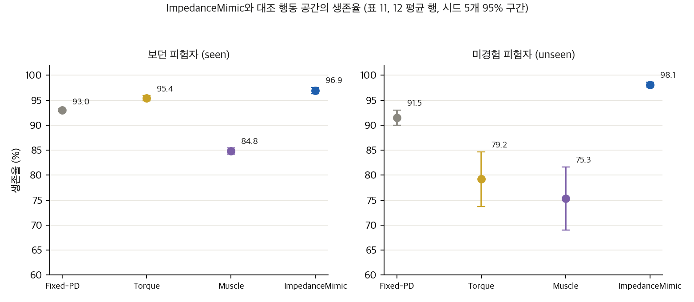
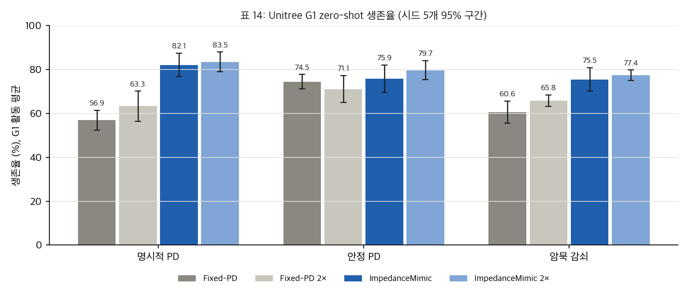
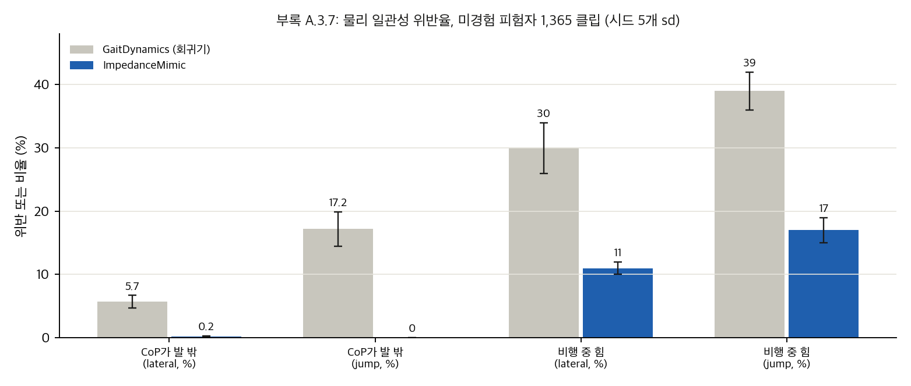

> **논문:** Matthias Jammot, Pembe Gizem Özdil. *ImpedanceMimic: Learned Impedance as Action Space for Force-Accurate Motion Imitation.* arXiv:2611.19153 (v1, 2026-11-14). 학회 표기 없음 ("Preprint. Under review.").
> 논문 라이선스는 CC BY 4.0입니다. 이 글은 논문 그림을 쓰지 않고, 논문 표의 숫자를 인용하며 우리가 그린 그래프 세 장을 넣었습니다.

## 논문이 묻는 것

사람이나 로봇의 동작을 보면 그 동작을 만든 힘은 알기 어렵습니다. 같은 움직임도 제어기가 다르면 바닥에 가하는 힘이 다릅니다. 힘판은 실험실에서만 쓸 수 있습니다. 물리 시뮬레이션에서 동작을 따라 하면 힘은 물리적으로 일관되지만, 흔히 쓰는 고정 이득 PD 제어기에서는 그 힘이 측정값과 다를 수 있습니다.

ImpedanceMimic은 PD 제어기의 관절별 강성, 감쇠, 목표 위치를 강화학습 정책이 매 10 ms 바꾸게 합니다. 정책은 힘판 측정을 보지 않고 동작만 입력받지만, 학습 중에는 측정 힘과 압력 중심으로 보상을 줍니다. 129명, 여섯 활동에서 실험합니다.

## 두 경계로 보는 이유

논문의 출발점은 두 가지 경계입니다. 접촉 중에는 관절이 힘을 낼 만큼 강성이 있어야 합니다(Bound 1, 식 4). 공중에서는 이산 시간 PD가 불안정해지지 않도록 감쇠를 낮게 두어야 합니다(Bound 2, 식 5). 접촉과 공중이 요구하는 값이 반대이므로, 고정 이득은 한쪽을 잃습니다. 단일 관절 막대 예제에서 두 경계는 강성 32 Nm/rad 이상, 감쇠 20 Nm·s/rad 미만으로 계산되며, 이 계산은 논문 표 6과 맞습니다.

## 이 글에서 확인한 것

**1. 보던 피험자에서 운동과 좌우 힘은 확실히 낫습니다.** 여섯 활동 평균 생존율은 96.9%로 고정 PD (93.0%)와 토크 (95.4%)보다 높고, 관절각 오차는 2.28°로 가장 낮습니다. 시드 5개로 Welch 검정하고 Holm 보정하면 이 차이는 모두 p < 0.05입니다.

**2. 수직 힘은 토크 기준선이 앞섭니다.** 수직 힘 상관은 토크 0.82, ImpedanceMimic 0.80입니다. 차이는 작지만 시드 기준으로 유의합니다(p_holm 0.015). 미경험 피험자에서도 토크가 0.79, ImpedanceMimic이 0.76으로 같은 방향입니다. 초록의 "모든 힘 정확도에서 우위"는 이 부분에서 조건을 붙여야 맞습니다.

*그래프 1. 우리가 논문 표 11과 12의 평균 행으로 그린 그림입니다. 미경험 피험자 22명에서 ImpedanceMimic의 생존율은 98.1%로 오히려 높고, 토크와 근육은 크게 떨어집니다. 구간은 시드 5개의 평균에 대한 t 분포 95% 구간이며, 피험자와 클립의 표집 변동은 빠져 있습니다.*

**3. "모든 적분 방식에서 우위"는 짝을 맞출 때 맞습니다.** 명시적 PD, 안정 PD, 암묵 감쇠 각각에서 같은 우선 이득끼리 비교하면 운동과 힘이 모두 낫습니다. 예외는 안정 PD에서 두 배 우선 이득을 줬을 때 생존율 한 칸입니다 (96.3 대 96.6). 

**4. 무학습 로봇 전이는 조건부입니다.** 인간만으로 학습한 정책을 Unitree G1에 옮기면, 명시적 PD에서는 생존율이 82.1%로 고정 PD (56.9%)보다 크게 높습니다. 그러나 안정 PD에서는 75.9%와 74.5%로 차이가 1.4점이고, 시드 기준 Welch p = 0.60입니다. 구분되지 않는 차이입니다.

*그래프 2. 논문 표 14의 값을 옮긴 그림입니다. 막대 위는 평균, 구간은 시드 5개의 95%입니다.*

**5. 힘 회귀기와의 비교는 정확도와 물리 일관성이 다릅니다.** 부록 A.3.7에서 GaitDynamics는 수직 힘 상관이 더 높지만 (0.92 대 0.80), 측면 절단과 점프에서 압력 중심이 발 밖에 있는 비율이 5.7%와 17.2%입니다. 우리 정책은 0.2%와 0%입니다. 비행 중에 지면을 누르는 비율도 회귀기가 30%와 39%, 정책이 11%와 17%입니다.

*그래프 3. 부록 A.3.7의 보고된 평균과 표준편차로 그린 그림입니다. 원자료 재계산은 하지 않았습니다.*

## 공개 상태와 재현 가능성

논문의 재현성 항목은 코드 공개를 말하지만, 2026-11-21 기준 GitHub 저장소에는 README와 웹사이트 파일만 있고 README는 "Code Coming (very) Soon!"이라고 씁니다. 체크포인트도 "soon"입니다. 그래서 이 글의 판단은 논문 표와 부록 수치에 근거합니다.

학습은 2×10⁹ 스텝, 8,192개 병렬 환경으로 GPU 약 550시간이 듭니다. 맥에서 같은 규모는 불가능합니다. 단일 관절 막대 예제는 CPU로 시험할 수 있습니다.

## 남는 질문

- 측정 힘을 학습에만 쓰는 방식은 로봇에 옮기기 좋습니다. 그러나 정책이 쓰는 추정기가 미래 0.4초를 봅니다. 실시간 제어에 쓰려면 과거 정보만으로 같은 정확도가 나오는지 확인해야 합니다.
- 수직 힘에서 토크 기준선을 이기지 못하는 이유는 본문에서 충분히 설명되지 않았습니다. 활동별 차이를 더 보면 답이 나올 수 있습니다.
- 관성 기준 이득의 설계는 몸이 다른 정책에 같은 배율을 주게 합니다. 로봇 관절의 관성 추정 오차가 이 설계를 얼마나 흔드는지는 다루지 않았습니다.

## 자료

- [통합 리포트 PDF](report/report_public.pdf)
- [ImpedanceMimic (arXiv:2611.19153) 논문 분석](analysis/01_paper_analysis.md)
- [ImpedanceMimic 선행연구와 연결 (arXiv:2611.19153)](analysis/02_prior_work.md)
- [ImpedanceMimic 수치 재계산과 일관성 검사](analysis/03_analysis.md)
- [ImpedanceMimic 주장 검증 (공식 코드 없음)](analysis/04_claim_verification.md)
