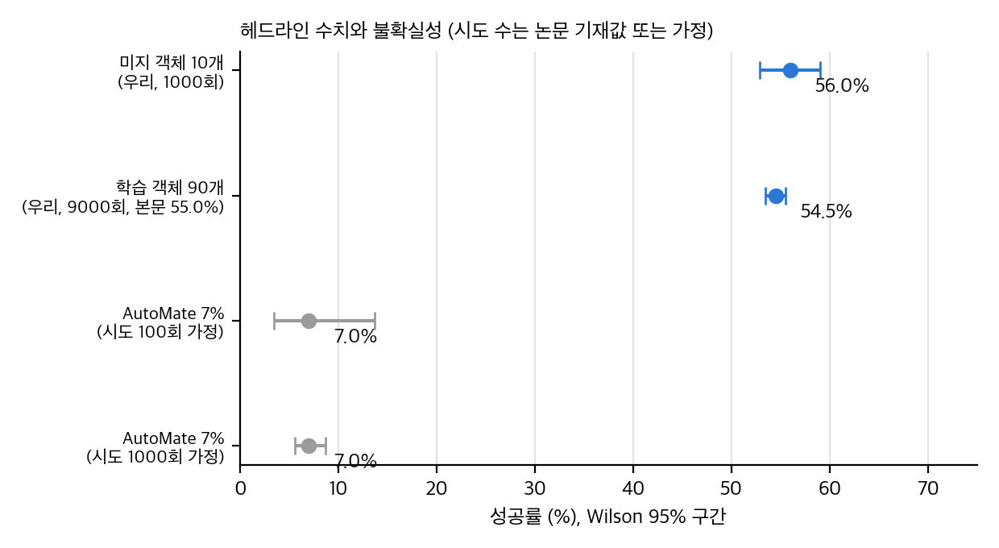
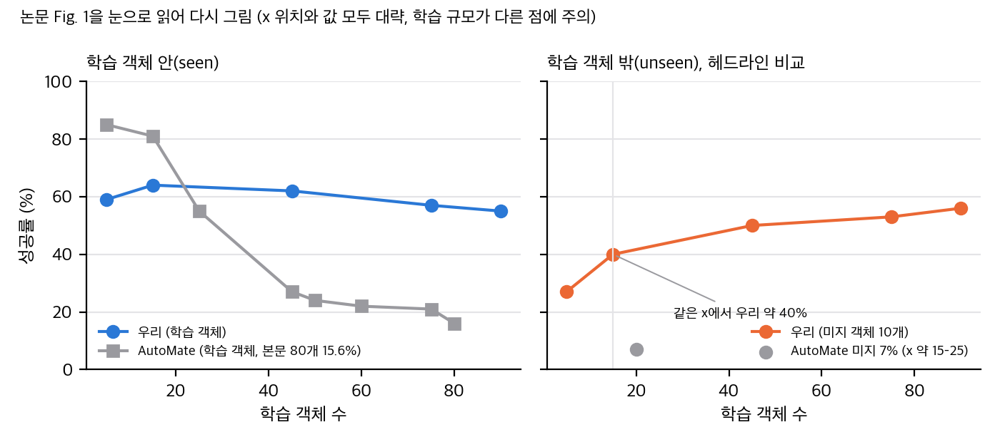
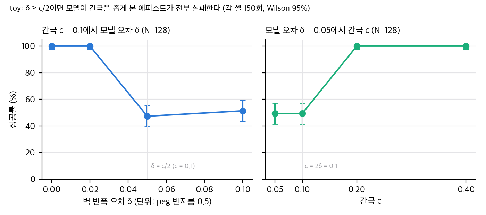
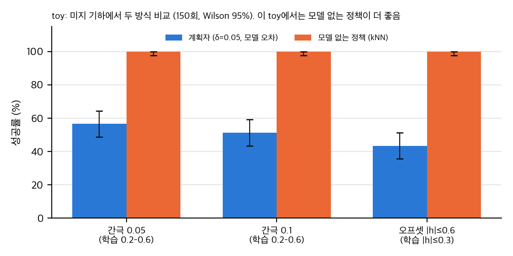

> **논문:** Hansen 외 10인. *Generalizable Robotic Insertion with World Models.* arXiv:2609.28258v1 (2026-09-23). 학회는 arXiv 메타데이터에 "IROS 2026"으로만 적혀 있고, 논문 본문에는 채택 문구가 없습니다.
> 논문 그림과 표는 라이선스(arXiv 비독점 배포, CC BY 아님) 때문에 싣지 않았습니다. 이 글의 그래프는 논문 수치를 눈으로 읽어 다시 그리거나 직접 만든 toy로 그렸습니다. 공식 코드는 찾지 못했습니다(2026-11-10 확인).

## 한 줄 요약

TD-MPC2 잠재 세계 모델 하나를 조립 객체 90개에 학습하고, 학습하지 않은 10개에서 제로샷 **56%**를 보고합니다. 비교 대상 **7%**는 AutoMate 논문의 수치이고, 학습 규모와 입력이 달라서 같은 조건의 비교가 아닙니다. 방향(시각 입력이 중요하다, 특수 모델이 낫다)은 대체로 믿을 만합니다. 헤드라인 숫자는 조심해서 읽어야 합니다.

## 1. 무엇을 하나

- **입력:** 손목 카메라 깊이 영상(96×96)과 고유감각 24차원. 고유감각에는 시뮬레이터 소켓 자세의 잡음 섞인 추정이 들어갑니다.
- **모델:** 깊이와 고유감각을 하나의 잠재 상태로 인코딩하고, 잠재 전이, 보상, 가치를 예측합니다. **영상이나 물체 자세를 예측하는 디코더는 없습니다.**
- **계획:** MPPI로 행동 시퀀스를 샘플링해 계획합니다. 샘플 수와 호라이즌은 논문에 없습니다.
- **학습:** 객체 90개를 병렬로 시뮬레이션하고, 역분해 시연으로 만든 보상을 씁니다. 이 보상은 객체의 기하에 의존합니다.

## 2. 헤드라인을 다시 계산하면

미지 객체 10개 × 100회 = 1000회에서 560번 성공했습니다. Wilson 95% 구간은 52.9–59.1%입니다. 하지만 10개 객체의 평균이라 객체 간 분산을 넣으면 구간이 약 ±15–19pp로 넓어집니다. 그래도 7%보다 훨씬 위입니다.

**비교가 맞지 않는 부분.** 논문 그림을 눈으로 읽으면, 7%는 AutoMate가 학습 객체 약 15–25개일 때의 한 점입니다. 같은 x에서 우리 모델은 약 40%입니다. 우리 값은 90개 학습에서 나왔습니다.

## 3. 세 가지 확인

- **특수 모델:** 100개 객체 평균 79.78%, AutoMate 70.31%. 객체별 차이의 SD를 10–30pp로 가정해도 방향은 유의합니다.
- **절제:** 시각 입력은 생성 모델에서 +14.9pp, 특수 모델에서 +24.6pp입니다. 커리큘럼 효과(+2–4pp)는 시드 수가 없어서 확인할 수 없습니다.
- **미세조정:** 1053, 1129, 1079, 1102에서 차이가 크고, 1132는 두 방법 모두 실패합니다. 비교 스텝이 30k 대 2M으로 달라서 해석에 주의가 필요합니다.

## 4. 2D toy로 본 메커니즘

모델의 벽 위치에 오차 δ를 넣고, 간극 c인 슬롯에 MPPI로 넣어 봤습니다.

- 모델 오차가 간극의 절반(δ ≥ c/2)에 이르면, 모델이 간극을 좁게 본 에피소드는 모두 실패합니다.
- 샘플 수를 16에서 256으로 늘려도 성공률은 약 50%로 같았습니다. 샘플은 모델 오차를 고쳐 주지 않습니다.
- 같은 미지 기하에서 **모델 없는 kNN 정책이 더 좋았습니다.** 이 기준선은 오라클 시연을 그대로 모방해서 강합니다. 그래서 "모델 기반이 낫다"는 주장은 기준선의 강도에 달려 있습니다.

## 5. 구현 가능성

- **공식 재현:** 불가능합니다. 코드와 자산이 공개되지 않았고, 실험은 CUDA GPU가 필요한 Isaac Gym입니다.
- **아이디어 재구현:** 중간에서 높습니다. TD-MPC2 공식 코드(MIT)는 재사용할 수 있지만, 조립 환경, 자산 100쌍, 역분해 시연 보상을 다시 만들어야 합니다.
- **실물:** 실물 결과가 없습니다.

## 6. 읽을 때 기억할 것

1. "unseen"은 같은 데이터 분포의 다른 자산이라는 뜻입니다.
2. 배포 때 CAD는 쓰지 않지만, 소켓 자세 추정과 역분해 시연 보상은 필요합니다.
3. 샘플 수, 호라이즌, 시드 수, 객체별 값이 논문에 없어서 재현과 비교에 한계가 있습니다.

## 자료

- [통합 리포트 PDF](report/report_public.pdf)
- [01. 논문 분석: Generalizable Robotic Insertion with World Models](analysis/01_paper_analysis.md)
- [02. 선행연구와 관련 저장소](analysis/02_prior_work.md)
- [03. 수치 재계산, 유도, toy 검증](analysis/03_analysis.md)
- [04. 주장 검증과 구현 가능성](analysis/04_claim_verification.md)
