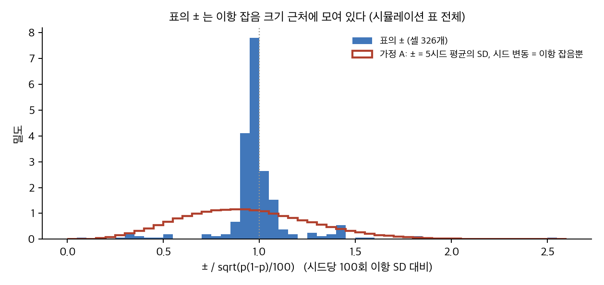
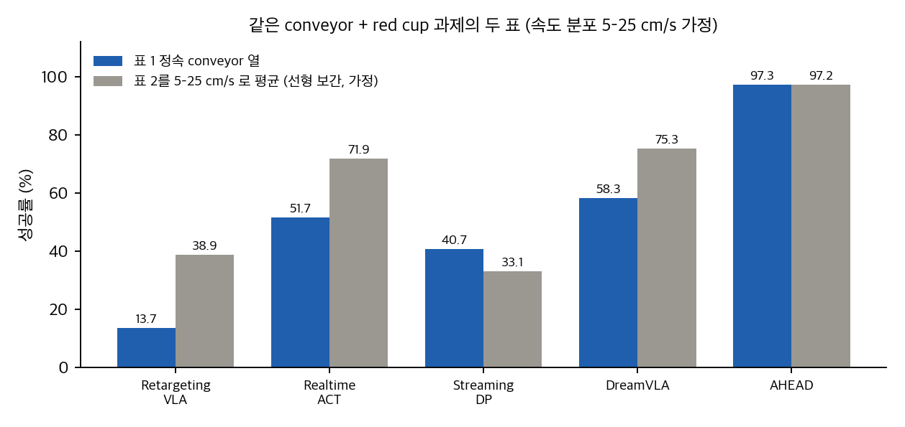
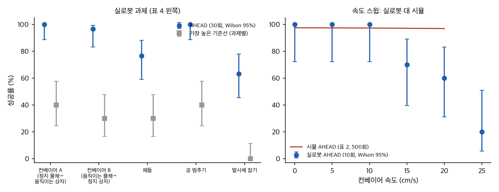
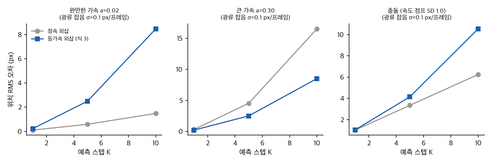

# 03. 수치 재계산, 일관성 검사, 토이

표 값은 `paper/paper.txt`(arXiv v2)에서 옮겨 `analysis/recompute.py`에 넣고 계산했습니다(결과는 `recompute_results.json`). 코드가 공개되지 않아 원자료(시드별 성공 수)를 볼 수 없으므로, 아래 검정은 표의 평균과 ±에서 시행 수를 **가정**해 낸 값입니다. 시뮬레이션 셀은 부록 C.5대로 "5 시드 × 시드당 100 롤아웃(셀당 500)"을 가정했습니다(시행 수 n = 500 가정). 이 문서는 표와 서술이 서로 어떻게 다른지를 적고, 원인은 추정하지 않습니다. 정의가 필요한 곳은 저자 확인이 필요합니다.

## 0. 요약

| 번호 | 검사 | 결과 |
|---|---|---|
| V1 | 표의 ±와 이항 잡음 | 326개 셀의 ± 중 80%가 시드당 100회 이항 SD의 ±10% 안. 5시드 표본 SD라면 약 21%가 예상 |
| V2 | 평균의 정수 격자 | 5×100(0.2 단위)에 맞지 않는 셀 53개, 그중 48개는 1/3 단위 격자에 맞음(표 1의 기존 7행에 집중) |
| V3 | 표 5 = 부록 표의 평균 | 24개 열 모두 일치(최대 차이 0.07). ±는 시나리오 4개 사이의 표준오차와 일치 |
| V4 | 같은 구성의 값이 표마다 | 정속 AHEAD 기본: 93.5(표 1, 12), 93.9(표 14, 18), 93.75(표 15 K = 5) |
| V5 | 표 1 Conveyor 열 대 표 2 | 기준선 3종이 표 2 보간값보다 17–25점 낮고 1종은 7.6점 높음(속도 분포 가정) |
| V6 | 초록의 범위 | "31–58%" = 표 1 DreamVLA의 최소·최대. 열별 학습된 기준선 최고는 11.4–60.3 |
| V7 | 본문 인용 수치 | 86.8, 93.5, 63.0, 2.7배, 2.1배, 2.5배 등 모두 재현 |
| V8 | 쌍별 비교 | 정렬 층 제거 −8.9, −26.3점(p < 1e-7, n = 500 가정). 전체 예측 대 마스크는 Beam, Roll에서 4.8–5.6점 |
| V9 | 실로봇 | 과제 5개 모두 최고 기준선과 p < 0.001. 속도 스윕 25 cm/s는 2/10 대 0/10, p = 0.47 |
| V10 | 산술 | 파라미터 4.9M, 지연 158 ms, GPU-시간 102는 맞음. 실현 horizon 9.1–9.6의 지연은 193–198 ms 추정 |
| V11 | 시간창 단조성 | 표 11 Realtime ACT가 200 ms 6.4 → 400 ms 3.6 → 800 ms 10.4 |
| T1 | 토이: 정속 대 등가속 외삽 | 등가속이 나아지려면 가속이 광류 속도 잡음의 약 1.7배를 넘어야 함(K와 무관) |

## 1. 재계산

### V1. ±와 이항 잡음 (분석: `recompute.py`)

시뮬레이션 표(표 1, 2, 3, 9–16, 18, 19)의 평균 p와 ±가 모두 0이 아닌 셀 326개에 대해 비율 ±/√(p(1−p)/100)를 냈습니다. 분모는 시드 하나(100회)의 이항 SD입니다.

- 비율의 중앙값 0.97, 평균 0.99, SD 0.21. 80.4%가 0.9–1.1에 있습니다.
- 부록 C.5의 정의를 "5개 시드 평균 사이의 표준오차"로 읽으면, 시드 사이 변동이 이항 잡음뿐일 때의 기대 비율은 √(χ²₄/4)/√5, 평균 약 0.42입니다. ±를 "5개 시드 평균의 SD"로 읽으면 평균 0.94, SD 0.34이고, 0.9–1.1에 들어올 비율은 약 21%입니다(그림 `own_pm_ratio.png`).
- 즉 표의 ±는 "시드당 100회의 이항 SD"에 가깝게 모여 있고, 5개 시드의 표본 SD 또는 표준오차로 기대되는 흩어짐보다 좁습니다. ±가 이항 모형에서 계산된 값이거나, 시드 간 변동이 이항 잡음과 거의 같은 경우가 가능합니다. 어느 쪽인지는 시드별 값이 없어 구분할 수 없습니다.
- 비율이 0.6 미만 또는 1.5 초과인 셀 18개. 표 3 Track-and-Intercept의 Multi-Balls 29.4 ± 0.3(기대 4.6), 표 1 AHEAD 가속 Pole 93.7 ± 6.1(기대 2.4)과 Roll 89.0 ± 0.9(기대 3.1), 표 3 LaDi-WM Air Hockey 48.2 ± 9.7, DreamVLA Ballistic Catch 49.1 ± 9.1(표 19에 같은 값), 표 16 고정 K = 5의 Plinko 31.4 ± 1.4, 표 10·11의 3.8 ± 2.9, 3.6 ± 2.9 등입니다. 이 18개 중 9개가 v2에서 추가된 두 기준선 행(표 3)에 있습니다.
- 표 3과 표 1의 ± 정의가 서로 다르게 읽히는 셀이 있다는 뜻이며, 정의 확인이 필요합니다.

*우리가 그린 그래프. 파란 막대는 표의 ± 326개 셀의 비율, 붉은 선은 "± = 5시드 평균의 SD, 시드 변동 = 이항 잡음"일 때 기대되는 분포입니다.*

### V2. 평균의 정수 격자

5 시드 × 100 롤아웃의 평균 성공률은 k/500의 형태, 즉 0.2 단위입니다(소수 첫째 자리 반올림 값이 짝수 자리). 398개 셀 중 이 격자에 맞지 않는 셀이 53개입니다.

- **표 1의 기존 7개 행**(Open-loop, Retargeting, Fast Replan, ACT, Streaming DP, DreamVLA, AHEAD, 56셀) 중 33개가 0.2 격자에 맞지 않습니다. 맞지 않는 값은 13.7, 22.3, 51.7, 97.3, 91.7, 87.7, 93.7처럼 x.3과 x.7 끝자리가 많습니다. 이 33개는 모두 1/3 단위 격자(300회 또는 3 시드 × 100회의 평균)에는 맞습니다.
- 표 1에서 v2에 추가된 Track-and-Intercept와 LaDi-WM 16개 셀은 모두 0.2 격자에 맞습니다.
- 같은 값이 표 12(RAFT 97.3, 91.7, CoTracker3 89.3, 87.7, 80.7, 78.3, Farnebäck 79.7, 69.3, 68.7, 프레임 차분 39.7, 40.3), 표 14, 18, 19의 AHEAD·DreamVLA 셀에도 나옵니다(합계 48개가 1/3 격자에 맞음).
- 나머지 5개는 표 3 DreamVLA의 49.1(Ballistic Catch, 표 19에 반복)과 43.5, 표 10의 14.9, 표 19의 61.1입니다. 600회 격자에 맞는 값이 있지만 어느 격자로도 설명하려면 시행 수가 부록 C.5와 달라야 합니다.
- 시드 수나 롤아웃 수가 표마다 다른 경우, 또는 반올림 방식이 다른 경우가 가능합니다. 실제 시행 수를 저자에게 확인해야 합니다.

### V3. 표 5의 재계산

표 5의 24개 열 평균을 표 12–15의 4개 시나리오 값의 평균으로 다시 냈습니다. 모두 일치합니다(최대 차이 0.07, 표 14의 언어+운동 열 93.87을 93.8로 적은 정도). ±는 4개 시나리오 값의 표본 SD/2와 같습니다(상관 1.00, 예: Learned dynamics 8.01 대 7.9). 즉 표 5의 ±는 시나리오 사이의 흩어짐이고 시드 잡음이 아닙니다. 캡션("across four scenarios")과 일치합니다.

### V4. 같은 구성의 값이 표마다 다름

정속 4개 시나리오의 AHEAD 기본 구성 값은 다음과 같습니다.

| 표(행) | Conv | Beam | Pole | Roll | 평균 |
|---|---|---|---|---|---|
| 표 1 AHEAD, 표 12 RAFT | 97.3 | 91.7 | 95.0 | 90.0 | 93.50 |
| 표 14 Language + motion, 표 18 S = 5 | 97.3 | 92.4 | 94.6 | 91.2 | 93.87 |
| 표 15 K = 5, 표 18 Enc 4L | 96.8 | 92.4 | 94.6 | 91.2 | 93.75 |

가속 시나리오의 AHEAD는 표 1이 87.7, 91.0, 93.7, 89.0(평균 90.35), 표 13이 88.4, 91.6, 93.2, 89.4(90.65)입니다. 표 1의 ±는 3.3, 3.9, 6.1, 0.9이고 표 13의 ±는 3.1, 2.6, 2.3, 2.9입니다. 차이는 모두 이항 잡음 안(≤ 1.3점)이지만, "같은 구성"이 표마다 다른 실행에서 나왔는지 같은 실행의 다른 집계인지는 표에 없습니다. 표 5는 정속 평균으로 93.5(운동 추정 열)와 93.8(마스킹·horizon 열)을 둘 다 "ours"로 씁니다. 표 5의 "K = 5 (=adaptive)"(93.8)는 표 17의 정속 실현 horizon 4.2와 같은 설정이 아닙니다.

### V5. 표 1 Conveyor 열 대 표 2

표 1 정속 Conveyor 열과 표 2는 모두 conveyor + red cup 과제입니다. 부록 C.1은 정속 conveyor 속도를 5–25 cm/s에서 무작위로 뽑는다고 씁니다. **가정:** 속도가 5–25 cm/s 균등이고 성공률이 표 2의 점(0, 10, 20, 30, 40 cm/s) 사이에서 선형이면, 표 2에서 기대되는 평균은 다음과 같습니다(그림 `own_table1_vs_2.png`).

| 방법 | 표 1 Conveyor | 표 2 보간 평균 | 차이 |
|---|---|---|---|
| Retargeting VLA | 13.7 | 38.9 | −25.2 |
| Realtime ACT | 51.7 | 71.9 | −20.2 |
| Streaming DP | 40.7 | 33.1 | +7.6 |
| DreamVLA | 58.3 | 75.3 | −17.0 |
| AHEAD | 97.3 | 97.2 | +0.1 |

AHEAD는 일치하고 기준선은 방향이 섞인 차이가 있습니다. 두 표의 속도 분포나 기준선 학습 설정이 같은지는 논문에 없습니다(표 1 캡션은 속도를 명시하지 않음). 가정이 맞지 않을 수 있는 부분은 선형 보간과 속도 분포입니다.

*우리가 그린 그래프. 표 2의 점을 5–25 cm/s 구간에서 평균한 값은 속도 균등과 선형 보간을 가정한 값입니다.*

### V6. 초록·서론의 범위, 시나리오 수

- **AHEAD 79–97%.** 주 16개 시나리오(표 1의 8열, 표 3의 8열)의 최솟값 79.4(Occlusion), 최댓값 97.3(Conveyor)입니다. 스트레스 시험 3개(48.6–76.4%)는 이 범위 밖입니다.
- **"가장 강한 기준선 31–58%".** 표 1에서 DreamVLA 한 방법의 최솟값 30.7과 최댓값 58.3과 일치합니다. 16개 시나리오 각각에서 학습된 기준선 6종의 최고값을 보면 11.4(Occlusion)–60.3(Beam)입니다. Track-and-Intercept와 LaDi-WM(v2에서 추가)까지 포함한 최고값은 34.8(Occlusion)–91.2(Conveyor)입니다.
- **"20개 시나리오".** 표에 있는 시나리오는 정속 4, 가속 4, 복합 8, 스트레스 3으로 19개입니다. 표 2의 속도 점 5개와 표 9–11의 시간창 점을 시나리오로 세는지는 적혀 있지 않습니다.
- **본문의 "표 3에서 가장 강한 기준선 최대 60%"(§5.2).** 학습된 기준선 6종의 최댓값은 60.2(Mid, Realtime ACT)입니다. v2의 Track-and-Intercept는 Place in Box에서 71.8입니다.
- **"Occ에서 Realtime ACT 외 모든 기준선이 정확히 0%".** v2의 Track-and-Intercept는 34.8, LaDi-WM은 18.6입니다.
- AHEAD는 표 1과 표 3의 모든 열에서 모든 기준선보다 높습니다(문장 "outperforming all baselines on every scenario"는 숫자로 맞음).

### V7. 본문 인용 수치

Track-and-Intercept 정속 평균 86.8, AHEAD 93.5, LaDi-WM 62.95(본문 63.0), DreamVLA 가속 범위 30.7–48.0, AHEAD 가속 최소 87.7, 정속-가속 차이 최대 9.6(주장 "within 10 percentage points"), 40 cm/s 잔차 97.6 − 95.4 = 2.2, 스트레스 비율 48.6/17.8 = 2.73, 76.4/35.6 = 2.15, 68.2/27.4 = 2.49(본문 2.7배, 2.1배, 2.5배)는 모두 표에서 재현됩니다.

### V8. 쌍별 비교 (이항 근사, 각 500회 가정)

| 비교 | 값 | p (n = 500 가정) |
|---|---|---|
| AHEAD 대 Track-and-Intercept, 표 1의 8열 | 격차 최소 6.1(정속 Conveyor) | 모두 p < 0.001 |
| 정렬 층 제거, Conveyor | 97.3 → 88.4 (−8.9) | 7e-8 |
| 정렬 층 제거, Ballistic Catch | 87.4 → 61.1 (−26.3) | 3e-21 |
| 팔 패치 제외, Ballistic Catch | 87.4 → 92.2 (+4.8) | 0.012 |
| 적응 중단 대 고정 K = 5, 세 스트레스 시험 | +12.6, +13.6, +17.2 | 모두 p < 1e-4 |
| 전체 예측 대 마스크 (표 14) | Conv +1.3, Beam +5.6, Pole −1.0, Roll +4.8 | 0.30, 0.004, 0.46, 0.016 |
| 중력 롤링: 상수 속도 대 운동학 + 가속 (표 13) | 90.6 대 89.4 | 0.53 |

- 표 14의 "전체 예측은 마스크와 오차 범위 안"(부록 E.3)은 표의 ±를 표준오차로 읽으면 맞습니다(z = 0.5, 1.3, −0.3, 1.1). ±를 이항 SD로 읽어 셀당 500회로 검정하면 Beam과 Roll의 차이는 5% 수준에서 나옵니다(위 표). 정의에 따라 결론이 달라집니다(V1).
- 중력 롤링에서는 가속 조건이 상수 속도보다 나은 점이 없습니다(부록 E.2도 "충분하다"고 씀). 이 결과는 식 3이 이득을 내는 시나리오가 conveyor와 pole push로 한정됨을 뜻합니다.
- 정렬 층 제거의 p 값은 셀당 500회의 독립 시행을 가정한 근사입니다. 시드 수준 변동이 크면 더 약해집니다.

### V9. 실로봇 (Wilson 95%, Fisher)

| 과제 | AHEAD | Wilson 95% | 최고 기준선 | Fisher p |
|---|---|---|---|---|
| 정지 물체 → 움직이는 상자 | 30/30 | 88.6–100 | 12/30 (DreamVLA) | 1.9e-7 |
| 움직이는 물체 → 정지 상자 | 29/30 | 83.3–99.4 | 9/30 (DreamVLA) | 6.1e-8 |
| 패들 | 23/30 | 59.1–88.2 | 9/30 (Realtime ACT) | 6.3e-4 |
| 공 멈추기 | 30/30 | 88.6–100 | 12/30 (DreamVLA) | 1.9e-7 |
| 발사체 잡기 | 19/30 | 45.5–78.1 | 0/30 | 5.3e-8 |

| 속도(cm/s) | AHEAD | Wilson 95% | 최고 기준선 | Fisher p |
|---|---|---|---|---|
| 0 | 10/10 | 72–100 | 10/10 | 1.0 |
| 5 | 10/10 | 72–100 | 8/10 (Realtime ACT) | 0.47 |
| 10 | 10/10 | 72–100 | 3/10 (Streaming DP) | 0.003 |
| 15 | 7/10 | 40–89 | 0/10 | 0.003 |
| 20 | 6/10 | 31–83 | 0/10 | 0.011 |
| 25 | 2/10 | 6–51 | 0/10 | 0.47 |

- **과제별 결과는 확실합니다.** 5개 과제 모두 최고 기준선과의 차이가 p < 0.001입니다.
- **"5 cm/s를 넘어서는 유일한 방법"(§5.3).** 10, 15, 20 cm/s에서는 맞습니다. 25 cm/s의 2/10 대 0/10은 구별되지 않습니다(p = 0.47). 본문의 "chance"는 정의되어 있지 않습니다.
- **스윕 대 과제 표.** AHEAD의 스윕 5–25 cm/s 합계는 35/50(70%)입니다. 이 속도 범위가 시뮬레이션 conveyor 장면의 속도 범위(5–25 cm/s, 부록 C.1)와 같고 표 4 왼쪽 컨베이어 과제의 속도가 적혀 있지 않으므로, 30/30(30회 중 전부)이 어느 속도에서 나왔는지 알 수 없습니다. 만약 과제가 5–25 cm/s에서 속도를 뽑았고 성공률이 70%라면 30회 연속 성공 확률은 약 2e-5입니다(성공률 0.7 가정). 과제가 낮은 속도에서 수행됐을 가능성이 있습니다. 확인이 필요합니다.
- **시뮬레이션 대 실로봇.** 표 2는 20 cm/s에서 97.0%(500회), 실로봇은 6/10(Wilson 31–83%)입니다. 컨베이어 속도 15 cm/s에서도 7/10입니다. 본문 §5.3은 "속도 강건성 이야기가 하드웨어로 옮겨진다"고 쓰고, 과제 표에서는 "컨베이어 30/30은 시뮬레이션 97.3%에 가깝다"고 쓰지만 스윕과의 차이는 논의하지 않습니다.
- 발사체 실패 11회의 분해(관절 한계 5 + 6)는 30 − 19 = 11과 맞습니다.

*우리가 그린 그래프. 표 4의 성공 수와 Wilson 95% 구간. 오른쪽의 시뮬레이션 선은 표 2의 AHEAD 값(0, 10, 20 cm/s)을 이은 것입니다.*

### V10. 산술

| 항목 | 계산 | 결과 |
|---|---|---|
| 파라미터 | 2.6 + 1.1 + 0.8 + 0.3 + 0.1 | 4.9M (7B의 0.07%, "0.1% 미만") |
| 지연 합 | 20 + 2 + 40 + 6 + 70 + 20 | 158 ms |
| 래퍼 추가 지연 | 158 − 90 | 68 ms |
| GPU-시간 | 96 + 4 + 2 | 102 (본문 약 102) |
| 사전학습 | 8 GPU × 12 h, 200K 스텝 | 초당 약 4.6 스텝, 배치 256이면 총 51.2M 샘플 = 코퍼스 656K의 약 78회 |
| 코퍼스 | 50 + 220 + 76 + 60 + 100 + 150 | 656K (+ 실험실 0.2K) |

- **지연의 horizon 의존.** 표 15의 지연은 K = 1, 2, 3, 5, 8, 12에서 120, 128, 138, 158, 185, 218 ms로, K당 약 9.0 ms 증가하는 직선에 가깝습니다(절편 111 ms, 최대 잔차 1.7 ms). 표 17의 실현 horizon을 이 직선에 대입하면 정속 4.2 → 약 149 ms, Plinko 1.8 → 약 127 ms, Ballistic 9.1 → 약 193 ms, Occlusion 9.6 → 약 198 ms입니다(**추정**: 지연이 K에 선형이라는 가정). 헤드라인의 158 ms는 K = 5 부근 값입니다. 30 Hz에서 5스텝은 167 ms로 재생 간격 158–171 ms와 비슷합니다.
- **정렬 층 0.1M.** 층이 "Linear–GELU–Linear, 토큰별, 잔차"(부록 B.7)이고 특징 차원이 d = 2176(OpenVLA의 SigLIP + DINOv2 연결, 논문에 없는 값)이면 은닉 폭이 약 22입니다. d × d 은닉이면 9.5M이 됩니다. 0.1M이라는 수치는 매우 좁은 병목을 뜻하거나 d가 다릅니다.
- **인코더 2.6M.** 4층, 폭 256, 입력 사영 (d + 4) → 256을 d = 2176에서 계산하면 FFN 배율 2에서 2.66M, 배율 4에서 3.70M입니다. 배율을 적지 않았습니다.
- **토큰 수.** N = 196은 14×14 격자(16픽셀 패치)입니다. OpenVLA의 인코더가 224 입력에서 만드는 토큰 수는 16×16 = 256으로 알려져 있어(외부 지식, 이 폴더에서 확인하지 못함) 차이가 있습니다.
- **1단계 특징 저장량.** 656K 시퀀스 × 16프레임 × N 토큰 × d = 2176 × bf16(2 바이트)를 모두 저장한다고 읽으면 N = 196에서 약 9.0 TB, N = 256에서 약 11.7 TB입니다(**가정:** 16프레임/시퀀스, d = 2176, 전 프레임 저장). 스트리밍으로 학습했는지는 적혀 있지 않습니다.
- **계산 자원 범위.** 약 102 GPU-시간에는 1단계의 특징 추출과 RAFT 광류가 들어 있지 않습니다(부록 C.6).

### V11. 시간창 단조성과 반복 셀

표 9–11에서 시간창이 길어지면 성공률이 늘지 않아야 할 이유가 없습니다. 표 11의 Realtime ACT만 6.4(200 ms), 3.6(400 ms), 10.4(800 ms)로 줄었다 늘어납니다. 표 10과 표 11의 Realtime ACT 200 ms 셀은 6.4 ± 2.5로 같은 값입니다(다른 시나리오의 독립된 셀입니다).

## 2. 해석

- **강한 결과.** 실로봇 과제별 차이(V9)와 AHEAD 대 기준선의 시뮬레이션 격차(V6, V8)는 p 값이 매우 작아 표 값이 맞다면 확실합니다. 정렬 층 제거의 큰 하락(V8)도 그렇습니다.
- **정의가 필요한 부분.** ±의 의미(V1), 시행 수(V2), 표 1과 표 2의 기준선 값(V5), 컨베이어 과제의 속도(V9)는 저자 확인이 필요합니다. 어느 쪽으로 정해져도 AHEAD가 기준선보다 높다는 방향은 바뀌지 않지만, 유의성이 경계에 있는 비교(표 14의 마스크 대 전체)는 정의에 따라 결론이 달라집니다.
- **초록 문구.** "가장 강한 기준선 31–58%"는 v2의 기준선 구성에서 읽는 방법이 하나가 아닙니다(V6).

## 3. 토이 T1: 정속 대 등가속 외삽 (`toy_kinematic.py`, numpy, 약 3초)

식 3의 속도 전파는 가속도 A를 두 광류 속도의 차분(식 10)으로 얻습니다. 속도 잡음이 σ이면 A의 잡음은 √2σ/Δt이므로, 가속이 작은 장면에서는 A가 잡음이고 K가 커질수록 위치 오차가 K(K+1)/2로 커집니다. 이 가설을 1차원 모형으로 시험했습니다(우리가 만든 모형, 논문 수치로 옮기면 안 됩니다).

**가정:** 프레임 간격 1(30 Hz), 속도 V₀ = 2 px/프레임(약 25 cm/s를 224 px가 1 m라고 가정한 값), 두 속도 측정에 독립 가우시안 잡음 σ, 예측 변위 = ΣV_k, 참값은 등가속 또는 K 스텝 안의 무작위 시각에 속도가 N(0, 1²) 튀는 충돌. 한 시드, 시행 4만 개.

| 설정 (σ = 0.1 px/프레임) | K = 1 / 5 / 10 정속 외삽 RMS 오차(px) | K = 1 / 5 / 10 등가속 외삽 |
|---|---|---|
| 완만한 가속 a = 0.02 (5스텝에 속도 5% 변화) | 0.10 / 0.58 / 1.48 | 0.22 / 2.49 / 8.48 |
| 큰 가속 a = 0.30 (5스텝에 속도 75% 변화) | 0.32 / 4.53 / 16.53 | 0.22 / 2.50 / 8.52 |
| 충돌 (속도 점프 SD 1.0) | 1.01 / 3.34 / 6.24 | 1.03 / 4.14 / 10.54 |
| 잡음 없음, a = 0.10 | 0.10 / 1.50 / 5.50 | 0 / 0 / 0 |

- **임계 가속.** K = 5에서 두 방법의 오차가 같아지는 |a|는 σ = 0.03, 0.1, 0.3에서 0.05, 0.17, 0.50입니다. 비율 a*/σ는 약 1.7로 σ와 무관합니다. 즉 연속 두 프레임 사이 속도 변화가 광류 속도 잡음의 약 1.7배보다 커야 가속 외삽이 이득입니다(`own_toy_kinematic.png`).
- **해석.** 가속 정보가 쓸모 있으려면 5스텝(약 167 ms)에 속도가 수십 % 바뀌어야 합니다. 표 13에서 conveyor(50.6 → 88.4)와 pole push(58.4 → 93.2)가 크게 개선되는 것은 해당 시나리오의 가속이 이 정도로 크다는 뜻이지만, 시나리오의 가속 크기와 광류 잡음은 논문에 없습니다. 중력 롤링(상수 속도 90.6 대 89.4)에서 이득이 없는 것은 이 토이의 "가속이 작으면 이득이 없다"와 방향이 같습니다.
- **충돌.** 속도가 갑자기 바뀌는 경우에는 어떤 외삽도 예측하지 못하고, 등가속 외삽은 K가 클수록 더 나쁩니다(K = 10에서 10.5 대 6.2). 논문이 Plinko에서 적응 중단(실현 horizon 1.8)을 쓰는 이유와 일치합니다.
- **한계.** 한 번의 3프레임 차분 기준이며(논문 설정), 여러 프레임 평활이나 칼만 필터는 이 모형에 없습니다. 또 식 3은 위치가 아니라 속도 조건이어서 학습된 세계모델이 적분을 어떻게 하는지는 모릅니다.

*우리가 그린 그래프. 세 설정에서 예측 스텝 K에 따른 위치 RMS 오차(px, σ = 0.1 px/프레임).*

## 4. 그래프와 스크립트

| 파일 | 내용 |
|---|---|
| `analysis/recompute.py` → `recompute_results.json` | V1–V11 (numpy, scipy, 수 초) |
| `analysis/toy_kinematic.py` → `toy_kinematic_results.json` | 토이 T1 (numpy, 약 3초) |
| `analysis/plot_figures.py` → `report/figures/own_*.png` | 우리가 그린 그래프 네 장 |
