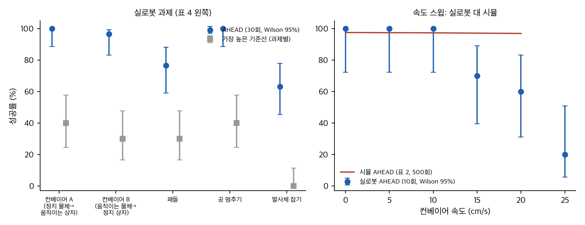
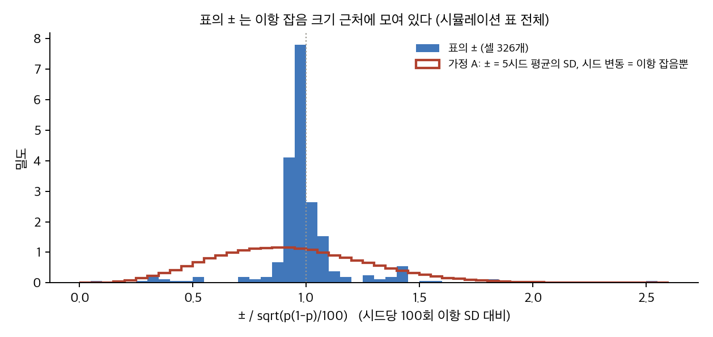
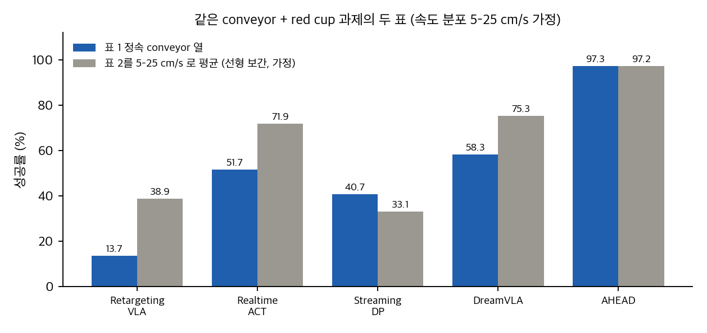
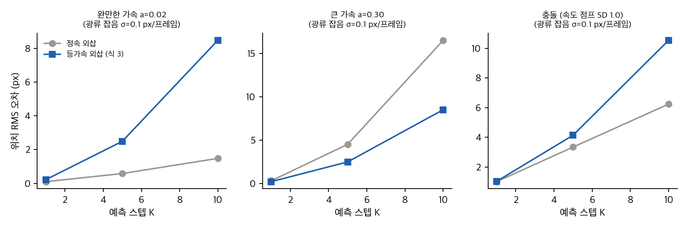

> **논문:** Shahram Najam Syed, Arthur Jakobsson, Haoran Hao, Jeffrey Ichnowski. *Intercepting the Future: Latent-Space Predictive World Model for Dynamic VLA Manipulation.* CoRL 2026 포스터, arXiv:2606.02486 (v2, 2026-10-03).
> 공식 코드와 프로젝트 페이지는 2026-11-26 기준으로 확인하지 못했습니다. 이 글의 그림은 모두 우리가 그린 그래프이고 논문 그림은 넣지 않았습니다.

## 논문이 묻는 것

VLA는 관측한 장면이 실행 시점까지 변하지 않는다고 가정합니다. 컨베이어 위의 물체나 굴러가는 공 앞에서는 지연 때문에 "물체가 있던 곳"을 잡게 됩니다. AHEAD는 동결한 OpenVLA 7B에 4.9M 파라미터의 잠재 세계모델을 붙입니다. RAFT 광류로 얻은 패치별 속도와 가속도를 조건으로, VLA 특징 공간에서 미래 패치 토큰을 예측하고, 동결된 행동 디코더에는 현재 토큰 대신 예측 토큰을 줍니다. 언어와 움직임으로 고른 30–60개 토큰만 예측하고, 샘플 분산이 임계값을 넘으면 롤아웃을 멈춥니다.

## 이 글에서 확인한 것

수치는 논문 표에서 옮겨 다시 계산했습니다. 코드와 원자료가 없어 시행 수는 부록 C.5대로 "5 시드 × 시드당 100 롤아웃"을 가정한 값입니다.

**1. 실로봇 과제별 격차는 확실합니다.** 과제 5개 모두 최고 기준선과의 차이가 Fisher p < 0.001입니다(30회). 발사체 잡기는 19/30 대 0/30입니다.

**2. 속도 스윕은 시뮬레이션과 다르게 읽힙니다.** 같은 하드웨어의 스윕에서 AHEAD는 15, 20, 25 cm/s에서 7/10, 6/10, 2/10이고, 시뮬레이션 표 2는 20 cm/s에서 97.0%입니다. 25 cm/s의 2/10 대 0/10은 구별되지 않습니다(p = 0.47). 표 4 왼쪽 컨베이어 과제(30/30)의 속도는 적혀 있지 않습니다.

*그래프 (우리가 그림). 표 4의 성공 수와 Wilson 95% 구간. 오른쪽 선은 표 2의 AHEAD 값입니다.*

**3. 초록의 "가장 강한 기준선 31–58%"는 표 1의 DreamVLA 한 방법의 범위와 일치합니다.** 시나리오별로 학습된 기준선 6종의 최고값을 보면 11.4–60.3이고, v2에서 추가된 Track-and-Intercept까지 포함하면 34.8–91.2입니다. 초록과 서론의 문구는 v1과 같습니다. "20개 시나리오"는 표 기준 16개(스트레스 시험 3개를 더하면 19개)입니다.

**4. 표의 ±와 평균의 격자를 5×100 평가와 맞추기 어렵습니다.** ± 326개 셀의 80%가 시드당 100회 이항 SD의 ±10% 안에 있습니다. 5개 시드의 표본 SD라면 약 21%가 예상됩니다(시행 수 5×100 가정). ±가 시드 사이 표본 SD가 아니라 이항 공식으로 계산한 값이라면 이 분포와 맞습니다. 평균 53개는 0.2 단위 격자 밖이고 그중 48개는 1/3 단위 격자에 맞습니다. 표 1의 기존 기준선 행에 집중되어 있습니다. 정의와 시행 수는 저자 확인이 필요합니다.

*그래프 (우리가 그림). 파란 막대는 표의 ± 326개 셀, 붉은 선은 ±가 5시드 평균의 SD이고 시드 변동이 이항 잡음뿐일 때의 기대 분포입니다.*

**5. 표 1 Conveyor 열과 표 2는 같은 과제인데 기준선 값이 다릅니다.** 속도 5–25 cm/s 균등과 선형 보간을 가정하면 표 2에서 기대되는 평균은 Retargeting 38.9(표 1은 13.7), Realtime ACT 71.9(51.7), DreamVLA 75.3(58.3), Streaming DP 33.1(40.7)이고 AHEAD는 97.2(97.3)입니다.

*그래프 (우리가 그림). 가정(속도 분포, 선형 보간)에 따른 값이며 논문의 숫자가 아닙니다.*

**6. 정렬 층의 기여가 큽니다.** 0.1M 정렬 층을 빼면 Ballistic Catch가 87.4에서 61.1로 떨어집니다(표 19). 이 층은 동결 VLA를 통과하는 행동 오차로 학습합니다. 논문은 정책을 공급하지 않고 충실도를 회복한다고 읽지만, 참 미래 프레임을 넣은 oracle 상한이 없어 두 해석이 모두 열려 있습니다. 세계모델 인코더가 |S|개 토큰을 256차원 벡터 하나로 평균 풀링한다는 점(식 5)도 식 4의 토큰별 분산 표기와 맞추어 읽을 필요가 있습니다.

## 토이로 본 가속 외삽

식 3의 가속 외삽은 두 광류 속도의 차분으로 가속도를 얻기 때문에 속도 잡음이 있으면 가속도 잡음이 큽니다. 1차원 모형(우리 가정: 프레임 간격 1, 속도 2 px/프레임)에서 K = 5일 때 등가속 외삽이 정속 외삽보다 나아지는 가속은 광류 속도 잡음의 약 1.7배였습니다. 완만한 가속에서는 등가속이 오히려 나쁘고, 속도가 갑자기 바뀌는 충돌에서는 K가 클수록 더 나쁩니다. 논문이 혼돈 운동에서 적응 중단을 쓰는 이유와 같은 방향입니다. 토이는 우리가 만든 모형이며 논문의 수치로 옮기면 안 됩니다.

*그래프 (우리가 그림). 세 설정에서 예측 스텝 K에 따른 위치 RMS 오차(광류 잡음 σ = 0.1 px/프레임, 한 시드).*

## 구현 가능성

논문 수치의 재현은 코드와 환경이 없고 7B VLA, 656K 시퀀스 코퍼스, 8×H100 약 100 GPU-시간, xArm 7이 필요해 어렵습니다. 래퍼 단독 지연 측정과 적응 중단 토이는 작은 장비로 가능하고, 소형 동결 정책과 소형 세계모델로 핵심 아이디어를 시험하는 것은 수 주(추정)가 듭니다.

## 저자에게 물을 것

±의 정의와 셀별 시행 수, 표 1과 표 2의 속도 분포, 표 4 컨베이어 과제의 속도, v2 기준선을 포함한 "가장 강한 기준선" 범위, 동결 VLA의 가중치와 참 미래 프레임 상한입니다.

## 자료

- [통합 리포트 PDF](report/report_public.pdf)
- [01. 논문 분석: Intercepting the Future (AHEAD)](analysis/01_paper_analysis.md)
- [02. 선행연구와 구성 요소의 출처](analysis/02_prior_work.md)
- [03. 수치 재계산, 일관성 검사, 토이](analysis/03_analysis.md)
- [04. 주장 검증과 구현 가능성 (공개 코드 없음)](analysis/04_claim_verification.md)
