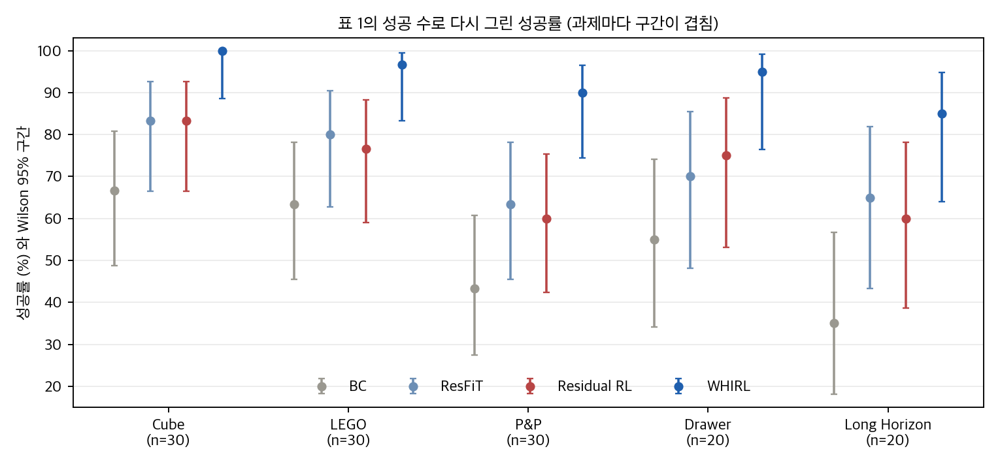
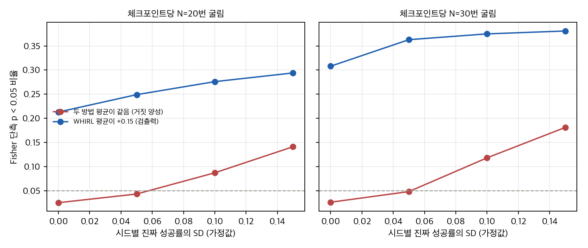
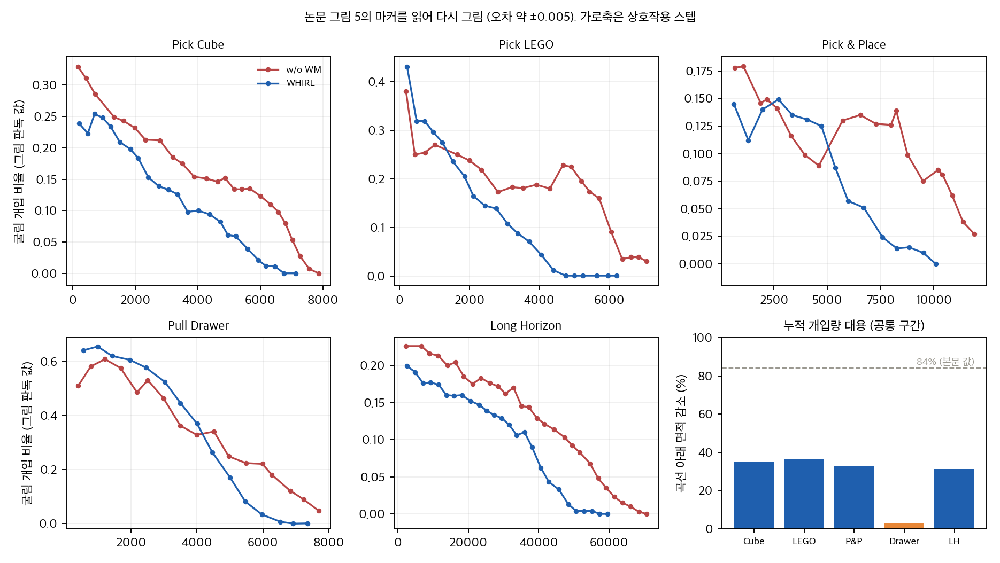
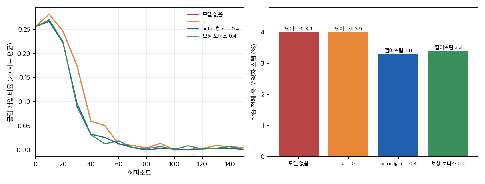

> **논문:** Jiaju Yin, Zhenhui Zhang 외. *How to Learn from What a Human Would Avoid? Intervention-Aware World Models with Real-World RL for Dexterous Manipulation.* CoRL 2026 포스터, arXiv:2609.06009 (v1, 2026-09-05).
> 프로젝트 페이지에는 "Code coming soon"만 있어 공식 코드는 없습니다. 이 글의 그림은 모두 우리가 그린 그래프입니다(논문 라이선스가 arXiv 비독점 배포라 논문 그림은 싣지 않았습니다).

## 논문이 묻는 것

사람이 개입하는 실로봇 RL(HIL RL)은 개입 라벨을 한 번 쓰고 버립니다. 행동 복제의 마스크이거나 재생 가중치입니다. WHIRL은 이 라벨을 "다음 스텝에 사람이 넘겨받을 확률"을 예측하는 머리의 감독으로 씁니다. 이 확률 p̂를 actor의 보조 손실에만 넣고, 보상과 Bellman 목표에서는 뺍니다. 사람의 습관이 가치 역전파에 섞이지 않게 하려는 설계입니다.

골격은 동결된 청크 BC 정책 위의 잔차 SAC입니다. 손 잔차는 3차원 시너지 기저에 제한합니다. 세계모델은 1스텝 결정론적 모델로 동역학 앙상블 5개와 보상, 종료, 개입 세 스칼라 머리를 둡니다. 16-DoF LEAP Hand와 Franka FR3로 다섯 과제를 평가했고 성공 수는 WHIRL 30/30, 29/30, 27/30, 19/20, 17/20입니다.

## 이 글에서 확인한 것

**1. 표 1의 산수와 부록 D의 통계는 재현됩니다.** 백분율 20개, Wilson 95% 구간 5개, Fisher 단측 p 5개가 모두 일치합니다.

*그래프 (우리가 그림). 표 1의 성공 수와 시행 수(30, 30, 30, 20, 20)에서 다시 그렸습니다. 과제마다 WHIRL과 기준선의 구간이 겹치는 곳이 있습니다.*

**2. "가장 강한 기준선" 대비는 과제마다 다릅니다.** 본문은 Residual RL을 가장 강한 기준선이라 부르는데, 표 1에서는 Pick LEGO, Pick & Place, Long Horizon에서 ResFiT가 1회 더 높습니다. 대 Residual RL 단측 p는 0.026, 0.026, 0.008, 0.091, 0.078로 부록 D와 같습니다. 표에서 가장 높은 기준선과 비교하면 Pick LEGO가 0.051이 됩니다. 비수정 단측 검정이므로 Holm 보정 후에는 Pick & Place 하나만 0.05 아래입니다.

**3. 시드 하나의 통계 단위.** 논문은 (과제, 방법) 칸마다 시드 하나와 운영자 한 명을 씁니다(4.4절). Fisher 검정은 그 체크포인트를 N번 굴린 오차만 봅니다. 시드별 진짜 성공률의 SD를 0.10으로 가정하면(논문에 없는 값) 두 방법이 같아도 N = 30에서 단측 p < 0.05가 약 12% 나옵니다.

*그래프 (우리가 그림). 평균 0.75의 두 방법을 20,000번 모의했습니다. 시드 SD는 가정값입니다.*

**4. "최대 84%"는 한 지점의 값입니다.** 4.5절은 Pull Drawer의 최종 굴림 개입 비율이 기준선 0.113에서 WHIRL 0.018로 줄었다고 씁니다(84%). 산수는 맞습니다. 그림 5의 마커를 읽으면(그림 판독 값, 오차 약 ±0.005) 마지막 마커는 기준선 0.047, WHIRL 0.000이고 본문의 두 값에 해당하는 마지막 점은 보이지 않습니다. 곡선 아래 면적으로 누적 개입량을 대신 비교하면 공통 구간에서 Pick Cube 35%, LEGO 37%, Pick & Place 33%, Long Horizon 31% 감소이고 Pull Drawer는 3%입니다. Pull Drawer에서는 처음 약 4,000스텝 동안 WHIRL 곡선이 더 높습니다. 논문도 그림 6 설명에서 이 "초기 비용"을 언급합니다.

*그래프 (우리가 그림). 논문 그림 5의 마커를 읽어 다시 그렸습니다(그림 판독 값). 오른쪽 아래는 공통 구간의 면적 감소(%)이고 점선은 본문의 84%입니다.*

**5. 그림 5와 그림 6의 같은 조건 곡선이 다릅니다.** Pull Drawer의 w/o WM 곡선은 그림 5에서 7,686스텝에 끝나고 그림 6에서 9,393스텝에 끝납니다(그림 판독 값). 두 곡선의 평균 절대 차이는 0.13입니다. 같은 실행인지 저자 확인이 필요합니다. 한편 그림 6의 순서(전체 WHIRL이 가장 먼저 0 근처, 그다음 α_i = 0, w/o WM이 가장 늦음)는 이 한 실행에서 보이는 방향입니다. α_i = 0과 w/o WM의 성공률은 보고되지 않아서, 성공률 이득을 개입 머리 덕분이라고 말하려면 이 절제가 더 필요합니다.

**6. 개입 라벨은 규칙에서 나옵니다.** 부록 D의 운영자 규칙은 작업 공간 한계 접근과 떨어뜨림 두 경우입니다. 앞의 것은 표 3에 수치로 있는 기하 규칙이라, 개입 머리가 사람의 판단을 배우는지 이미 알려진 한계를 배우는지는 이 실험으로 가를 수 없습니다.

## 토이로 본 것

개입 확률 항을 actor에만 쓰는 설계를 표 형태 복도 환경에서 확인했습니다(numpy, 20 시드, 약 30초). 운영자가 위험 구역에서 확률 0.85로 되돌리는 설정입니다. 이 모형은 논문의 논리가 성립하도록 만든 것이라 독립 증거가 아니고, 논문 실험의 재현도 아닙니다.

- 운영자 스텝 비율이 모델 없음 0.040에서 actor 항(α_i = 0.4) 0.033으로 줄었고, 학습 중 떨어뜨림은 3.9회에서 3.0회로 줄었습니다.
- 보상 보너스 변형도 비슷했습니다(0.034, 3.3). 논문 부록 C가 기각하는 대안이지만, 두 설계가 갈려야 할 경우(운영자 구역이 과제 경로와 겹침)는 이 토이가 만들지 않았습니다.
- 종료 머리 항만 켠 변형은 모델 없음과 같았습니다. 개입이 떨어뜨림을 막으면 종료 라벨이 드물어진다는 논리와 모양이 같습니다. 실로봇에서 두 머리의 양성 라벨 수는 논문에 없습니다.

*그래프 (우리가 그림). 표 형태 복도 환경, 20 시드. 오른쪽 막대 위 숫자는 시드당 학습 중 떨어뜨림 횟수입니다.*

부록 A 식 (10)(엄지 IK의 가우스-뉴턴 정규방정식)은 임의의 3D 사슬에서 수치 걸음과 비교해 일치했습니다(최대 차이 2e-9). LEAP의 실제 기구학은 확인하지 않았습니다.

## 구현 가능성 (Apple M4 Pro, CUDA 없음)

- **논문 수치의 재현: 불가.** Franka FR3, LEAP Hand, Manus 장갑, 페달, 시연 15–30개와 RTX 4090이 필요하고 코드가 없습니다.
- **알고리즘 핵심의 소형 시뮬 구현: 가능.** 네 머리와 게이트, 잔차 SAC, actor 보조 손실은 PyTorch로 짧게 쓸 수 있습니다. 추정 2–4일이고, 소형 시뮬 비교까지 1–2주입니다(측정 전).
- **빠진 정보:** actor와 비평가의 학습률, 업데이트-데이터 비율, 이미지 인코더, 시너지 기저를 만드는 방법이 표 2에 없습니다.

## 한계

- 그림에서 읽은 값은 논문 원자료가 아닙니다. 마커를 에피소드 하나로 보는 가정은 논문에 없습니다.
- 토이 1의 시드 SD는 가정값이고, 토이 2는 표 형태의 작은 모형입니다.
- 코드가 공개되면 하이퍼파라미터와 평가 프로토콜을 정적으로 대조할 수 있습니다. 이 글은 코드 없이 논문만으로 검증했습니다.

## 출처와 라이선스

- 논문: arXiv:2609.06009, arXiv 비독점 배포 라이선스(abs 페이지 확인, 2026-11-24). 논문 그림은 싣지 않았습니다.
- 표 값과 본문 수치는 인용과 재계산을 위해 옮겼습니다. 그래프, 토이, 분석 문서와 스크립트는 이 저장소 작성자가 만들었습니다.
- 공식 코드, 체크포인트, 데이터는 없습니다.

## 자료

- [통합 리포트 PDF](report/report_public.pdf)
- [01. 논문 분석: WHIRL (arXiv:2609.06009 v1)](analysis/01_paper_analysis.md)
- [02. 선행 연구와 자료](analysis/02_prior_work.md)
- [03. 수치 재계산과 토이 (V1–V14, 토이 1·2)](analysis/03_analysis.md)
- [04. 주장 검증과 구현 가능성 (공식 코드 없음)](analysis/04_claim_verification.md)
