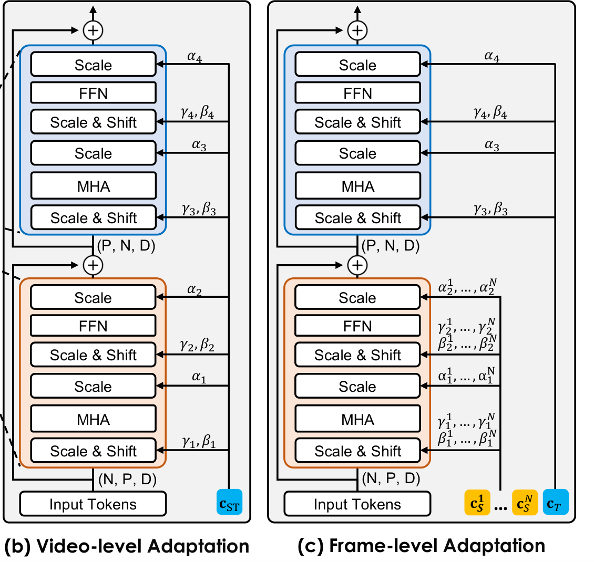
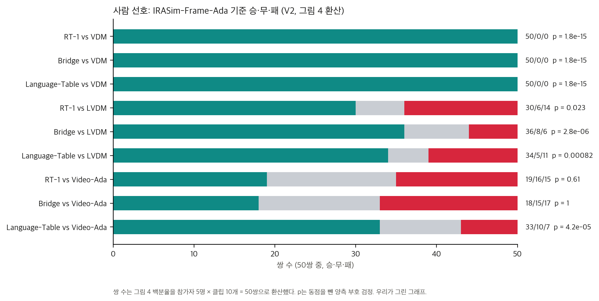
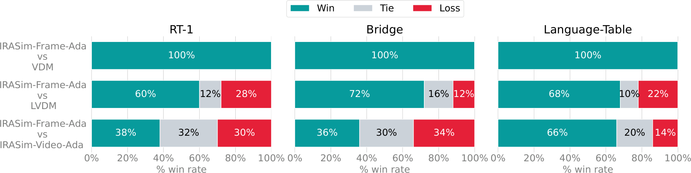
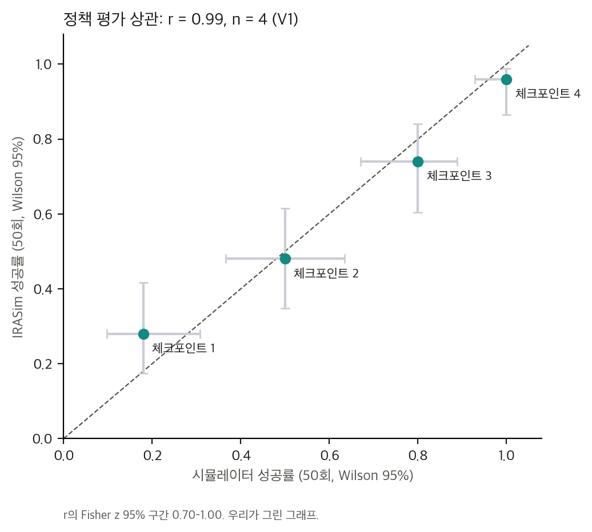
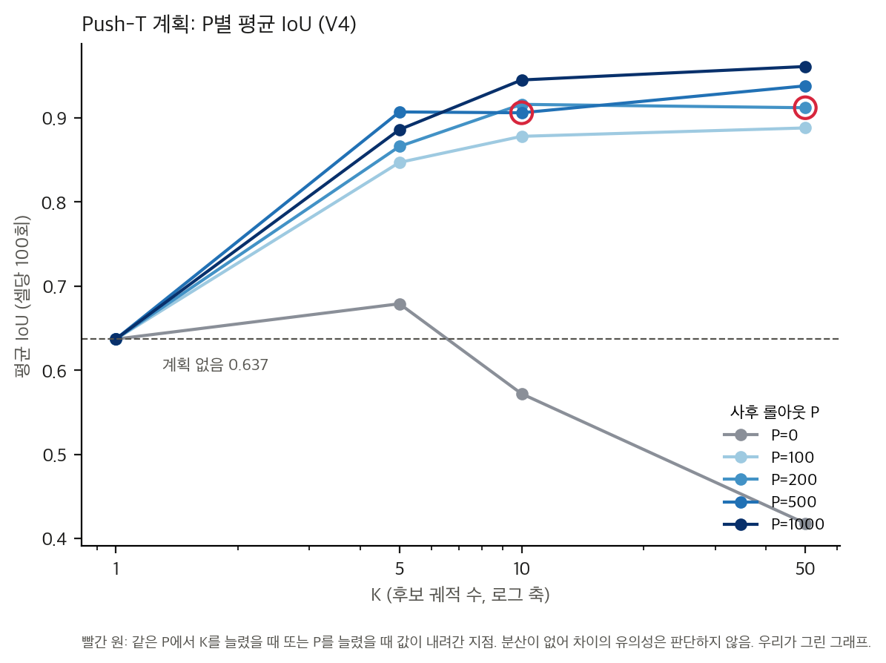
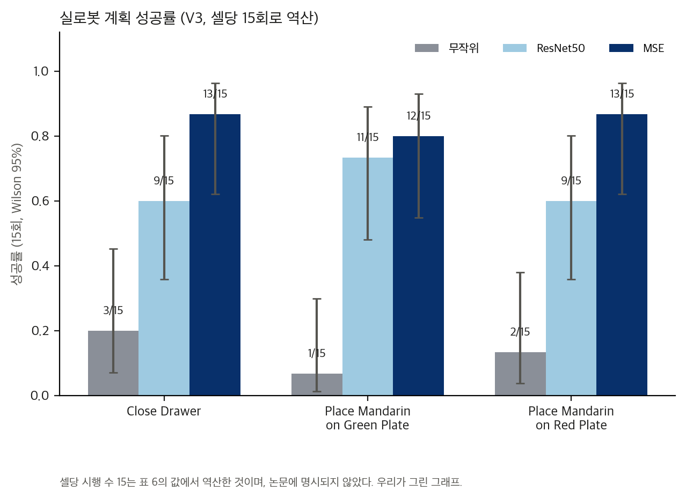
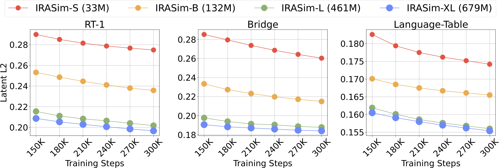

IRASim은 과거 프레임과 행동 궤적을 받아 로봇 팔의 미래 영상을 만드는 세계 모델입니다. 논문의 핵심은 행동을 전체 영상에 한 번 넣는 대신 **프레임마다 맞춰 넣는 것**입니다. 이 글은 논문 v2(arXiv, 2025-07-29)와 ICCV 2025 게재본의 수치를 다시 계산하고, 공식 코드(Apache-2.0)를 정적으로 대조한 결과입니다. 코드는 실행하지 않았고, 학습 재현도 하지 않았습니다.

## 무엇을 했나

- 표 1–6의 수치를 다시 계산하고 검정했습니다. 사람 선호 쌍 수, 정책 평가 상관의 구간, 실로봇 시행 수를 확인했습니다.
- 공식 저장소의 `models/irasim.py`와 설정 파일을 논문 식과 부록 설정에 맞춰 읽었습니다.
- 맥(CUDA 없음)에서 무엇을 재현할 수 있는지 판정했습니다.

## 프레임 단위 조건은 공간 블록에만 작동합니다

논문 부록 C.2는 시간 블록도 궤적 임베딩을 쓴다고 씁니다. 코드에서는 시간 블록이 확산 시각 임베딩만 받습니다. 행동 정보는 공간 블록에서만 프레임별로 들어갑니다. 최종 레이어도 기본 설정에서 행동을 받지 않습니다. 논문의 "프레임 정렬"은 공간 블록 안의 이야기입니다.

논문 그림 2의 (b)와 (c). © 저자 (Zhu et al.), CC BY 4.0, 출처 arXiv:2406.14540 (v2). 데이터셋 프레임이 있는 (a) 패널은 뺐습니다.

## 사람 선호는 Language-Table에서만 뚜렷합니다

대 VDM은 세 데이터셋 모두 100%입니다. 대 LVDM은 세 데이터셋 모두 우세합니다. 그러나 대 Video-Ada에서는 RT-1이 19대 15, Bridge가 18대 17입니다. 두 경우 모두 통계적으로 차이가 없습니다 (p = 0.61, 1.00). 이 우위는 Language-Table(33대 7)에서만 뚜렷합니다. 참가자 5명과 클립 10개(쌍 50개)로 환산한 값입니다.

우리가 그린 그래프. 논문 그림 4의 백분율을 쌍 50개로 환산했습니다. p는 동점을 뺀 양측 부호 검정입니다.

논문 그림 4. © 저자 (Zhu et al.), CC BY 4.0, 출처 arXiv:2406.14540 (v2).

## 정책 평가 상관 0.99는 점 4개입니다

논문 표 4는 LIBERO에서 정책 체크포인트 4개의 성공률을 시뮬레이터와 IRASim에서 비교합니다. Pearson r은 0.993입니다. 그러나 점이 4개이고, r의 95% 구간은 0.70–1.00입니다. 순위는 모두 같습니다. 강한 주장을 하려면 체크포인트를 더 늘려야 합니다.

우리가 그린 그래프. 표 4의 성공률과 Wilson 95% 구간 (각 50회).

## 계획 결과는 단조롭지 않고, 최고값은 선택된 값입니다

Push-T에서 평균 IoU는 0.637에서 0.961로 올라갑니다 (P=1000, K=50). 그러나 표 5의 20개 셀 중 최댓값이고, 셀마다 100회 평균이라는 것만 적혀 있습니다. 표준편차가 없어 셀 간 차이를 검정할 수 없습니다. 같은 P에서 K를 늘리거나 P를 늘렸을 때 값이 내려간 곳이 4군데 있습니다 (P=200 K 10→50, P=500 K 5→10 등). 사후 롤아웃이 없으면 K를 늘릴수록 기준선보다 나빠집니다.

우리가 그린 그래프. 표 5의 평균 IoU, 빨간 원은 값이 내려간 지점입니다.

## 실로봇 결과는 15회 규모입니다

표 6의 값은 셀당 15회에서 나온 것으로 보입니다 (역산). MSE 점수는 합산 38/45, ResNet50 점수는 29/45입니다. 두 방법의 차이는 합산 Fisher p = 0.052로 유의하지 않습니다. 무작위 선택 (6/45)보다 낫다는 결론은 확실합니다.

우리가 그린 그래프. 표 6에서 역산한 셀당 15회의 성공률과 Wilson 95% 구간.

## 본문과 표, 공식 코드가 어긋나는 곳

- 학습 스텝: 본문과 설정 파일은 30만, 표 10은 300만입니다.
- 학습 방식: 부록 E는 "모든 모델을 처음부터 학습"한다고 쓰지만, 정책 실험은 OpenSora 가중치로 시작합니다.
- 배치 크기: 논문은 64라고 씁니다. 코드의 유효 배치는 GPU 수와 누적 설정에 따라 달라지고, Language-Table 설정은 GPU 32개에서 32가 됩니다.
- 학습 중 행동 조건을 10% 확률로 지우는 마스킹이 있는데, 논문에는 없습니다.
- README의 인용 번호(2406.12802)는 틀렸습니다.

논문 그림 5. © 저자 (Zhu et al.), CC BY 4.0, 출처 arXiv:2406.14540 (v2). 그림에서 읽은 XL 끝점은 표 1의 같은 모델 값과 약 0.01 차이가 납니다.

## 맥에서 할 수 있는 것

- 학습은 불가능합니다. 데이터셋당 약 2,370 GPU 시간이고 CUDA를 전제합니다.
- 공식 추론 코드는 MPS로 옮길 수 있을 가능성이 있지만 아직 측정하지 않았습니다. 체크포인트 하나를 받아 16프레임 생성 시간을 재는 것이 첫 단계입니다.
- 정책 평가와 Push-T 계획 실험은 공식 코드가 없어서 재구현이 필요합니다. GPU 없이는 어렵습니다.

## 라이선스

논문 PDF는 arXiv 페이지에서 CC BY 4.0으로 표시되어 있습니다. 논문 그림 세 장은 저작자 표기와 함께 실었습니다. 공식 코드는 Apache-2.0입니다.

## 자료

- [통합 리포트 PDF](report/report_public.pdf)
- [IRASim 논문 분석 (arXiv:2406.14540)](analysis/01_paper_analysis.md)
- [IRASim 선행연구와 관련 자료](analysis/02_prior_work.md)
- [IRASim 수치 재계산, 일관성 검사, 주장 판정](analysis/03_analysis.md)
- [IRASim 공식 코드 대조 (정적 읽기)](analysis/04_code_verification.md)
