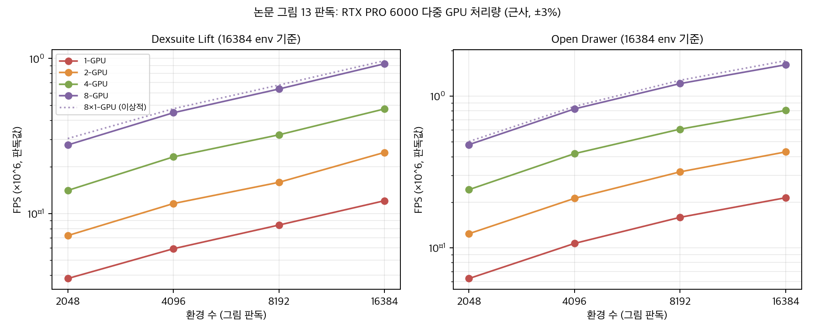
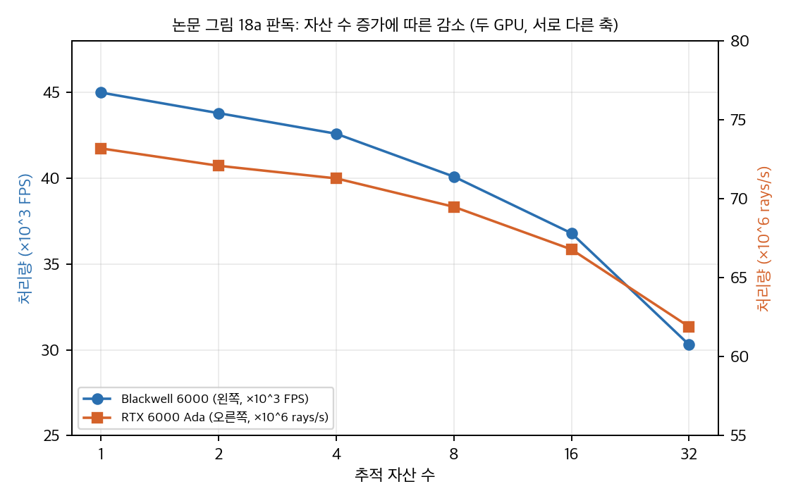

> **논문:** Mayank Mittal, Pascal Roth 외 (NVIDIA). *Isaac Lab: A GPU-Accelerated Simulation Framework for Multi-Modal Robot Learning.* 기술 보고서, arXiv:2511.04831 (v1, 2025-11-06).
> 공식 코드는 GitHub isaac-sim/IsaacLab(BSD-3-Clause)에 있습니다. 이 글의 그래프는 논문 그림을 눈으로 읽어 우리가 다시 그린 것입니다. 논문 그림은 싣지 않았습니다.

## 논문이 하는 말

Isaac Lab은 Isaac Gym의 후속으로 소개되는 GPU 병렬 로봇 학습 프레임워크입니다. PhysX의 GPU 텐서 API, RTX 렌더러, USD 장면 자료 구조 위에 액추에이터 모델, 센서 여러 종류, 역기구학과 임피던스 제어, 텔레오퍼레이션, 강화학습과 모방학습 연결을 얹었습니다.

논문은 두 가지 면에서 강하게 말합니다. 하나는 GPU 세대와 개수에 따른 처리량이고, 다른 하나는 sim-to-real 응용입니다. 이 글은 두 가지 모두 그림과 본문 숫자로 확인할 수 있는 만큼 확인했습니다.

## 이 글에서 확인한 것

**1. 처리량 숫자는 그림과 대체로 맞습니다.** 8-GPU에서 16384 env로 DextrAH 학습을 돌리면 본문 말대로 900k FPS 이상이 나옵니다. 그림을 읽으면 약 0.93M입니다. Franka 서랍 과제의 "1.6M FPS 이상"은 그림으로 약 1.61M입니다. 경계에서 맞습니다. 다만 읽기 오차가 약 3% 있어서 이 정도 차이는 판단하지 못합니다.

**2. 다중 GPU 확장은 거의 선형입니다.** 같은 환경 수에서 N-GPU 처리량을 N × 1-GPU로 나누면 효율은 두 과제 모두 0.91–1.03 범위입니다. 8-GPU는 0.91–0.96입니다. 본문의 "almost perfectly linearly"와 맞습니다. 이 계산에서 환경 수가 GPU당인지 전체인지는 중요하지 않습니다. 같은 격자에서 비교하기 때문입니다.

*그래프 (우리가 그림). 논문 그림 13의 눈 읽기 값(근사, ±3%)으로 그렸습니다. 점선은 1-GPU 값의 8배입니다.*

**3. 반복과 통계가 없습니다.** 실행 수, 표준편차, 신뢰구간, 검정이 논문에 없습니다. 그림의 음영 띠가 무엇인지도 캡션에 없습니다. 그래서 "직접 작성 워크플로가 평균 3.53% 빠르다"는 말은 방향만 받아들일 수 있습니다. 점 값이 없어 크기를 다시 계산할 수 없습니다.

**4. 그림과 본문이 어긋나는 곳이 세 군데 있습니다.**

- 메시 면 수 범위: 본문과 캡션은 20k–200k라고 씁니다. 그림의 x축은 약 20k에서 끝납니다.
- 그림 16의 캡션은 좌측이 다중 GPU라고 쓰지만, 좌측 패널은 GPU 세 종류의 단일 GPU 비교입니다.
- 그림 18에는 GPU 이름 "Blackwell 6000"과 "RTX 6000 Ada"가 나오는데, 장비 목록(L40, RTX PRO 6000, GeForce 5090)에는 없습니다.

**5. 레이캐스터 스케일링은 준선형입니다.** 추적 자산을 32배로 늘리면 Blackwell GPU는 처리량이 약 33% 줄고, Ada는 약 15% 줄었습니다. 메시 면 수는 처리량을 약 1% 바꿉니다.

*그래프 (우리가 그림). 논문 그림 18a의 눈 읽기 값입니다. 두 GPU는 서로 다른 축을 쓰므로 절대 비교는 하지 않았습니다.*

**6. sim-to-real 수치는 모두 인용입니다.** Factory 조립 정책의 제로샷 성공률 83–99%, AutoMate의 약 80%, Spot의 5.2 m/s는 원 논문에서 가져온 것입니다. 이 논문에는 자체 전이 실험이 없습니다. "Isaac Lab이 sim-to-real을 돕는다"는 근거는 인용과 설계 설명입니다.

## 공식 코드와 논문의 차이

논문과 맞는 코드 부분이 많습니다. 액추에이터 모델(Ideal PD, DC 모터, 지연 PD, 원격 PD, 신경망), 카메라 좌표 규약, 레이캐스터 카메라의 RGB 미지원, 차분 IK 네 가지 방법, Pink IK의 영공간 과제, DexPBT 8 정책 설정이 그렇습니다.

다른 부분은 세 가지입니다. 첫째, 시각 촉각 센서는 논문 시점의 릴리스(v2.3.0)에 없습니다. 최신 main에서 실험 기능으로만 있습니다. 둘째, 알고리즘 2에 있는 "물리 부분 스텝의 사전 이벤트" 단계가 코드에 없습니다. 셋째, 지연 PD는 논문에 없는 환경별 무작위 지연을 씁니다.

대조 기준은 논문 제출에 가장 가까운 릴리스 v2.3.0(2025-10-28)입니다. 최신 main은 v3.0.0이고 백엔드와 Isaac Sim 버전이 다릅니다.

## 구현 가능성: Mac에서는 실행할 수 없습니다

Isaac Lab의 설치 요건은 Ubuntu 22.04 또는 Windows 11, RAM 32 GB 이상, GPU VRAM 16 GB 이상입니다. macOS는 지원하지 않습니다.

- **처리량 재현 (그림 13, 18):** Linux GPU 서버가 필요합니다. 설치와 벤치 실행은 수 일 규모로 추정합니다. 측정하지 않았습니다.
- **문서와 코드 대조, 수치 판독과 재계산:** 이 글에서 완료했습니다.
- **커널리스 Newton 경로:** 맥의 Warp CPU에서 도는지는 확인하지 않았습니다.

이 글은 재현 실험을 하지 않았습니다. 설치도 하지 않았습니다.

## 한계

- 그림 판독 값은 근사입니다. 중요한 판정은 읽기 오차 안에서만 맞는다고 말할 수 있습니다.
- 처리량 측정 방법(워밍업, 측정 창, 환경 수 의미)이 본문에 없습니다.
- 논문 시점과 최신 릴리스가 다릅니다. v2.3.0 기준으로 대조했습니다.

## 출처와 라이선스

- 논문: arXiv:2511.04831. arXiv 페이지의 라이선스 링크는 CC BY 4.0입니다. 그러나 원문 PDF에 "© 2025 NVIDIA. All rights reserved."가 있어 두 표시가 충돌합니다. 그래서 논문 그림은 싣지 않았습니다.
- 본문 수치와 표현은 인용과 재계산을 위해 옮겼습니다. 그래프 두 장과 분석 문서, 스크립트는 이 글 작성자가 만들었습니다.
- 공식 코드(BSD-3-Clause)는 받아서 실행하지 않았습니다. 코드는 정적으로만 읽었습니다.

## 자료

- [통합 리포트 PDF](report/report_public.pdf)
- [01. 논문 분석: Isaac Lab (arXiv:2511.04831)](analysis/01_paper_analysis.md)
- [02. 선행연구와 관련 저장소](analysis/02_prior_work.md)
- [03. 수치 재계산과 일관성 검사](analysis/03_analysis.md)
- [04. 공식 코드 대조 (정적 읽기)](analysis/04_code_verification.md)
