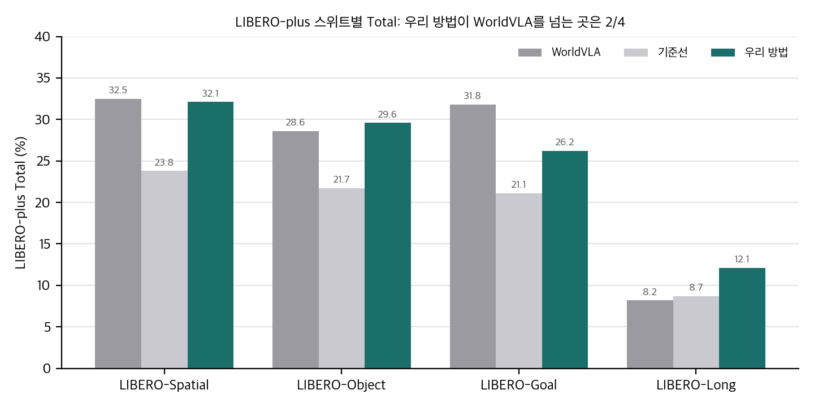
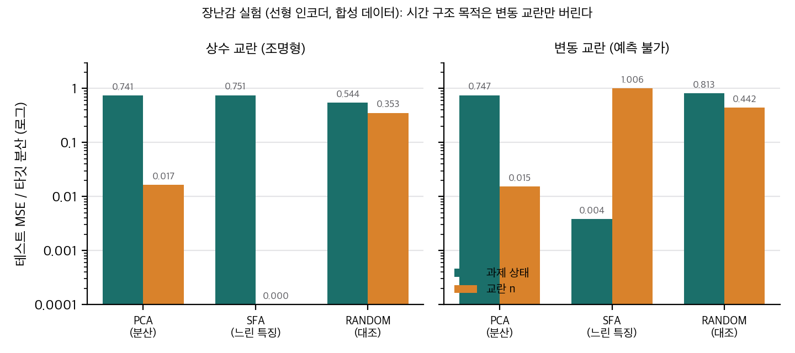
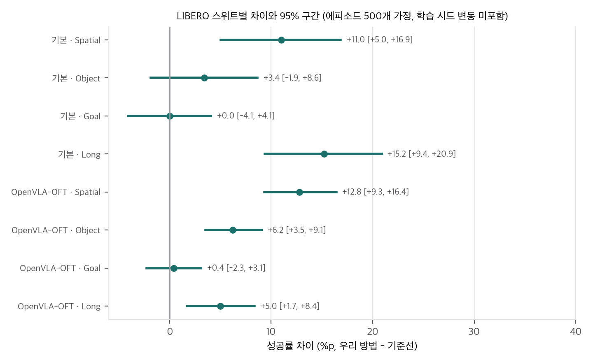

# JEPA-VLA 수치 재계산과 장난감 검증

재계산 스크립트는 `analysis/03_recompute.py`(결과 `analysis/03_recompute_results.json`), 장난감 실험은 `analysis/03_toy_encoder_probe.py`(결과 `analysis/03_toy_encoder_probe_results.json`), 그림은 `analysis/plot_results.py`입니다. 모두 numpy와 scipy만 쓰며 CPU에서 1초 안팎으로 끝납니다. 논문 값은 페이지 이미지에서 읽어 스크립트에 옮겼습니다. 표 값을 읽는 과정에서 오류가 있을 수 있으므로, 중요한 값은 `paper/paper.pdf` 해당 쪽에서 다시 확인하십시오.

## 1. 평균과 Δ 재계산: 모두 일치

| 표 | 재계산 | 논문 | 일치 |
|---|---|---|---|
| Table 1 평균 (기준 / 우리) | 61.65 / 69.05 | 61.65 / 69.05 | 예 |
| Table 1 스위트별 Δ | +11.0, +3.4, 0.0, +15.2 | 같음 | 예 |
| Table 3 평균 (공식 / 재현 / 우리) | 95.35 / 90.30 / 96.40 | 같음 | 예 |
| Table 3 스위트별 Δ (재현 기준) | +12.8, +6.2, +0.4, +5.0 | 같음 | 예 |
| Table 4 Easy 평균 (기준 / 우리) | 54.83 / 73.5 | 54.8 / 73.5 | 예 (반올림) |
| Table 4 Hard 평균 (기준 / 우리) | 9.33 / 17.67 | 9.3 / 17.7 | 예 (반올림) |
| Table 4 Δ 평균 (Easy / Hard) | +18.7 / +8.4 | 같음 | 예 |
| Table 6 MetaWorld 평균 (VC-1 / 우리) | 88.8 / 90.4 | 같음 | 예 |
| Table 6 DMControl 평균 (VC-1 / 우리) | 536.0 / 583.8 | 같음 | 예 |
| Tables 9–12 스위트별 Δ (8열) | 네 스위트 모두 일치 | 같음 | 예 |

산술 자체에는 문제가 없습니다. 문제는 집계 방식, 표본 크기, 표의 설명에 있습니다.

## 2. Table 2 집계와 WorldVLA 비교

Table 2는 LIBERO-plus 1/10 데이터 결과의 7개 차원과 Total을 보여 줍니다. Tables 9–12는 스위트별 값입니다. 두 표를 맞춰 보면 다음과 같습니다.

| 모델 | 차원별 평균 (Table 2와 일치) | Total (Table 2 인쇄) | 7개 차원 평균 | 네 스위트 Total 평균 |
|---|---|---|---|---|
| WorldVLA | 일치 | 25.0 | **25.61** | 25.28 |
| 기준선 | 일치 | 18.9 | 18.89 | 18.82 |
| 우리 방법 | 일치 | 25.6 | 25.61 | **25.00** |

- 차원별 평균은 Table 2와 맞습니다. Table 2의 Total 18.9와 25.6은 7개 차원의 무가중 평균과 맞습니다.
- 그러나 **WorldVLA의 Total 25.0은 자신의 7개 차원 평균(25.61)과 맞지 않습니다.** 우리 방법의 Total 25.6이 WorldVLA보다 높아 보이는 것은 WorldVLA의 Total이 다르게 계산되었기 때문입니다.
- 스위트별 Total을 평균하면 우리 방법 25.00, WorldVLA 25.28로 **오히려 우리 방법이 낮습니다.**
- 스위트별로 보면 우리 방법은 WorldVLA보다 Spatial에서 0.4 낮고(32.1 vs 32.5), Goal에서 5.6 낮고(26.2 vs 31.8), Object와 Long에서 높습니다. 네 스위트 중 2개에서만 이깁니다.

결론: "LIBERO-plus에서 WorldVLA를 이긴다"(Sec. 4.3)는 Table 2 인쇄값에만 성립하며, 다른 집계 방식에서는 성립하지 않습니다. 논문이 WorldVLA 수치를 어디서 가져왔는지(재학습인지 인용인지), 학습 데이터 양이 같은지도 본문에 없습니다.

## 3. 장난감 실험: 시간 구조 목적은 어떤 교란을 버리는가

Figure 2의 해석은 "예측 목적은 예측 불가능한 요인을 버리고, 과제 상태와 전이 정보를 남긴다"입니다. 이 해석이 인코더 목적의 일반적 성질인지 확인하려고, 합성 데이터 장난감을 만들었습니다.

- **설계:** 과제 상태 s_t(4차원, 평균회귀 AR(1))와 교란 n(3차원)을 두고, 32차원 관측 x_t = A s_t + B n + 잡음을 만듭니다. 교란의 크기를 키워 픽셀 분산이 과제 신호보다 크게 합니다. 교란은 두 종류입니다. 궤적 안에서 **상수**(조명·배경 유형, 논문 Sec. 2.1.2와 같은 성질)와 매 스텝 바뀌는 **변동**(예측 불가능 유형)입니다.
- **인코더(선형, 4차원 출력, 두 프레임 입력):** PCA(분산이 큰 방향, 재구성형 대리), SFA(시간 차분이 작은 방향, 느린 특징 대리), RANDOM(대조군).
- **프로브:** 리지 회귀로 과제 상태, 10 스텝 뒤 변화 Δs, 교란 n을 예측합니다. 점수는 테스트 MSE를 타깃 분산으로 나눈 값입니다(낮을수록 많이 담음). 시드 3개 평균입니다.

| 교란 | 인코더 | 과제 상태 | Δs (10 스텝) | 교란 n |
|---|---|---|---|---|
| 상수 | PCA | 0.741 | 0.954 | 0.017 |
| 상수 | SFA | 0.751 | 0.958 | **0.0001** |
| 상수 | RANDOM | 0.545 | 0.912 | 0.353 |
| 변동 | PCA | 0.747 | 0.937 | 0.015 |
| 변동 | SFA | **0.004** | 0.750 | **1.006** |
| 변동 | RANDOM | 0.813 | 0.961 | 0.442 |

(숫자는 `03_toy_encoder_probe_results.json`의 시드 3개 평균입니다. 시드별 값은 같은 파일에 있습니다. SFA의 두 패턴(상수 교란 0.0001, 변동 교란 과제 상태 0.0035–0.0039 대 교란 0.998–1.013)은 시드 3개에서 모두 같았습니다. RANDOM 행은 시드 간 편차가 커서 해석에 쓰지 않습니다.)

해석은 다음과 같습니다.

1. **시간 구조 목적은 상수 교란을 버리지 않습니다.** SFA는 상수 교란을 거의 완벽하게 담습니다(0.0001). 조명처럼 궤적 안에서 고정된 요인은 "예측 가능"하므로 시간 목적이 오히려 보존합니다. 논문 Fig. 2 우측의 무관 요인 실험도 상수 교란입니다. 따라서 그 실험의 결과는 "예측 목적이 조명을 버린다"를 지지하지 않습니다. 장난감에서 이 실험과 같은 조건을 만들면 반대 방향이 나옵니다.
2. **시간 구조 목적은 변동 교란을 버립니다.** 변동 교란에서 SFA는 과제 상태를 거의 완전히 담고(0.004), 교란은 찾지 못합니다(1.006, 예측 수준). "예측 불가능한 요인을 버린다"는 설명은 **변동하는** 교란에서만 성립합니다.
3. **PCA는 픽셀 분산이 큰 요인을 담습니다.** 이것은 "재구성형 표현은 무관 요인을 보존한다"는 논문의 설명과 맞습니다.

주의: 이 장난감은 선형 인코더 3종과 합성 데이터뿐입니다. V-JEPA 2의 학습 목적(마스크 잠재 예측)은 SFA와 같지 않습니다. 따라서 이 결과는 "V-JEPA 2가 조명을 덜 담는 이유가 예측 목적 때문이 아니다"를 증명하지 않습니다. 대신 **논문의 무관 요인 실험이 그 해석을 뒷받침하지 못할 수 있다**는 것을 보여 줍니다. 이를 확인하려면 조명 변동이 있는 데이터(예: LIBERO-plus 조명 궤적 내 변화)로 실험해야 합니다. 이 실험은 재현 계획에서 다룹니다(`README.md`의 재현 판정).

## 4. 통계: 구간과 검정

### 4.1 가정

- 논문은 평가 에피소드 수를 밝히지 않습니다. LIBERO는 표준 프로토콜(과제당 50회 × 10과제 = 스위트당 500회)을 가정했습니다.
- RoboTwin은 과제당 50회 또는 100회를 가정했습니다.
- 모든 비교는 학습 시드 1개로 보입니다. 아래 구간은 **에피소드 표본 변동만** 반영하며, 학습 시드 변동은 빠져 있습니다. 실제 불확실성은 더 큽니다.

### 4.2 LIBERO (Newcombe 95% 구간, 500회 가정)

| 비교 | Spatial | Object | Goal | Long |
|---|---|---|---|---|
| Table 1 기본 VLA (Δ, 95% 구간) | +11.0 [+5.0, +16.9] | +3.4 [−1.9, +8.6] | 0.0 [−4.1, +4.1] | +15.2 [+9.4, +20.9] |
| Table 3 OFT 재현 (Δ, 95% 구간) | +12.8 [+9.3, +16.4] | +6.2 [+3.5, +9.1] | +0.4 [−2.3, +3.1] | +5.0 [+1.7, +8.4] |
| Table 3 공식 OFT 대비 (Δ, 95% 구간) | +1.0 [−1.3, +3.4] | −0.3 [−2.1, +1.5] | −0.6 [−3.2, +1.9] | +4.1 [+0.9, +7.4] |

- 공식 OpenVLA-OFT 대비 차이는 대부분 구간이 0을 포함합니다. "공식 결과를 넘었다"는 Table 3의 평균 +1.05는 표본 오차 안에 있습니다.
- 재현 기준 차이는 Spatial과 Object, Long에서 구간이 0을 피합니다. 단, 학습 시드 변동이 포함되지 않았습니다.
- 재현 기준 4개 스위트가 모두 양수이므로 단측 부호 검정 p = 0.0625입니다(Table 1은 Goal이 0.0이라 부호 검정에 쓰지 않습니다).

### 4.3 RoboTwin 2.0 (과제 6개)

- 쉬운 설정(Easy): 6과제 모두 양의 차이입니다. 단측 부호 검정 p = 0.016.
- 어려운 설정(Hard): 0 차이인 과제(Place Fan)를 빼면 5과제 모두 양수입니다. 양측 p = 0.063.
- 과제 간 분산을 반영한 Easy 평균 차이의 근사 95% 구간은 +4.5 ~ +32.8 %p(50회 가정), +5.2 ~ +32.1 %p(100회 가정)입니다. 과제 수가 6이므로 구간이 넓습니다.
- **과제 6개는 50개 중에서 고른 것입니다.** 선택 기준이 없어서 결과가 선택에 민감할 수 있습니다.

### 4.4 실로봇 (Table 5)

- Table 5의 값 33.3과 66.7은 1/3 단위입니다. 모델당 10회 시행(App. E)이면 나올 수 없습니다. 실제 시행 수는 3회(또는 3의 배수)로 보입니다.
- 3회 가정에서 Fisher 정확검정은 layout p = 1.0, light p = 0.40입니다. 유의하지 않습니다.
- **Average 열을 하위 열로 재현할 수 없습니다.** 기본 VLA는 Average 50.0인데 Layout과 Light는 둘 다 0.0입니다. 세 조건(표준, layout, light)의 동일 가중 평균이라면 표준 조건이 150%여야 합니다. 평균이 어떻게 정의되었는지 본문에 없습니다. 표에 표준 조건 열이 없습니다.
- 학습 데이터 1/5은 본문 4.1에서는 22 궤적, App. E에서는 100의 1/5(20 궤적)입니다.

### 4.5 CortexBench (Table 6)

- MetaWorld 5과제: 우리(V-JEPA 2)가 VC-1보다 2과제에서 높고, 2과제는 같고, 1과제는 낮습니다. 평균 차이는 +1.6입니다.
- DMControl 5과제: 4과제에서 높고, 1과제(Reacher Easy, 836 vs 821)에서 낮습니다. 평균 차이는 +47.8(+8.9%)입니다.
- "눈에 띄는 향상"(Sec. 4.4)은 MetaWorld에서는 과장입니다. DMControl의 향상은 더 큽니다.
- 17과제 중 10과제만 씁니다(App. D).

### 4.6 표현 교체 (Table 7)

- DINOv2 행이 두 번 나옵니다(26.0, 31.2). 어느 쪽이 DINOv2이고 어느 쪽이 다른 설정인지 알 수 없습니다.
- 본문은 DINOv2가 "미미하거나 음수인 이득"을 준다고 씁니다. 표에서 음수인 값은 없습니다. 가장 낮은 DINOv2 값(26.0)도 기준선(25.8)보다 0.2 높습니다.
- V-JEPA 2(41.0)와 SigLIP(33.6)의 차이(7.4)는 단일 시드로는 판단할 수 없습니다.

## 5. 표와 본문의 불일치 목록

| 위치 | 내용 |
|---|---|
| Sec. 4.1 vs App. E | 실로봇 1/5 학습 데이터: 22 궤적 vs 20 궤적 (100의 1/5) |
| App. E vs Table 5 | 시행 10회 vs 33.3, 66.7 (1/3 단위) |
| Table 5 | Average 열을 하위 열로 재현할 수 없음 |
| Table 2 vs Tables 9–12 | WorldVLA Total 25.0이 자신의 7개 차원 평균 25.6과 다름 |
| Sec. 4.3 | "WorldVLA를 이겼다"는 Table 2 인쇄 Total 기준에만 성립 |
| Table 6 캡션 vs App. D | MetaWorld 표를 "성공률(%)"이라고 쓰지만 App. D는 "보상"을 보고했다고 씀 |
| Table 6 | "Table 6 and 6" (본문 Sec. 4.4)은 Table 6, 7의 오타로 보임 |
| Table 7 | DINOv2 라벨 중복, 본문 "음수 이득" 주장과 불일치 |
| Sec. 2 intro (Sec. 1) | "모든 기존 표현보다 낫다" vs 비교 대상은 2종 |
| Sec. 1 (SigLIP) | SigLIP과 SigLIP 2 중 어느 것인지 불명확 |
| App. A / Fig. 2 | 교란 헤드 구조(조명 CLS, 배경 MAE)가 달라서 두 실험을 직접 비교하기 어려움 |

## 6. 결론

- 표의 산술은 모두 맞습니다. 주요 결과의 방향(Table 1, 4의 향상)은 재계산으로 확인됩니다.
- 그러나 **통계적 증거의 강도가 약합니다.** 단일 시드, 에피소드 수 미보고, 과제 선택, 소규모 실로봇 실험이 겹칩니다. RoboTwin과 LIBERO 재현 기준 차이는 이 조건에서도 방향이 일관되지만, 시드 변동을 넣으면 구간이 넓어질 가능성이 큽니다.
- WorldVLA 우위와 공식 OpenVLA-OFT 우위는 약한 주장입니다.
- 장난감 실험은 Figure 2의 무관 요인 해석이 상수 교란에 대해서는 맞지 않을 수 있음을 보여 줍니다. 이는 논문의 기전 주장에 대한 반례 후보입니다(`04_claim_verification.md` C4).
