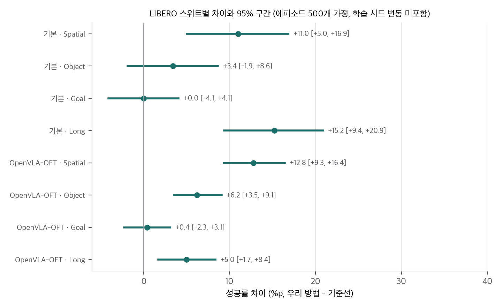
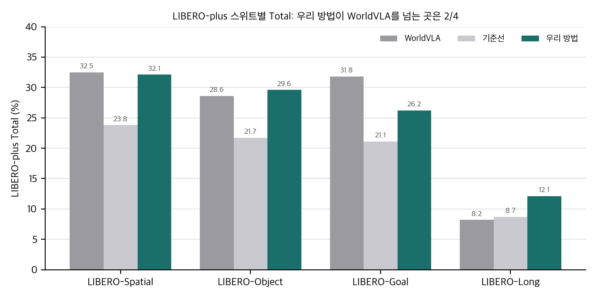
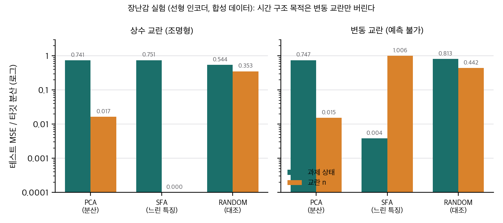

> **논문:** Miao et al. *JEPA-VLA: Video Predictive Embedding is Needed for VLA Models.* arXiv:2602.11832v1 (2026-02-12). 저자: Shangchen Miao, Ningya Feng, Jialong Wu, Ye Lin, Xu He, Dong Li, Mingsheng Long (Tsinghua University, Huawei Noah's Ark Lab).
> 논문 그림은 arXiv 비독점 배포 라이선스(CC가 아님)라서 싣지 않았습니다. 그림은 [원문](https://arxiv.org/abs/2602.11832)에서 볼 수 있습니다. 아래 그래프는 논문 표의 수치와 직접 만든 장난감 실험으로 그렸습니다. 공식 코드는 찾지 못했습니다.

## 한 줄 요약

로봇 VLA의 시각 표현(DINOv2, SigLIP)이 과제 상태와 행동의 변화에 대한 사전지식을 충분히 담지 못한다고 보고, 비디오 예측 임베딩 V-JEPA 2를 기존 VLA에 게이트드 교차주의로 붙입니다. 표의 산술은 모두 맞습니다. 다만 **WorldVLA 우위와 무관 요인 해석은 집계 방식과 실험 설계에 따라 흔들립니다.**

## 1. 주장과 방법

논문은 VLA가 시각 표현에서 두 가지를 얻어야 한다고 봅니다. 하나는 과제에 필요한 상태를 정확히 담고 조명처럼 무관한 요인은 버리는 **환경 이해**입니다. 다른 하나는 성공적인 수행에서 환경이 어떻게 바뀌는지에 대한 **정책 사전지식**입니다. 저자들은 DINOv2와 SigLIP이 두 가지 모두에서 부족하고, V-JEPA 2는 낫다고 보입니다.

방법은 간단합니다. V-JEPA 2 인코더를 고정하고, 그 출력을 VLA의 교차주의 층(Flamingo식 게이트드)으로 넣습니다. 새 층의 학습률은 원래 파라미터보다 낮게 둡니다. 로봇 사전학습이 없는 VLA에는 토큰을 그냥 이어 붙이는 방식을 씁니다.

## 2. 표는 맞다

Table 1, 3, 4의 평균과 Δ를 다시 계산했습니다. 모두 논문 값과 일치합니다. LIBERO 기본 VLA(1/10 데이터)는 61.65에서 69.05로 올라갔고, Long 스위트에서 +15.2로 가장 큽니다. RoboTwin 2.0은 6과제 평균에서 Easy +18.7, Hard +8.4입니다.

통계는 얇습니다. 학습 시드가 하나이고, 평가 에피소드 수가 없습니다. RoboTwin은 50개 과제 중 6개만 씁니다. 그래도 방향은 일관되어 보입니다. 재현 기준 OpenVLA-OFT에서 네 스위트가 모두 양수입니다(부호 검정 p = 0.0625).

그림 1. LIBERO 스위트별 성공률 차이와 95% 구간. 에피소드 500개를 가정한 Newcombe 구간이며, 학습 시드 변동은 포함하지 않았습니다. 논문 Table 1, 3의 값으로 직접 그렸습니다.

## 3. WorldVLA 우위는 어떻게 계산하느냐에 달려 있다

LIBERO-plus Table 2의 인쇄 Total은 우리 25.6, WorldVLA 25.0입니다. 그런데 WorldVLA의 7개 차원 평균은 25.61이고, 네 스위트 Total의 평균은 우리 25.00, WorldVLA 25.28입니다. 스위트별로 보면 Spatial과 Goal에서는 WorldVLA가 높고, Object와 Long에서는 우리가 높습니다.

그림 2. LIBERO-plus 스위트별 Total (논문 Tables 2, 9–12의 값). 인쇄 Total 기준으로는 우리가 앞서지만, 스위트 평균 기준으로는 뒤집힙니다.

그래서 "WorldVLA를 이겼다"는 문장은 인쇄 Total에서만 성립합니다. 이 비교에 쓰인 WorldVLA 수치가 같은 학습 데이터 양에서 나왔는지도 본문에 없습니다.

## 4. 무관 요인 실험의 기전이 불확실하다

논문의 핵심 기전은 "예측 목적이 예측 불가능한 요인을 버리고, 과제에 중요한 전이 정보를 남긴다"입니다. 이를 보이는 실험이 Fig. 2 우측입니다. V-JEPA 2가 조명과 배경을 덜 담는다는 결과입니다.

그런데 이 실험의 교란은 궤적 안에서 **상수**입니다. 그래서 다음 장난감 실험을 만들었습니다. 과제 상태는 평균회귀 AR(1), 관측은 과제 신호와 교란을 섞은 32차원 벡터입니다. 인코더는 분산이 큰 방향을 고르는 PCA와, 시간에 따라 천천히 변하는 방향을 고르는 느린 특징(SFA)입니다. 시간 구조를 쓰는 SFA는 상수 교란을 거의 완전히 담았습니다. 매 스텝 바뀌는 교란만 버렸습니다.

그림 3. 선형 인코더와 합성 데이터의 장난감 실험. 값은 테스트 MSE를 타깃 분산으로 나눈 것이며, 낮을수록 많이 담습니다. 시드 3개 평균입니다. V-JEPA 2의 결과가 아닙니다.

이 결과는 "V-JEPA 2가 조명을 덜 담는 이유는 예측 목적 때문이다"를 증명하지 않습니다. 대신 논문의 무관 요인 실험이 그 해석을 뒷받침하지 못할 수 있음을 보여 줍니다. 확인하려면 교란이 실제로 변하는 데이터가 필요합니다.

## 5. 실험 설계에서 빠진 것

- **시드와 에피소드 수:** 모든 표가 단일 값입니다. 평가 에피소드 수도 없습니다.
- **과제 선택:** RoboTwin 2.0 50개 중 6개를 고른 이유가 없습니다.
- **실로봇:** 모델당 10회 시행이라고 하지만 값은 33.3과 66.7입니다. 1/3 단위입니다. 평균 열도 하위 열로 설명되지 않습니다. 1/5 학습 데이터는 본문에서 22 궤적, 부록에서 20 궤적입니다.
- **대조군:** 표현을 "추가"하는 대조는 없고 "교체"만 있습니다. Table 7의 DINOv2 행은 두 번 나오고, 본문이 말한 "음수 이득"은 표에 없습니다.
- **기전 근거:** 게이트드 융합이 사전학습된 VLA를 보호한다는 주장과 학습률 선택의 근거를 보이는 절제 실험이 없습니다.
- **효율:** 추가 연산량과 지연 시간을 측정하지 않았습니다.

## 6. 종합

아이디어는 단순하고, 같은 방향의 결과가 LIBERO와 RoboTwin에서 반복됩니다. 그러나 증거의 강도는 고르지 않습니다. 가장 확실한 것은 기본 VLA의 Long 스위트와 RoboTwin 평균입니다. 가장 약한 것은 WorldVLA 우위, 실로봇 결과, CortexBench의 "눈에 띄는" 향상입니다.

이 논문을 인용한다면 "V-JEPA 2 표현이 LIBERO와 RoboTwin에서 기준선보다 높은 성공률을 보였다(단일 시드)"까지가 안전합니다. "예측 목적이 무관 요인을 버린다"는 기전으로 인용하기에는 아직 근거가 부족합니다.

## 근거와 재현

- 표 재계산과 검정, 장난감 실험 코드와 결과 파일은 게시 패키지에 있습니다. 재계산은 numpy와 scipy만 쓰며 CPU에서 1초 안팎입니다.
- 논문의 VLA 학습과 평가는 GPU와 시뮬레이터가 필요해서 이 맥에서는 재현하지 않았습니다. 표현 프로브 재현은 데이터와 가중치를 받은 뒤에 가능합니다.
- 원문은 [arXiv:2602.11832](https://arxiv.org/abs/2602.11832)입니다. 논문 PDF의 라이선스는 arXiv 비독점 배포입니다.

## 자료

- [통합 리포트 PDF](report/report_public.pdf)
- [JEPA-VLA: Video Predictive Embedding is Needed for VLA Models 논문 분석](analysis/01_paper_analysis.md)
- [JEPA-VLA 선행연구와 관련 연구](analysis/02_prior_work.md)
- [JEPA-VLA 수치 재계산과 장난감 검증](analysis/03_analysis.md)
- [JEPA-VLA 주장 검증 (C1–C20)](analysis/04_claim_verification.md)
